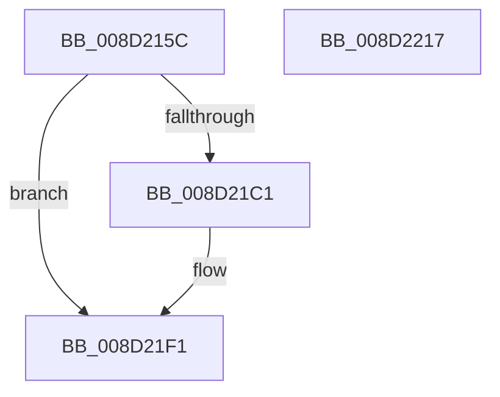

# sub_008D215C

- RVA: `0x008D215C`–`0x008D2218` (길이 `188` bytes)
- VA: `0x00000001408D215C`
- 실행 섹션: `PAGE`
- PDB 이름 있음: `아니요`; PDB Function 태그: `아니요`
- unwind 정보 RVA: `0x00084C9C`
- 디코드: `55`개 명령, `188/188` bytes 표시
- 미해석 바이트: `0` (있으면 어셈블리에 `.byte`로 보존)

> 이 문서는 커널 이미지의 기계어와 PDB 기호를 분석해 생성했습니다. 4번과 5번은 함수 원형과 자료형을 바이너리 사용 방식에서 추정한 C 해석이며 원본 소스 복구 결과는 아닙니다.

## 1. Dependencies

- 직접 호출 지점: **4**; 고유 호출 대상: **4**
- 직접 호출자로 확인된 함수: **1**
- RIP 상대 이미지 참조: **0**

### Outgoing calls
- `0x008D2194` → [ExAllocatePool2](../../poolcode/B8/ExAllocatePool2_function_00B820F0.md) (function, `0x00B820F0`)
- `0x008D21B7` → [PdcCloseEvent](PdcCloseEvent_function_008D2404.md) (function, `0x008D2404`)
- `0x008D21CC` → [memset](../../text/6C/memset_function_006C6C40.md) (function, `0x006C6C40`)
- `0x008D21F7` → [sub_00A0FA98](../A0/Unknown_function_00A0FA98.md) (function, `0x00A0FA98`)

### Direct callers
- [sub_008D379C](Unknown_function_008D379C.md) at `0x008D3988`

### Static image references
- 디코드된 RIP-relative 메모리 참조가 없습니다.

## 2. Other-region calls and transfers

- 다른 실행 섹션으로 향하는 call: **2**
  - `0x008D2194` → [ExAllocatePool2](../../poolcode/B8/ExAllocatePool2_function_00B820F0.md) (`PAGE` → `POOLCODE`)
  - `0x008D21CC` → [memset](../../text/6C/memset_function_006C6C40.md) (`PAGE` → `.text`)
- 별도 외부 분기/꼬리 이동을 확인하지 못했습니다.

## 3. Assembly (complete function range)

```asm
008D215C  48 8B C4                        mov rax, rsp
008D215F  48 89 58 08                     mov qword ptr [rax + 8], rbx
008D2163  48 89 68 10                     mov qword ptr [rax + 0x10], rbp
008D2167  48 89 70 18                     mov qword ptr [rax + 0x18], rsi
008D216B  57                              push rdi
008D216C  41 56                           push r14
008D216E  41 57                           push r15
008D2170  48 83 EC 30                     sub rsp, 0x30
008D2174  4D 8B F0                        mov r14, r8
008D2177  4C 8B FA                        mov r15, rdx
008D217A  48 8B E9                        mov rbp, rcx
008D217D  0F 57 C0                        xorps xmm0, xmm0
008D2180  BA 00 05 00 00                  mov edx, 0x500
008D2185  B9 00 01 00 00                  mov ecx, 0x100
008D218A  41 B8 57 41 52 42               mov r8d, 0x42524157
008D2190  0F 11 40 D8                     movups xmmword ptr [rax - 0x28], xmm0
008D2194  E8 57 FF 2A 00                  call 0x140b820f0
008D2199  33 FF                           xor edi, edi
008D219B  48 8B D8                        mov rbx, rax
008D219E  48 85 C0                        test rax, rax
008D21A1  48 0F 45 F8                     cmovne rdi, rax
008D21A5  48 8B C8                        mov rcx, rax
008D21A8  48 F7 D9                        neg rcx
008D21AB  1B F6                           sbb esi, esi
008D21AD  33 C9                           xor ecx, ecx
008D21AF  F7 D6                           not esi
008D21B1  81 E6 17 00 00 C0               and esi, 0xc0000017
008D21B7  E8 48 02 00 00                  call 0x1408d2404
008D21BC  48 85 DB                        test rbx, rbx
008D21BF  74 30                           je 0x1408d21f1
008D21C1  33 D2                           xor edx, edx
008D21C3  41 B8 00 05 00 00               mov r8d, 0x500
008D21C9  48 8B CF                        mov rcx, rdi
008D21CC  E8 6F 4A DF FF                  call 0x1406c6c40
008D21D1  48 FF 47 08                     inc qword ptr [rdi + 8]
008D21D5  4C 89 3F                        mov qword ptr [rdi], r15
008D21D8  83 67 10 00                     and dword ptr [rdi + 0x10], 0
008D21DC  83 67 14 00                     and dword ptr [rdi + 0x14], 0
008D21E0  48 83 67 18 00                  and qword ptr [rdi + 0x18], 0
008D21E5  C7 47 20 0A 00 00 00            mov dword ptr [rdi + 0x20], 0xa
008D21EC  49 89 3E                        mov qword ptr [r14], rdi
008D21EF  33 FF                           xor edi, edi
008D21F1  48 8B D7                        mov rdx, rdi
008D21F4  48 8B CD                        mov rcx, rbp
008D21F7  E8 9C D8 13 00                  call 0x140a0fa98
008D21FC  48 8B 5C 24 50                  mov rbx, qword ptr [rsp + 0x50]
008D2201  8B C6                           mov eax, esi
008D2203  48 8B 74 24 60                  mov rsi, qword ptr [rsp + 0x60]
008D2208  48 8B 6C 24 58                  mov rbp, qword ptr [rsp + 0x58]
008D220D  48 83 C4 30                     add rsp, 0x30
008D2211  41 5F                           pop r15
008D2213  41 5E                           pop r14
008D2215  5F                              pop rdi
008D2216  C3                              ret
008D2217  CC                              int3
```

## 4. C-style interpretation (structured pseudocode)

```c
__int64 __fastcall sub_008D215C(__int64 a1, __int64 a2, __int64 a3)
{
    __int64 result;
    __int64 v_rdi;
    __int64 v_rsi;
    __int64 v_rsp;
    unsigned __int64 v_stack_p10;
    unsigned __int64 v_stack_p18;
    unsigned __int64 v_stack_p8;

    *(unsigned __int64 *)(v_rsp + 8) = v_rbx;
    *(unsigned __int64 *)(v_rsp + 16) = v_rbp;
    *(unsigned __int64 *)(v_rsp + 24) = v_rsi;
    v_rsp = (v_rsp) - (48);
    *(unsigned __int64 *)(v_rsp - 40) = v_xmm0;
    result = ExAllocatePool2(256, (unsigned int)(0x500ULL), (unsigned int)(0x42524157ULL), a4);
    v_rdi = 0;
    if (result != 0) { v_rdi = result; }
    a1 = -(result);
    a1 = 0;
    v_rsi = (unsigned int)(~(v_rsi));
    v_rsi = (unsigned int)((v_rsi) & (0xC0000017ULL));
    result = PdcCloseEvent(a1, (unsigned int)(0x500ULL), (unsigned int)(0x42524157ULL), a4);
    if (result != 0) {
        a2 = 0;
        a3 = 0x500ULL;
        a1 = v_rdi;
        result = memset(a1, a2, a3, a4);
        *(unsigned __int64 *)(v_rdi) = 0;
        *(unsigned int *)(v_rdi + 32) = 10;
        *(unsigned __int64 *)(a3) = v_rdi;
        v_rdi = 0;
    }
    result = sub_00A0FA98(a1, 0, a3, a4);
    v_rsp = (v_rsp) + (48);
    return (unsigned int)((unsigned int)(v_rsi));
}
```

## 5. (Beta) C Style

```c
int64_t sub_008D215C(int64_t Arg1, int64_t Arg2, void *Arg3)
{
    uint8_t *arg3 = (uint8_t *)Arg3;

    int64_t result;
    int64_t local_rdi;
    int64_t local_rsi;
    int64_t local_rsp;
    uint64_t v_stack_p10;
    uint64_t v_stack_p18;
    uint64_t v_stack_p8;

    *(uint64_t *)(local_rsp + 0x8) = local_rbx;
    *(uint64_t *)(local_rsp + 0x10) = local_rbp;
    *(uint64_t *)(local_rsp + 0x18) = local_rsi;
    local_rsp = (local_rsp) - (48);
    *(uint64_t *)(local_rsp - 0x28) = v_xmm0;
    result = ExAllocatePool2(256, (uint32_t)(0x500ULL), (uint32_t)(0x42524157ULL), a4);
    local_rdi = 0;
    if (result != 0) { local_rdi = result; }
    Arg1 = -(result);
    Arg1 = 0;
    local_rsi = (uint32_t)(~(local_rsi));
    local_rsi = (uint32_t)((local_rsi) & (0xC0000017ULL));
    result = PdcCloseEvent(Arg1, (uint32_t)(0x500ULL), (uint32_t)(0x42524157ULL), a4);
    if (result != 0) {
        Arg2 = 0;
        Arg3 = 0x500ULL;
        Arg1 = local_rdi;
        result = memset(Arg1, Arg2, Arg3, a4);
        *(uint64_t *)(local_rdi) = 0;
        *(uint32_t *)(local_rdi + 0x20) = 10;
        *(uint64_t *)(arg3) = local_rdi;
        local_rdi = 0;
    }
    result = sub_00A0FA98(Arg1, 0, Arg3, a4);
    local_rsp = (local_rsp) + (48);
    return (uint32_t)((uint32_t)(local_rsi));
}
```

### 관측된 메모리 오프셋

구조체 형식이 확인되지 않은 접근은 인자 기준의 오프셋으로만 기록했습니다.

| 기준 인자 | 오프셋 표현 | 폭 (bit) | 접근 |
|---|---:|---:|---|
| `Arg3` | `+ 0x0` | `64` | `W` |

## 6. Execution-region graph

[열기: 2D/3D 그래프와 함수 탐색 컨트롤 패널](../../../control-panel.html?section=page&rva=0x008D215C&view=graph)

- 2D 그래프는 위에서 아래로 흐르고, 3D 그래프는 빈 공간을 드래그해 회전합니다. Shift+드래그는 이동, 휠은 확대·축소, 함수 노드 선택은 대상 보고서 이동입니다.

### Static fallback


