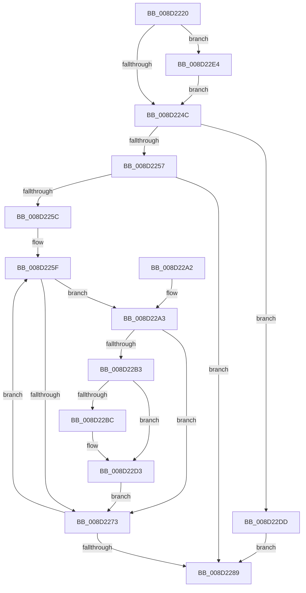

# sub_008D2220

- RVA: `0x008D2220`–`0x008D22EC` (길이 `204` bytes)
- VA: `0x00000001408D2220`
- 실행 섹션: `PAGE`
- PDB 이름 있음: `아니요`; PDB Function 태그: `아니요`
- unwind 정보 RVA: `0x00084CB8`
- 디코드: `64`개 명령, `204/204` bytes 표시
- 미해석 바이트: `0` (있으면 어셈블리에 `.byte`로 보존)

> 이 문서는 커널 이미지의 기계어와 PDB 기호를 분석해 생성했습니다. 4번과 5번은 함수 원형과 자료형을 바이너리 사용 방식에서 추정한 C 해석이며 원본 소스 복구 결과는 아닙니다.

## 1. Dependencies

- 직접 호출 지점: **2**; 고유 호출 대상: **2**
- 직접 호출자로 확인된 함수: **4**
- RIP 상대 이미지 참조: **0**

### Outgoing calls
- `0x008D22BF` → [sub_008D2420](Unknown_function_008D2420.md) (function, `0x008D2420`)
- `0x008D22D6` → [PdcCloseEvent](PdcCloseEvent_function_008D2404.md) (function, `0x008D2404`)

### Direct callers
- [sub_008D2508](Unknown_function_008D2508.md) at `0x008D272F`
- [sub_008D2C07](Unknown_function_008D2C07.md) at `0x008D2C15`
- [sub_008D379C](Unknown_function_008D379C.md) at `0x008D3A52`
- [sub_00A0FA98](../A0/Unknown_function_00A0FA98.md) at `0x00A0FACD`

### Static image references
- 디코드된 RIP-relative 메모리 참조가 없습니다.

## 2. Other-region calls and transfers

- 다른 실행 섹션으로 향하는 call: **0**
- 별도 외부 분기/꼬리 이동을 확인하지 못했습니다.

## 3. Assembly (complete function range)

```asm
008D2220  48 89 5C 24 08                  mov qword ptr [rsp + 8], rbx
008D2225  48 89 6C 24 18                  mov qword ptr [rsp + 0x18], rbp
008D222A  56                              push rsi
008D222B  57                              push rdi
008D222C  41 54                           push r12
008D222E  41 56                           push r14
008D2230  41 57                           push r15
008D2232  48 83 EC 20                     sub rsp, 0x20
008D2236  33 DB                           xor ebx, ebx
008D2238  48 8D 72 10                     lea rsi, [rdx + 0x10]
008D223C  4C 8B FA                        mov r15, rdx
008D223F  4C 8B E1                        mov r12, rcx
008D2242  41 83 F8 FF                     cmp r8d, -1
008D2246  0F 8E 98 00 00 00               jle 0x1408d22e4
008D224C  8B 06                           mov eax, dword ptr [rsi]
008D224E  44 3B C0                        cmp r8d, eax
008D2251  0F 87 86 00 00 00               ja 0x1408d22dd
008D2257  45 85 C0                        test r8d, r8d
008D225A  7E 2D                           jle 0x1408d2289
008D225C  41 8B E8                        mov ebp, r8d
008D225F  44 8D 70 FF                     lea r14d, [rax - 1]
008D2263  49 C1 E6 05                     shl r14, 5
008D2267  4D 03 77 18                     add r14, qword ptr [r15 + 0x18]
008D226B  49 8B 3E                        mov rdi, qword ptr [r14]
008D226E  48 85 FF                        test rdi, rdi
008D2271  75 30                           jne 0x1408d22a3
008D2273  0F 57 C0                        xorps xmm0, xmm0
008D2276  41 0F 11 06                     movups xmmword ptr [r14], xmm0
008D227A  41 0F 11 46 10                  movups xmmword ptr [r14 + 0x10], xmm0
008D227F  FF 0E                           dec dword ptr [rsi]
008D2281  8B 06                           mov eax, dword ptr [rsi]
008D2283  48 83 ED 01                     sub rbp, 1
008D2287  75 D6                           jne 0x1408d225f
008D2289  48 8B 6C 24 60                  mov rbp, qword ptr [rsp + 0x60]
008D228E  8B C3                           mov eax, ebx
008D2290  48 8B 5C 24 50                  mov rbx, qword ptr [rsp + 0x50]
008D2295  48 83 C4 20                     add rsp, 0x20
008D2299  41 5F                           pop r15
008D229B  41 5E                           pop r14
008D229D  41 5C                           pop r12
008D229F  5F                              pop rdi
008D22A0  5E                              pop rsi
008D22A1  C3                              ret
008D22A2  CC                              int3
008D22A3  48 83 C8 FF                     or rax, 0xffffffffffffffff
008D22A7  F0 48 0F C1 47 50               lock xadd qword ptr [rdi + 0x50], rax
008D22AD  48 83 F8 01                     cmp rax, 1
008D22B1  75 C0                           jne 0x1408d2273
008D22B3  48 8B 57 28                     mov rdx, qword ptr [rdi + 0x28]
008D22B7  48 85 D2                        test rdx, rdx
008D22BA  74 17                           je 0x1408d22d3
008D22BC  49 8B CC                        mov rcx, r12
008D22BF  E8 5C 01 00 00                  call 0x1408d2420
008D22C4  48 89 5F 28                     mov qword ptr [rdi + 0x28], rbx
008D22C8  48 89 5F 18                     mov qword ptr [rdi + 0x18], rbx
008D22CC  48 89 5F 20                     mov qword ptr [rdi + 0x20], rbx
008D22D0  89 5F 48                        mov dword ptr [rdi + 0x48], ebx
008D22D3  48 8B CF                        mov rcx, rdi
008D22D6  E8 29 01 00 00                  call 0x1408d2404
008D22DB  EB 96                           jmp 0x1408d2273
008D22DD  BB 0D 00 00 C0                  mov ebx, 0xc000000d
008D22E2  EB A5                           jmp 0x1408d2289
008D22E4  44 8B 06                        mov r8d, dword ptr [rsi]
008D22E7  E9 60 FF FF FF                  jmp 0x1408d224c
```

## 4. C-style interpretation (structured pseudocode)

```c
__int64 __fastcall sub_008D2220(__int64 a1, __int64 a2, int a3)
{
    __int64 result;
    __int64 v_r14;
    __int64 v_rbp;
    __int64 v_rbx;
    __int64 v_rsp;
    unsigned __int64 v_stack_p18;
    unsigned __int64 v_stack_p8;

    v_stack_p8 = v_rbx;
    v_stack_p18 = v_rbp;
    v_rsp = (v_rsp) - (32);
    v_rbx = 0;
    if (a3 <= -1) goto loc_008D22E4;
loc_008D224C:
    if (a3 > ((unsigned int)((unsigned int)(*(unsigned int *)(a2 + 16))))) goto loc_008D22DD;
    if (condition_is_less_or_equal) goto loc_008D2289;
loc_008D225F:
    v_r14 = ((unsigned int)(*(unsigned int *)(a2 + 16)) - 1) << (5);
    v_r14 = (v_r14) + (*(unsigned __int64 *)(a2 + 24));
    if (*(unsigned __int64 *)(v_r14) != 0) goto loc_008D22A3;
loc_008D2273:
    *(unsigned __int64 *)(v_r14) = v_xmm0;
    *(unsigned __int64 *)(v_r14 + 16) = v_xmm0;
    v_rbp = ((unsigned int)(a3)) - (1);
    if (condition_is_not_equal) goto loc_008D225F;
loc_008D2289:
    v_rsp = (v_rsp) + (32);
    return 0;
loc_008D22A3:
    result = (0) | (-1);
    if (result != 1) goto loc_008D2273;
    if (*(unsigned __int64 *)(*(unsigned __int64 *)(v_r14) + 40) != 0) {
        a1 = a1;
        result = sub_008D2420(a1, *(unsigned __int64 *)(*(unsigned __int64 *)(v_r14) + 40), a3, a4);
        *(unsigned __int64 *)(*(unsigned __int64 *)(v_r14) + 40) = v_stack_p8;
        *(unsigned __int64 *)(*(unsigned __int64 *)(v_r14) + 24) = v_stack_p8;
        *(unsigned __int64 *)(*(unsigned __int64 *)(v_r14) + 32) = v_stack_p8;
        *(unsigned int *)(*(unsigned __int64 *)(v_r14) + 72) = (unsigned int)(v_stack_p8);
    }
    result = PdcCloseEvent(*(unsigned __int64 *)(v_r14), *(unsigned __int64 *)(*(unsigned __int64 *)(v_r14) + 40), a3, a4);
    goto loc_008D2273;
loc_008D22DD:
    goto loc_008D2289;
loc_008D22E4:
    goto loc_008D224C;
}
```

## 5. (Beta) C Style

```c
int64_t sub_008D2220(int64_t Arg1, void *Arg2, int32_t Arg3)
{
    uint8_t *arg2 = (uint8_t *)Arg2;

    int64_t result;
    int64_t local_r14;
    int64_t local_rbp;
    int64_t local_rbx;
    int64_t local_rsp;
    uint64_t v_stack_p18;
    uint64_t v_stack_p8;

    v_stack_p8 = local_rbx;
    v_stack_p18 = local_rbp;
    local_rsp = (local_rsp) - (32);
    local_rbx = 0;
    if (Arg3 <= -1) goto loc_008D22E4;
loc_008D224C:
    if (Arg3 > ((uint32_t)((uint32_t)(*(uint32_t *)(arg2 + 0x10))))) goto loc_008D22DD;
    if (condition_is_less_or_equal) goto loc_008D2289;
loc_008D225F:
    local_r14 = ((uint32_t)(*(uint32_t *)(arg2 + 0x10)) - 1) << (5);
    local_r14 = (local_r14) + (*(uint64_t *)(arg2 + 0x18));
    if (*(uint64_t *)(local_r14) != 0) goto loc_008D22A3;
loc_008D2273:
    *(uint64_t *)(local_r14) = v_xmm0;
    *(uint64_t *)(local_r14 + 0x10) = v_xmm0;
    local_rbp = ((uint32_t)(Arg3)) - (1);
    if (condition_is_not_equal) goto loc_008D225F;
loc_008D2289:
    local_rsp = (local_rsp) + (32);
    return 0;
loc_008D22A3:
    result = (0) | (-1);
    if (result != 1) goto loc_008D2273;
    if (*(uint64_t *)(*(uint64_t *)(local_r14) + 0x28) != 0) {
        Arg1 = Arg1;
        result = sub_008D2420(Arg1, *(uint64_t *)(*(uint64_t *)(local_r14) + 0x28), Arg3, a4);
        *(uint64_t *)(*(uint64_t *)(local_r14) + 0x28) = v_stack_p8;
        *(uint64_t *)(*(uint64_t *)(local_r14) + 0x18) = v_stack_p8;
        *(uint64_t *)(*(uint64_t *)(local_r14) + 0x20) = v_stack_p8;
        *(uint32_t *)(*(uint64_t *)(local_r14) + 0x48) = (uint32_t)(v_stack_p8);
    }
    result = PdcCloseEvent(*(uint64_t *)(local_r14), *(uint64_t *)(*(uint64_t *)(local_r14) + 0x28), Arg3, a4);
    goto loc_008D2273;
loc_008D22DD:
    goto loc_008D2289;
loc_008D22E4:
    goto loc_008D224C;
}
```

### 관측된 메모리 오프셋

구조체 형식이 확인되지 않은 접근은 인자 기준의 오프셋으로만 기록했습니다.

| 기준 인자 | 오프셋 표현 | 폭 (bit) | 접근 |
|---|---:|---:|---|
| `Arg2` | `+ 0x0` | `32` | `R` |
| `Arg2` | `+ 0x0` | `32` | `R/W` |
| `Arg2` | `+ 0x10` | `64` | `R` |
| `Arg2` | `+ 0x18` | `64` | `R` |

## 6. Execution-region graph

[열기: 2D/3D 그래프와 함수 탐색 컨트롤 패널](../../../control-panel.html?section=page&rva=0x008D2220&view=graph)

- 2D 그래프는 위에서 아래로 흐르고, 3D 그래프는 빈 공간을 드래그해 회전합니다. Shift+드래그는 이동, 휠은 확대·축소, 함수 노드 선택은 대상 보고서 이동입니다.

### Static fallback


