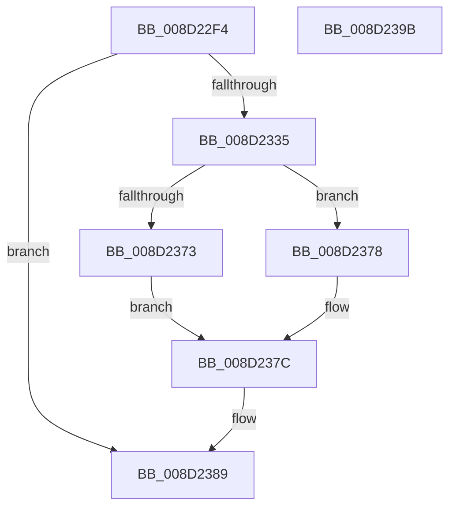

# sub_008D22F4

- RVA: `0x008D22F4`–`0x008D239C` (길이 `168` bytes)
- VA: `0x00000001408D22F4`
- 실행 섹션: `PAGE`
- PDB 이름 있음: `아니요`; PDB Function 태그: `아니요`
- unwind 정보 RVA: `0x00084CD4`
- 디코드: `48`개 명령, `168/168` bytes 표시
- 미해석 바이트: `0` (있으면 어셈블리에 `.byte`로 보존)

> 이 문서는 커널 이미지의 기계어와 PDB 기호를 분석해 생성했습니다. 4번과 5번은 함수 원형과 자료형을 바이너리 사용 방식에서 추정한 C 해석이며 원본 소스 복구 결과는 아닙니다.

## 1. Dependencies

- 직접 호출 지점: **4**; 고유 호출 대상: **4**
- 직접 호출자로 확인된 함수: **1**
- RIP 상대 이미지 참조: **0**

### Outgoing calls
- `0x008D232A` → [sub_008D3DC0](Unknown_function_008D3DC0.md) (function, `0x008D3DC0`)
- `0x008D2365` → [memcpy](../../text/6C/memcpy_function_006C6840.md) (function, `0x006C6840`)
- `0x008D236A` → [Feature_58333519__private_IsEnabledDeviceUsageNoInline](../../text/4F/Feature_58333519__private_IsEnabledDeviceUsageNoInline_function_004F5D4C.md) (function, `0x004F5D4C`)
- `0x008D2384` → [sub_008D23A4](Unknown_function_008D23A4.md) (function, `0x008D23A4`)

### Direct callers
- [sub_008D3F58](Unknown_function_008D3F58.md) at `0x008D406B`

### Static image references
- 디코드된 RIP-relative 메모리 참조가 없습니다.

## 2. Other-region calls and transfers

- 다른 실행 섹션으로 향하는 call: **2**
  - `0x008D2365` → [memcpy](../../text/6C/memcpy_function_006C6840.md) (`PAGE` → `.text`)
  - `0x008D236A` → [Feature_58333519__private_IsEnabledDeviceUsageNoInline](../../text/4F/Feature_58333519__private_IsEnabledDeviceUsageNoInline_function_004F5D4C.md) (`PAGE` → `.text`)
- 별도 외부 분기/꼬리 이동을 확인하지 못했습니다.

## 3. Assembly (complete function range)

```asm
008D22F4  4C 8B DC                        mov r11, rsp
008D22F7  49 89 5B 18                     mov qword ptr [r11 + 0x18], rbx
008D22FB  49 89 73 20                     mov qword ptr [r11 + 0x20], rsi
008D22FF  57                              push rdi
008D2300  48 83 EC 30                     sub rsp, 0x30
008D2304  48 8B 52 30                     mov rdx, qword ptr [rdx + 0x30]
008D2308  49 8D 43 08                     lea rax, [r11 + 8]
008D230C  49 83 63 10 00                  and qword ptr [r11 + 0x10], 0
008D2311  4D 8D 4B 10                     lea r9, [r11 + 0x10]
008D2315  83 4C 24 40 FF                  or dword ptr [rsp + 0x40], 0xffffffff
008D231A  41 B8 08 00 00 00               mov r8d, 8
008D2320  48 8B F1                        mov rsi, rcx
008D2323  49 89 43 E8                     mov qword ptr [r11 - 0x18], rax
008D2327  49 03 C8                        add rcx, r8
008D232A  E8 91 1A 00 00                  call 0x1408d3dc0
008D232F  8B F8                           mov edi, eax
008D2331  85 C0                           test eax, eax
008D2333  78 54                           js 0x1408d2389
008D2335  44 8B 4C 24 40                  mov r9d, dword ptr [rsp + 0x40]
008D233A  44 8B 5E 08                     mov r11d, dword ptr [rsi + 8]
008D233E  4C 8B 56 18                     mov r10, qword ptr [rsi + 0x18]
008D2342  44 8B 46 0C                     mov r8d, dword ptr [rsi + 0xc]
008D2346  45 2B C1                        sub r8d, r9d
008D2349  41 8D 51 01                     lea edx, [r9 + 1]
008D234D  41 0F AF D3                     imul edx, r11d
008D2351  41 FF C8                        dec r8d
008D2354  45 0F AF C3                     imul r8d, r11d
008D2358  45 0F AF D9                     imul r11d, r9d
008D235C  49 03 D2                        add rdx, r10
008D235F  41 8B CB                        mov ecx, r11d
008D2362  49 03 CA                        add rcx, r10
008D2365  E8 D6 44 DF FF                  call 0x1406c6840
008D236A  E8 DD 39 C2 FF                  call 0x1404f5d4c
008D236F  85 C0                           test eax, eax
008D2371  75 05                           jne 0x1408d2378
008D2373  FF 4E 0C                        dec dword ptr [rsi + 0xc]
008D2376  EB 04                           jmp 0x1408d237c
008D2378  F0 FF 4E 0C                     lock dec dword ptr [rsi + 0xc]
008D237C  48 8B 54 24 48                  mov rdx, qword ptr [rsp + 0x48]
008D2381  48 8B CE                        mov rcx, rsi
008D2384  E8 1B 00 00 00                  call 0x1408d23a4
008D2389  48 8B 5C 24 50                  mov rbx, qword ptr [rsp + 0x50]
008D238E  8B C7                           mov eax, edi
008D2390  48 8B 74 24 58                  mov rsi, qword ptr [rsp + 0x58]
008D2395  48 83 C4 30                     add rsp, 0x30
008D2399  5F                              pop rdi
008D239A  C3                              ret
008D239B  CC                              int3
```

## 4. C-style interpretation (structured pseudocode)

```c
__int64 __fastcall sub_008D22F4(__int64 a1, __int64 a2)
{
    __int64 result;
    __int64 v_r11;
    __int64 v_rsp;
    unsigned __int64 v_stack_p10;
    unsigned __int64 v_stack_p18;
    unsigned __int64 v_stack_p20;
    unsigned int v_stack_p8;

    *(unsigned __int64 *)(v_rsp + 24) = v_rbx;
    *(unsigned __int64 *)(v_rsp + 32) = v_rsi;
    v_rsp = (v_rsp) - (48);
    *(unsigned __int64 *)(v_rsp - 24) = v_rsp + 8;
    a1 = (a1) + (8);
    result = sub_008D3DC0(a1, *(unsigned __int64 *)(a2 + 48), 8, v_rsp + 16);
    if (sign_flag) goto loc_008D2389;
    a3 = (unsigned int)(((unsigned int)(*(unsigned int *)(a1 + 12))) - ((unsigned int)((unsigned int)(v_stack_p8))));
    a2 = (unsigned int)(((unsigned int)(v_stack_p8) + 1) * ((unsigned int)((unsigned int)(*(unsigned int *)(a1 + 8)))));
    a3 = (unsigned int)((a3) - 1);
    a3 = (unsigned int)((a3) * ((unsigned int)((unsigned int)(*(unsigned int *)(a1 + 8)))));
    v_r11 = (unsigned int)(((unsigned int)(*(unsigned int *)(a1 + 8))) * ((unsigned int)((unsigned int)(v_stack_p8))));
    a2 = (a2) + (*(unsigned __int64 *)(a1 + 24));
    a1 = ((unsigned int)((unsigned int)(v_r11))) + (*(unsigned __int64 *)(a1 + 24));
    result = memcpy(a1, a2, a3, (unsigned int)(v_stack_p8));
    result = Feature_58333519__private_IsEnabledDeviceUsageNoInline(a1, a2, a3, (unsigned int)(v_stack_p8));
    if ((unsigned int)(result) != 0) goto loc_008D2378;
    goto loc_008D237C;
loc_008D2378:
loc_008D237C:
    result = sub_008D23A4(a1, v_stack_p10, a3, (unsigned int)(v_stack_p8));
loc_008D2389:
    v_rsp = (v_rsp) + (48);
    return (unsigned int)((unsigned int)((unsigned int)((unsigned int)(result))));
}
```

## 5. (Beta) C Style

```c
int64_t sub_008D22F4(void *Arg1, void *Arg2)
{
    uint8_t *arg1 = (uint8_t *)Arg1;
    uint8_t *arg2 = (uint8_t *)Arg2;

    int64_t result;
    int64_t local_r11;
    int64_t local_rsp;
    uint64_t v_stack_p10;
    uint64_t v_stack_p18;
    uint64_t v_stack_p20;
    uint32_t v_stack_p8;

    *(uint64_t *)(local_rsp + 0x18) = local_rbx;
    *(uint64_t *)(local_rsp + 0x20) = local_rsi;
    local_rsp = (local_rsp) - (48);
    *(uint64_t *)(local_rsp - 0x18) = local_rsp + 8;
    Arg1 = (Arg1) + (8);
    result = sub_008D3DC0(Arg1, *(uint64_t *)(arg2 + 0x30), 8, local_rsp + 16);
    if (sign_flag) goto loc_008D2389;
    a3 = (uint32_t)(((uint32_t)(*(uint32_t *)(arg1 + 0xC))) - ((uint32_t)((uint32_t)(v_stack_p8))));
    Arg2 = (uint32_t)(((uint32_t)(v_stack_p8) + 1) * ((uint32_t)((uint32_t)(*(uint32_t *)(arg1 + 0x8)))));
    a3 = (uint32_t)((a3) - 1);
    a3 = (uint32_t)((a3) * ((uint32_t)((uint32_t)(*(uint32_t *)(arg1 + 0x8)))));
    local_r11 = (uint32_t)(((uint32_t)(*(uint32_t *)(arg1 + 0x8))) * ((uint32_t)((uint32_t)(v_stack_p8))));
    Arg2 = (Arg2) + (*(uint64_t *)(arg1 + 0x18));
    Arg1 = ((uint32_t)((uint32_t)(local_r11))) + (*(uint64_t *)(arg1 + 0x18));
    result = memcpy(Arg1, Arg2, a3, (uint32_t)(v_stack_p8));
    result = Feature_58333519__private_IsEnabledDeviceUsageNoInline(Arg1, Arg2, a3, (uint32_t)(v_stack_p8));
    if ((uint32_t)(result) != 0) goto loc_008D2378;
    goto loc_008D237C;
loc_008D2378:
loc_008D237C:
    result = sub_008D23A4(Arg1, v_stack_p10, a3, (uint32_t)(v_stack_p8));
loc_008D2389:
    local_rsp = (local_rsp) + (48);
    return (uint32_t)((uint32_t)((uint32_t)((uint32_t)(result))));
}
```

### 관측된 메모리 오프셋

구조체 형식이 확인되지 않은 접근은 인자 기준의 오프셋으로만 기록했습니다.

| 기준 인자 | 오프셋 표현 | 폭 (bit) | 접근 |
|---|---:|---:|---|
| `Arg1` | `+ 0x8` | `32` | `R` |
| `Arg1` | `+ 0xC` | `32` | `R` |
| `Arg1` | `+ 0xC` | `32` | `R/W` |
| `Arg1` | `+ 0x18` | `64` | `R` |
| `Arg2` | `+ 0x30` | `64` | `R` |

## 6. Execution-region graph

[열기: 2D/3D 그래프와 함수 탐색 컨트롤 패널](../../../control-panel.html?section=page&rva=0x008D22F4&view=graph)

- 2D 그래프는 위에서 아래로 흐르고, 3D 그래프는 빈 공간을 드래그해 회전합니다. Shift+드래그는 이동, 휠은 확대·축소, 함수 노드 선택은 대상 보고서 이동입니다.

### Static fallback


