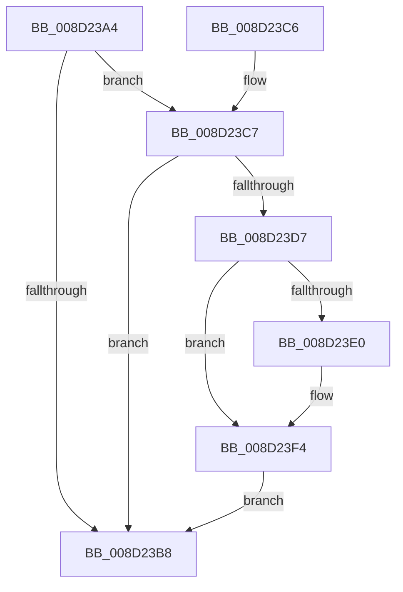

# sub_008D23A4

- RVA: `0x008D23A4`–`0x008D23FE` (길이 `90` bytes)
- VA: `0x00000001408D23A4`
- 실행 섹션: `PAGE`
- PDB 이름 있음: `아니요`; PDB Function 태그: `아니요`
- unwind 정보 RVA: `0x00062E24`
- 디코드: `28`개 명령, `90/90` bytes 표시
- 미해석 바이트: `0` (있으면 어셈블리에 `.byte`로 보존)

> 이 문서는 커널 이미지의 기계어와 PDB 기호를 분석해 생성했습니다. 4번과 5번은 함수 원형과 자료형을 바이너리 사용 방식에서 추정한 C 해석이며 원본 소스 복구 결과는 아닙니다.

## 1. Dependencies

- 직접 호출 지점: **2**; 고유 호출 대상: **2**
- 직접 호출자로 확인된 함수: **6**
- RIP 상대 이미지 참조: **0**

### Outgoing calls
- `0x008D23E0` → [sub_008D2420](Unknown_function_008D2420.md) (function, `0x008D2420`)
- `0x008D23F7` → [PdcCloseEvent](PdcCloseEvent_function_008D2404.md) (function, `0x008D2404`)

### Direct callers
- [sub_008D22F4](Unknown_function_008D22F4.md) at `0x008D2384`
- [sub_008D2F2C](Unknown_function_008D2F2C.md) at `0x008D327D`
- [sub_008D3F58](Unknown_function_008D3F58.md) at `0x008D409A`
- [sub_008D4104](Unknown_function_008D4104.md) at `0x008D4152`
- [sub_008D4104](Unknown_function_008D4104.md) at `0x008D4194`
- [WbCreateHeapExecutedBlock](WbCreateHeapExecutedBlock_function_008D4BE8.md) at `0x008D5328`
- [WbHeapExecutionUnloadModule](../A6/WbHeapExecutionUnloadModule_function_00A67D74.md) at `0x00A67E67`

### Static image references
- 디코드된 RIP-relative 메모리 참조가 없습니다.

## 2. Other-region calls and transfers

- 다른 실행 섹션으로 향하는 call: **0**
- 별도 외부 분기/꼬리 이동을 확인하지 못했습니다.

## 3. Assembly (complete function range)

```asm
008D23A4  48 89 5C 24 08                  mov qword ptr [rsp + 8], rbx
008D23A9  57                              push rdi
008D23AA  48 83 EC 20                     sub rsp, 0x20
008D23AE  33 FF                           xor edi, edi
008D23B0  48 8B DA                        mov rbx, rdx
008D23B3  48 85 D2                        test rdx, rdx
008D23B6  75 0F                           jne 0x1408d23c7
008D23B8  48 8B 5C 24 30                  mov rbx, qword ptr [rsp + 0x30]
008D23BD  48 8B C7                        mov rax, rdi
008D23C0  48 83 C4 20                     add rsp, 0x20
008D23C4  5F                              pop rdi
008D23C5  C3                              ret
008D23C6  CC                              int3
008D23C7  48 83 CF FF                     or rdi, 0xffffffffffffffff
008D23CB  F0 48 0F C1 7A 50               lock xadd qword ptr [rdx + 0x50], rdi
008D23D1  48 83 EF 01                     sub rdi, 1
008D23D5  75 E1                           jne 0x1408d23b8
008D23D7  48 8B 52 28                     mov rdx, qword ptr [rdx + 0x28]
008D23DB  48 85 D2                        test rdx, rdx
008D23DE  74 14                           je 0x1408d23f4
008D23E0  E8 3B 00 00 00                  call 0x1408d2420
008D23E5  48 21 7B 28                     and qword ptr [rbx + 0x28], rdi
008D23E9  48 21 7B 18                     and qword ptr [rbx + 0x18], rdi
008D23ED  48 21 7B 20                     and qword ptr [rbx + 0x20], rdi
008D23F1  21 7B 48                        and dword ptr [rbx + 0x48], edi
008D23F4  48 8B CB                        mov rcx, rbx
008D23F7  E8 08 00 00 00                  call 0x1408d2404
008D23FC  EB BA                           jmp 0x1408d23b8
```

## 4. C-style interpretation (structured pseudocode)

```c
__int64 __fastcall sub_008D23A4(__int64 a1, __int64 a2)
{
    __int64 result;
    __int64 v_rdi;
    __int64 v_rsp;
    unsigned __int64 v_stack_p8;

    v_stack_p8 = v_rbx;
    v_rsp = (v_rsp) - (32);
    v_rdi = 0;
    if (a2 != 0) goto loc_008D23C7;
loc_008D23B8:
    v_rsp = (v_rsp) + (32);
    return 0;
loc_008D23C7:
    v_rdi = (v_rdi) | (-1);
    v_rdi = (v_rdi) - (1);
    if (condition_is_not_equal) goto loc_008D23B8;
    result = 0;
    if (*(unsigned __int64 *)(a2 + 40) != 0) {
        result = sub_008D2420(a1, *(unsigned __int64 *)(a2 + 40), a3, a4);
    }
    result = PdcCloseEvent(v_stack_p8, *(unsigned __int64 *)(a2 + 40), a3, a4);
    goto loc_008D23B8;
}
```

## 5. (Beta) C Style

```c
int64_t sub_008D23A4(int64_t Arg1, void *Arg2)
{
    uint8_t *arg2 = (uint8_t *)Arg2;

    int64_t result;
    int64_t local_rdi;
    int64_t local_rsp;
    uint64_t v_stack_p8;

    v_stack_p8 = local_rbx;
    local_rsp = (local_rsp) - (32);
    local_rdi = 0;
    if (Arg2 != NULL) goto loc_008D23C7;
loc_008D23B8:
    local_rsp = (local_rsp) + (32);
    return 0;
loc_008D23C7:
    local_rdi = (local_rdi) | (-1);
    local_rdi = (local_rdi) - (1);
    if (condition_is_not_equal) goto loc_008D23B8;
    result = 0;
    if (*(uint64_t *)(arg2 + 0x28) != 0) {
        result = sub_008D2420(Arg1, *(uint64_t *)(arg2 + 0x28), a3, a4);
    }
    result = PdcCloseEvent(v_stack_p8, *(uint64_t *)(arg2 + 0x28), a3, a4);
    goto loc_008D23B8;
}
```

### 관측된 메모리 오프셋

구조체 형식이 확인되지 않은 접근은 인자 기준의 오프셋으로만 기록했습니다.

| 기준 인자 | 오프셋 표현 | 폭 (bit) | 접근 |
|---|---:|---:|---|
| `Arg2` | `+ 0x18` | `64` | `R/W` |
| `Arg2` | `+ 0x20` | `64` | `R/W` |
| `Arg2` | `+ 0x28` | `64` | `R/W` |
| `Arg2` | `+ 0x48` | `32` | `R/W` |

## 6. Execution-region graph

[열기: 2D/3D 그래프와 함수 탐색 컨트롤 패널](../../../control-panel.html?section=page&rva=0x008D23A4&view=graph)

- 2D 그래프는 위에서 아래로 흐르고, 3D 그래프는 빈 공간을 드래그해 회전합니다. Shift+드래그는 이동, 휠은 확대·축소, 함수 노드 선택은 대상 보고서 이동입니다.

### Static fallback


