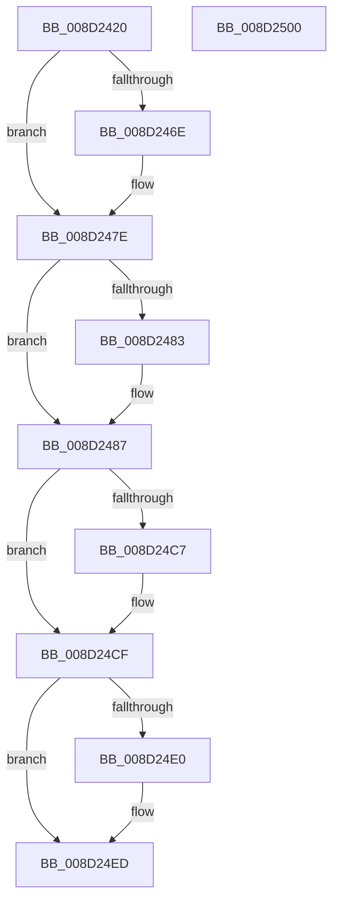

# sub_008D2420

- RVA: `0x008D2420`–`0x008D2501` (길이 `225` bytes)
- VA: `0x00000001408D2420`
- 실행 섹션: `PAGE`
- PDB 이름 있음: `아니요`; PDB Function 태그: `아니요`
- unwind 정보 RVA: `0x00084CE8`
- 디코드: `67`개 명령, `225/225` bytes 표시
- 미해석 바이트: `0` (있으면 어셈블리에 `.byte`로 보존)

> 이 문서는 커널 이미지의 기계어와 PDB 기호를 분석해 생성했습니다. 4번과 5번은 함수 원형과 자료형을 바이너리 사용 방식에서 추정한 C 해석이며 원본 소스 복구 결과는 아닙니다.

## 1. Dependencies

- 직접 호출 지점: **7**; 고유 호출 대상: **7**
- 직접 호출자로 확인된 함수: **5**
- RIP 상대 이미지 참조: **0**

### Outgoing calls
- `0x008D2459` → [KeAbPreAcquire](../../text/21/KeAbPreAcquire_function_00210230.md) (function, `0x00210230`)
- `0x008D2479` → [ExfAcquirePushLockSharedEx](../../text/21/ExfAcquirePushLockSharedEx_function_0021044C.md) (function, `0x0021044C`)
- `0x008D24AB` → [sub_008D3DC0](Unknown_function_008D3DC0.md) (function, `0x008D3DC0`)
- `0x008D24CA` → [ExfReleasePushLockShared](../../text/26/ExfReleasePushLockShared_function_00263440.md) (function, `0x00263440`)
- `0x008D24D2` → [KeAbPostRelease](../../text/2E/KeAbPostRelease_function_002E1600.md) (function, `0x002E1600`)
- `0x008D24D7` → [KeLeaveGuardedRegion](../../text/2E/KeLeaveGuardedRegion_function_002E2C40.md) (function, `0x002E2C40`)
- `0x008D24E6` → [sub_008D0600](Unknown_function_008D0600.md) (function, `0x008D0600`)

### Direct callers
- [sub_008D2220](Unknown_function_008D2220.md) at `0x008D22BF`
- [sub_008D23A4](Unknown_function_008D23A4.md) at `0x008D23E0`
- [sub_008D2508](Unknown_function_008D2508.md) at `0x008D26B6`
- [sub_008D2AC5](Unknown_function_008D2AC5.md) at `0x008D2AE6`
- [sub_008D2F2C](Unknown_function_008D2F2C.md) at `0x008D31EA`
- [sub_008D2F2C](Unknown_function_008D2F2C.md) at `0x008D322B`

### Static image references
- 디코드된 RIP-relative 메모리 참조가 없습니다.

## 2. Other-region calls and transfers

- 다른 실행 섹션으로 향하는 call: **5**
  - `0x008D2459` → [KeAbPreAcquire](../../text/21/KeAbPreAcquire_function_00210230.md) (`PAGE` → `.text`)
  - `0x008D2479` → [ExfAcquirePushLockSharedEx](../../text/21/ExfAcquirePushLockSharedEx_function_0021044C.md) (`PAGE` → `.text`)
  - `0x008D24CA` → [ExfReleasePushLockShared](../../text/26/ExfReleasePushLockShared_function_00263440.md) (`PAGE` → `.text`)
  - `0x008D24D2` → [KeAbPostRelease](../../text/2E/KeAbPostRelease_function_002E1600.md) (`PAGE` → `.text`)
  - `0x008D24D7` → [KeLeaveGuardedRegion](../../text/2E/KeLeaveGuardedRegion_function_002E2C40.md) (`PAGE` → `.text`)
- 별도 외부 분기/꼬리 이동을 확인하지 못했습니다.

## 3. Assembly (complete function range)

```asm
008D2420  48 89 5C 24 10                  mov qword ptr [rsp + 0x10], rbx
008D2425  55                              push rbp
008D2426  56                              push rsi
008D2427  57                              push rdi
008D2428  41 56                           push r14
008D242A  41 57                           push r15
008D242C  48 83 EC 30                     sub rsp, 0x30
008D2430  65 48 8B 04 25 88 01 00 00      mov rax, qword ptr gs:[0x188]
008D2439  48 8D 99 E0 00 00 00            lea rbx, [rcx + 0xe0]
008D2440  48 8B EA                        mov rbp, rdx
008D2443  48 8B F1                        mov rsi, rcx
008D2446  45 33 C0                        xor r8d, r8d
008D2449  33 D2                           xor edx, edx
008D244B  48 8B CB                        mov rcx, rbx
008D244E  45 33 F6                        xor r14d, r14d
008D2451  66 FF 88 E6 01 00 00            dec word ptr [rax + 0x1e6]
008D2458  90                              nop
008D2459  E8 D2 DD 93 FF                  call 0x140210230
008D245E  48 8B F8                        mov rdi, rax
008D2461  45 8D 7E 11                     lea r15d, [r14 + 0x11]
008D2465  33 C0                           xor eax, eax
008D2467  F0 4C 0F B1 3B                  lock cmpxchg qword ptr [rbx], r15
008D246C  74 10                           je 0x1408d247e
008D246E  4C 8B CB                        mov r9, rbx
008D2471  4C 8B C7                        mov r8, rdi
008D2474  33 D2                           xor edx, edx
008D2476  48 8B CB                        mov rcx, rbx
008D2479  E8 CE DF 93 FF                  call 0x14021044c
008D247E  48 85 FF                        test rdi, rdi
008D2481  74 04                           je 0x1408d2487
008D2483  C6 47 0A 01                     mov byte ptr [rdi + 0xa], 1
008D2487  48 8D 44 24 60                  lea rax, [rsp + 0x60]
008D248C  4C 89 74 24 70                  mov qword ptr [rsp + 0x70], r14
008D2491  48 8D 8E B8 00 00 00            lea rcx, [rsi + 0xb8]
008D2498  48 89 44 24 20                  mov qword ptr [rsp + 0x20], rax
008D249D  4C 8D 4C 24 70                  lea r9, [rsp + 0x70]
008D24A2  41 B8 08 00 00 00               mov r8d, 8
008D24A8  48 8B D5                        mov rdx, rbp
008D24AB  E8 10 19 00 00                  call 0x1408d3dc0
008D24B0  85 C0                           test eax, eax
008D24B2  49 8B F6                        mov rsi, r14
008D24B5  8B F8                           mov edi, eax
008D24B7  48 0F 49 74 24 70               cmovns rsi, qword ptr [rsp + 0x70]
008D24BD  49 8B C7                        mov rax, r15
008D24C0  F0 4C 0F B1 33                  lock cmpxchg qword ptr [rbx], r14
008D24C5  74 08                           je 0x1408d24cf
008D24C7  48 8B CB                        mov rcx, rbx
008D24CA  E8 71 0F 99 FF                  call 0x140263440
008D24CF  48 8B CB                        mov rcx, rbx
008D24D2  E8 29 F1 A0 FF                  call 0x1402e1600
008D24D7  E8 64 07 A1 FF                  call 0x1402e2c40
008D24DC  85 FF                           test edi, edi
008D24DE  78 0D                           js 0x1408d24ed
008D24E0  48 8B D5                        mov rdx, rbp
008D24E3  48 8B CE                        mov rcx, rsi
008D24E6  E8 15 E1 FF FF                  call 0x1408d0600
008D24EB  8B F8                           mov edi, eax
008D24ED  48 8B 5C 24 68                  mov rbx, qword ptr [rsp + 0x68]
008D24F2  8B C7                           mov eax, edi
008D24F4  48 83 C4 30                     add rsp, 0x30
008D24F8  41 5F                           pop r15
008D24FA  41 5E                           pop r14
008D24FC  5F                              pop rdi
008D24FD  5E                              pop rsi
008D24FE  5D                              pop rbp
008D24FF  C3                              ret
008D2500  CC                              int3
```

## 4. C-style interpretation (structured pseudocode)

```c
__int64 __fastcall sub_008D2420(__int64 a1, __int64 a2, int a3)
{
    __int64 result;
    __int64 v_r14;
    __int64 v_rdi;
    __int64 v_rsi;
    __int64 v_rsp;
    unsigned __int64 v_stack_m38;
    unsigned __int64 v_stack_p10;
    unsigned __int64 v_stack_p18;
    unsigned __int64 v_stack_p8;

    v_stack_p10 = v_rbx;
    v_rsp = (v_rsp) - (48);
    a3 = 0;
    a2 = 0;
    v_r14 = 0;
    result = KeAbPreAcquire(a1 + 224, a2, a3, a4);
    result = 0;
    if (!(condition_is_equal)) {
        a4 = a1 + 224;
        a3 = 0;
        a2 = 0;
        a1 = a1 + 224;
        result = ExfAcquirePushLockSharedEx(a1, a2, a3, a4);
    }
    if (result != 0) {
        *(unsigned __int8 *)(result + 10) = 1;
    }
    v_stack_p18 = 0;
    v_stack_m38 = v_stack_p8;
    result = sub_008D3DC0(a1 + 184, 0, 8, v_stack_p18);
    v_rsi = 0;
    if (!sign_flag) { v_rsi = v_stack_p18; }
    result = v_r14 + 17;
    if ((unsigned int)(result) != 0) {
        a1 = a1 + 224;
        result = ExfReleasePushLockShared(a1, 0, 8, v_stack_p18);
    }
    result = KeAbPostRelease(a1 + 224, 0, 8, v_stack_p18);
    result = KeLeaveGuardedRegion(a1 + 224, 0, 8, v_stack_p18);
    v_rdi = (unsigned int)((unsigned int)(result));
    if (!(sign_flag)) {
        a2 = 0;
        a1 = v_rsi;
        result = sub_008D0600(a1, a2, 8, v_stack_p18);
        v_rdi = (unsigned int)(result);
    }
    v_rsp = (v_rsp) + (48);
    return (unsigned int)((unsigned int)(v_rdi));
}
```

## 5. (Beta) C Style

```c
int64_t sub_008D2420(void *Arg1, int64_t Arg2, int32_t Arg3)
{
    uint8_t *arg1 = (uint8_t *)Arg1;

    int64_t result;
    int64_t local_r14;
    int64_t local_rdi;
    int64_t local_rsi;
    int64_t local_rsp;
    uint64_t v_stack_m38;
    uint64_t v_stack_p10;
    uint64_t v_stack_p18;
    uint64_t v_stack_p8;

    v_stack_p10 = local_rbx;
    local_rsp = (local_rsp) - (48);
    Arg3 = 0;
    Arg2 = 0;
    local_r14 = 0;
    result = KeAbPreAcquire(Arg1 + 224, Arg2, Arg3, a4);
    result = 0;
    if (!(condition_is_equal)) {
        a4 = Arg1 + 224;
        Arg3 = 0;
        Arg2 = 0;
        Arg1 = Arg1 + 224;
        result = ExfAcquirePushLockSharedEx(Arg1, Arg2, Arg3, a4);
    }
    if (result != 0) {
        *(uint8_t *)(result + 0xA) = 1;
    }
    v_stack_p18 = 0;
    v_stack_m38 = v_stack_p8;
    result = sub_008D3DC0(Arg1 + 184, 0, 8, v_stack_p18);
    local_rsi = 0;
    if (!sign_flag) { local_rsi = v_stack_p18; }
    result = local_r14 + 17;
    if ((uint32_t)(result) != 0) {
        Arg1 = Arg1 + 224;
        result = ExfReleasePushLockShared(Arg1, 0, 8, v_stack_p18);
    }
    result = KeAbPostRelease(Arg1 + 224, 0, 8, v_stack_p18);
    result = KeLeaveGuardedRegion(Arg1 + 224, 0, 8, v_stack_p18);
    local_rdi = (uint32_t)((uint32_t)(result));
    if (!(sign_flag)) {
        Arg2 = 0;
        Arg1 = local_rsi;
        result = sub_008D0600(Arg1, Arg2, 8, v_stack_p18);
        local_rdi = (uint32_t)(result);
    }
    local_rsp = (local_rsp) + (48);
    return (uint32_t)((uint32_t)(local_rdi));
}
```

### 관측된 메모리 오프셋

구조체 형식이 확인되지 않은 접근은 인자 기준의 오프셋으로만 기록했습니다.

| 기준 인자 | 오프셋 표현 | 폭 (bit) | 접근 |
|---|---:|---:|---|
| `Arg1` | `+ 0x0` | `64` | `R` |
| `Arg1` | `+ 0xB8` | `64` | `R` |
| `Arg1` | `+ 0xE0` | `64` | `R` |

## 6. Execution-region graph

[열기: 2D/3D 그래프와 함수 탐색 컨트롤 패널](../../../control-panel.html?section=page&rva=0x008D2420&view=graph)

- 2D 그래프는 위에서 아래로 흐르고, 3D 그래프는 빈 공간을 드래그해 회전합니다. Shift+드래그는 이동, 휠은 확대·축소, 함수 노드 선택은 대상 보고서 이동입니다.

### Static fallback


