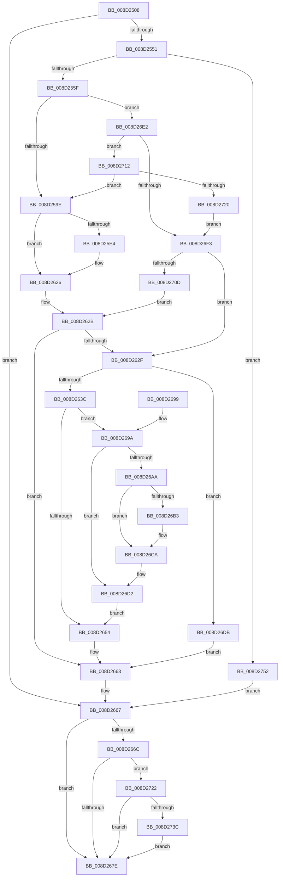

# sub_008D2508

- RVA: `0x008D2508`–`0x008D275C` (길이 `596` bytes)
- VA: `0x00000001408D2508`
- 실행 섹션: `PAGE`
- PDB 이름 있음: `아니요`; PDB Function 태그: `아니요`
- unwind 정보 RVA: `0x00084D00`
- 디코드: `154`개 명령, `596/596` bytes 표시
- 미해석 바이트: `0` (있으면 어셈블리에 `.byte`로 보존)

> 이 문서는 커널 이미지의 기계어와 PDB 기호를 분석해 생성했습니다. 4번과 5번은 함수 원형과 자료형을 바이너리 사용 방식에서 추정한 C 해석이며 원본 소스 복구 결과는 아닙니다.

## 1. Dependencies

- 직접 호출 지점: **10**; 고유 호출 대상: **8**
- 직접 호출자로 확인된 함수: **1**
- RIP 상대 이미지 참조: **0**

### Outgoing calls
- `0x008D253A` → [sub_008D379C](Unknown_function_008D379C.md) (function, `0x008D379C`)
- `0x008D25D9` → [PspGetContextThreadInternal](PspGetContextThreadInternal_function_008D4770.md) (function, `0x008D4770`)
- `0x008D261B` → [PspSetContextThreadInternal](PspSetContextThreadInternal_function_008D4420.md) (function, `0x008D4420`)
- `0x008D2626` → [KeLeaveGuardedRegion](../../text/2E/KeLeaveGuardedRegion_function_002E2C40.md) (function, `0x002E2C40`)
- `0x008D26B6` → [sub_008D2420](Unknown_function_008D2420.md) (function, `0x008D2420`)
- `0x008D26CD` → [PdcCloseEvent](PdcCloseEvent_function_008D2404.md) (function, `0x008D2404`)
- `0x008D26FE` → [WbSetWowTrapFrame](WbSetWowTrapFrame_function_008D57EC.md) (function, `0x008D57EC`)
- `0x008D272F` → [sub_008D2220](Unknown_function_008D2220.md) (function, `0x008D2220`)
- `0x008D2740` → [PdcCloseEvent](PdcCloseEvent_function_008D2404.md) (function, `0x008D2404`)
- `0x008D2748` → [PdcCloseEvent](PdcCloseEvent_function_008D2404.md) (function, `0x008D2404`)

### Direct callers
- [sub_008D3420](Unknown_function_008D3420.md) at `0x008D35C0`

### Static image references
- 디코드된 RIP-relative 메모리 참조가 없습니다.

## 2. Other-region calls and transfers

- 다른 실행 섹션으로 향하는 call: **1**
  - `0x008D2626` → [KeLeaveGuardedRegion](../../text/2E/KeLeaveGuardedRegion_function_002E2C40.md) (`PAGE` → `.text`)
- 별도 외부 분기/꼬리 이동을 확인하지 못했습니다.

## 3. Assembly (complete function range)

```asm
008D2508  48 89 5C 24 08                  mov qword ptr [rsp + 8], rbx
008D250D  48 89 74 24 20                  mov qword ptr [rsp + 0x20], rsi
008D2512  55                              push rbp
008D2513  57                              push rdi
008D2514  41 54                           push r12
008D2516  41 56                           push r14
008D2518  41 57                           push r15
008D251A  48 8B EC                        mov rbp, rsp
008D251D  48 83 EC 50                     sub rsp, 0x50
008D2521  48 83 65 38 00                  and qword ptr [rbp + 0x38], 0
008D2526  4C 8D 45 38                     lea r8, [rbp + 0x38]
008D252A  0F 57 C0                        xorps xmm0, xmm0
008D252D  33 C0                           xor eax, eax
008D252F  0F 11 45 E0                     movups xmmword ptr [rbp - 0x20], xmm0
008D2533  48 89 45 F0                     mov qword ptr [rbp - 0x10], rax
008D2537  4C 8B E1                        mov r12, rcx
008D253A  E8 5D 12 00 00                  call 0x1408d379c
008D253F  48 8B 5D 38                     mov rbx, qword ptr [rbp + 0x38]
008D2543  48 83 CA FF                     or rdx, 0xffffffffffffffff
008D2547  8B F8                           mov edi, eax
008D2549  85 C0                           test eax, eax
008D254B  0F 88 16 01 00 00               js 0x1408d2667
008D2551  48 8D 73 10                     lea rsi, [rbx + 0x10]
008D2555  8B 06                           mov eax, dword ptr [rsi]
008D2557  85 C0                           test eax, eax
008D2559  0F 84 F3 01 00 00               je 0x1408d2752
008D255F  8D 48 FF                        lea ecx, [rax - 1]
008D2562  48 C1 E1 05                     shl rcx, 5
008D2566  48 03 4B 18                     add rcx, qword ptr [rbx + 0x18]
008D256A  48 8B 41 08                     mov rax, qword ptr [rcx + 8]
008D256E  48 89 45 E8                     mov qword ptr [rbp - 0x18], rax
008D2572  48 8B 41 10                     mov rax, qword ptr [rcx + 0x10]
008D2576  48 89 45 E0                     mov qword ptr [rbp - 0x20], rax
008D257A  8B 41 18                        mov eax, dword ptr [rcx + 0x18]
008D257D  89 45 F0                        mov dword ptr [rbp - 0x10], eax
008D2580  65 48 8B 04 25 88 01 00 00      mov rax, qword ptr gs:[0x188]
008D2589  48 8B 80 B8 00 00 00            mov rax, qword ptr [rax + 0xb8]
008D2590  48 83 B8 10 03 00 00 00         cmp qword ptr [rax + 0x310], 0
008D2598  0F 85 44 01 00 00               jne 0x1408d26e2
008D259E  65 48 8B 04 25 88 01 00 00      mov rax, qword ptr gs:[0x188]
008D25A7  41 B1 01                        mov r9b, 1
008D25AA  45 33 C0                        xor r8d, r8d
008D25AD  C7 44 24 20 01 00 00 00         mov dword ptr [rsp + 0x20], 1
008D25B5  66 01 90 E6 01 00 00            add word ptr [rax + 0x1e6], dx
008D25BC  90                              nop
008D25BD  48 8B 45 38                     mov rax, qword ptr [rbp + 0x38]
008D25C1  C7 40 60 01 00 10 00            mov dword ptr [rax + 0x60], 0x100001
008D25C8  65 48 8B 0C 25 88 01 00 00      mov rcx, qword ptr gs:[0x188]
008D25D1  48 8B 5D 38                     mov rbx, qword ptr [rbp + 0x38]
008D25D5  48 8D 53 30                     lea rdx, [rbx + 0x30]
008D25D9  E8 92 21 00 00                  call 0x1408d4770
008D25DE  8B F8                           mov edi, eax
008D25E0  85 C0                           test eax, eax
008D25E2  78 42                           js 0x1408d2626
008D25E4  48 8B 45 E8                     mov rax, qword ptr [rbp - 0x18]
008D25E8  48 8D 53 30                     lea rdx, [rbx + 0x30]
008D25EC  48 89 83 28 01 00 00            mov qword ptr [rbx + 0x128], rax
008D25F3  41 B1 01                        mov r9b, 1
008D25F6  48 8B 45 E0                     mov rax, qword ptr [rbp - 0x20]
008D25FA  45 33 C0                        xor r8d, r8d
008D25FD  48 89 83 C8 00 00 00            mov qword ptr [rbx + 0xc8], rax
008D2604  8B 45 F0                        mov eax, dword ptr [rbp - 0x10]
008D2607  89 43 74                        mov dword ptr [rbx + 0x74], eax
008D260A  65 48 8B 0C 25 88 01 00 00      mov rcx, qword ptr gs:[0x188]
008D2613  C7 44 24 20 03 00 00 00         mov dword ptr [rsp + 0x20], 3
008D261B  E8 00 1E 00 00                  call 0x1408d4420
008D2620  48 8B 5D 38                     mov rbx, qword ptr [rbp + 0x38]
008D2624  8B F8                           mov edi, eax
008D2626  E8 15 06 A1 FF                  call 0x1402e2c40
008D262B  85 FF                           test edi, edi
008D262D  78 34                           js 0x1408d2663
008D262F  8B 06                           mov eax, dword ptr [rsi]
008D2631  33 FF                           xor edi, edi
008D2633  83 F8 01                        cmp eax, 1
008D2636  0F 82 9F 00 00 00               jb 0x1408d26db
008D263C  44 8D 70 FF                     lea r14d, [rax - 1]
008D2640  49 C1 E6 05                     shl r14, 5
008D2644  4C 8D 7B 10                     lea r15, [rbx + 0x10]
008D2648  4C 03 73 18                     add r14, qword ptr [rbx + 0x18]
008D264C  49 8B 36                        mov rsi, qword ptr [r14]
008D264F  48 85 F6                        test rsi, rsi
008D2652  75 46                           jne 0x1408d269a
008D2654  0F 57 C0                        xorps xmm0, xmm0
008D2657  41 0F 11 06                     movups xmmword ptr [r14], xmm0
008D265B  41 0F 11 46 10                  movups xmmword ptr [r14 + 0x10], xmm0
008D2660  41 FF 0F                        dec dword ptr [r15]
008D2663  48 83 CA FF                     or rdx, 0xffffffffffffffff
008D2667  48 85 DB                        test rbx, rbx
008D266A  74 12                           je 0x1408d267e
008D266C  48 8B C2                        mov rax, rdx
008D266F  F0 48 0F C1 43 08               lock xadd qword ptr [rbx + 8], rax
008D2675  48 03 C2                        add rax, rdx
008D2678  0F 84 A4 00 00 00               je 0x1408d2722
008D267E  4C 8D 5C 24 50                  lea r11, [rsp + 0x50]
008D2683  8B C7                           mov eax, edi
008D2685  49 8B 5B 30                     mov rbx, qword ptr [r11 + 0x30]
008D2689  49 8B 73 48                     mov rsi, qword ptr [r11 + 0x48]
008D268D  49 8B E3                        mov rsp, r11
008D2690  41 5F                           pop r15
008D2692  41 5E                           pop r14
008D2694  41 5C                           pop r12
008D2696  5F                              pop rdi
008D2697  5D                              pop rbp
008D2698  C3                              ret
008D2699  CC                              int3
008D269A  48 83 C8 FF                     or rax, 0xffffffffffffffff
008D269E  F0 48 0F C1 46 50               lock xadd qword ptr [rsi + 0x50], rax
008D26A4  48 83 F8 01                     cmp rax, 1
008D26A8  75 28                           jne 0x1408d26d2
008D26AA  48 8B 56 28                     mov rdx, qword ptr [rsi + 0x28]
008D26AE  48 85 D2                        test rdx, rdx
008D26B1  74 17                           je 0x1408d26ca
008D26B3  49 8B CC                        mov rcx, r12
008D26B6  E8 65 FD FF FF                  call 0x1408d2420
008D26BB  48 21 7E 28                     and qword ptr [rsi + 0x28], rdi
008D26BF  48 21 7E 18                     and qword ptr [rsi + 0x18], rdi
008D26C3  48 21 7E 20                     and qword ptr [rsi + 0x20], rdi
008D26C7  21 7E 48                        and dword ptr [rsi + 0x48], edi
008D26CA  48 8B CE                        mov rcx, rsi
008D26CD  E8 32 FD FF FF                  call 0x1408d2404
008D26D2  48 8B 5D 38                     mov rbx, qword ptr [rbp + 0x38]
008D26D6  E9 79 FF FF FF                  jmp 0x1408d2654
008D26DB  BF 0D 00 00 C0                  mov edi, 0xc000000d
008D26E0  EB 81                           jmp 0x1408d2663
008D26E2  0F B7 80 EC 06 00 00            movzx eax, word ptr [rax + 0x6ec]
008D26E9  B9 4C 01 00 00                  mov ecx, 0x14c
008D26EE  66 3B C1                        cmp ax, cx
008D26F1  75 1F                           jne 0x1408d2712
008D26F3  48 8B 5D 38                     mov rbx, qword ptr [rbp + 0x38]
008D26F7  48 8D 55 E0                     lea rdx, [rbp - 0x20]
008D26FB  48 8B CB                        mov rcx, rbx
008D26FE  E8 E9 30 00 00                  call 0x1408d57ec
008D2703  8B F8                           mov edi, eax
008D2705  85 C0                           test eax, eax
008D2707  0F 89 22 FF FF FF               jns 0x1408d262f
008D270D  E9 19 FF FF FF                  jmp 0x1408d262b
008D2712  B9 C4 01 00 00                  mov ecx, 0x1c4
008D2717  66 3B C1                        cmp ax, cx
008D271A  0F 85 7E FE FF FF               jne 0x1408d259e
008D2720  EB D1                           jmp 0x1408d26f3
008D2722  48 8B 5D 38                     mov rbx, qword ptr [rbp + 0x38]
008D2726  44 8B C2                        mov r8d, edx
008D2729  48 8B D3                        mov rdx, rbx
008D272C  49 8B CC                        mov rcx, r12
008D272F  E8 EC FA FF FF                  call 0x1408d2220
008D2734  85 C0                           test eax, eax
008D2736  0F 88 42 FF FF FF               js 0x1408d267e
008D273C  48 8B 4B 18                     mov rcx, qword ptr [rbx + 0x18]
008D2740  E8 BF FC FF FF                  call 0x1408d2404
008D2745  48 8B CB                        mov rcx, rbx
008D2748  E8 B7 FC FF FF                  call 0x1408d2404
008D274D  E9 2C FF FF FF                  jmp 0x1408d267e
008D2752  BF 0D 00 00 C0                  mov edi, 0xc000000d
008D2757  E9 0B FF FF FF                  jmp 0x1408d2667
```

## 4. C-style interpretation (structured pseudocode)

```c
__int64 __fastcall sub_008D2508(__int64 a1, __int64 a2)
{
    __int64 result;
    __int64 v_r14;
    __int64 v_rbx;
    __int64 v_rdi;
    __int64 v_rsp;
    unsigned __int64 v_stack_m28;
    unsigned __int64 v_stack_m38;
    unsigned __int64 v_stack_m40;
    unsigned __int64 v_stack_m48;
    unsigned int v_stack_m58;
    unsigned __int64 v_stack_p10;
    unsigned __int64 v_stack_p20;
    unsigned __int64 v_stack_p8;

    v_stack_p8 = v_rbx;
    v_stack_p20 = v_rsi;
    v_rsp = (v_rsp) - (80);
    result = 0;
    v_stack_m48 = v_xmm0;
    v_stack_m38 = 0;
    result = sub_008D379C(a1, a2, v_stack_p10, a4);
    a2 = (a2) | (-1);
    if (sign_flag) goto loc_008D2667;
    if ((unsigned int)((unsigned int)(*(unsigned int *)(v_stack_p10 + 16))) == 0) goto loc_008D2752;
    a1 = ((unsigned int)(*(unsigned int *)(v_stack_p10 + 16)) - 1) << (5);
    a1 = (a1) + (*(unsigned __int64 *)(v_stack_p10 + 24));
    v_stack_m40 = *(unsigned __int64 *)(a1 + 8);
    v_stack_m48 = *(unsigned __int64 *)(a1 + 16);
    v_stack_m38 = (unsigned int)((unsigned int)(*(unsigned int *)(a1 + 24)));
    if ((*(unsigned __int64 *)(*(unsigned __int64 *)(*(unsigned __int64 *)(gs_base + (0 + 392)) + 184) + 784)) != 0) goto loc_008D26E2;
loc_008D259E:
    a3 = 0;
    v_stack_m58 = 1;
    *(unsigned int *)(v_stack_p10 + 96) = 0x100001ULL;
    result = PspGetContextThreadInternal(*(unsigned __int64 *)(gs_base + (0 + 392)), v_stack_p10 + 48, a3, 1);
    v_rbx = v_stack_p10;
    v_rdi = (unsigned int)((unsigned int)(result));
    if (!(sign_flag)) {
        result = v_stack_m40;
        a2 = v_stack_p10 + 48;
        *(unsigned __int64 *)(v_stack_p10 + 296) = result;
        a4 = 1;
        result = v_stack_m48;
        a3 = 0;
        *(unsigned __int64 *)(v_stack_p10 + 200) = result;
        result = v_stack_m38;
        *(unsigned int *)(v_stack_p10 + 116) = (unsigned int)(result);
        a1 = *(unsigned __int64 *)(gs_base + (0 + 392));
        v_stack_m58 = 3;
        result = PspSetContextThreadInternal(a1, a2, a3, a4);
        v_rbx = v_stack_p10;
        v_rdi = (unsigned int)(result);
    }
    result = KeLeaveGuardedRegion(a1, a2, a3, a4);
loc_008D262B:
    if (sign_flag) goto loc_008D2663;
loc_008D262F:
    v_rdi = 0;
    if (((unsigned int)((unsigned int)(*(unsigned int *)(v_stack_p10 + 16)))) < 1) goto loc_008D26DB;
    v_r14 = ((unsigned int)(*(unsigned int *)(v_stack_p10 + 16)) - 1) << (5);
    v_r14 = (v_r14) + (*(unsigned __int64 *)(v_rbx + 24));
    if (*(unsigned __int64 *)(v_r14) != 0) goto loc_008D269A;
loc_008D2654:
    *(unsigned __int64 *)(v_r14) = v_xmm0;
    *(unsigned __int64 *)(v_r14 + 16) = v_xmm0;
loc_008D2663:
    a2 = (a2) | (-1);
loc_008D2667:
    if (v_rbx == 0) goto loc_008D267E;
    result = (a2) + (a2);
    if (condition_is_equal) goto loc_008D2722;
loc_008D267E:
    return 0;
loc_008D269A:
    result = (0) | (-1);
    if (result != 1) goto loc_008D26D2;
    if (*(unsigned __int64 *)(*(unsigned __int64 *)(v_stack_m28 + 72) + 40) != 0) {
        a1 = a1;
        result = sub_008D2420(a1, *(unsigned __int64 *)(*(unsigned __int64 *)(v_stack_m28 + 72) + 40), a3, a4);
    }
    result = PdcCloseEvent(*(unsigned __int64 *)(v_stack_m28 + 72), *(unsigned __int64 *)(*(unsigned __int64 *)(v_stack_m28 + 72) + 40), a3, a4);
loc_008D26D2:
    goto loc_008D2654;
loc_008D26DB:
    goto loc_008D2663;
loc_008D26E2:
    if (((unsigned __int16)(*(unsigned __int16 *)(result + 1772))) != 332) goto loc_008D2712;
loc_008D26F3:
    result = WbSetWowTrapFrame(v_stack_p10, v_stack_m48, a3, a4);
    if (!sign_flag) goto loc_008D262F;
    goto loc_008D262B;
loc_008D2712:
    if (((unsigned __int16)(result)) != 452) goto loc_008D259E;
    goto loc_008D26F3;
loc_008D2722:
    result = sub_008D2220(a1, v_stack_p10, (unsigned int)((unsigned int)(v_stack_m48)), a4);
    if (sign_flag) goto loc_008D267E;
    result = PdcCloseEvent(*(unsigned __int64 *)(v_stack_p10 + 24), v_stack_p10, (unsigned int)((unsigned int)(v_stack_m48)), a4);
    result = PdcCloseEvent(v_stack_p10, v_stack_p10, (unsigned int)((unsigned int)(v_stack_m48)), a4);
    goto loc_008D267E;
loc_008D2752:
    goto loc_008D2667;
}
```

## 5. (Beta) C Style

```c
int64_t sub_008D2508(int64_t Arg1, int64_t Arg2)
{
    int64_t result;
    int64_t local_r14;
    int64_t local_rbx;
    int64_t local_rdi;
    int64_t local_rsp;
    uint64_t v_stack_m28;
    uint64_t v_stack_m38;
    uint64_t v_stack_m40;
    uint64_t v_stack_m48;
    uint32_t v_stack_m58;
    uint64_t v_stack_p10;
    uint64_t v_stack_p20;
    uint64_t v_stack_p8;

    v_stack_p8 = local_rbx;
    v_stack_p20 = local_rsi;
    local_rsp = (local_rsp) - (80);
    result = 0;
    v_stack_m48 = v_xmm0;
    v_stack_m38 = 0;
    result = sub_008D379C(Arg1, Arg2, v_stack_p10, a4);
    Arg2 = (Arg2) | (-1);
    if (sign_flag) goto loc_008D2667;
    if ((uint32_t)((uint32_t)(*(uint32_t *)(v_stack_p10 + 0x10))) == 0) goto loc_008D2752;
    Arg1 = ((uint32_t)(*(uint32_t *)(v_stack_p10 + 0x10)) - 1) << (5);
    Arg1 = (Arg1) + (*(uint64_t *)(v_stack_p10 + 0x18));
    v_stack_m40 = *(uint64_t *)(Arg1 + 0x8);
    v_stack_m48 = *(uint64_t *)(Arg1 + 0x10);
    v_stack_m38 = (uint32_t)((uint32_t)(*(uint32_t *)(Arg1 + 0x18)));
    if ((*(uint64_t *)(*(uint64_t *)(*(uint64_t *)(gs_base + (0 + 0x188)) + 0xB8) + 0x310)) != 0) goto loc_008D26E2;
loc_008D259E:
    a3 = 0;
    v_stack_m58 = 1;
    *(uint32_t *)(v_stack_p10 + 0x60) = 0x100001ULL;
    result = PspGetContextThreadInternal(*(uint64_t *)(gs_base + (0 + 0x188)), v_stack_p10 + 48, a3, 1);
    local_rbx = v_stack_p10;
    local_rdi = (uint32_t)((uint32_t)(result));
    if (!(sign_flag)) {
        result = v_stack_m40;
        Arg2 = v_stack_p10 + 48;
        *(uint64_t *)(v_stack_p10 + 0x128) = result;
        a4 = 1;
        result = v_stack_m48;
        a3 = 0;
        *(uint64_t *)(v_stack_p10 + 0xC8) = result;
        result = v_stack_m38;
        *(uint32_t *)(v_stack_p10 + 0x74) = (uint32_t)(result);
        Arg1 = *(uint64_t *)(gs_base + (0 + 0x188));
        v_stack_m58 = 3;
        result = PspSetContextThreadInternal(Arg1, Arg2, a3, a4);
        local_rbx = v_stack_p10;
        local_rdi = (uint32_t)(result);
    }
    result = KeLeaveGuardedRegion(Arg1, Arg2, a3, a4);
loc_008D262B:
    if (sign_flag) goto loc_008D2663;
loc_008D262F:
    local_rdi = 0;
    if (((uint32_t)((uint32_t)(*(uint32_t *)(v_stack_p10 + 0x10)))) < 1) goto loc_008D26DB;
    local_r14 = ((uint32_t)(*(uint32_t *)(v_stack_p10 + 0x10)) - 1) << (5);
    local_r14 = (local_r14) + (*(uint64_t *)(local_rbx + 0x18));
    if (*(uint64_t *)(local_r14) != 0) goto loc_008D269A;
loc_008D2654:
    *(uint64_t *)(local_r14) = v_xmm0;
    *(uint64_t *)(local_r14 + 0x10) = v_xmm0;
loc_008D2663:
    Arg2 = (Arg2) | (-1);
loc_008D2667:
    if (local_rbx == 0) goto loc_008D267E;
    result = (Arg2) + (Arg2);
    if (condition_is_equal) goto loc_008D2722;
loc_008D267E:
    return 0;
loc_008D269A:
    result = (0) | (-1);
    if (result != 1) goto loc_008D26D2;
    if (*(uint64_t *)(*(uint64_t *)(v_stack_m28 + 0x48) + 0x28) != 0) {
        Arg1 = Arg1;
        result = sub_008D2420(Arg1, *(uint64_t *)(*(uint64_t *)(v_stack_m28 + 0x48) + 0x28), a3, a4);
    }
    result = PdcCloseEvent(*(uint64_t *)(v_stack_m28 + 0x48), *(uint64_t *)(*(uint64_t *)(v_stack_m28 + 0x48) + 0x28), a3, a4);
loc_008D26D2:
    goto loc_008D2654;
loc_008D26DB:
    goto loc_008D2663;
loc_008D26E2:
    if (((uint16_t)(*(uint16_t *)(result + 0x6EC))) != 332) goto loc_008D2712;
loc_008D26F3:
    result = WbSetWowTrapFrame(v_stack_p10, v_stack_m48, a3, a4);
    if (!sign_flag) goto loc_008D262F;
    goto loc_008D262B;
loc_008D2712:
    if (((uint16_t)(result)) != 452) goto loc_008D259E;
    goto loc_008D26F3;
loc_008D2722:
    result = sub_008D2220(Arg1, v_stack_p10, (uint32_t)((uint32_t)(v_stack_m48)), a4);
    if (sign_flag) goto loc_008D267E;
    result = PdcCloseEvent(*(uint64_t *)(v_stack_p10 + 0x18), v_stack_p10, (uint32_t)((uint32_t)(v_stack_m48)), a4);
    result = PdcCloseEvent(v_stack_p10, v_stack_p10, (uint32_t)((uint32_t)(v_stack_m48)), a4);
    goto loc_008D267E;
loc_008D2752:
    goto loc_008D2667;
}
```

## 6. Execution-region graph

[열기: 2D/3D 그래프와 함수 탐색 컨트롤 패널](../../../control-panel.html?section=page&rva=0x008D2508&view=graph)

- 2D 그래프는 위에서 아래로 흐르고, 3D 그래프는 빈 공간을 드래그해 회전합니다. Shift+드래그는 이동, 휠은 확대·축소, 함수 노드 선택은 대상 보고서 이동입니다.

### Static fallback


