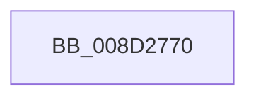

# sub_008D2770

- RVA: `0x008D2770`–`0x008D27AD` (길이 `61` bytes)
- VA: `0x00000001408D2770`
- 실행 섹션: `PAGE`
- PDB 이름 있음: `아니요`; PDB Function 태그: `아니요`
- unwind 정보 RVA: `0x00084D1C`
- 디코드: `17`개 명령, `61/61` bytes 표시
- 미해석 바이트: `0` (있으면 어셈블리에 `.byte`로 보존)

> 이 문서는 커널 이미지의 기계어와 PDB 기호를 분석해 생성했습니다. 4번과 5번은 함수 원형과 자료형을 바이너리 사용 방식에서 추정한 C 해석이며 원본 소스 복구 결과는 아닙니다.

## 1. Dependencies

- 직접 호출 지점: **0**; 고유 호출 대상: **0**
- 직접 호출자로 확인된 함수: **1**
- RIP 상대 이미지 참조: **1**

### Outgoing calls
- 직접 디코드된 call 명령이 없습니다.

### Direct callers
- [sub_008D3420](Unknown_function_008D3420.md) at `0x008D354C`

### Static image references
- `0x008D2789` → RVA `0x00E0A740` (`.data`; read)

## 2. Other-region calls and transfers

- 다른 실행 섹션으로 향하는 call: **0**
- 별도 외부 분기/꼬리 이동을 확인하지 못했습니다.

## 3. Assembly (complete function range)

```asm
008D2770  4C 8B DC                        mov r11, rsp
008D2773  55                              push rbp
008D2774  53                              push rbx
008D2775  56                              push rsi
008D2776  57                              push rdi
008D2777  41 55                           push r13
008D2779  41 56                           push r14
008D277B  49 8D AB F8 FE FF FF            lea rbp, [r11 - 0x108]
008D2782  48 81 EC D8 01 00 00            sub rsp, 0x1d8
008D2789  48 8B 05 B0 7F 53 00            mov rax, qword ptr [rip + 0x537fb0]
008D2790  48 33 C4                        xor rax, rsp
008D2793  48 89 85 C0 00 00 00            mov qword ptr [rbp + 0xc0], rax
008D279A  4C 89 44 24 68                  mov qword ptr [rsp + 0x68], r8
008D279F  48 8B DA                        mov rbx, rdx
008D27A2  48 89 54 24 60                  mov qword ptr [rsp + 0x60], rdx
008D27A7  4C 8B E9                        mov r13, rcx
008D27AA  0F 57 C0                        xorps xmm0, xmm0
```

## 4. C-style interpretation (structured pseudocode)

```c
__int64 __fastcall sub_008D2770(__int64 a1, __int64 a2, __int64 a3)
{
    __int64 result;
    __int64 v_rsp;
    unsigned __int64 v_stack_m1A0;
    unsigned __int64 v_stack_m1A8;

    v_rsp = (v_rsp) - (472);
    result = (*(unsigned __int64 *)(v_rip + 5472176)) ^ (v_rsp);
    *(unsigned __int64 *)(v_rsp - 264 + 192) = result;
    v_stack_m1A0 = a3;
    v_stack_m1A8 = a2;
    return result;
}
```

## 5. (Beta) C Style

```c
int64_t sub_008D2770(int64_t Arg1, int64_t Arg2, int64_t Arg3)
{
    int64_t result;
    int64_t local_rsp;
    uint64_t v_stack_m1A0;
    uint64_t v_stack_m1A8;

    local_rsp = (local_rsp) - (472);
    result = (*(uint64_t *)(v_rip + 0x537FB0)) ^ (local_rsp);
    *(uint64_t *)(local_rsp - 0x108 + 0xC0) = result;
    v_stack_m1A0 = Arg3;
    v_stack_m1A8 = Arg2;
    return result;
}
```

## 6. Execution-region graph

[열기: 2D/3D 그래프와 함수 탐색 컨트롤 패널](../../../control-panel.html?section=page&rva=0x008D2770&view=graph)

- 2D 그래프는 위에서 아래로 흐르고, 3D 그래프는 빈 공간을 드래그해 회전합니다. Shift+드래그는 이동, 휠은 확대·축소, 함수 노드 선택은 대상 보고서 이동입니다.

### Static fallback


