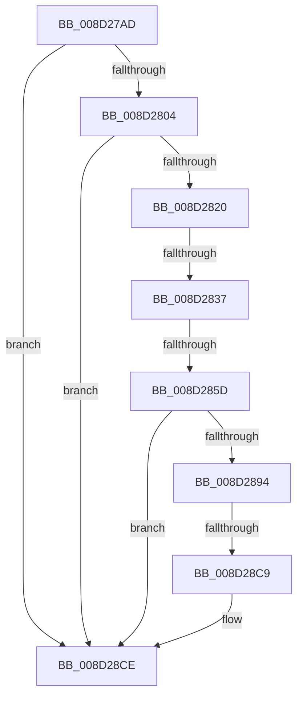

# sub_008D27AD

- RVA: `0x008D27AD`–`0x008D28EA` (길이 `317` bytes)
- VA: `0x00000001408D27AD`
- 실행 섹션: `PAGE`
- PDB 이름 있음: `아니요`; PDB Function 태그: `아니요`
- unwind 정보 RVA: `0x00084D38`
- 디코드: `70`개 명령, `317/317` bytes 표시
- 미해석 바이트: `0` (있으면 어셈블리에 `.byte`로 보존)

> 이 문서는 커널 이미지의 기계어와 PDB 기호를 분석해 생성했습니다. 4번과 5번은 함수 원형과 자료형을 바이너리 사용 방식에서 추정한 C 해석이며 원본 소스 복구 결과는 아닙니다.

## 1. Dependencies

- 직접 호출 지점: **5**; 고유 호출 대상: **5**
- 직접 호출자로 확인된 함수: **0**
- RIP 상대 이미지 참조: **0**

### Outgoing calls
- `0x008D27E6` → [memset](../../text/6C/memset_function_006C6C40.md) (function, `0x006C6C40`)
- `0x008D27F5` → [WbValidateHeapExecuteCallArguments](WbValidateHeapExecuteCallArguments_function_008D2C50.md) (function, `0x008D2C50`)
- `0x008D2811` → [sub_008D2F2C](Unknown_function_008D2F2C.md) (function, `0x008D2F2C`)
- `0x008D2828` → [sub_008D379C](Unknown_function_008D379C.md) (function, `0x008D379C`)
- `0x008D2889` → [PspGetContextThreadInternal](PspGetContextThreadInternal_function_008D4770.md) (function, `0x008D4770`)

### Direct callers
- 이 함수 시작 RVA로 연결되는 직접 call은 확인되지 않았습니다. 간접 호출은 완전히 역산할 수 없습니다.

### Static image references
- 디코드된 RIP-relative 메모리 참조가 없습니다.

## 2. Other-region calls and transfers

- 다른 실행 섹션으로 향하는 call: **1**
  - `0x008D27E6` → [memset](../../text/6C/memset_function_006C6C40.md) (`PAGE` → `.text`)
- call이 아닌 외부 분기/꼬리 이동: **4**
  - `0x008D2831` → [sub_008D292D + 0x18E](Unknown_function_008D292D.md) (`tail-transfer`)
  - `0x008D2857` → [sub_008D2B19](Unknown_function_008D2B19.md) (`tail-transfer`)
  - `0x008D28C7` → [sub_008D292D](Unknown_function_008D292D.md) (`tail-transfer`)
  - `0x008D28E8` → [sub_008D28EA + 0x13](Unknown_function_008D28EA.md) (`tail-transfer`)

## 3. Assembly (complete function range)

```asm
008D27AD  4D 89 63 20                     mov qword ptr [r11 + 0x20], r12
008D27B1  33 C0                           xor eax, eax
008D27B3  4D 89 7B C8                     mov qword ptr [r11 - 0x38], r15
008D27B7  33 FF                           xor edi, edi
008D27B9  48 89 44 24 50                  mov qword ptr [rsp + 0x50], rax
008D27BE  33 D2                           xor edx, edx
008D27C0  48 89 7C 24 30                  mov qword ptr [rsp + 0x30], rdi
008D27C5  41 B8 50 01 00 00               mov r8d, 0x150
008D27CB  44 89 4C 24 58                  mov dword ptr [rsp + 0x58], r9d
008D27D0  48 8D 4C 24 70                  lea rcx, [rsp + 0x70]
008D27D5  48 C7 44 24 38 00 00 00 00      mov qword ptr [rsp + 0x38], 0
008D27DE  0F 11 44 24 40                  movups xmmword ptr [rsp + 0x40], xmm0
008D27E3  41 8B F1                        mov esi, r9d
008D27E6  E8 55 44 DF FF                  call 0x1406c6c40
008D27EB  4C 8D 44 24 70                  lea r8, [rsp + 0x70]
008D27F0  8B D6                           mov edx, esi
008D27F2  48 8B CB                        mov rcx, rbx
008D27F5  E8 56 04 00 00                  call 0x1408d2c50
008D27FA  8B D8                           mov ebx, eax
008D27FC  85 C0                           test eax, eax
008D27FE  0F 88 CA 00 00 00               js 0x1408d28ce
008D2804  4C 8D 44 24 38                  lea r8, [rsp + 0x38]
008D2809  49 8B CD                        mov rcx, r13
008D280C  48 8D 54 24 70                  lea rdx, [rsp + 0x70]
008D2811  E8 16 07 00 00                  call 0x1408d2f2c
008D2816  8B D8                           mov ebx, eax
008D2818  85 C0                           test eax, eax
008D281A  0F 88 AE 00 00 00               js 0x1408d28ce
008D2820  4C 8D 44 24 30                  lea r8, [rsp + 0x30]
008D2825  49 8B CD                        mov rcx, r13
008D2828  E8 6F 0F 00 00                  call 0x1408d379c
008D282D  8B D8                           mov ebx, eax
008D282F  85 C0                           test eax, eax
008D2831  0F 88 84 02 00 00               js 0x1408d2abb
008D2837  65 48 8B 04 25 88 01 00 00      mov rax, qword ptr gs:[0x188]
008D2840  BA 4C 01 00 00                  mov edx, 0x14c
008D2845  48 8B 88 B8 00 00 00            mov rcx, qword ptr [rax + 0xb8]
008D284C  44 8D 42 78                     lea r8d, [rdx + 0x78]
008D2850  48 39 B9 10 03 00 00            cmp qword ptr [rcx + 0x310], rdi
008D2857  0F 85 BC 02 00 00               jne 0x1408d2b19
008D285D  48 8B 44 24 30                  mov rax, qword ptr [rsp + 0x30]
008D2862  41 B1 01                        mov r9b, 1
008D2865  45 33 C0                        xor r8d, r8d
008D2868  C7 44 24 20 01 00 00 00         mov dword ptr [rsp + 0x20], 1
008D2870  C7 40 60 01 00 10 00            mov dword ptr [rax + 0x60], 0x100001
008D2877  65 48 8B 0C 25 88 01 00 00      mov rcx, qword ptr gs:[0x188]
008D2880  48 8B 7C 24 30                  mov rdi, qword ptr [rsp + 0x30]
008D2885  48 8D 57 30                     lea rdx, [rdi + 0x30]
008D2889  E8 E2 1E 00 00                  call 0x1408d4770
008D288E  8B D8                           mov ebx, eax
008D2890  85 C0                           test eax, eax
008D2892  78 3A                           js 0x1408d28ce
008D2894  4C 8B BF 28 01 00 00            mov r15, qword ptr [rdi + 0x128]
008D289B  4C 8B A7 C8 00 00 00            mov r12, qword ptr [rdi + 0xc8]
008D28A2  44 8B 77 74                     mov r14d, dword ptr [rdi + 0x74]
008D28A6  4C 89 7C 24 48                  mov qword ptr [rsp + 0x48], r15
008D28AB  4C 89 64 24 40                  mov qword ptr [rsp + 0x40], r12
008D28B0  44 89 74 24 50                  mov dword ptr [rsp + 0x50], r14d
008D28B5  8B 4F 14                        mov ecx, dword ptr [rdi + 0x14]
008D28B8  41 B9 FF FF FF FF               mov r9d, 0xffffffff
008D28BE  8B D1                           mov edx, ecx
008D28C0  48 C1 E2 05                     shl rdx, 5
008D28C4  49 3B D1                        cmp rdx, r9
008D28C7  76 64                           jbe 0x1408d292d
008D28C9  BB 95 00 00 C0                  mov ebx, 0xc0000095
008D28CE  4C 8B BC 24 D0 01 00 00         mov r15, qword ptr [rsp + 0x1d0]
008D28D6  49 C7 C6 FF FF FF FF            mov r14, 0xffffffffffffffff
008D28DD  4C 8B A4 24 28 02 00 00         mov r12, qword ptr [rsp + 0x228]
008D28E5  48 85 FF                        test rdi, rdi
008D28E8  74 13                           je 0x1408d28fd
```

## 4. C-style interpretation (structured pseudocode)

```c
__int64 __fastcall sub_008D27AD(__int64 a1, int a2, __int64 a3, int a4, __int64 a5, __int64 a6, __int64 a7, __int64 a8, __int64 a9, __int64 a10, __int64 a11, __int64 a12, __int64 a13, __int64 a14, __int64 a15, __int64 a16, __int64 a17, __int64 a18, __int64 a19, __int64 a20, __int64 a21, __int64 a22, __int64 a23, __int64 a24, __int64 a25, __int64 a26, __int64 a27, __int64 a28, __int64 a29, __int64 a30, __int64 a31, __int64 a32, __int64 a33, __int64 a34, __int64 a35, __int64 a36, __int64 a37, __int64 a38, __int64 a39, __int64 a40, __int64 a41, __int64 a42, __int64 a43, __int64 a44, __int64 a45, __int64 a46, __int64 a47, __int64 a48, __int64 a49, __int64 a50, __int64 a51, __int64 a52, __int64 a53, __int64 a54, __int64 a55, __int64 a56, __int64 a57, __int64 a58, __int64 a59, __int64 a60, __int64 a61, __int64 a62, __int64 a63, __int64 a64, __int64 a65, __int64 a66, __int64 a67, __int64 a68, __int64 a69)
{
    __int64 result;
    __int64 v_rdi;
    unsigned int v_stack_p20;
    unsigned __int64 v_stack_p30;
    unsigned __int64 v_stack_p38;
    unsigned __int64 v_stack_p40;
    unsigned __int64 v_stack_p48;
    unsigned __int64 v_stack_p50;
    unsigned int v_stack_p58;

    *(unsigned __int64 *)(v_r11 + 32) = v_r12;
    result = 0;
    *(unsigned __int64 *)(v_r11 - 56) = v_r15;
    v_rdi = 0;
    v_stack_p50 = 0;
    a2 = 0;
    v_stack_p30 = 0;
    v_stack_p58 = a4;
    v_stack_p38 = 0;
    a8 = v_xmm0;
    result = memset(a14, a2, 336, a4);
    result = WbValidateHeapExecuteCallArguments(v_rbx, (unsigned int)((unsigned int)((unsigned int)(a4))), a14, a4);
    if (sign_flag) goto loc_008D28CE;
    result = sub_008D2F2C(v_r13, a14, a7, a4);
    if (sign_flag) goto loc_008D28CE;
    result = sub_008D379C(v_r13, a14, a6, a4);
    a3 = 0;
    v_stack_p20 = 1;
    *(unsigned int *)(a6 + 96) = 0x100001ULL;
    result = PspGetContextThreadInternal(*(unsigned __int64 *)(gs_base + (0 + 392)), a6 + 48, a3, 1);
    if (sign_flag) goto loc_008D28CE;
    v_stack_p48 = *(unsigned __int64 *)(a6 + 296);
    v_stack_p40 = *(unsigned __int64 *)(a6 + 200);
    v_stack_p50 = (unsigned int)((unsigned int)(*(unsigned int *)(a6 + 116)));
    a2 = ((unsigned int)((unsigned int)((unsigned int)(*(unsigned int *)(a6 + 20))))) << (5);
loc_008D28CE:
}
```

## 5. (Beta) C Style

```c
int64_t sub_008D27AD(int64_t Arg1, int32_t Arg2, int64_t Arg3, int32_t Arg4, uint64_t Arg5, void *Arg6, int64_t Arg7, int64_t Arg8, uint64_t Arg9, uint64_t Arg10, uint64_t Arg11, uint64_t Arg12, uint64_t Arg13, int64_t Arg14, uint64_t Arg15, uint64_t Arg16, uint64_t Arg17, uint64_t Arg18, uint64_t Arg19, uint64_t Arg20, uint64_t Arg21, uint64_t Arg22, uint64_t Arg23, uint64_t Arg24, uint64_t Arg25, uint64_t Arg26, uint64_t Arg27, uint64_t Arg28, uint64_t Arg29, uint64_t Arg30, uint64_t Arg31, uint64_t Arg32, uint64_t Arg33, uint64_t Arg34, uint64_t Arg35, uint64_t Arg36, uint64_t Arg37, uint64_t Arg38, uint64_t Arg39, uint64_t Arg40, uint64_t Arg41, uint64_t Arg42, uint64_t Arg43, uint64_t Arg44, uint64_t Arg45, uint64_t Arg46, uint64_t Arg47, uint64_t Arg48, uint64_t Arg49, uint64_t Arg50, uint64_t Arg51, uint64_t Arg52, uint64_t Arg53, uint64_t Arg54, uint64_t Arg55, uint64_t Arg56, uint64_t Arg57, int64_t Arg58, uint64_t Arg59, uint64_t Arg60, uint64_t Arg61, uint64_t Arg62, uint64_t Arg63, uint64_t Arg64, uint64_t Arg65, uint64_t Arg66, uint64_t Arg67, uint64_t Arg68, int64_t Arg69)
{
    uint8_t *arg6 = (uint8_t *)Arg6;

    int64_t result;
    int64_t local_rdi;
    uint32_t v_stack_p20;
    uint64_t v_stack_p30;
    uint64_t v_stack_p38;
    uint64_t v_stack_p40;
    uint64_t v_stack_p48;
    uint64_t v_stack_p50;
    uint32_t v_stack_p58;

    *(uint64_t *)(local_r11 + 0x20) = local_r12;
    result = 0;
    *(uint64_t *)(local_r11 - 0x38) = local_r15;
    local_rdi = 0;
    v_stack_p50 = 0;
    Arg2 = 0;
    v_stack_p30 = 0;
    v_stack_p58 = Arg4;
    v_stack_p38 = 0;
    Arg8 = v_xmm0;
    result = memset(Arg14, Arg2, 336, Arg4);
    result = WbValidateHeapExecuteCallArguments(local_rbx, (uint32_t)((uint32_t)((uint32_t)(Arg4))), Arg14, Arg4);
    if (sign_flag) goto loc_008D28CE;
    result = sub_008D2F2C(local_r13, Arg14, Arg7, Arg4);
    if (sign_flag) goto loc_008D28CE;
    result = sub_008D379C(local_r13, Arg14, Arg6, Arg4);
    Arg3 = 0;
    v_stack_p20 = 1;
    *(uint32_t *)(arg6 + 0x60) = 0x100001ULL;
    result = PspGetContextThreadInternal(*(uint64_t *)(gs_base + (0 + 0x188)), Arg6 + 48, Arg3, 1);
    if (sign_flag) goto loc_008D28CE;
    v_stack_p48 = *(uint64_t *)(arg6 + 0x128);
    v_stack_p40 = *(uint64_t *)(arg6 + 0xC8);
    v_stack_p50 = (uint32_t)((uint32_t)(*(uint32_t *)(arg6 + 0x74)));
    Arg2 = ((uint32_t)((uint32_t)((uint32_t)(*(uint32_t *)(arg6 + 0x14))))) << (5);
loc_008D28CE:
}
```

### 관측된 메모리 오프셋

구조체 형식이 확인되지 않은 접근은 인자 기준의 오프셋으로만 기록했습니다.

| 기준 인자 | 오프셋 표현 | 폭 (bit) | 접근 |
|---|---:|---:|---|
| `Arg6` | `+ 0x14` | `32` | `R` |
| `Arg6` | `+ 0x30` | `64` | `R` |
| `Arg6` | `+ 0x60` | `32` | `W` |
| `Arg6` | `+ 0x74` | `32` | `R` |
| `Arg6` | `+ 0xC8` | `64` | `R` |
| `Arg6` | `+ 0x128` | `64` | `R` |

## 6. Execution-region graph

[열기: 2D/3D 그래프와 함수 탐색 컨트롤 패널](../../../control-panel.html?section=page&rva=0x008D27AD&view=graph)

- 2D 그래프는 위에서 아래로 흐르고, 3D 그래프는 빈 공간을 드래그해 회전합니다. Shift+드래그는 이동, 휠은 확대·축소, 함수 노드 선택은 대상 보고서 이동입니다.

### Static fallback


