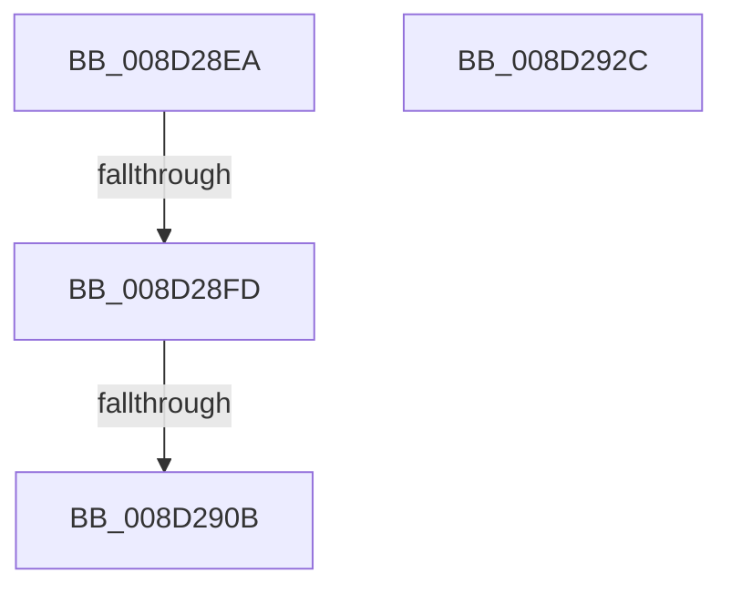

# sub_008D28EA

- RVA: `0x008D28EA`–`0x008D292D` (길이 `67` bytes)
- VA: `0x00000001408D28EA`
- 실행 섹션: `PAGE`
- PDB 이름 있음: `아니요`; PDB Function 태그: `아니요`
- unwind 정보 RVA: `0x00084D50`
- 디코드: `20`개 명령, `67/67` bytes 표시
- 미해석 바이트: `0` (있으면 어셈블리에 `.byte`로 보존)

> 이 문서는 커널 이미지의 기계어와 PDB 기호를 분석해 생성했습니다. 4번과 5번은 함수 원형과 자료형을 바이너리 사용 방식에서 추정한 C 해석이며 원본 소스 복구 결과는 아닙니다.

## 1. Dependencies

- 직접 호출 지점: **1**; 고유 호출 대상: **1**
- 직접 호출자로 확인된 함수: **0**
- RIP 상대 이미지 참조: **0**

### Outgoing calls
- `0x008D2917` → [_security_check_cookie](../../text/6A/_security_check_cookie_function_006AC640.md) (function, `0x006AC640`)

### Direct callers
- 이 함수 시작 RVA로 연결되는 직접 call은 확인되지 않았습니다. 간접 호출은 완전히 역산할 수 없습니다.

### Static image references
- 디코드된 RIP-relative 메모리 참조가 없습니다.

## 2. Other-region calls and transfers

- 다른 실행 섹션으로 향하는 call: **1**
  - `0x008D2917` → [_security_check_cookie](../../text/6A/_security_check_cookie_function_006AC640.md) (`PAGE` → `.text`)
- call이 아닌 외부 분기/꼬리 이동: **2**
  - `0x008D28F7` → [sub_008D2C07](Unknown_function_008D2C07.md) (`tail-transfer`)
  - `0x008D2905` → [sub_008D2AC5](Unknown_function_008D2AC5.md) (`tail-transfer`)

## 3. Assembly (complete function range)

```asm
008D28EA  49 8B C6                        mov rax, r14
008D28ED  F0 48 0F C1 47 08               lock xadd qword ptr [rdi + 8], rax
008D28F3  48 83 F8 01                     cmp rax, 1
008D28F7  0F 84 0A 03 00 00               je 0x1408d2c07
008D28FD  48 8B 74 24 38                  mov rsi, qword ptr [rsp + 0x38]
008D2902  48 85 F6                        test rsi, rsi
008D2905  0F 85 BA 01 00 00               jne 0x1408d2ac5
008D290B  8B C3                           mov eax, ebx
008D290D  48 8B 8D C0 00 00 00            mov rcx, qword ptr [rbp + 0xc0]
008D2914  48 33 CC                        xor rcx, rsp
008D2917  E8 24 9D DD FF                  call 0x1406ac640
008D291C  48 81 C4 D8 01 00 00            add rsp, 0x1d8
008D2923  41 5E                           pop r14
008D2925  41 5D                           pop r13
008D2927  5F                              pop rdi
008D2928  5E                              pop rsi
008D2929  5B                              pop rbx
008D292A  5D                              pop rbp
008D292B  C3                              ret
008D292C  CC                              int3
```

## 4. C-style interpretation (structured pseudocode)

```c
__int64 __fastcall sub_008D28EA(__int64 a1, __int64 a2, __int64 a3, __int64 a4, __int64 a5, __int64 a6, __int64 a7)
{
    __int64 result;
    __int64 v_rsp;

    a1 = (*(unsigned __int64 *)(v_rbp + 192)) ^ (v_rsp);
    result = _security_check_cookie(a1, a2, a3, a4);
    v_rsp = (v_rsp) + (472);
    return result;
}
```

## 5. (Beta) C Style

```c
int64_t sub_008D28EA(int64_t Arg1, int64_t Arg2, int64_t Arg3, int64_t Arg4, uint64_t Arg5, uint64_t Arg6, int64_t Arg7)
{
    int64_t result;
    int64_t local_rsp;

    Arg1 = (*(uint64_t *)(local_rbp + 0xC0)) ^ (local_rsp);
    result = _security_check_cookie(Arg1, Arg2, Arg3, Arg4);
    local_rsp = (local_rsp) + (472);
    return result;
}
```

## 6. Execution-region graph

[열기: 2D/3D 그래프와 함수 탐색 컨트롤 패널](../../../control-panel.html?section=page&rva=0x008D28EA&view=graph)

- 2D 그래프는 위에서 아래로 흐르고, 3D 그래프는 빈 공간을 드래그해 회전합니다. Shift+드래그는 이동, 휠은 확대·축소, 함수 노드 선택은 대상 보고서 이동입니다.

### Static fallback


