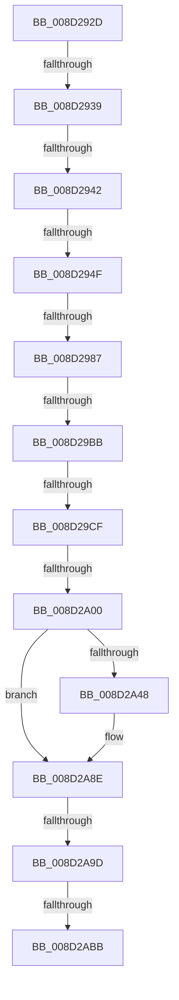

# sub_008D292D

- RVA: `0x008D292D`–`0x008D2AC5` (길이 `408` bytes)
- VA: `0x00000001408D292D`
- 실행 섹션: `PAGE`
- PDB 이름 있음: `아니요`; PDB Function 태그: `아니요`
- unwind 정보 RVA: `0x00084D64`
- 디코드: `90`개 명령, `408/408` bytes 표시
- 미해석 바이트: `0` (있으면 어셈블리에 `.byte`로 보존)

> 이 문서는 커널 이미지의 기계어와 PDB 기호를 분석해 생성했습니다. 4번과 5번은 함수 원형과 자료형을 바이너리 사용 방식에서 추정한 C 해석이며 원본 소스 복구 결과는 아닙니다.

## 1. Dependencies

- 직접 호출 지점: **6**; 고유 호출 대상: **6**
- 직접 호출자로 확인된 함수: **0**
- RIP 상대 이미지 참조: **0**

### Outgoing calls
- `0x008D2974` → [sub_008D4254](Unknown_function_008D4254.md) (function, `0x008D4254`)
- `0x008D29AC` → [sub_008D4274](Unknown_function_008D4274.md) (function, `0x008D4274`)
- `0x008D29C0` → [WbDisableTracing](WbDisableTracing_function_008D4368.md) (function, `0x008D4368`)
- `0x008D2A3D` → [PspGetContextThreadInternal](PspGetContextThreadInternal_function_008D4770.md) (function, `0x008D4770`)
- `0x008D2A82` → [PspSetContextThreadInternal](PspSetContextThreadInternal_function_008D4420.md) (function, `0x008D4420`)
- `0x008D2A8E` → [KeLeaveGuardedRegion](../../text/2E/KeLeaveGuardedRegion_function_002E2C40.md) (function, `0x002E2C40`)

### Direct callers
- 이 함수 시작 RVA로 연결되는 직접 call은 확인되지 않았습니다. 간접 호출은 완전히 역산할 수 없습니다.

### Static image references
- 디코드된 RIP-relative 메모리 참조가 없습니다.

## 2. Other-region calls and transfers

- 다른 실행 섹션으로 향하는 call: **1**
  - `0x008D2A8E` → [KeLeaveGuardedRegion](../../text/2E/KeLeaveGuardedRegion_function_002E2C40.md) (`PAGE` → `.text`)
- call이 아닌 외부 분기/꼬리 이동: **10**
  - `0x008D2937` → [sub_008D27AD + 0x11C](Unknown_function_008D27AD.md) (`tail-transfer`)
  - `0x008D2940` → [sub_008D27AD + 0x11C](Unknown_function_008D27AD.md) (`tail-transfer`)
  - `0x008D2949` → [sub_008D2B19 + 0xCC](Unknown_function_008D2B19.md) (`tail-transfer`)
  - `0x008D2981` → [sub_008D27AD + 0x121](Unknown_function_008D27AD.md) (`tail-transfer`)
  - `0x008D29B5` → [sub_008D27AD + 0x121](Unknown_function_008D27AD.md) (`tail-transfer`)
  - `0x008D29C9` → [sub_008D27AD + 0x121](Unknown_function_008D27AD.md) (`tail-transfer`)
  - `0x008D29FA` → [sub_008D2B19 + 0x40](Unknown_function_008D2B19.md) (`tail-transfer`)
  - `0x008D2A97` → [sub_008D27AD + 0x121](Unknown_function_008D27AD.md) (`tail-transfer`)
  - `0x008D2AB5` → [sub_008D2B19 + 0x70](Unknown_function_008D2B19.md) (`tail-transfer`)
  - `0x008D2AC0` → [sub_008D27AD + 0x121](Unknown_function_008D27AD.md) (`tail-transfer`)

## 3. Assembly (complete function range)

```asm
008D292D  44 8B 47 20                     mov r8d, dword ptr [rdi + 0x20]
008D2931  44 03 C1                        add r8d, ecx
008D2934  44 3B C1                        cmp r8d, ecx
008D2937  72 90                           jb 0x1408d28c9
008D2939  49 C1 E0 05                     shl r8, 5
008D293D  4D 3B C1                        cmp r8, r9
008D2940  77 87                           ja 0x1408d28c9
008D2942  8B 47 10                        mov eax, dword ptr [rdi + 0x10]
008D2945  FF C0                           inc eax
008D2947  3B C1                           cmp eax, ecx
008D2949  0F 83 96 02 00 00               jae 0x1408d2be5
008D294F  8B 47 10                        mov eax, dword ptr [rdi + 0x10]
008D2952  48 8B 74 24 38                  mov rsi, qword ptr [rsp + 0x38]
008D2957  48 C1 E0 05                     shl rax, 5
008D295B  48 8B CE                        mov rcx, rsi
008D295E  48 03 47 18                     add rax, qword ptr [rdi + 0x18]
008D2962  48 89 30                        mov qword ptr [rax], rsi
008D2965  4C 89 78 08                     mov qword ptr [rax + 8], r15
008D2969  4C 89 60 10                     mov qword ptr [rax + 0x10], r12
008D296D  44 89 70 18                     mov dword ptr [rax + 0x18], r14d
008D2971  FF 47 10                        inc dword ptr [rdi + 0x10]
008D2974  E8 DB 18 00 00                  call 0x1408d4254
008D2979  8B 74 24 58                     mov esi, dword ptr [rsp + 0x58]
008D297D  8B D8                           mov ebx, eax
008D297F  85 DB                           test ebx, ebx
008D2981  0F 88 47 FF FF FF               js 0x1408d28ce
008D2987  48 8B 44 24 68                  mov rax, qword ptr [rsp + 0x68]
008D298C  4C 8D 44 24 40                  lea r8, [rsp + 0x40]
008D2991  4C 8B 4C 24 60                  mov r9, qword ptr [rsp + 0x60]
008D2996  48 8D 4C 24 70                  lea rcx, [rsp + 0x70]
008D299B  89 74 24 28                     mov dword ptr [rsp + 0x28], esi
008D299F  48 8B 74 24 38                  mov rsi, qword ptr [rsp + 0x38]
008D29A4  48 8B D6                        mov rdx, rsi
008D29A7  48 89 44 24 20                  mov qword ptr [rsp + 0x20], rax
008D29AC  E8 C3 18 00 00                  call 0x1408d4274
008D29B1  8B D8                           mov ebx, eax
008D29B3  85 C0                           test eax, eax
008D29B5  0F 88 13 FF FF FF               js 0x1408d28ce
008D29BB  48 8D 4C 24 40                  lea rcx, [rsp + 0x40]
008D29C0  E8 A3 19 00 00                  call 0x1408d4368
008D29C5  8B D8                           mov ebx, eax
008D29C7  85 C0                           test eax, eax
008D29C9  0F 88 FF FE FF FF               js 0x1408d28ce
008D29CF  48 8B 46 18                     mov rax, qword ptr [rsi + 0x18]
008D29D3  41 BE 4C 01 00 00               mov r14d, 0x14c
008D29D9  48 89 44 24 48                  mov qword ptr [rsp + 0x48], rax
008D29DE  65 48 8B 04 25 88 01 00 00      mov rax, qword ptr gs:[0x188]
008D29E7  45 8D 7E 78                     lea r15d, [r14 + 0x78]
008D29EB  48 8B 88 B8 00 00 00            mov rcx, qword ptr [rax + 0xb8]
008D29F2  48 83 B9 10 03 00 00 00         cmp qword ptr [rcx + 0x310], 0
008D29FA  0F 85 59 01 00 00               jne 0x1408d2b59
008D2A00  65 48 8B 04 25 88 01 00 00      mov rax, qword ptr gs:[0x188]
008D2A09  41 B1 01                        mov r9b, 1
008D2A0C  45 33 C0                        xor r8d, r8d
008D2A0F  C7 44 24 20 01 00 00 00         mov dword ptr [rsp + 0x20], 1
008D2A17  66 FF 88 E6 01 00 00            dec word ptr [rax + 0x1e6]
008D2A1E  90                              nop
008D2A1F  48 8B 44 24 30                  mov rax, qword ptr [rsp + 0x30]
008D2A24  C7 40 60 01 00 10 00            mov dword ptr [rax + 0x60], 0x100001
008D2A2B  65 48 8B 0C 25 88 01 00 00      mov rcx, qword ptr gs:[0x188]
008D2A34  48 8B 7C 24 30                  mov rdi, qword ptr [rsp + 0x30]
008D2A39  48 8D 57 30                     lea rdx, [rdi + 0x30]
008D2A3D  E8 2E 1D 00 00                  call 0x1408d4770
008D2A42  8B F0                           mov esi, eax
008D2A44  85 C0                           test eax, eax
008D2A46  78 46                           js 0x1408d2a8e
008D2A48  48 8B 44 24 48                  mov rax, qword ptr [rsp + 0x48]
008D2A4D  48 8D 57 30                     lea rdx, [rdi + 0x30]
008D2A51  48 89 87 28 01 00 00            mov qword ptr [rdi + 0x128], rax
008D2A58  41 B1 01                        mov r9b, 1
008D2A5B  48 8B 44 24 40                  mov rax, qword ptr [rsp + 0x40]
008D2A60  45 33 C0                        xor r8d, r8d
008D2A63  48 89 87 C8 00 00 00            mov qword ptr [rdi + 0xc8], rax
008D2A6A  8B 44 24 50                     mov eax, dword ptr [rsp + 0x50]
008D2A6E  89 47 74                        mov dword ptr [rdi + 0x74], eax
008D2A71  65 48 8B 0C 25 88 01 00 00      mov rcx, qword ptr gs:[0x188]
008D2A7A  C7 44 24 20 03 00 00 00         mov dword ptr [rsp + 0x20], 3
008D2A82  E8 99 19 00 00                  call 0x1408d4420
008D2A87  48 8B 7C 24 30                  mov rdi, qword ptr [rsp + 0x30]
008D2A8C  8B F0                           mov esi, eax
008D2A8E  E8 AD 01 A1 FF                  call 0x1402e2c40
008D2A93  8B DE                           mov ebx, esi
008D2A95  85 F6                           test esi, esi
008D2A97  0F 88 31 FE FF FF               js 0x1408d28ce
008D2A9D  65 48 8B 04 25 88 01 00 00      mov rax, qword ptr gs:[0x188]
008D2AA6  48 8B 88 B8 00 00 00            mov rcx, qword ptr [rax + 0xb8]
008D2AAD  48 83 B9 10 03 00 00 00         cmp qword ptr [rcx + 0x310], 0
008D2AB5  0F 85 CE 00 00 00               jne 0x1408d2b89
008D2ABB  48 8B 7C 24 30                  mov rdi, qword ptr [rsp + 0x30]
008D2AC0  E9 09 FE FF FF                  jmp 0x1408d28ce
```

## 4. C-style interpretation (structured pseudocode)

```c
__int64 __fastcall sub_008D292D(int a1, __int64 a2, __int64 a3, __int64 a4, __int64 a5, __int64 a6, __int64 a7, __int64 a8, __int64 a9, unsigned int a10, unsigned int a11, __int64 a12, __int64 a13, __int64 a14)
{
    __int64 result;
    __int64 v_rdi;
    __int64 v_rsi;
    unsigned __int64 v_stack_p20;
    unsigned int v_stack_p28;
    unsigned __int64 v_stack_p48;

    a3 = (unsigned int)(((unsigned int)(*(unsigned int *)(v_rdi + 32))) + (a1));
    a3 = (a3) << (5);
    result = (unsigned int)(((unsigned int)(*(unsigned int *)(v_rdi + 16))) + 1);
    result = ((unsigned int)(*(unsigned int *)(v_rdi + 16))) << (5);
    result = (result) + (*(unsigned __int64 *)(v_rdi + 24));
    *(unsigned __int64 *)(result) = a7;
    *(unsigned __int64 *)(result + 8) = v_r15;
    *(unsigned __int64 *)(result + 16) = v_r12;
    *(unsigned int *)(result + 24) = (unsigned int)(v_r14);
    result = sub_008D4254(a7, a2, a3, a4);
    v_stack_p28 = (unsigned int)((unsigned int)(a11));
    v_stack_p20 = a13;
    result = sub_008D4274(a14, a7, a8, a12);
    result = WbDisableTracing(a8, a7, a8, a12);
    v_stack_p48 = *(unsigned __int64 *)(a7 + 24);
    a3 = 0;
    v_stack_p20 = 1;
    *(unsigned int *)(a6 + 96) = 0x100001ULL;
    result = PspGetContextThreadInternal(*(unsigned __int64 *)(gs_base + (0 + 392)), a6 + 48, a3, 1);
    v_rsi = (unsigned int)((unsigned int)(result));
    v_rdi = a6;
    if (!(sign_flag)) {
        result = a9;
        a2 = a6 + 48;
        *(unsigned __int64 *)(a6 + 296) = result;
        a4 = 1;
        result = a8;
        a3 = 0;
        *(unsigned __int64 *)(a6 + 200) = result;
        result = a10;
        *(unsigned int *)(a6 + 116) = (unsigned int)(result);
        a1 = *(unsigned __int64 *)(gs_base + (0 + 392));
        v_stack_p20 = 3;
        result = PspSetContextThreadInternal(a1, a2, a3, a4);
        v_rdi = a6;
        v_rsi = (unsigned int)(result);
    }
    result = KeLeaveGuardedRegion(a1, a2, a3, a4);
}
```

## 5. (Beta) C Style

```c
int64_t sub_008D292D(int32_t Arg1, int64_t Arg2, int64_t Arg3, int64_t Arg4, uint64_t Arg5, void *Arg6, void *Arg7, int64_t Arg8, int64_t Arg9, uint32_t Arg10, uint32_t Arg11, int64_t Arg12, int64_t Arg13, int64_t Arg14)
{
    uint8_t *arg6 = (uint8_t *)Arg6;
    uint8_t *arg7 = (uint8_t *)Arg7;

    int64_t result;
    int64_t local_rdi;
    int64_t local_rsi;
    uint64_t v_stack_p20;
    uint32_t v_stack_p28;
    uint64_t v_stack_p48;

    Arg3 = (uint32_t)(((uint32_t)(*(uint32_t *)(local_rdi + 0x20))) + (Arg1));
    Arg3 = (Arg3) << (5);
    result = (uint32_t)(((uint32_t)(*(uint32_t *)(local_rdi + 0x10))) + 1);
    result = ((uint32_t)(*(uint32_t *)(local_rdi + 0x10))) << (5);
    result = (result) + (*(uint64_t *)(local_rdi + 0x18));
    *(void **)(result) = Arg7;
    *(uint64_t *)(result + 0x8) = local_r15;
    *(uint64_t *)(result + 0x10) = local_r12;
    *(uint32_t *)(result + 0x18) = (uint32_t)(local_r14);
    result = sub_008D4254(Arg7, Arg2, Arg3, Arg4);
    v_stack_p28 = (uint32_t)((uint32_t)(Arg11));
    v_stack_p20 = Arg13;
    result = sub_008D4274(Arg14, Arg7, Arg8, Arg12);
    result = WbDisableTracing(Arg8, Arg7, Arg8, Arg12);
    v_stack_p48 = *(uint64_t *)(arg7 + 0x18);
    Arg3 = 0;
    v_stack_p20 = 1;
    *(uint32_t *)(arg6 + 0x60) = 0x100001ULL;
    result = PspGetContextThreadInternal(*(uint64_t *)(gs_base + (0 + 0x188)), Arg6 + 48, Arg3, 1);
    local_rsi = (uint32_t)((uint32_t)(result));
    local_rdi = Arg6;
    if (!(sign_flag)) {
        result = Arg9;
        Arg2 = Arg6 + 48;
        *(uint64_t *)(arg6 + 0x128) = result;
        Arg4 = 1;
        result = Arg8;
        Arg3 = 0;
        *(uint64_t *)(arg6 + 0xC8) = result;
        result = Arg10;
        *(uint32_t *)(arg6 + 0x74) = (uint32_t)(result);
        Arg1 = *(uint64_t *)(gs_base + (0 + 0x188));
        v_stack_p20 = 3;
        result = PspSetContextThreadInternal(Arg1, Arg2, Arg3, Arg4);
        local_rdi = Arg6;
        local_rsi = (uint32_t)(result);
    }
    result = KeLeaveGuardedRegion(Arg1, Arg2, Arg3, Arg4);
}
```

### 관측된 메모리 오프셋

구조체 형식이 확인되지 않은 접근은 인자 기준의 오프셋으로만 기록했습니다.

| 기준 인자 | 오프셋 표현 | 폭 (bit) | 접근 |
|---|---:|---:|---|
| `Arg6` | `+ 0x30` | `64` | `R` |
| `Arg6` | `+ 0x60` | `32` | `W` |
| `Arg6` | `+ 0x74` | `32` | `W` |
| `Arg6` | `+ 0xC8` | `64` | `W` |
| `Arg6` | `+ 0x128` | `64` | `W` |
| `Arg7` | `+ 0x18` | `64` | `R` |

## 6. Execution-region graph

[열기: 2D/3D 그래프와 함수 탐색 컨트롤 패널](../../../control-panel.html?section=page&rva=0x008D292D&view=graph)

- 2D 그래프는 위에서 아래로 흐르고, 3D 그래프는 빈 공간을 드래그해 회전합니다. Shift+드래그는 이동, 휠은 확대·축소, 함수 노드 선택은 대상 보고서 이동입니다.

### Static fallback


