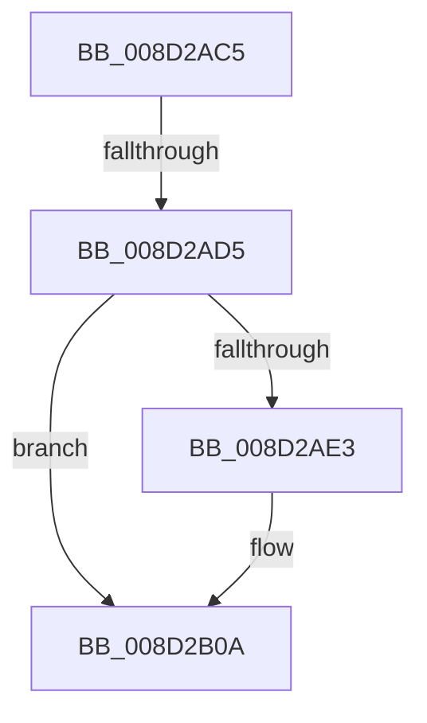

# sub_008D2AC5

- RVA: `0x008D2AC5`–`0x008D2B19` (길이 `84` bytes)
- VA: `0x00000001408D2AC5`
- 실행 섹션: `PAGE`
- PDB 이름 있음: `아니요`; PDB Function 태그: `아니요`
- unwind 정보 RVA: `0x00084D7C`
- 디코드: `17`개 명령, `84/84` bytes 표시
- 미해석 바이트: `0` (있으면 어셈블리에 `.byte`로 보존)

> 이 문서는 커널 이미지의 기계어와 PDB 기호를 분석해 생성했습니다. 4번과 5번은 함수 원형과 자료형을 바이너리 사용 방식에서 추정한 C 해석이며 원본 소스 복구 결과는 아닙니다.

## 1. Dependencies

- 직접 호출 지점: **2**; 고유 호출 대상: **2**
- 직접 호출자로 확인된 함수: **0**
- RIP 상대 이미지 참조: **0**

### Outgoing calls
- `0x008D2AE6` → [sub_008D2420](Unknown_function_008D2420.md) (function, `0x008D2420`)
- `0x008D2B0F` → [ExFreePoolWithTag](../../poolcode/B8/ExFreePoolWithTag_function_00B82870.md) (function, `0x00B82870`)

### Direct callers
- 이 함수 시작 RVA로 연결되는 직접 call은 확인되지 않았습니다. 간접 호출은 완전히 역산할 수 없습니다.

### Static image references
- 디코드된 RIP-relative 메모리 참조가 없습니다.

## 2. Other-region calls and transfers

- 다른 실행 섹션으로 향하는 call: **1**
  - `0x008D2B0F` → [ExFreePoolWithTag](../../poolcode/B8/ExFreePoolWithTag_function_00B82870.md) (`PAGE` → `POOLCODE`)
- call이 아닌 외부 분기/꼬리 이동: **2**
  - `0x008D2ACF` → [sub_008D28EA + 0x21](Unknown_function_008D28EA.md) (`tail-transfer`)
  - `0x008D2B14` → [sub_008D28EA + 0x21](Unknown_function_008D28EA.md) (`tail-transfer`)

## 3. Assembly (complete function range)

```asm
008D2AC5  F0 4C 0F C1 76 50               lock xadd qword ptr [rsi + 0x50], r14
008D2ACB  49 83 FE 01                     cmp r14, 1
008D2ACF  0F 85 36 FE FF FF               jne 0x1408d290b
008D2AD5  48 8B 7C 24 38                  mov rdi, qword ptr [rsp + 0x38]
008D2ADA  48 8B 57 28                     mov rdx, qword ptr [rdi + 0x28]
008D2ADE  48 85 D2                        test rdx, rdx
008D2AE1  74 27                           je 0x1408d2b0a
008D2AE3  49 8B CD                        mov rcx, r13
008D2AE6  E8 35 F9 FF FF                  call 0x1408d2420
008D2AEB  48 C7 47 28 00 00 00 00         mov qword ptr [rdi + 0x28], 0
008D2AF3  48 C7 47 18 00 00 00 00         mov qword ptr [rdi + 0x18], 0
008D2AFB  48 C7 47 20 00 00 00 00         mov qword ptr [rdi + 0x20], 0
008D2B03  C7 47 48 00 00 00 00            mov dword ptr [rdi + 0x48], 0
008D2B0A  33 D2                           xor edx, edx
008D2B0C  48 8B CF                        mov rcx, rdi
008D2B0F  E8 5C FD 2A 00                  call 0x140b82870
008D2B14  E9 F2 FD FF FF                  jmp 0x1408d290b
```

## 4. C-style interpretation (structured pseudocode)

```c
__int64 __fastcall sub_008D2AC5(__int64 a1, __int64 a2, __int64 a3, __int64 a4, __int64 a5, __int64 a6, __int64 a7)
{
    __int64 result;

    if (*(unsigned __int64 *)(a7 + 40) != 0) {
        a1 = v_r13;
        result = sub_008D2420(a1, *(unsigned __int64 *)(a7 + 40), a3, a4);
        *(unsigned __int64 *)(a7 + 40) = 0;
        *(unsigned __int64 *)(a7 + 24) = 0;
        *(unsigned __int64 *)(a7 + 32) = 0;
        *(unsigned int *)(a7 + 72) = 0;
    }
    a2 = 0;
    result = ExFreePoolWithTag(a7, a2, a3, a4);
}
```

## 5. (Beta) C Style

```c
int64_t sub_008D2AC5(int64_t Arg1, int64_t Arg2, int64_t Arg3, int64_t Arg4, uint64_t Arg5, uint64_t Arg6, void *Arg7)
{
    uint8_t *arg7 = (uint8_t *)Arg7;

    int64_t result;

    if (*(uint64_t *)(arg7 + 0x28) != 0) {
        Arg1 = local_r13;
        result = sub_008D2420(Arg1, *(uint64_t *)(arg7 + 0x28), Arg3, Arg4);
        *(uint64_t *)(arg7 + 0x28) = 0;
        *(uint64_t *)(arg7 + 0x18) = 0;
        *(uint64_t *)(arg7 + 0x20) = 0;
        *(uint32_t *)(arg7 + 0x48) = 0;
    }
    Arg2 = 0;
    result = ExFreePoolWithTag(Arg7, Arg2, Arg3, Arg4);
}
```

### 관측된 메모리 오프셋

구조체 형식이 확인되지 않은 접근은 인자 기준의 오프셋으로만 기록했습니다.

| 기준 인자 | 오프셋 표현 | 폭 (bit) | 접근 |
|---|---:|---:|---|
| `Arg7` | `+ 0x18` | `64` | `W` |
| `Arg7` | `+ 0x20` | `64` | `W` |
| `Arg7` | `+ 0x28` | `64` | `R` |
| `Arg7` | `+ 0x28` | `64` | `W` |
| `Arg7` | `+ 0x48` | `32` | `W` |

## 6. Execution-region graph

[열기: 2D/3D 그래프와 함수 탐색 컨트롤 패널](../../../control-panel.html?section=page&rva=0x008D2AC5&view=graph)

- 2D 그래프는 위에서 아래로 흐르고, 3D 그래프는 빈 공간을 드래그해 회전합니다. Shift+드래그는 이동, 휠은 확대·축소, 함수 노드 선택은 대상 보고서 이동입니다.

### Static fallback


