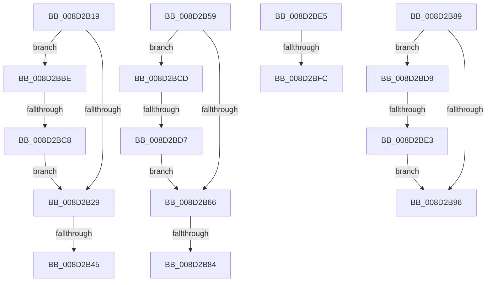

# sub_008D2B19

- RVA: `0x008D2B19`–`0x008D2C07` (길이 `238` bytes)
- VA: `0x00000001408D2B19`
- 실행 섹션: `PAGE`
- PDB 이름 있음: `아니요`; PDB Function 태그: `아니요`
- unwind 정보 RVA: `0x00084D8C`
- 디코드: `54`개 명령, `238/238` bytes 표시
- 미해석 바이트: `0` (있으면 어셈블리에 `.byte`로 보존)

> 이 문서는 커널 이미지의 기계어와 PDB 기호를 분석해 생성했습니다. 4번과 5번은 함수 원형과 자료형을 바이너리 사용 방식에서 추정한 C 해석이며 원본 소스 복구 결과는 아닙니다.

## 1. Dependencies

- 직접 호출 지점: **4**; 고유 호출 대상: **4**
- 직접 호출자로 확인된 함수: **0**
- RIP 상대 이미지 참조: **0**

### Outgoing calls
- `0x008D2B36` → [WbGetWowTrapFrame](../81/WbGetWowTrapFrame_function_00811DF0.md) (function, `0x00811DF0`)
- `0x008D2B73` → [WbSetWowTrapFrame](WbSetWowTrapFrame_function_008D57EC.md) (function, `0x008D57EC`)
- `0x008D2BA6` → [PsWow64GetProcessMachine](PsWow64GetProcessMachine_function_008D2130.md) (function, `0x008D2130`)
- `0x008D2BED` → [sub_00A7C49C](../A7/Unknown_function_00A7C49C.md) (function, `0x00A7C49C`)

### Direct callers
- 이 함수 시작 RVA로 연결되는 직접 call은 확인되지 않았습니다. 간접 호출은 완전히 역산할 수 없습니다.

### Static image references
- 디코드된 RIP-relative 메모리 참조가 없습니다.

## 2. Other-region calls and transfers

- 다른 실행 섹션으로 향하는 call: **0**
- call이 아닌 외부 분기/꼬리 이동: **10**
  - `0x008D2B3F` → [sub_008D27AD + 0x121](Unknown_function_008D27AD.md) (`tail-transfer`)
  - `0x008D2B54` → [sub_008D27AD + 0x108](Unknown_function_008D27AD.md) (`tail-transfer`)
  - `0x008D2B7E` → [sub_008D292D + 0x170](Unknown_function_008D292D.md) (`tail-transfer`)
  - `0x008D2B84` → [sub_008D292D + 0x166](Unknown_function_008D292D.md) (`tail-transfer`)
  - `0x008D2BB9` → [sub_008D27AD + 0x121](Unknown_function_008D27AD.md) (`tail-transfer`)
  - `0x008D2BC2` → [sub_008D27AD + 0xB0](Unknown_function_008D27AD.md) (`tail-transfer`)
  - `0x008D2BD1` → [sub_008D292D + 0xD3](Unknown_function_008D292D.md) (`tail-transfer`)
  - `0x008D2BDD` → [sub_008D292D + 0x18E](Unknown_function_008D292D.md) (`tail-transfer`)
  - `0x008D2BF6` → [sub_008D292D + 0x52](Unknown_function_008D292D.md) (`tail-transfer`)
  - `0x008D2C02` → [sub_008D292D + 0x22](Unknown_function_008D292D.md) (`tail-transfer`)

## 3. Assembly (complete function range)

```asm
008D2B19  0F B7 81 EC 06 00 00            movzx eax, word ptr [rcx + 0x6ec]
008D2B20  66 3B C2                        cmp ax, dx
008D2B23  0F 85 95 00 00 00               jne 0x1408d2bbe
008D2B29  48 8B 7C 24 30                  mov rdi, qword ptr [rsp + 0x30]
008D2B2E  48 8D 54 24 40                  lea rdx, [rsp + 0x40]
008D2B33  48 8B CF                        mov rcx, rdi
008D2B36  E8 B5 F2 F3 FF                  call 0x140811df0
008D2B3B  8B D8                           mov ebx, eax
008D2B3D  85 C0                           test eax, eax
008D2B3F  0F 88 89 FD FF FF               js 0x1408d28ce
008D2B45  44 8B 74 24 50                  mov r14d, dword ptr [rsp + 0x50]
008D2B4A  4C 8B 7C 24 48                  mov r15, qword ptr [rsp + 0x48]
008D2B4F  4C 8B 64 24 40                  mov r12, qword ptr [rsp + 0x40]
008D2B54  E9 5C FD FF FF                  jmp 0x1408d28b5
008D2B59  0F B7 81 EC 06 00 00            movzx eax, word ptr [rcx + 0x6ec]
008D2B60  66 41 3B C6                     cmp ax, r14w
008D2B64  75 67                           jne 0x1408d2bcd
008D2B66  48 8B 7C 24 30                  mov rdi, qword ptr [rsp + 0x30]
008D2B6B  48 8D 54 24 40                  lea rdx, [rsp + 0x40]
008D2B70  48 8B CF                        mov rcx, rdi
008D2B73  E8 74 2C 00 00                  call 0x1408d57ec
008D2B78  8B F0                           mov esi, eax
008D2B7A  8B D8                           mov ebx, eax
008D2B7C  85 C0                           test eax, eax
008D2B7E  0F 89 19 FF FF FF               jns 0x1408d2a9d
008D2B84  E9 0A FF FF FF                  jmp 0x1408d2a93
008D2B89  0F B7 81 EC 06 00 00            movzx eax, word ptr [rcx + 0x6ec]
008D2B90  66 41 3B C6                     cmp ax, r14w
008D2B94  75 43                           jne 0x1408d2bd9
008D2B96  65 48 8B 0C 25 88 01 00 00      mov rcx, qword ptr gs:[0x188]
008D2B9F  48 8B 89 B8 00 00 00            mov rcx, qword ptr [rcx + 0xb8]
008D2BA6  E8 85 F5 FF FF                  call 0x1408d2130
008D2BAB  48 8B 7C 24 30                  mov rdi, qword ptr [rsp + 0x30]
008D2BB0  66 41 3B C6                     cmp ax, r14w
008D2BB4  0F 44 5C 24 48                  cmove ebx, dword ptr [rsp + 0x48]
008D2BB9  E9 10 FD FF FF                  jmp 0x1408d28ce
008D2BBE  66 41 3B C0                     cmp ax, r8w
008D2BC2  0F 85 95 FC FF FF               jne 0x1408d285d
008D2BC8  E9 5C FF FF FF                  jmp 0x1408d2b29
008D2BCD  66 41 3B C7                     cmp ax, r15w
008D2BD1  0F 85 29 FE FF FF               jne 0x1408d2a00
008D2BD7  EB 8D                           jmp 0x1408d2b66
008D2BD9  66 41 3B C7                     cmp ax, r15w
008D2BDD  0F 85 D8 FE FF FF               jne 0x1408d2abb
008D2BE3  EB B1                           jmp 0x1408d2b96
008D2BE5  48 8B 4F 18                     mov rcx, qword ptr [rdi + 0x18]
008D2BE9  4C 8D 4F 18                     lea r9, [rdi + 0x18]
008D2BED  E8 AA 98 1A 00                  call 0x140a7c49c
008D2BF2  8B D8                           mov ebx, eax
008D2BF4  85 C0                           test eax, eax
008D2BF6  0F 88 83 FD FF FF               js 0x1408d297f
008D2BFC  8B 47 20                        mov eax, dword ptr [rdi + 0x20]
008D2BFF  01 47 14                        add dword ptr [rdi + 0x14], eax
008D2C02  E9 48 FD FF FF                  jmp 0x1408d294f
```

## 4. C-style interpretation (structured pseudocode)

```c
__int64 __fastcall sub_008D2B19(__int64 a1, unsigned __int16 a2, unsigned __int16 a3, __int64 a4, __int64 a5, __int64 a6, __int64 a7, __int64 a8, __int64 a9, unsigned int a10)
{
    __int64 result;
    unsigned __int64 v_stack_p30;
    unsigned __int64 v_stack_p40;
    unsigned int v_stack_p48;

    if (((unsigned __int16)(*(unsigned __int16 *)(a1 + 1772))) != a2) goto loc_008D2BBE;
loc_008D2B29:
    result = WbGetWowTrapFrame(a6, a8, a3, a4);
loc_008D2BBE:
    goto loc_008D2B29;
}
```

## 5. (Beta) C Style

```c
int64_t sub_008D2B19(void *Arg1, uint16_t Arg2, uint16_t Arg3, int64_t Arg4, uint64_t Arg5, int64_t Arg6, uint64_t Arg7, int64_t Arg8, int64_t Arg9, uint32_t Arg10)
{
    uint8_t *arg1 = (uint8_t *)Arg1;

    int64_t result;
    uint64_t v_stack_p30;
    uint64_t v_stack_p40;
    uint32_t v_stack_p48;

    if (((uint16_t)(*(uint16_t *)(arg1 + 0x6EC))) != Arg2) goto loc_008D2BBE;
loc_008D2B29:
    result = WbGetWowTrapFrame(Arg6, Arg8, Arg3, Arg4);
loc_008D2BBE:
    goto loc_008D2B29;
}
```

### 관측된 메모리 오프셋

구조체 형식이 확인되지 않은 접근은 인자 기준의 오프셋으로만 기록했습니다.

| 기준 인자 | 오프셋 표현 | 폭 (bit) | 접근 |
|---|---:|---:|---|
| `Arg1` | `+ 0x6EC` | `16` | `R` |

## 6. Execution-region graph

[열기: 2D/3D 그래프와 함수 탐색 컨트롤 패널](../../../control-panel.html?section=page&rva=0x008D2B19&view=graph)

- 2D 그래프는 위에서 아래로 흐르고, 3D 그래프는 빈 공간을 드래그해 회전합니다. Shift+드래그는 이동, 휠은 확대·축소, 함수 노드 선택은 대상 보고서 이동입니다.

### Static fallback


