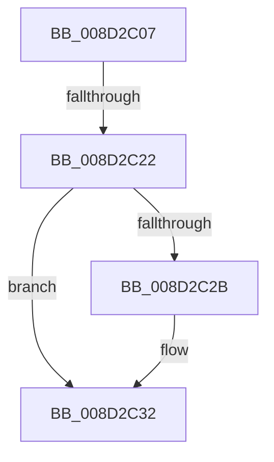

# sub_008D2C07

- RVA: `0x008D2C07`–`0x008D2C41` (길이 `58` bytes)
- VA: `0x00000001408D2C07`
- 실행 섹션: `PAGE`
- PDB 이름 있음: `아니요`; PDB Function 태그: `아니요`
- unwind 정보 RVA: `0x00084DA4`
- 디코드: `16`개 명령, `58/58` bytes 표시
- 미해석 바이트: `0` (있으면 어셈블리에 `.byte`로 보존)

> 이 문서는 커널 이미지의 기계어와 PDB 기호를 분석해 생성했습니다. 4번과 5번은 함수 원형과 자료형을 바이너리 사용 방식에서 추정한 C 해석이며 원본 소스 복구 결과는 아닙니다.

## 1. Dependencies

- 직접 호출 지점: **3**; 고유 호출 대상: **2**
- 직접 호출자로 확인된 함수: **0**
- RIP 상대 이미지 참조: **0**

### Outgoing calls
- `0x008D2C15` → [sub_008D2220](Unknown_function_008D2220.md) (function, `0x008D2220`)
- `0x008D2C2D` → [ExFreePoolWithTag](../../poolcode/B8/ExFreePoolWithTag_function_00B82870.md) (function, `0x00B82870`)
- `0x008D2C37` → [ExFreePoolWithTag](../../poolcode/B8/ExFreePoolWithTag_function_00B82870.md) (function, `0x00B82870`)

### Direct callers
- 이 함수 시작 RVA로 연결되는 직접 call은 확인되지 않았습니다. 간접 호출은 완전히 역산할 수 없습니다.

### Static image references
- 디코드된 RIP-relative 메모리 참조가 없습니다.

## 2. Other-region calls and transfers

- 다른 실행 섹션으로 향하는 call: **2**
  - `0x008D2C2D` → [ExFreePoolWithTag](../../poolcode/B8/ExFreePoolWithTag_function_00B82870.md) (`PAGE` → `POOLCODE`)
  - `0x008D2C37` → [ExFreePoolWithTag](../../poolcode/B8/ExFreePoolWithTag_function_00B82870.md) (`PAGE` → `POOLCODE`)
- call이 아닌 외부 분기/꼬리 이동: **2**
  - `0x008D2C1C` → [sub_008D28EA + 0x13](Unknown_function_008D28EA.md) (`tail-transfer`)
  - `0x008D2C3C` → [sub_008D28EA + 0x13](Unknown_function_008D28EA.md) (`tail-transfer`)

## 3. Assembly (complete function range)

```asm
008D2C07  48 8B 7C 24 30                  mov rdi, qword ptr [rsp + 0x30]
008D2C0C  45 8B C6                        mov r8d, r14d
008D2C0F  48 8B D7                        mov rdx, rdi
008D2C12  49 8B CD                        mov rcx, r13
008D2C15  E8 06 F6 FF FF                  call 0x1408d2220
008D2C1A  85 C0                           test eax, eax
008D2C1C  0F 88 DB FC FF FF               js 0x1408d28fd
008D2C22  48 8B 4F 18                     mov rcx, qword ptr [rdi + 0x18]
008D2C26  48 85 C9                        test rcx, rcx
008D2C29  74 07                           je 0x1408d2c32
008D2C2B  33 D2                           xor edx, edx
008D2C2D  E8 3E FC 2A 00                  call 0x140b82870
008D2C32  33 D2                           xor edx, edx
008D2C34  48 8B CF                        mov rcx, rdi
008D2C37  E8 34 FC 2A 00                  call 0x140b82870
008D2C3C  E9 BC FC FF FF                  jmp 0x1408d28fd
```

## 4. C-style interpretation (structured pseudocode)

```c
__int64 __fastcall sub_008D2C07(__int64 a1, __int64 a2, __int64 a3, __int64 a4, __int64 a5, __int64 a6)
{
    __int64 result;

    result = sub_008D2220(v_r13, a6, (unsigned int)((unsigned int)(v_r14)), a4);
    if (*(unsigned __int64 *)(a6 + 24) != 0) {
        a2 = 0;
        result = ExFreePoolWithTag(*(unsigned __int64 *)(a6 + 24), a2, (unsigned int)((unsigned int)(v_r14)), a4);
    }
    a2 = 0;
    result = ExFreePoolWithTag(a6, a2, (unsigned int)((unsigned int)(v_r14)), a4);
}
```

## 5. (Beta) C Style

```c
int64_t sub_008D2C07(int64_t Arg1, int64_t Arg2, int64_t Arg3, int64_t Arg4, uint64_t Arg5, void *Arg6)
{
    uint8_t *arg6 = (uint8_t *)Arg6;

    int64_t result;

    result = sub_008D2220(local_r13, Arg6, (uint32_t)((uint32_t)(local_r14)), Arg4);
    if (*(uint64_t *)(arg6 + 0x18) != 0) {
        Arg2 = 0;
        result = ExFreePoolWithTag(*(uint64_t *)(arg6 + 0x18), Arg2, (uint32_t)((uint32_t)(local_r14)), Arg4);
    }
    Arg2 = 0;
    result = ExFreePoolWithTag(Arg6, Arg2, (uint32_t)((uint32_t)(local_r14)), Arg4);
}
```

### 관측된 메모리 오프셋

구조체 형식이 확인되지 않은 접근은 인자 기준의 오프셋으로만 기록했습니다.

| 기준 인자 | 오프셋 표현 | 폭 (bit) | 접근 |
|---|---:|---:|---|
| `Arg6` | `+ 0x18` | `64` | `R` |

## 6. Execution-region graph

[열기: 2D/3D 그래프와 함수 탐색 컨트롤 패널](../../../control-panel.html?section=page&rva=0x008D2C07&view=graph)

- 2D 그래프는 위에서 아래로 흐르고, 3D 그래프는 빈 공간을 드래그해 회전합니다. Shift+드래그는 이동, 휠은 확대·축소, 함수 노드 선택은 대상 보고서 이동입니다.

### Static fallback


