# sub_008D2F2C

- RVA: `0x008D2F2C`–`0x008D32CC` (길이 `928` bytes)
- VA: `0x00000001408D2F2C`
- 실행 섹션: `PAGE`
- PDB 이름 있음: `아니요`; PDB Function 태그: `아니요`
- unwind 정보 RVA: `0x00084E1C`
- 디코드: `255`개 명령, `928/928` bytes 표시
- 미해석 바이트: `0` (있으면 어셈블리에 `.byte`로 보존)

> 이 문서는 커널 이미지의 기계어와 PDB 기호를 분석해 생성했습니다. 4번과 5번은 함수 원형과 자료형을 바이너리 사용 방식에서 추정한 C 해석이며 원본 소스 복구 결과는 아닙니다.

## 1. Dependencies

- 직접 호출 지점: **22**; 고유 호출 대상: **17**
- 직접 호출자로 확인된 함수: **1**
- RIP 상대 이미지 참조: **3**

### Outgoing calls
- `0x008D2F5F` → [sub_008D3F58](Unknown_function_008D3F58.md) (function, `0x008D3F58`)
- `0x008D2F85` → [KeAbPreAcquire](../../text/21/KeAbPreAcquire_function_00210230.md) (function, `0x00210230`)
- `0x008D2FA5` → [ExfAcquirePushLockSharedEx](../../text/21/ExfAcquirePushLockSharedEx_function_0021044C.md) (function, `0x0021044C`)
- `0x008D3011` → [sub_008D3F00](Unknown_function_008D3F00.md) (function, `0x008D3F00`)
- `0x008D301B` → [sub_008D3ED0](Unknown_function_008D3ED0.md) (function, `0x008D3ED0`)
- `0x008D307B` → [KeAbPostRelease](../../text/2E/KeAbPostRelease_function_002E1600.md) (function, `0x002E1600`)
- `0x008D3080` → [KeLeaveGuardedRegion](../../text/2E/KeLeaveGuardedRegion_function_002E2C40.md) (function, `0x002E2C40`)
- `0x008D30BB` → [KeAbPreAcquire](../../text/21/KeAbPreAcquire_function_00210230.md) (function, `0x00210230`)
- `0x008D30D4` → [ExfAcquirePushLockExclusiveEx](../../text/20/ExfAcquirePushLockExclusiveEx_function_0020FC90.md) (function, `0x0020FC90`)
- `0x008D312E` → [sub_008D3F30](Unknown_function_008D3F30.md) (function, `0x008D3F30`)
- `0x008D3142` → [WbCreateHeapExecutedBlock](WbCreateHeapExecutedBlock_function_008D4BE8.md) (function, `0x008D4BE8`)
- `0x008D317A` → [KeAbPostRelease](../../text/2E/KeAbPostRelease_function_002E1600.md) (function, `0x002E1600`)
- `0x008D317F` → [KeLeaveGuardedRegion](../../text/2E/KeLeaveGuardedRegion_function_002E2C40.md) (function, `0x002E2C40`)
- `0x008D31EA` → [sub_008D2420](Unknown_function_008D2420.md) (function, `0x008D2420`)
- `0x008D3202` → [PdcCloseEvent](PdcCloseEvent_function_008D2404.md) (function, `0x008D2404`)
- `0x008D322B` → [sub_008D2420](Unknown_function_008D2420.md) (function, `0x008D2420`)
- `0x008D3243` → [PdcCloseEvent](PdcCloseEvent_function_008D2404.md) (function, `0x008D2404`)
- `0x008D325B` → [sub_008D18D4](Unknown_function_008D18D4.md) (function, `0x008D18D4`)
- `0x008D327D` → [sub_008D23A4](Unknown_function_008D23A4.md) (function, `0x008D23A4`)
- `0x008D3292` → [ExfTryToWakePushLock](../../text/26/ExfTryToWakePushLock_function_00265DD0.md) (function, `0x00265DD0`)
- `0x008D329F` → [ExfReleasePushLockShared](../../text/26/ExfReleasePushLockShared_function_00263440.md) (function, `0x00263440`)
- `0x008D32A9` → [guard_dispatch_icall](../../text/6B/guard_dispatch_icall_function_006BAAD0.md) (function, `0x006BAAD0`)

### Direct callers
- [sub_008D27AD](Unknown_function_008D27AD.md) at `0x008D2811`

### Static image references
- `0x008D2FF2` → RVA `0x008D3ED0` (`PAGE`; read)
- `0x008D2FFE` → RVA `0x008D3F00` (`PAGE`; read)
- `0x008D311B` → RVA `0x008D3F30` (`PAGE`; read)

## 2. Other-region calls and transfers

- 다른 실행 섹션으로 향하는 call: **11**
  - `0x008D2F85` → [KeAbPreAcquire](../../text/21/KeAbPreAcquire_function_00210230.md) (`PAGE` → `.text`)
  - `0x008D2FA5` → [ExfAcquirePushLockSharedEx](../../text/21/ExfAcquirePushLockSharedEx_function_0021044C.md) (`PAGE` → `.text`)
  - `0x008D307B` → [KeAbPostRelease](../../text/2E/KeAbPostRelease_function_002E1600.md) (`PAGE` → `.text`)
  - `0x008D3080` → [KeLeaveGuardedRegion](../../text/2E/KeLeaveGuardedRegion_function_002E2C40.md) (`PAGE` → `.text`)
  - `0x008D30BB` → [KeAbPreAcquire](../../text/21/KeAbPreAcquire_function_00210230.md) (`PAGE` → `.text`)
  - `0x008D30D4` → [ExfAcquirePushLockExclusiveEx](../../text/20/ExfAcquirePushLockExclusiveEx_function_0020FC90.md) (`PAGE` → `.text`)
  - `0x008D317A` → [KeAbPostRelease](../../text/2E/KeAbPostRelease_function_002E1600.md) (`PAGE` → `.text`)
  - `0x008D317F` → [KeLeaveGuardedRegion](../../text/2E/KeLeaveGuardedRegion_function_002E2C40.md) (`PAGE` → `.text`)
  - `0x008D3292` → [ExfTryToWakePushLock](../../text/26/ExfTryToWakePushLock_function_00265DD0.md) (`PAGE` → `.text`)
  - `0x008D329F` → [ExfReleasePushLockShared](../../text/26/ExfReleasePushLockShared_function_00263440.md) (`PAGE` → `.text`)
  - `0x008D32A9` → [guard_dispatch_icall](../../text/6B/guard_dispatch_icall_function_006BAAD0.md) (`PAGE` → `.text`)
- 별도 외부 분기/꼬리 이동을 확인하지 못했습니다.

## 3. Assembly (complete function range)

```asm
008D2F2C  48 89 5C 24 10                  mov qword ptr [rsp + 0x10], rbx
008D2F31  4C 89 44 24 18                  mov qword ptr [rsp + 0x18], r8
008D2F36  55                              push rbp
008D2F37  56                              push rsi
008D2F38  57                              push rdi
008D2F39  41 54                           push r12
008D2F3B  41 55                           push r13
008D2F3D  41 56                           push r14
008D2F3F  41 57                           push r15
008D2F41  48 8B EC                        mov rbp, rsp
008D2F44  48 83 EC 30                     sub rsp, 0x30
008D2F48  4C 8B EA                        mov r13, rdx
008D2F4B  45 33 FF                        xor r15d, r15d
008D2F4E  8B 51 0C                        mov edx, dword ptr [rcx + 0xc]
008D2F51  48 8B F1                        mov rsi, rcx
008D2F54  2B 51 38                        sub edx, dword ptr [rcx + 0x38]
008D2F57  4C 89 7D 40                     mov qword ptr [rbp + 0x40], r15
008D2F5B  4C 89 7D 58                     mov qword ptr [rbp + 0x58], r15
008D2F5F  E8 F4 0F 00 00                  call 0x1408d3f58
008D2F64  65 48 8B 04 25 88 01 00 00      mov rax, qword ptr gs:[0x188]
008D2F6D  48 8D 5E 30                     lea rbx, [rsi + 0x30]
008D2F71  48 83 C9 FF                     or rcx, 0xffffffffffffffff
008D2F75  45 33 C0                        xor r8d, r8d
008D2F78  33 D2                           xor edx, edx
008D2F7A  66 01 88 E6 01 00 00            add word ptr [rax + 0x1e6], cx
008D2F81  48 8B CB                        mov rcx, rbx
008D2F84  90                              nop
008D2F85  E8 A6 D2 93 FF                  call 0x140210230
008D2F8A  48 8B F8                        mov rdi, rax
008D2F8D  41 8D 4F 11                     lea ecx, [r15 + 0x11]
008D2F91  33 C0                           xor eax, eax
008D2F93  F0 48 0F B1 0B                  lock cmpxchg qword ptr [rbx], rcx
008D2F98  74 10                           je 0x1408d2faa
008D2F9A  4C 8B CB                        mov r9, rbx
008D2F9D  4C 8B C7                        mov r8, rdi
008D2FA0  33 D2                           xor edx, edx
008D2FA2  48 8B CB                        mov rcx, rbx
008D2FA5  E8 A2 D4 93 FF                  call 0x14021044c
008D2FAA  48 85 FF                        test rdi, rdi
008D2FAD  74 04                           je 0x1408d2fb3
008D2FAF  C6 47 0A 01                     mov byte ptr [rdi + 0xa], 1
008D2FB3  8B 7E 0C                        mov edi, dword ptr [rsi + 0xc]
008D2FB6  45 8B F7                        mov r14d, r15d
008D2FB9  4D 8B A5 10 01 00 00            mov r12, qword ptr [r13 + 0x110]
008D2FC0  FF CF                           dec edi
008D2FC2  41 B8 08 00 00 00               mov r8d, 8
008D2FC8  41 8D 48 FA                     lea ecx, [r8 - 6]
008D2FCC  44 3B F7                        cmp r14d, edi
008D2FCF  0F 8F E8 02 00 00               jg 0x1408d32bd
008D2FD5  42 8D 04 37                     lea eax, [rdi + r14]
008D2FD9  99                              cdq
008D2FDA  F7 F9                           idiv ecx
008D2FDC  48 8B 4E 18                     mov rcx, qword ptr [rsi + 0x18]
008D2FE0  44 8B F8                        mov r15d, eax
008D2FE3  48 8B 46 28                     mov rax, qword ptr [rsi + 0x28]
008D2FE7  41 8B D7                        mov edx, r15d
008D2FEA  0F AF 56 08                     imul edx, dword ptr [rsi + 8]
008D2FEE  48 8B 0C 0A                     mov rcx, qword ptr [rdx + rcx]
008D2FF2  48 8D 15 D7 0E 00 00            lea rdx, [rip + 0xed7]
008D2FF9  48 3B C2                        cmp rax, rdx
008D2FFC  74 1A                           je 0x1408d3018
008D2FFE  48 8D 15 FB 0E 00 00            lea rdx, [rip + 0xefb]
008D3005  48 3B C2                        cmp rax, rdx
008D3008  0F 85 0D 01 00 00               jne 0x1408d311b
008D300E  49 8B D4                        mov rdx, r12
008D3011  E8 EA 0E 00 00                  call 0x1408d3f00
008D3016  EB 08                           jmp 0x1408d3020
008D3018  49 8B D4                        mov rdx, r12
008D301B  E8 B0 0E 00 00                  call 0x1408d3ed0
008D3020  48 8B C8                        mov rcx, rax
008D3023  48 85 C0                        test rax, rax
008D3026  74 19                           je 0x1408d3041
008D3028  41 8D 47 01                     lea eax, [r15 + 1]
008D302C  44 0F 49 F0                     cmovns r14d, eax
008D3030  41 8D 47 FF                     lea eax, [r15 - 1]
008D3034  45 33 FF                        xor r15d, r15d
008D3037  48 85 C9                        test rcx, rcx
008D303A  0F 49 C7                        cmovns eax, edi
008D303D  8B F8                           mov edi, eax
008D303F  EB 81                           jmp 0x1408d2fc2
008D3041  44 0F AF 7E 08                  imul r15d, dword ptr [rsi + 8]
008D3046  48 8B 46 18                     mov rax, qword ptr [rsi + 0x18]
008D304A  49 8B 14 07                     mov rdx, qword ptr [r15 + rax]
008D304E  45 33 FF                        xor r15d, r15d
008D3051  48 85 D2                        test rdx, rdx
008D3054  74 0B                           je 0x1408d3061
008D3056  F0 48 FF 42 50                  lock inc qword ptr [rdx + 0x50]
008D305B  0F 84 52 02 00 00               je 0x1408d32b3
008D3061  41 8B FF                        mov edi, r15d
008D3064  48 89 55 40                     mov qword ptr [rbp + 0x40], rdx
008D3068  B8 11 00 00 00                  mov eax, 0x11
008D306D  F0 4C 0F B1 3B                  lock cmpxchg qword ptr [rbx], r15
008D3072  0F 85 24 02 00 00               jne 0x1408d329c
008D3078  48 8B CB                        mov rcx, rbx
008D307B  E8 80 E5 A0 FF                  call 0x1402e1600
008D3080  E8 BB FB A0 FF                  call 0x1402e2c40
008D3085  81 FF 72 02 00 C0               cmp edi, 0xc0000272
008D308B  0F 84 A7 00 00 00               je 0x1408d3138
008D3091  85 FF                           test edi, edi
008D3093  0F 88 B8 00 00 00               js 0x1408d3151
008D3099  65 48 8B 04 25 88 01 00 00      mov rax, qword ptr gs:[0x188]
008D30A2  48 8D 5E 50                     lea rbx, [rsi + 0x50]
008D30A6  49 83 CC FF                     or r12, 0xffffffffffffffff
008D30AA  45 33 C0                        xor r8d, r8d
008D30AD  33 D2                           xor edx, edx
008D30AF  48 8B CB                        mov rcx, rbx
008D30B2  66 44 01 A0 E6 01 00 00         add word ptr [rax + 0x1e6], r12w
008D30BA  90                              nop
008D30BB  E8 70 D1 93 FF                  call 0x140210230
008D30C0  F0 48 0F BA 2B 00               lock bts qword ptr [rbx], 0
008D30C6  4C 8B F0                        mov r14, rax
008D30C9  73 0E                           jae 0x1408d30d9
008D30CB  4C 8B C3                        mov r8, rbx
008D30CE  48 8B D0                        mov rdx, rax
008D30D1  48 8B CB                        mov rcx, rbx
008D30D4  E8 B7 CB 93 FF                  call 0x14020fc90
008D30D9  4D 85 F6                        test r14, r14
008D30DC  74 05                           je 0x1408d30e3
008D30DE  41 C6 46 0A 01                  mov byte ptr [r14 + 0xa], 1
008D30E3  48 8B 4D 40                     mov rcx, qword ptr [rbp + 0x40]
008D30E7  8B 41 10                        mov eax, dword ptr [rcx + 0x10]
008D30EA  A8 01                           test al, 1
008D30EC  74 77                           je 0x1408d3165
008D30EE  48 8B 01                        mov rax, qword ptr [rcx]
008D30F1  48 39 48 08                     cmp qword ptr [rax + 8], rcx
008D30F5  75 1D                           jne 0x1408d3114
008D30F7  48 8B 51 08                     mov rdx, qword ptr [rcx + 8]
008D30FB  48 39 0A                        cmp qword ptr [rdx], rcx
008D30FE  75 14                           jne 0x1408d3114
008D3100  48 89 02                        mov qword ptr [rdx], rax
008D3103  48 89 50 08                     mov qword ptr [rax + 8], rdx
008D3107  48 8D 46 40                     lea rax, [rsi + 0x40]
008D310B  48 8B 50 08                     mov rdx, qword ptr [rax + 8]
008D310F  48 39 02                        cmp qword ptr [rdx], rax
008D3112  74 43                           je 0x1408d3157
008D3114  B9 03 00 00 00                  mov ecx, 3
008D3119  CD 29                           int 0x29
008D311B  48 8D 15 0E 0E 00 00            lea rdx, [rip + 0xe0e]
008D3122  48 3B C2                        cmp rax, rdx
008D3125  49 8B D4                        mov rdx, r12
008D3128  0F 85 7B 01 00 00               jne 0x1408d32a9
008D312E  E8 FD 0D 00 00                  call 0x1408d3f30
008D3133  E9 E8 FE FF FF                  jmp 0x1408d3020
008D3138  4C 8D 45 40                     lea r8, [rbp + 0x40]
008D313C  49 8B D5                        mov rdx, r13
008D313F  48 8B CE                        mov rcx, rsi
008D3142  E8 A1 1A 00 00                  call 0x1408d4be8
008D3147  8B F8                           mov edi, eax
008D3149  85 C0                           test eax, eax
008D314B  0F 89 FC 00 00 00               jns 0x1408d324d
008D3151  48 8B 5D 40                     mov rbx, qword ptr [rbp + 0x40]
008D3155  EB 4B                           jmp 0x1408d31a2
008D3157  48 89 01                        mov qword ptr [rcx], rax
008D315A  48 89 51 08                     mov qword ptr [rcx + 8], rdx
008D315E  48 89 0A                        mov qword ptr [rdx], rcx
008D3161  48 89 48 08                     mov qword ptr [rax + 8], rcx
008D3165  49 8B C4                        mov rax, r12
008D3168  F0 48 0F C1 03                  lock xadd qword ptr [rbx], rax
008D316D  24 06                           and al, 6
008D316F  3C 02                           cmp al, 2
008D3171  0F 84 18 01 00 00               je 0x1408d328f
008D3177  48 8B CB                        mov rcx, rbx
008D317A  E8 81 E4 A0 FF                  call 0x1402e1600
008D317F  E8 BC FA A0 FF                  call 0x1402e2c40
008D3184  4C 8B 7D 50                     mov r15, qword ptr [rbp + 0x50]
008D3188  4D 85 FF                        test r15, r15
008D318B  0F 84 36 01 00 00               je 0x1408d32c7
008D3191  48 8B 45 40                     mov rax, qword ptr [rbp + 0x40]
008D3195  49 89 07                        mov qword ptr [r15], rax
008D3198  45 33 FF                        xor r15d, r15d
008D319B  41 8B DF                        mov ebx, r15d
008D319E  48 89 5D 40                     mov qword ptr [rbp + 0x40], rbx
008D31A2  48 83 CA FF                     or rdx, 0xffffffffffffffff
008D31A6  48 85 DB                        test rbx, rbx
008D31A9  75 21                           jne 0x1408d31cc
008D31AB  48 8B 4D 58                     mov rcx, qword ptr [rbp + 0x58]
008D31AF  48 85 C9                        test rcx, rcx
008D31B2  75 59                           jne 0x1408d320d
008D31B4  48 8B 5C 24 78                  mov rbx, qword ptr [rsp + 0x78]
008D31B9  8B C7                           mov eax, edi
008D31BB  48 83 C4 30                     add rsp, 0x30
008D31BF  41 5F                           pop r15
008D31C1  41 5E                           pop r14
008D31C3  41 5D                           pop r13
008D31C5  41 5C                           pop r12
008D31C7  5F                              pop rdi
008D31C8  5E                              pop rsi
008D31C9  5D                              pop rbp
008D31CA  C3                              ret
008D31CB  CC                              int3
008D31CC  48 8B C2                        mov rax, rdx
008D31CF  F0 48 0F C1 43 50               lock xadd qword ptr [rbx + 0x50], rax
008D31D5  48 03 C2                        add rax, rdx
008D31D8  75 D1                           jne 0x1408d31ab
008D31DA  48 8B 5D 40                     mov rbx, qword ptr [rbp + 0x40]
008D31DE  48 8B 53 28                     mov rdx, qword ptr [rbx + 0x28]
008D31E2  48 85 D2                        test rdx, rdx
008D31E5  74 18                           je 0x1408d31ff
008D31E7  48 8B CE                        mov rcx, rsi
008D31EA  E8 31 F2 FF FF                  call 0x1408d2420
008D31EF  4C 89 7B 28                     mov qword ptr [rbx + 0x28], r15
008D31F3  4C 89 7B 18                     mov qword ptr [rbx + 0x18], r15
008D31F7  4C 89 7B 20                     mov qword ptr [rbx + 0x20], r15
008D31FB  44 89 7B 48                     mov dword ptr [rbx + 0x48], r15d
008D31FF  48 8B CB                        mov rcx, rbx
008D3202  E8 FD F1 FF FF                  call 0x1408d2404
008D3207  48 83 CA FF                     or rdx, 0xffffffffffffffff
008D320B  EB 9E                           jmp 0x1408d31ab
008D320D  48 8B C2                        mov rax, rdx
008D3210  F0 48 0F C1 41 50               lock xadd qword ptr [rcx + 0x50], rax
008D3216  48 03 C2                        add rax, rdx
008D3219  75 99                           jne 0x1408d31b4
008D321B  48 8B 5D 58                     mov rbx, qword ptr [rbp + 0x58]
008D321F  48 8B 53 28                     mov rdx, qword ptr [rbx + 0x28]
008D3223  48 85 D2                        test rdx, rdx
008D3226  74 18                           je 0x1408d3240
008D3228  48 8B CE                        mov rcx, rsi
008D322B  E8 F0 F1 FF FF                  call 0x1408d2420
008D3230  4C 89 7B 28                     mov qword ptr [rbx + 0x28], r15
008D3234  4C 89 7B 18                     mov qword ptr [rbx + 0x18], r15
008D3238  4C 89 7B 20                     mov qword ptr [rbx + 0x20], r15
008D323C  44 89 7B 48                     mov dword ptr [rbx + 0x48], r15d
008D3240  48 8B CB                        mov rcx, rbx
008D3243  E8 BC F1 FF FF                  call 0x1408d2404
008D3248  E9 67 FF FF FF                  jmp 0x1408d31b4
008D324D  48 8B 5D 40                     mov rbx, qword ptr [rbp + 0x40]
008D3251  4C 8D 45 58                     lea r8, [rbp + 0x58]
008D3255  48 8B D3                        mov rdx, rbx
008D3258  48 8B CE                        mov rcx, rsi
008D325B  E8 74 E6 FF FF                  call 0x1408d18d4
008D3260  8B F8                           mov edi, eax
008D3262  85 C0                           test eax, eax
008D3264  0F 88 38 FF FF FF               js 0x1408d31a2
008D326A  4C 8B 75 58                     mov r14, qword ptr [rbp + 0x58]
008D326E  4D 85 F6                        test r14, r14
008D3271  0F 84 22 FE FF FF               je 0x1408d3099
008D3277  48 8B D3                        mov rdx, rbx
008D327A  48 8B CE                        mov rcx, rsi
008D327D  E8 22 F1 FF FF                  call 0x1408d23a4
008D3282  4C 89 75 40                     mov qword ptr [rbp + 0x40], r14
008D3286  4C 89 7D 58                     mov qword ptr [rbp + 0x58], r15
008D328A  E9 0A FE FF FF                  jmp 0x1408d3099
008D328F  48 8B CB                        mov rcx, rbx
008D3292  E8 39 2B 99 FF                  call 0x140265dd0
008D3297  E9 DB FE FF FF                  jmp 0x1408d3177
008D329C  48 8B CB                        mov rcx, rbx
008D329F  E8 9C 01 99 FF                  call 0x140263440
008D32A4  E9 CF FD FF FF                  jmp 0x1408d3078
008D32A9  E8 22 78 DE FF                  call 0x1406baad0
008D32AE  E9 6D FD FF FF                  jmp 0x1408d3020
008D32B3  BF E5 00 00 C0                  mov edi, 0xc00000e5
008D32B8  E9 AB FD FF FF                  jmp 0x1408d3068
008D32BD  BF 72 02 00 C0                  mov edi, 0xc0000272
008D32C2  E9 A1 FD FF FF                  jmp 0x1408d3068
008D32C7  E9 85 FE FF FF                  jmp 0x1408d3151
```

## 4. C-style interpretation (structured pseudocode)

```c
__int64 __fastcall sub_008D2F2C(__int64 a1, __int64 a2, __int64 a3)
{
    __int64 result;
    __int64 v_r12;
    __int64 v_r14;
    __int64 v_r15;
    __int64 v_rdi;
    __int64 v_rsp;
    unsigned __int64 v_stack_p10;
    unsigned __int64 v_stack_p18;
    unsigned __int64 v_stack_p20;
    unsigned __int64 v_stack_p8;

    v_stack_p10 = v_rbx;
    v_stack_p18 = a3;
    v_rsp = (v_rsp) - (48);
    v_r15 = 0;
    a2 = (unsigned int)(((unsigned int)(*(unsigned int *)(a1 + 12))) - (*(unsigned int *)(a1 + 56)));
    v_stack_p8 = 0;
    v_stack_p20 = 0;
    result = sub_008D3F58(a1, a2, a3, a4);
    a1 = (a1) | (-1);
    a3 = 0;
    a2 = 0;
    result = KeAbPreAcquire(a1 + 48, a2, a3, a4);
    result = 0;
    if (!(condition_is_equal)) {
        a4 = a1 + 48;
        a3 = 0;
        a2 = 0;
        a1 = a1 + 48;
        result = ExfAcquirePushLockSharedEx(a1, a2, a3, a4);
    }
    if (result != 0) {
        *(unsigned __int8 *)(result + 10) = 1;
    }
    v_rdi = (unsigned int)(((unsigned int)(*(unsigned int *)(a1 + 12))) - 1);
loc_008D2FC2:
    if (0 > ((unsigned int)(v_rdi))) goto loc_008D32BD;
    a2 = (unsigned int)(((unsigned int)((unsigned int)((unsigned int)((unsigned int)(v_rdi + 0 * 1))))) * (*(unsigned int *)(a1 + 8)));
    if ((*(unsigned __int64 *)(a1 + 40)) == (v_rip + 3799)) goto loc_008D3018;
    if ((*(unsigned __int64 *)(a1 + 40)) != (v_rip + 3835)) goto loc_008D311B;
    result = sub_008D3F00(*(unsigned __int64 *)(a2 + *(unsigned __int64 *)(a1 + 24) * 1), *(unsigned __int64 *)(a2 + 272), 8, a4);
    goto loc_008D3020;
loc_008D3018:
    result = sub_008D3ED0(*(unsigned __int64 *)(a2 + *(unsigned __int64 *)(a1 + 24) * 1), *(unsigned __int64 *)(a2 + 272), 8, a4);
loc_008D3020:
    if (result == 0) goto loc_008D3041;
    v_r14 = 0;
    if (!sign_flag) { v_r14 = (unsigned int)((unsigned int)((unsigned int)(v_rdi + 0 * 1)) + 1); }
    v_r15 = 0;
    result = (unsigned int)((unsigned int)(v_rdi + 0 * 1)) - 1;
    if (!sign_flag) { result = (unsigned int)(v_rdi); }
    goto loc_008D2FC2;
loc_008D3041:
    v_r15 = (unsigned int)((v_r15) * (*(unsigned int *)(a1 + 8)));
    v_r15 = 0;
    if (*(unsigned __int64 *)(v_r15 + *(unsigned __int64 *)(a1 + 24) * 1) == 0) goto loc_008D3061;
    if (*(unsigned __int64 *)(v_r15 + *(unsigned __int64 *)(a1 + 24) * 1) == 0) goto loc_008D32B3;
loc_008D3061:
    v_stack_p8 = *(unsigned __int64 *)(v_r15 + *(unsigned __int64 *)(a1 + 24) * 1);
loc_008D3068:
    if (*(unsigned __int64 *)(v_r15 + *(unsigned __int64 *)(a1 + 24) * 1) != 0) goto loc_008D329C;
loc_008D3078:
    result = KeAbPostRelease(a1 + 48, *(unsigned __int64 *)(v_r15 + *(unsigned __int64 *)(a1 + 24) * 1), 8, a4);
    result = KeLeaveGuardedRegion(a1 + 48, *(unsigned __int64 *)(v_r15 + *(unsigned __int64 *)(a1 + 24) * 1), 8, a4);
    if (0 == 0xC0000272ULL) goto loc_008D3138;
    if (sign_flag) goto loc_008D3151;
loc_008D3099:
    v_r12 = (*(unsigned __int64 *)(a2 + 272)) | (-1);
    a3 = 0;
    a2 = 0;
    result = KeAbPreAcquire(a1 + 80, a2, a3, a4);
    if (!(condition_is_above_or_equal)) {
        a3 = a1 + 80;
        a2 = result;
        a1 = a1 + 80;
        result = ExfAcquirePushLockExclusiveEx(a1, a2, a3, a4);
    }
    if (result != 0) {
        *(unsigned __int8 *)(result + 10) = 1;
    }
    if ((((unsigned __int8)((unsigned int)(*(unsigned int *)(v_stack_p8 + 16)))) & (1)) == 0) goto loc_008D3165;
    if ((*(unsigned __int64 *)(*(unsigned __int64 *)(v_stack_p8) + 8)) != v_stack_p8) goto loc_008D3114;
    if ((*(unsigned __int64 *)(*(unsigned __int64 *)(v_stack_p8 + 8))) != v_stack_p8) goto loc_008D3114;
    *(unsigned __int64 *)(*(unsigned __int64 *)(v_stack_p8 + 8)) = *(unsigned __int64 *)(v_stack_p8);
    *(unsigned __int64 *)(*(unsigned __int64 *)(v_stack_p8) + 8) = *(unsigned __int64 *)(v_stack_p8 + 8);
    if ((*(unsigned __int64 *)(*(unsigned __int64 *)(a1 + 64 + 8))) == (a1 + 64)) goto loc_008D3157;
loc_008D3114:
loc_008D311B:
    if ((a1 + 64) != (v_rip + 3598)) goto loc_008D32A9;
    result = sub_008D3F30(3, v_r12, a3, a4);
    goto loc_008D3020;
loc_008D3138:
    result = WbCreateHeapExecutedBlock(a1, a2, v_stack_p8, a4);
    if (!sign_flag) goto loc_008D324D;
loc_008D3151:
    goto loc_008D31A2;
loc_008D3157:
    *(unsigned __int64 *)(a1) = result;
    *(unsigned __int64 *)(a1 + 8) = a2;
    *(unsigned __int64 *)(a2) = a1;
    *(unsigned __int64 *)(result + 8) = a1;
loc_008D3165:
    result = (unsigned __int8)((v_r12) & (6));
    if (((unsigned __int8)(result)) == 2) goto loc_008D328F;
loc_008D3177:
    result = KeAbPostRelease(v_stack_p8, a2, v_stack_p8, a4);
    result = KeLeaveGuardedRegion(v_stack_p8, a2, v_stack_p8, a4);
    if (v_stack_p18 == 0) goto loc_008D32C7;
    *(unsigned __int64 *)(v_stack_p18) = v_stack_p8;
    v_r15 = 0;
    v_stack_p8 = 0;
loc_008D31A2:
    a2 = (a2) | (-1);
    if (0 != 0) goto loc_008D31CC;
loc_008D31AB:
    if (v_stack_p20 != 0) goto loc_008D320D;
loc_008D31B4:
    v_rsp = (v_rsp) + (48);
    return (unsigned int)((unsigned int)((unsigned int)((unsigned int)(result))));
loc_008D31CC:
    result = (a2) + (a2);
    if (condition_is_not_equal) goto loc_008D31AB;
    if (*(unsigned __int64 *)(v_stack_p8 + 40) != 0) {
        a1 = a1;
        result = sub_008D2420(a1, *(unsigned __int64 *)(v_stack_p8 + 40), v_stack_p8, a4);
        *(unsigned __int64 *)(v_stack_p8 + 40) = 0;
        *(unsigned __int64 *)(v_stack_p8 + 24) = 0;
        *(unsigned __int64 *)(v_stack_p8 + 32) = 0;
        *(unsigned int *)(v_stack_p8 + 72) = 0;
    }
    result = PdcCloseEvent(v_stack_p8, *(unsigned __int64 *)(v_stack_p8 + 40), v_stack_p8, a4);
    a2 = (*(unsigned __int64 *)(v_stack_p8 + 40)) | (-1);
    goto loc_008D31AB;
loc_008D320D:
    result = (a2) + (a2);
    if (condition_is_not_equal) goto loc_008D31B4;
    if (*(unsigned __int64 *)(v_stack_p20 + 40) != 0) {
        a1 = a1;
        result = sub_008D2420(a1, *(unsigned __int64 *)(v_stack_p20 + 40), v_stack_p8, a4);
        *(unsigned __int64 *)(v_stack_p20 + 40) = 0;
        *(unsigned __int64 *)(v_stack_p20 + 24) = 0;
        *(unsigned __int64 *)(v_stack_p20 + 32) = 0;
        *(unsigned int *)(v_stack_p20 + 72) = 0;
    }
    result = PdcCloseEvent(v_stack_p20, *(unsigned __int64 *)(v_stack_p20 + 40), v_stack_p8, a4);
    goto loc_008D31B4;
loc_008D324D:
    result = sub_008D18D4(a1, v_stack_p8, v_stack_p20, a4);
    if (sign_flag) goto loc_008D31A2;
    if (v_stack_p20 == 0) goto loc_008D3099;
    result = sub_008D23A4(a1, v_stack_p8, v_stack_p20, a4);
    v_stack_p8 = v_stack_p20;
    v_stack_p20 = 0;
    goto loc_008D3099;
loc_008D328F:
    result = ExfTryToWakePushLock(v_stack_p8, v_stack_p8, v_stack_p20, a4);
    goto loc_008D3177;
loc_008D329C:
    result = ExfReleasePushLockShared(v_stack_p8, v_stack_p8, v_stack_p20, a4);
    goto loc_008D3078;
loc_008D32A9:
    result = guard_dispatch_icall(v_stack_p8, v_stack_p8, v_stack_p20, a4);
    goto loc_008D3020;
loc_008D32B3:
    goto loc_008D3068;
loc_008D32BD:
    goto loc_008D3068;
loc_008D32C7:
    goto loc_008D3151;
}
```

## 5. (Beta) C Style

```c
int64_t sub_008D2F2C(void *Arg1, void *Arg2, int64_t Arg3)
{
    uint8_t *arg1 = (uint8_t *)Arg1;
    uint8_t *arg2 = (uint8_t *)Arg2;

    int64_t result;
    int64_t local_r12;
    int64_t local_r14;
    int64_t local_r15;
    int64_t local_rdi;
    int64_t local_rsp;
    uint64_t v_stack_p10;
    uint64_t v_stack_p18;
    uint64_t v_stack_p20;
    uint64_t v_stack_p8;

    v_stack_p10 = local_rbx;
    v_stack_p18 = Arg3;
    local_rsp = (local_rsp) - (48);
    local_r15 = 0;
    Arg2 = (uint32_t)(((uint32_t)(*(uint32_t *)(arg1 + 0xC))) - (*(uint32_t *)(arg1 + 0x38)));
    v_stack_p8 = 0;
    v_stack_p20 = 0;
    result = sub_008D3F58(Arg1, Arg2, Arg3, a4);
    Arg1 = (Arg1) | (-1);
    Arg3 = 0;
    Arg2 = 0;
    result = KeAbPreAcquire(Arg1 + 48, Arg2, Arg3, a4);
    result = 0;
    if (!(condition_is_equal)) {
        a4 = Arg1 + 48;
        Arg3 = 0;
        Arg2 = 0;
        Arg1 = Arg1 + 48;
        result = ExfAcquirePushLockSharedEx(Arg1, Arg2, Arg3, a4);
    }
    if (result != 0) {
        *(uint8_t *)(result + 0xA) = 1;
    }
    local_rdi = (uint32_t)(((uint32_t)(*(uint32_t *)(arg1 + 0xC))) - 1);
loc_008D2FC2:
    if (0 > ((uint32_t)(local_rdi))) goto loc_008D32BD;
    Arg2 = (uint32_t)(((uint32_t)((uint32_t)((uint32_t)((uint32_t)(local_rdi + 0 * 1))))) * (*(uint32_t *)(arg1 + 0x8)));
    if ((*(uint64_t *)(arg1 + 0x28)) == (v_rip + 3799)) goto loc_008D3018;
    if ((*(uint64_t *)(arg1 + 0x28)) != (v_rip + 3835)) goto loc_008D311B;
    result = sub_008D3F00(*(uint64_t *)(arg2 + *(uint64_t *)(arg1 + 0x18) * 1), *(uint64_t *)(arg2 + 0x110), 8, a4);
    goto loc_008D3020;
loc_008D3018:
    result = sub_008D3ED0(*(uint64_t *)(arg2 + *(uint64_t *)(arg1 + 0x18) * 1), *(uint64_t *)(arg2 + 0x110), 8, a4);
loc_008D3020:
    if (result == 0) goto loc_008D3041;
    local_r14 = 0;
    if (!sign_flag) { local_r14 = (uint32_t)((uint32_t)((uint32_t)(local_rdi + 0 * 1)) + 1); }
    local_r15 = 0;
    result = (uint32_t)((uint32_t)(local_rdi + 0 * 1)) - 1;
    if (!sign_flag) { result = (uint32_t)(local_rdi); }
    goto loc_008D2FC2;
loc_008D3041:
    local_r15 = (uint32_t)((local_r15) * (*(uint32_t *)(arg1 + 0x8)));
    local_r15 = 0;
    if (*(uint64_t *)(local_r15 + *(uint64_t *)(arg1 + 0x18) * 1) == 0) goto loc_008D3061;
    if (*(uint64_t *)(local_r15 + *(uint64_t *)(arg1 + 0x18) * 1) == 0) goto loc_008D32B3;
loc_008D3061:
    v_stack_p8 = *(uint64_t *)(local_r15 + *(uint64_t *)(arg1 + 0x18) * 1);
loc_008D3068:
    if (*(uint64_t *)(local_r15 + *(uint64_t *)(arg1 + 0x18) * 1) != 0) goto loc_008D329C;
loc_008D3078:
    result = KeAbPostRelease(Arg1 + 48, *(uint64_t *)(local_r15 + *(uint64_t *)(arg1 + 0x18) * 1), 8, a4);
    result = KeLeaveGuardedRegion(Arg1 + 48, *(uint64_t *)(local_r15 + *(uint64_t *)(arg1 + 0x18) * 1), 8, a4);
    if (0 == 0xC0000272ULL) goto loc_008D3138;
    if (sign_flag) goto loc_008D3151;
loc_008D3099:
    local_r12 = (*(uint64_t *)(arg2 + 0x110)) | (-1);
    Arg3 = 0;
    Arg2 = 0;
    result = KeAbPreAcquire(Arg1 + 80, Arg2, Arg3, a4);
    if (!(condition_is_above_or_equal)) {
        Arg3 = Arg1 + 80;
        Arg2 = result;
        Arg1 = Arg1 + 80;
        result = ExfAcquirePushLockExclusiveEx(Arg1, Arg2, Arg3, a4);
    }
    if (result != 0) {
        *(uint8_t *)(result + 0xA) = 1;
    }
    if ((((uint8_t)((uint32_t)(*(uint32_t *)(v_stack_p8 + 0x10)))) & (1)) == 0) goto loc_008D3165;
    if ((*(uint64_t *)(*(uint64_t *)(v_stack_p8) + 0x8)) != v_stack_p8) goto loc_008D3114;
    if ((*(uint64_t *)(*(uint64_t *)(v_stack_p8 + 0x8))) != v_stack_p8) goto loc_008D3114;
    *(uint64_t *)(*(uint64_t *)(v_stack_p8 + 0x8)) = *(uint64_t *)(v_stack_p8);
    *(uint64_t *)(*(uint64_t *)(v_stack_p8) + 0x8) = *(uint64_t *)(v_stack_p8 + 0x8);
    if ((*(uint64_t *)(*(uint64_t *)(arg1 + 0x40 + 0x8))) == (Arg1 + 64)) goto loc_008D3157;
loc_008D3114:
loc_008D311B:
    if ((Arg1 + 64) != (v_rip + 3598)) goto loc_008D32A9;
    result = sub_008D3F30(3, local_r12, Arg3, a4);
    goto loc_008D3020;
loc_008D3138:
    result = WbCreateHeapExecutedBlock(Arg1, Arg2, v_stack_p8, a4);
    if (!sign_flag) goto loc_008D324D;
loc_008D3151:
    goto loc_008D31A2;
loc_008D3157:
    *(uint64_t *)(arg1) = result;
    *(void **)(arg1 + 0x8) = Arg2;
    *(void **)(arg2) = Arg1;
    *(void **)(result + 0x8) = Arg1;
loc_008D3165:
    result = (uint8_t)((local_r12) & (6));
    if (((uint8_t)(result)) == 2) goto loc_008D328F;
loc_008D3177:
    result = KeAbPostRelease(v_stack_p8, Arg2, v_stack_p8, a4);
    result = KeLeaveGuardedRegion(v_stack_p8, Arg2, v_stack_p8, a4);
    if (v_stack_p18 == 0) goto loc_008D32C7;
    *(uint64_t *)(v_stack_p18) = v_stack_p8;
    local_r15 = 0;
    v_stack_p8 = 0;
loc_008D31A2:
    Arg2 = (Arg2) | (-1);
    if (0 != 0) goto loc_008D31CC;
loc_008D31AB:
    if (v_stack_p20 != 0) goto loc_008D320D;
loc_008D31B4:
    local_rsp = (local_rsp) + (48);
    return (uint32_t)((uint32_t)((uint32_t)((uint32_t)(result))));
loc_008D31CC:
    result = (Arg2) + (Arg2);
    if (condition_is_not_equal) goto loc_008D31AB;
    if (*(uint64_t *)(v_stack_p8 + 0x28) != 0) {
        Arg1 = Arg1;
        result = sub_008D2420(Arg1, *(uint64_t *)(v_stack_p8 + 0x28), v_stack_p8, a4);
        *(uint64_t *)(v_stack_p8 + 0x28) = 0;
        *(uint64_t *)(v_stack_p8 + 0x18) = 0;
        *(uint64_t *)(v_stack_p8 + 0x20) = 0;
        *(uint32_t *)(v_stack_p8 + 0x48) = 0;
    }
    result = PdcCloseEvent(v_stack_p8, *(uint64_t *)(v_stack_p8 + 0x28), v_stack_p8, a4);
    Arg2 = (*(uint64_t *)(v_stack_p8 + 0x28)) | (-1);
    goto loc_008D31AB;
loc_008D320D:
    result = (Arg2) + (Arg2);
    if (condition_is_not_equal) goto loc_008D31B4;
    if (*(uint64_t *)(v_stack_p20 + 0x28) != 0) {
        Arg1 = Arg1;
        result = sub_008D2420(Arg1, *(uint64_t *)(v_stack_p20 + 0x28), v_stack_p8, a4);
        *(uint64_t *)(v_stack_p20 + 0x28) = 0;
        *(uint64_t *)(v_stack_p20 + 0x18) = 0;
        *(uint64_t *)(v_stack_p20 + 0x20) = 0;
        *(uint32_t *)(v_stack_p20 + 0x48) = 0;
    }
    result = PdcCloseEvent(v_stack_p20, *(uint64_t *)(v_stack_p20 + 0x28), v_stack_p8, a4);
    goto loc_008D31B4;
loc_008D324D:
    result = sub_008D18D4(Arg1, v_stack_p8, v_stack_p20, a4);
    if (sign_flag) goto loc_008D31A2;
    if (v_stack_p20 == 0) goto loc_008D3099;
    result = sub_008D23A4(Arg1, v_stack_p8, v_stack_p20, a4);
    v_stack_p8 = v_stack_p20;
    v_stack_p20 = 0;
    goto loc_008D3099;
loc_008D328F:
    result = ExfTryToWakePushLock(v_stack_p8, v_stack_p8, v_stack_p20, a4);
    goto loc_008D3177;
loc_008D329C:
    result = ExfReleasePushLockShared(v_stack_p8, v_stack_p8, v_stack_p20, a4);
    goto loc_008D3078;
loc_008D32A9:
    result = guard_dispatch_icall(v_stack_p8, v_stack_p8, v_stack_p20, a4);
    goto loc_008D3020;
loc_008D32B3:
    goto loc_008D3068;
loc_008D32BD:
    goto loc_008D3068;
loc_008D32C7:
    goto loc_008D3151;
}
```

### 관측된 메모리 오프셋

구조체 형식이 확인되지 않은 접근은 인자 기준의 오프셋으로만 기록했습니다.

| 기준 인자 | 오프셋 표현 | 폭 (bit) | 접근 |
|---|---:|---:|---|
| `Arg1` | `+ 0x0` | `64` | `R` |
| `Arg1` | `+ 0x0` | `64` | `R/W` |
| `Arg1` | `+ 0x8` | `32` | `R` |
| `Arg1` | `+ 0x8` | `64` | `R` |
| `Arg1` | `+ 0x8` | `64` | `W` |
| `Arg1` | `+ 0xC` | `32` | `R` |
| `Arg1` | `+ 0x18` | `64` | `R` |
| `Arg1` | `+ 0x28` | `64` | `R` |
| `Arg1` | `+ 0x30` | `64` | `R` |
| `Arg1` | `+ 0x38` | `32` | `R` |
| `Arg1` | `+ 0x40` | `64` | `R` |
| `Arg1` | `+ 0x50` | `64` | `R` |
| `Arg2` | `+ 0x110` | `64` | `R` |

## 6. Execution-region graph

[열기: 2D/3D 그래프와 함수 탐색 컨트롤 패널](../../../control-panel.html?section=page&rva=0x008D2F2C&view=graph)

- 2D 그래프는 위에서 아래로 흐르고, 3D 그래프는 빈 공간을 드래그해 회전합니다. Shift+드래그는 이동, 휠은 확대·축소, 함수 노드 선택은 대상 보고서 이동입니다.

### Static fallback

```mermaid
flowchart TD
  bb_008D2F2C[BB_008D2F2C]
  bb_008D2F9A[BB_008D2F9A]
  bb_008D2FAA[BB_008D2FAA]
  bb_008D2FAF[BB_008D2FAF]
  bb_008D2FB3[BB_008D2FB3]
  bb_008D2FC2[BB_008D2FC2]
  bb_008D2FD5[BB_008D2FD5]
  bb_008D2FFE[BB_008D2FFE]
  bb_008D300E[BB_008D300E]
  bb_008D3018[BB_008D3018]
  bb_008D3020[BB_008D3020]
  bb_008D3028[BB_008D3028]
  bb_008D3041[BB_008D3041]
  bb_008D3056[BB_008D3056]
  bb_008D3061[BB_008D3061]
  bb_008D3068[BB_008D3068]
  bb_008D3078[BB_008D3078]
  bb_008D3091[BB_008D3091]
  bb_008D3099[BB_008D3099]
  bb_008D30CB[BB_008D30CB]
  bb_008D30D9[BB_008D30D9]
  bb_008D30DE[BB_008D30DE]
  bb_008D30E3[BB_008D30E3]
  bb_008D30EE[BB_008D30EE]
  bb_008D30F7[BB_008D30F7]
  bb_008D3100[BB_008D3100]
  bb_008D3114[BB_008D3114]
  bb_008D311B[BB_008D311B]
  bb_008D312E[BB_008D312E]
  bb_008D3138[BB_008D3138]
  bb_008D3151[BB_008D3151]
  bb_008D3157[BB_008D3157]
  bb_008D3165[BB_008D3165]
  bb_008D3177[BB_008D3177]
  bb_008D3191[BB_008D3191]
  bb_008D31A2[BB_008D31A2]
  bb_008D31AB[BB_008D31AB]
  bb_008D31B4[BB_008D31B4]
  bb_008D31CB[BB_008D31CB]
  bb_008D31CC[BB_008D31CC]
  bb_008D31DA[BB_008D31DA]
  bb_008D31E7[BB_008D31E7]
  bb_008D31FF[BB_008D31FF]
  bb_008D320D[BB_008D320D]
  bb_008D321B[BB_008D321B]
  bb_008D3228[BB_008D3228]
  bb_008D3240[BB_008D3240]
  bb_008D324D[BB_008D324D]
  bb_008D326A[BB_008D326A]
  bb_008D3277[BB_008D3277]
  bb_008D328F[BB_008D328F]
  bb_008D329C[BB_008D329C]
  bb_008D32A9[BB_008D32A9]
  bb_008D32B3[BB_008D32B3]
  bb_008D32BD[BB_008D32BD]
  bb_008D32C7[BB_008D32C7]
  bb_008D2F2C -->|branch| bb_008D2FAA
  bb_008D2F2C -->|fallthrough| bb_008D2F9A
  bb_008D2F9A -->|flow| bb_008D2FAA
  bb_008D2FAA -->|branch| bb_008D2FB3
  bb_008D2FAA -->|fallthrough| bb_008D2FAF
  bb_008D2FAF -->|flow| bb_008D2FB3
  bb_008D2FB3 -->|flow| bb_008D2FC2
  bb_008D2FC2 -->|branch| bb_008D32BD
  bb_008D2FC2 -->|fallthrough| bb_008D2FD5
  bb_008D2FD5 -->|branch| bb_008D3018
  bb_008D2FD5 -->|fallthrough| bb_008D2FFE
  bb_008D2FFE -->|branch| bb_008D311B
  bb_008D2FFE -->|fallthrough| bb_008D300E
  bb_008D300E -->|branch| bb_008D3020
  bb_008D3018 -->|flow| bb_008D3020
  bb_008D3020 -->|branch| bb_008D3041
  bb_008D3020 -->|fallthrough| bb_008D3028
  bb_008D3028 -->|branch| bb_008D2FC2
  bb_008D3041 -->|branch| bb_008D3061
  bb_008D3041 -->|fallthrough| bb_008D3056
  bb_008D3056 -->|branch| bb_008D32B3
  bb_008D3056 -->|fallthrough| bb_008D3061
  bb_008D3061 -->|flow| bb_008D3068
  bb_008D3068 -->|branch| bb_008D329C
  bb_008D3068 -->|fallthrough| bb_008D3078
  bb_008D3078 -->|branch| bb_008D3138
  bb_008D3078 -->|fallthrough| bb_008D3091
  bb_008D3091 -->|branch| bb_008D3151
  bb_008D3091 -->|fallthrough| bb_008D3099
  bb_008D3099 -->|branch| bb_008D30D9
  bb_008D3099 -->|fallthrough| bb_008D30CB
  bb_008D30CB -->|flow| bb_008D30D9
  bb_008D30D9 -->|branch| bb_008D30E3
  bb_008D30D9 -->|fallthrough| bb_008D30DE
  bb_008D30DE -->|flow| bb_008D30E3
  bb_008D30E3 -->|branch| bb_008D3165
  bb_008D30E3 -->|fallthrough| bb_008D30EE
  bb_008D30EE -->|branch| bb_008D3114
  bb_008D30EE -->|fallthrough| bb_008D30F7
  bb_008D30F7 -->|branch| bb_008D3114
  bb_008D30F7 -->|fallthrough| bb_008D3100
  bb_008D3100 -->|branch| bb_008D3157
  bb_008D3100 -->|fallthrough| bb_008D3114
  bb_008D3114 -->|flow| bb_008D311B
  bb_008D311B -->|branch| bb_008D32A9
  bb_008D311B -->|fallthrough| bb_008D312E
  bb_008D312E -->|branch| bb_008D3020
  bb_008D3138 -->|branch| bb_008D324D
  bb_008D3138 -->|fallthrough| bb_008D3151
  bb_008D3151 -->|branch| bb_008D31A2
  bb_008D3157 -->|flow| bb_008D3165
  bb_008D3165 -->|branch| bb_008D328F
  bb_008D3165 -->|fallthrough| bb_008D3177
  bb_008D3177 -->|branch| bb_008D32C7
  bb_008D3177 -->|fallthrough| bb_008D3191
  bb_008D3191 -->|flow| bb_008D31A2
  bb_008D31A2 -->|branch| bb_008D31CC
  bb_008D31A2 -->|fallthrough| bb_008D31AB
  bb_008D31AB -->|branch| bb_008D320D
  bb_008D31AB -->|fallthrough| bb_008D31B4
  bb_008D31CB -->|flow| bb_008D31CC
  bb_008D31CC -->|branch| bb_008D31AB
  bb_008D31CC -->|fallthrough| bb_008D31DA
  bb_008D31DA -->|branch| bb_008D31FF
  bb_008D31DA -->|fallthrough| bb_008D31E7
  bb_008D31E7 -->|flow| bb_008D31FF
  bb_008D31FF -->|branch| bb_008D31AB
  bb_008D320D -->|branch| bb_008D31B4
  bb_008D320D -->|fallthrough| bb_008D321B
  bb_008D321B -->|branch| bb_008D3240
  bb_008D321B -->|fallthrough| bb_008D3228
  bb_008D3228 -->|flow| bb_008D3240
  bb_008D3240 -->|branch| bb_008D31B4
  bb_008D324D -->|branch| bb_008D31A2
  bb_008D324D -->|fallthrough| bb_008D326A
  bb_008D326A -->|branch| bb_008D3099
  bb_008D326A -->|fallthrough| bb_008D3277
  bb_008D3277 -->|branch| bb_008D3099
  bb_008D328F -->|branch| bb_008D3177
  bb_008D329C -->|branch| bb_008D3078
  bb_008D32A9 -->|branch| bb_008D3020
  bb_008D32B3 -->|branch| bb_008D3068
  bb_008D32BD -->|branch| bb_008D3068
  bb_008D32C7 -->|branch| bb_008D3151
```


