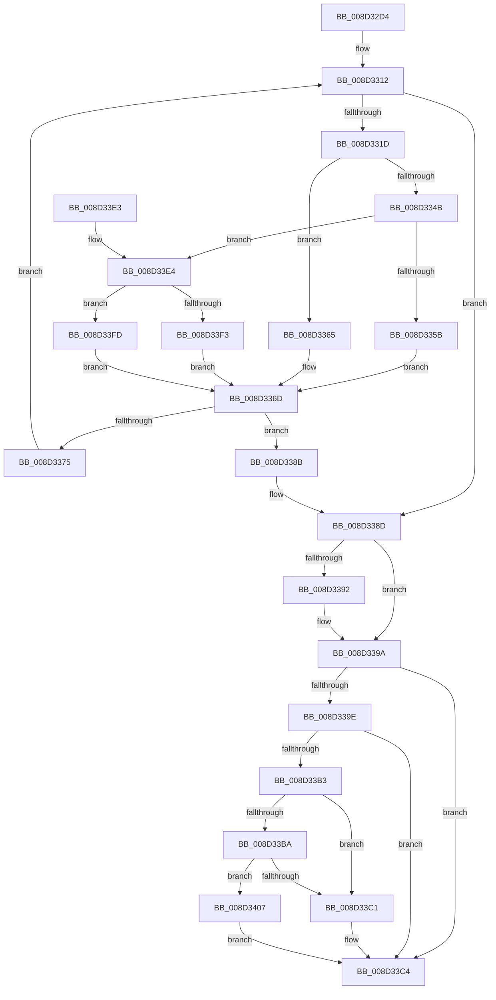

# sub_008D32D4

- RVA: `0x008D32D4`–`0x008D340E` (길이 `314` bytes)
- VA: `0x00000001408D32D4`
- 실행 섹션: `PAGE`
- PDB 이름 있음: `아니요`; PDB Function 태그: `아니요`
- unwind 정보 RVA: `0x00084E38`
- 디코드: `96`개 명령, `314/314` bytes 표시
- 미해석 바이트: `0` (있으면 어셈블리에 `.byte`로 보존)

> 이 문서는 커널 이미지의 기계어와 PDB 기호를 분석해 생성했습니다. 4번과 5번은 함수 원형과 자료형을 바이너리 사용 방식에서 추정한 C 해석이며 원본 소스 복구 결과는 아닙니다.

## 1. Dependencies

- 직접 호출 지점: **4**; 고유 호출 대상: **4**
- 직접 호출자로 확인된 함수: **1**
- RIP 상대 이미지 참조: **3**

### Outgoing calls
- `0x008D335E` → [sub_008D3F00](Unknown_function_008D3F00.md) (function, `0x008D3F00`)
- `0x008D3368` → [sub_008D3ED0](Unknown_function_008D3ED0.md) (function, `0x008D3ED0`)
- `0x008D33F3` → [sub_008D3F30](Unknown_function_008D3F30.md) (function, `0x008D3F30`)
- `0x008D33FD` → [guard_dispatch_icall](../../text/6B/guard_dispatch_icall_function_006BAAD0.md) (function, `0x006BAAD0`)

### Direct callers
- [sub_008D18D4](Unknown_function_008D18D4.md) at `0x008D1951`

### Static image references
- `0x008D333F` → RVA `0x008D3ED0` (`PAGE`; read)
- `0x008D334B` → RVA `0x008D3F00` (`PAGE`; read)
- `0x008D33E4` → RVA `0x008D3F30` (`PAGE`; read)

## 2. Other-region calls and transfers

- 다른 실행 섹션으로 향하는 call: **1**
  - `0x008D33FD` → [guard_dispatch_icall](../../text/6B/guard_dispatch_icall_function_006BAAD0.md) (`PAGE` → `.text`)
- 별도 외부 분기/꼬리 이동을 확인하지 못했습니다.

## 3. Assembly (complete function range)

```asm
008D32D4  48 8B C4                        mov rax, rsp
008D32D7  48 89 58 08                     mov qword ptr [rax + 8], rbx
008D32DB  48 89 68 10                     mov qword ptr [rax + 0x10], rbp
008D32DF  48 89 70 20                     mov qword ptr [rax + 0x20], rsi
008D32E3  4C 89 40 18                     mov qword ptr [rax + 0x18], r8
008D32E7  57                              push rdi
008D32E8  41 54                           push r12
008D32EA  41 55                           push r13
008D32EC  41 56                           push r14
008D32EE  41 57                           push r15
008D32F0  48 83 EC 20                     sub rsp, 0x20
008D32F4  44 8B 71 0C                     mov r14d, dword ptr [rcx + 0xc]
008D32F8  48 8D 71 18                     lea rsi, [rcx + 0x18]
008D32FC  41 FF CE                        dec r14d
008D32FF  45 33 E4                        xor r12d, r12d
008D3302  33 FF                           xor edi, edi
008D3304  4D 8B E9                        mov r13, r9
008D3307  4C 8B FA                        mov r15, rdx
008D330A  48 8B E9                        mov rbp, rcx
008D330D  BB 72 02 00 C0                  mov ebx, 0xc0000272
008D3312  41 B8 08 00 00 00               mov r8d, 8
008D3318  45 3B E6                        cmp r12d, r14d
008D331B  7F 70                           jg 0x1408d338d
008D331D  43 8D 04 26                     lea eax, [r14 + r12]
008D3321  99                              cdq
008D3322  41 8D 48 FA                     lea ecx, [r8 - 6]
008D3326  F7 F9                           idiv ecx
008D3328  48 8D 75 18                     lea rsi, [rbp + 0x18]
008D332C  48 8B 0E                        mov rcx, qword ptr [rsi]
008D332F  8B F8                           mov edi, eax
008D3331  48 8B 45 28                     mov rax, qword ptr [rbp + 0x28]
008D3335  8B D7                           mov edx, edi
008D3337  0F AF 55 08                     imul edx, dword ptr [rbp + 8]
008D333B  48 8B 0C 0A                     mov rcx, qword ptr [rdx + rcx]
008D333F  48 8D 15 8A 0B 00 00            lea rdx, [rip + 0xb8a]
008D3346  48 3B C2                        cmp rax, rdx
008D3349  74 1A                           je 0x1408d3365
008D334B  48 8D 15 AE 0B 00 00            lea rdx, [rip + 0xbae]
008D3352  48 3B C2                        cmp rax, rdx
008D3355  0F 85 89 00 00 00               jne 0x1408d33e4
008D335B  49 8B D7                        mov rdx, r15
008D335E  E8 9D 0B 00 00                  call 0x1408d3f00
008D3363  EB 08                           jmp 0x1408d336d
008D3365  49 8B D7                        mov rdx, r15
008D3368  E8 63 0B 00 00                  call 0x1408d3ed0
008D336D  48 8B D0                        mov rdx, rax
008D3370  48 85 C0                        test rax, rax
008D3373  74 16                           je 0x1408d338b
008D3375  8D 47 FF                        lea eax, [rdi - 1]
008D3378  8D 4F 01                        lea ecx, [rdi + 1]
008D337B  41 0F 49 C6                     cmovns eax, r14d
008D337F  44 8B F0                        mov r14d, eax
008D3382  44 0F 49 E1                     cmovns r12d, ecx
008D3386  0F 49 F9                        cmovns edi, ecx
008D3389  EB 87                           jmp 0x1408d3312
008D338B  33 DB                           xor ebx, ebx
008D338D  4D 85 ED                        test r13, r13
008D3390  74 08                           je 0x1408d339a
008D3392  41 89 7D 00                     mov dword ptr [r13], edi
008D3396  48 8D 75 18                     lea rsi, [rbp + 0x18]
008D339A  85 DB                           test ebx, ebx
008D339C  78 26                           js 0x1408d33c4
008D339E  0F AF 7D 08                     imul edi, dword ptr [rbp + 8]
008D33A2  48 8B 06                        mov rax, qword ptr [rsi]
008D33A5  4C 8B 44 24 60                  mov r8, qword ptr [rsp + 0x60]
008D33AA  48 8B 14 07                     mov rdx, qword ptr [rdi + rax]
008D33AE  4D 85 C0                        test r8, r8
008D33B1  74 11                           je 0x1408d33c4
008D33B3  33 DB                           xor ebx, ebx
008D33B5  48 85 D2                        test rdx, rdx
008D33B8  74 07                           je 0x1408d33c1
008D33BA  F0 48 FF 42 50                  lock inc qword ptr [rdx + 0x50]
008D33BF  74 46                           je 0x1408d3407
008D33C1  49 89 10                        mov qword ptr [r8], rdx
008D33C4  48 8B 6C 24 58                  mov rbp, qword ptr [rsp + 0x58]
008D33C9  8B C3                           mov eax, ebx
008D33CB  48 8B 5C 24 50                  mov rbx, qword ptr [rsp + 0x50]
008D33D0  48 8B 74 24 68                  mov rsi, qword ptr [rsp + 0x68]
008D33D5  48 83 C4 20                     add rsp, 0x20
008D33D9  41 5F                           pop r15
008D33DB  41 5E                           pop r14
008D33DD  41 5D                           pop r13
008D33DF  41 5C                           pop r12
008D33E1  5F                              pop rdi
008D33E2  C3                              ret
008D33E3  CC                              int3
008D33E4  48 8D 15 45 0B 00 00            lea rdx, [rip + 0xb45]
008D33EB  48 3B C2                        cmp rax, rdx
008D33EE  49 8B D7                        mov rdx, r15
008D33F1  75 0A                           jne 0x1408d33fd
008D33F3  E8 38 0B 00 00                  call 0x1408d3f30
008D33F8  E9 70 FF FF FF                  jmp 0x1408d336d
008D33FD  E8 CE 76 DE FF                  call 0x1406baad0
008D3402  E9 66 FF FF FF                  jmp 0x1408d336d
008D3407  BB E5 00 00 C0                  mov ebx, 0xc00000e5
008D340C  EB B6                           jmp 0x1408d33c4
```

## 4. C-style interpretation (structured pseudocode)

```c
__int64 __fastcall sub_008D32D4(__int64 a1, __int64 a2, __int64 a3, __int64 a4)
{
    __int64 result;
    __int64 v_r12;
    __int64 v_r14;
    __int64 v_rbx;
    __int64 v_rdi;
    __int64 v_rsi;
    __int64 v_rsp;
    unsigned __int64 v_stack_p10;
    unsigned __int64 v_stack_p18;
    unsigned __int64 v_stack_p20;
    unsigned __int64 v_stack_p8;

    *(unsigned __int64 *)(v_rsp + 8) = v_rbx;
    *(unsigned __int64 *)(v_rsp + 16) = v_rbp;
    *(unsigned __int64 *)(v_rsp + 32) = v_rsi;
    *(unsigned __int64 *)(v_rsp + 24) = a3;
    v_rsp = (v_rsp) - (32);
    v_r14 = (unsigned int)(((unsigned int)(*(unsigned int *)(a1 + 12))) - 1);
    v_r12 = 0;
    v_rdi = 0;
loc_008D3312:
    if (0 > ((unsigned int)(v_r14))) goto loc_008D338D;
    a2 = (unsigned int)(((unsigned int)((unsigned int)((unsigned int)((unsigned int)(v_r14 + v_r12 * 1))))) * (*(unsigned int *)(a1 + 8)));
    if ((*(unsigned __int64 *)(a1 + 40)) == (v_rip + 2954)) goto loc_008D3365;
    if ((*(unsigned __int64 *)(a1 + 40)) != (v_rip + 2990)) goto loc_008D33E4;
    result = sub_008D3F00(*(unsigned __int64 *)(a2 + *(unsigned __int64 *)(a1 + 24) * 1), a2, 8, a4);
    goto loc_008D336D;
loc_008D3365:
    result = sub_008D3ED0(*(unsigned __int64 *)(a2 + *(unsigned __int64 *)(a1 + 24) * 1), a2, 8, a4);
loc_008D336D:
    if (result == 0) goto loc_008D338B;
    result = (unsigned int)((unsigned int)(v_r14 + v_r12 * 1)) - 1;
    if (!sign_flag) {
        result = (unsigned int)(v_r14);
        v_r12 = (unsigned int)((unsigned int)((unsigned int)(v_r14 + v_r12 * 1)) + 1);
    }
    v_rdi = (unsigned int)((unsigned int)(v_r14 + v_r12 * 1));
    if (!sign_flag) { v_rdi = (unsigned int)((unsigned int)((unsigned int)(v_r14 + v_r12 * 1)) + 1); }
    goto loc_008D3312;
loc_008D338B:
    v_rbx = 0;
loc_008D338D:
    v_rsi = a1 + 24;
    if (a4 != 0) {
        *(unsigned int *)(a4) = (unsigned int)(v_rdi);
        v_rsi = a1 + 24;
    }
    if (sign_flag) goto loc_008D33C4;
    v_rdi = (unsigned int)((v_rdi) * (*(unsigned int *)(a1 + 8)));
    if (v_stack_p18 == 0) goto loc_008D33C4;
    v_rbx = 0;
    if (*(unsigned __int64 *)(v_rdi + *(unsigned __int64 *)(v_rsi) * 1) == 0) goto loc_008D33C1;
    if (*(unsigned __int64 *)(v_rdi + *(unsigned __int64 *)(v_rsi) * 1) == 0) goto loc_008D3407;
loc_008D33C1:
    *(unsigned __int64 *)(v_stack_p18) = *(unsigned __int64 *)(v_rdi + *(unsigned __int64 *)(v_rsi) * 1);
loc_008D33C4:
    v_rsp = (v_rsp) + (32);
    return 0;
loc_008D33E4:
    if (0 != (v_rip + 2885)) goto loc_008D33FD;
    result = sub_008D3F30((unsigned int)((unsigned int)(v_r14 + v_r12 * 1)) + 1, a2, v_stack_p18, a4);
    goto loc_008D336D;
loc_008D33FD:
    result = guard_dispatch_icall((unsigned int)((unsigned int)(v_r14 + v_r12 * 1)) + 1, a2, v_stack_p18, a4);
    goto loc_008D336D;
loc_008D3407:
    goto loc_008D33C4;
}
```

## 5. (Beta) C Style

```c
int64_t sub_008D32D4(void *Arg1, int64_t Arg2, int64_t Arg3, int64_t Arg4)
{
    uint8_t *arg1 = (uint8_t *)Arg1;

    int64_t result;
    int64_t local_r12;
    int64_t local_r14;
    int64_t local_rbx;
    int64_t local_rdi;
    int64_t local_rsi;
    int64_t local_rsp;
    uint64_t v_stack_p10;
    uint64_t v_stack_p18;
    uint64_t v_stack_p20;
    uint64_t v_stack_p8;

    *(uint64_t *)(local_rsp + 0x8) = local_rbx;
    *(uint64_t *)(local_rsp + 0x10) = local_rbp;
    *(uint64_t *)(local_rsp + 0x20) = local_rsi;
    *(uint64_t *)(local_rsp + 0x18) = Arg3;
    local_rsp = (local_rsp) - (32);
    local_r14 = (uint32_t)(((uint32_t)(*(uint32_t *)(arg1 + 0xC))) - 1);
    local_r12 = 0;
    local_rdi = 0;
loc_008D3312:
    if (0 > ((uint32_t)(local_r14))) goto loc_008D338D;
    Arg2 = (uint32_t)(((uint32_t)((uint32_t)((uint32_t)((uint32_t)(local_r14 + local_r12 * 1))))) * (*(uint32_t *)(arg1 + 0x8)));
    if ((*(uint64_t *)(arg1 + 0x28)) == (v_rip + 2954)) goto loc_008D3365;
    if ((*(uint64_t *)(arg1 + 0x28)) != (v_rip + 2990)) goto loc_008D33E4;
    result = sub_008D3F00(*(uint64_t *)(Arg2 + *(uint64_t *)(arg1 + 0x18) * 1), Arg2, 8, Arg4);
    goto loc_008D336D;
loc_008D3365:
    result = sub_008D3ED0(*(uint64_t *)(Arg2 + *(uint64_t *)(arg1 + 0x18) * 1), Arg2, 8, Arg4);
loc_008D336D:
    if (result == 0) goto loc_008D338B;
    result = (uint32_t)((uint32_t)(local_r14 + local_r12 * 1)) - 1;
    if (!sign_flag) {
        result = (uint32_t)(local_r14);
        local_r12 = (uint32_t)((uint32_t)((uint32_t)(local_r14 + local_r12 * 1)) + 1);
    }
    local_rdi = (uint32_t)((uint32_t)(local_r14 + local_r12 * 1));
    if (!sign_flag) { local_rdi = (uint32_t)((uint32_t)((uint32_t)(local_r14 + local_r12 * 1)) + 1); }
    goto loc_008D3312;
loc_008D338B:
    local_rbx = 0;
loc_008D338D:
    local_rsi = Arg1 + 24;
    if (Arg4 != 0) {
        *(uint32_t *)(Arg4) = (uint32_t)(local_rdi);
        local_rsi = Arg1 + 24;
    }
    if (sign_flag) goto loc_008D33C4;
    local_rdi = (uint32_t)((local_rdi) * (*(uint32_t *)(arg1 + 0x8)));
    if (v_stack_p18 == 0) goto loc_008D33C4;
    local_rbx = 0;
    if (*(uint64_t *)(local_rdi + *(uint64_t *)(local_rsi) * 1) == 0) goto loc_008D33C1;
    if (*(uint64_t *)(local_rdi + *(uint64_t *)(local_rsi) * 1) == 0) goto loc_008D3407;
loc_008D33C1:
    *(uint64_t *)(v_stack_p18) = *(uint64_t *)(local_rdi + *(uint64_t *)(local_rsi) * 1);
loc_008D33C4:
    local_rsp = (local_rsp) + (32);
    return 0;
loc_008D33E4:
    if (0 != (v_rip + 2885)) goto loc_008D33FD;
    result = sub_008D3F30((uint32_t)((uint32_t)(local_r14 + local_r12 * 1)) + 1, Arg2, v_stack_p18, Arg4);
    goto loc_008D336D;
loc_008D33FD:
    result = guard_dispatch_icall((uint32_t)((uint32_t)(local_r14 + local_r12 * 1)) + 1, Arg2, v_stack_p18, Arg4);
    goto loc_008D336D;
loc_008D3407:
    goto loc_008D33C4;
}
```

### 관측된 메모리 오프셋

구조체 형식이 확인되지 않은 접근은 인자 기준의 오프셋으로만 기록했습니다.

| 기준 인자 | 오프셋 표현 | 폭 (bit) | 접근 |
|---|---:|---:|---|
| `Arg1` | `+ 0x0` | `64` | `R` |
| `Arg1` | `+ 0x8` | `32` | `R` |
| `Arg1` | `+ 0xC` | `32` | `R` |
| `Arg1` | `+ 0x18` | `64` | `R` |
| `Arg1` | `+ 0x28` | `64` | `R` |

## 6. Execution-region graph

[열기: 2D/3D 그래프와 함수 탐색 컨트롤 패널](../../../control-panel.html?section=page&rva=0x008D32D4&view=graph)

- 2D 그래프는 위에서 아래로 흐르고, 3D 그래프는 빈 공간을 드래그해 회전합니다. Shift+드래그는 이동, 휠은 확대·축소, 함수 노드 선택은 대상 보고서 이동입니다.

### Static fallback


