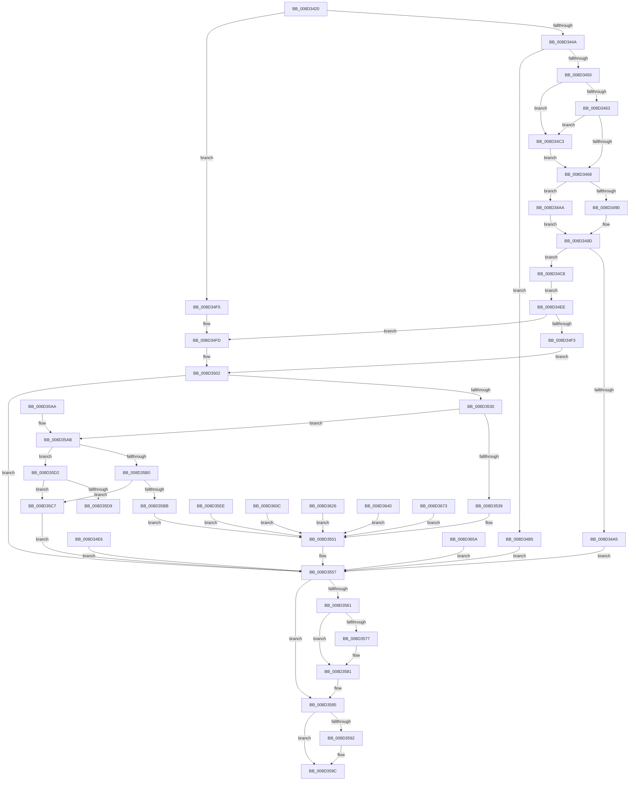

# sub_008D3420

- RVA: `0x008D3420`–`0x008D3685` (길이 `613` bytes)
- VA: `0x00000001408D3420`
- 실행 섹션: `PAGE`
- PDB 이름 있음: `아니요`; PDB Function 태그: `아니요`
- unwind 정보 RVA: `0x00084E58`
- 디코드: `159`개 명령, `613/613` bytes 표시
- 미해석 바이트: `0` (있으면 어셈블리에 `.byte`로 보존)

> 이 문서는 커널 이미지의 기계어와 PDB 기호를 분석해 생성했습니다. 4번과 5번은 함수 원형과 자료형을 바이너리 사용 방식에서 추정한 C 해석이며 원본 소스 복구 결과는 아닙니다.

## 1. Dependencies

- 직접 호출 지점: **13**; 고유 호출 대상: **13**
- 직접 호출자로 확인된 함수: **1**
- RIP 상대 이미지 참조: **1**

### Outgoing calls
- `0x008D3481` → [ExAllocatePool2](../../poolcode/B8/ExAllocatePool2_function_00B820F0.md) (function, `0x00B820F0`)
- `0x008D34D9` → [memcpy](../../text/6C/memcpy_function_006C6840.md) (function, `0x006C6840`)
- `0x008D3512` → [PsGetProcessId](../../text/43/PsGetProcessId_function_0043D910.md) (function, `0x0043D910`)
- `0x008D3521` → [sub_008D3AA0](Unknown_function_008D3AA0.md) (function, `0x008D3AA0`)
- `0x008D354C` → [sub_008D2770](Unknown_function_008D2770.md) (function, `0x008D2770`)
- `0x008D357C` → [sub_008D4104](Unknown_function_008D4104.md) (function, `0x008D4104`)
- `0x008D3597` → [ExFreePoolWithTag](../../poolcode/B8/ExFreePoolWithTag_function_00B82870.md) (function, `0x00B82870`)
- `0x008D35C0` → [sub_008D2508](Unknown_function_008D2508.md) (function, `0x008D2508`)
- `0x008D3602` → [sub_009A02CC](../9A/Unknown_function_009A02CC.md) (function, `0x009A02CC`)
- `0x008D361C` → [sub_009A01EC](../9A/Unknown_function_009A01EC.md) (function, `0x009A01EC`)
- `0x008D3636` → [sub_00A7AE48](../A7/Unknown_function_00A7AE48.md) (function, `0x00A7AE48`)
- `0x008D3650` → [sub_00A67C68](../A6/Unknown_function_00A67C68.md) (function, `0x00A67C68`)
- `0x008D367B` → [sub_00907768](../90/Unknown_function_00907768.md) (function, `0x00907768`)

### Direct callers
- [ExpQuerySystemInformation](../A5/ExpQuerySystemInformation_function_00A57858.md) at `0x00A5AB5C`

### Static image references
- `0x008D35DB` → RVA `0x00000000` (`image boundary/outside`; read)

## 2. Other-region calls and transfers

- 다른 실행 섹션으로 향하는 call: **4**
  - `0x008D3481` → [ExAllocatePool2](../../poolcode/B8/ExAllocatePool2_function_00B820F0.md) (`PAGE` → `POOLCODE`)
  - `0x008D34D9` → [memcpy](../../text/6C/memcpy_function_006C6840.md) (`PAGE` → `.text`)
  - `0x008D3512` → [PsGetProcessId](../../text/43/PsGetProcessId_function_0043D910.md) (`PAGE` → `.text`)
  - `0x008D3597` → [ExFreePoolWithTag](../../poolcode/B8/ExFreePoolWithTag_function_00B82870.md) (`PAGE` → `POOLCODE`)
- 별도 외부 분기/꼬리 이동을 확인하지 못했습니다.

## 3. Assembly (complete function range)

```asm
008D3420  40 53                           push rbx
008D3422  56                              push rsi
008D3423  57                              push rdi
008D3424  41 56                           push r14
008D3426  41 57                           push r15
008D3428  48 83 EC 40                     sub rsp, 0x40
008D342C  44 8B FA                        mov r15d, edx
008D342F  4C 8B F1                        mov r14, rcx
008D3432  33 DB                           xor ebx, ebx
008D3434  48 89 5C 24 70                  mov qword ptr [rsp + 0x70], rbx
008D3439  48 89 9C 24 80 00 00 00         mov qword ptr [rsp + 0x80], rbx
008D3441  48 85 C9                        test rcx, rcx
008D3444  0F 84 AB 00 00 00               je 0x1408d34f5
008D344A  41 83 FF 08                     cmp r15d, 8
008D344E  72 65                           jb 0x1408d34b5
008D3450  49 8D 04 0F                     lea rax, [r15 + rcx]
008D3454  48 B9 00 00 FF FF FF 7F 00 00   movabs rcx, 0x7fffffff0000
008D345E  48 3B C1                        cmp rax, rcx
008D3461  77 60                           ja 0x1408d34c3
008D3463  49 3B C6                        cmp rax, r14
008D3466  72 5B                           jb 0x1408d34c3
008D3468  48 89 5C 24 30                  mov qword ptr [rsp + 0x30], rbx
008D346D  8B FB                           mov edi, ebx
008D346F  89 5C 24 2C                     mov dword ptr [rsp + 0x2c], ebx
008D3473  41 B8 57 41 52 42               mov r8d, 0x42524157
008D3479  49 8B D7                        mov rdx, r15
008D347C  B9 00 01 00 00                  mov ecx, 0x100
008D3481  E8 6A EC 2A 00                  call 0x140b820f0
008D3486  48 89 44 24 30                  mov qword ptr [rsp + 0x30], rax
008D348B  48 85 C0                        test rax, rax
008D348E  74 1A                           je 0x1408d34aa
008D3490  48 89 84 24 80 00 00 00         mov qword ptr [rsp + 0x80], rax
008D3498  48 89 5C 24 30                  mov qword ptr [rsp + 0x30], rbx
008D349D  89 7C 24 24                     mov dword ptr [rsp + 0x24], edi
008D34A1  85 FF                           test edi, edi
008D34A3  79 23                           jns 0x1408d34c8
008D34A5  E9 AD 00 00 00                  jmp 0x1408d3557
008D34AA  BF 17 00 00 C0                  mov edi, 0xc0000017
008D34AF  89 7C 24 2C                     mov dword ptr [rsp + 0x2c], edi
008D34B3  EB E8                           jmp 0x1408d349d
008D34B5  BF 0D 00 00 C0                  mov edi, 0xc000000d
008D34BA  89 7C 24 24                     mov dword ptr [rsp + 0x24], edi
008D34BE  E9 94 00 00 00                  jmp 0x1408d3557
008D34C3  0F B6 01                        movzx eax, byte ptr [rcx]
008D34C6  EB A0                           jmp 0x1408d3468
008D34C8  4D 8B C7                        mov r8, r15
008D34CB  49 8B D6                        mov rdx, r14
008D34CE  48 8B B4 24 80 00 00 00         mov rsi, qword ptr [rsp + 0x80]
008D34D6  48 8B CE                        mov rcx, rsi
008D34D9  E8 62 33 DF FF                  call 0x1406c6840
008D34DE  8B 06                           mov eax, dword ptr [rsi]
008D34E0  89 44 24 28                     mov dword ptr [rsp + 0x28], eax
008D34E4  EB 08                           jmp 0x1408d34ee
008D34E6  8B F8                           mov edi, eax
008D34E8  89 44 24 24                     mov dword ptr [rsp + 0x24], eax
008D34EC  EB 69                           jmp 0x1408d3557
008D34EE  83 F8 07                        cmp eax, 7
008D34F1  75 0A                           jne 0x1408d34fd
008D34F3  EB 0D                           jmp 0x1408d3502
008D34F5  C7 44 24 28 04 00 00 00         mov dword ptr [rsp + 0x28], 4
008D34FD  BB 01 00 00 00                  mov ebx, 1
008D3502  65 48 8B 04 25 88 01 00 00      mov rax, qword ptr gs:[0x188]
008D350B  48 8B 88 B8 00 00 00            mov rcx, qword ptr [rax + 0xb8]
008D3512  E8 F9 A3 B6 FF                  call 0x14043d910
008D3517  48 8B C8                        mov rcx, rax
008D351A  4C 8D 44 24 70                  lea r8, [rsp + 0x70]
008D351F  8B D3                           mov edx, ebx
008D3521  E8 7A 05 00 00                  call 0x1408d3aa0
008D3526  8B F8                           mov edi, eax
008D3528  89 44 24 24                     mov dword ptr [rsp + 0x24], eax
008D352C  85 C0                           test eax, eax
008D352E  78 27                           js 0x1408d3557
008D3530  8B 44 24 28                     mov eax, dword ptr [rsp + 0x28]
008D3534  83 F8 03                        cmp eax, 3
008D3537  75 72                           jne 0x1408d35ab
008D3539  45 8B CF                        mov r9d, r15d
008D353C  4D 8B C6                        mov r8, r14
008D353F  48 8B 94 24 80 00 00 00         mov rdx, qword ptr [rsp + 0x80]
008D3547  48 8B 4C 24 70                  mov rcx, qword ptr [rsp + 0x70]
008D354C  E8 1F F2 FF FF                  call 0x1408d2770
008D3551  8B F8                           mov edi, eax
008D3553  89 44 24 24                     mov dword ptr [rsp + 0x24], eax
008D3557  48 8B 4C 24 70                  mov rcx, qword ptr [rsp + 0x70]
008D355C  48 85 C9                        test rcx, rcx
008D355F  74 24                           je 0x1408d3585
008D3561  48 C7 C0 FF FF FF FF            mov rax, 0xffffffffffffffff
008D3568  F0 48 0F C1 81 E8 00 00 00      lock xadd qword ptr [rcx + 0xe8], rax
008D3571  48 83 F8 01                     cmp rax, 1
008D3575  75 0A                           jne 0x1408d3581
008D3577  48 8B 4C 24 70                  mov rcx, qword ptr [rsp + 0x70]
008D357C  E8 83 0B 00 00                  call 0x1408d4104
008D3581  8B 7C 24 24                     mov edi, dword ptr [rsp + 0x24]
008D3585  48 8B B4 24 80 00 00 00         mov rsi, qword ptr [rsp + 0x80]
008D358D  48 85 F6                        test rsi, rsi
008D3590  74 0A                           je 0x1408d359c
008D3592  33 D2                           xor edx, edx
008D3594  48 8B CE                        mov rcx, rsi
008D3597  E8 D4 F2 2A 00                  call 0x140b82870
008D359C  8B C7                           mov eax, edi
008D359E  48 83 C4 40                     add rsp, 0x40
008D35A2  41 5F                           pop r15
008D35A4  41 5E                           pop r14
008D35A6  5F                              pop rdi
008D35A7  5E                              pop rsi
008D35A8  5B                              pop rbx
008D35A9  C3                              ret
008D35AA  CC                              int3
008D35AB  83 F8 04                        cmp eax, 4
008D35AE  75 22                           jne 0x1408d35d2
008D35B0  48 83 BC 24 80 00 00 00 00      cmp qword ptr [rsp + 0x80], 0
008D35B9  75 0C                           jne 0x1408d35c7
008D35BB  48 8B 4C 24 70                  mov rcx, qword ptr [rsp + 0x70]
008D35C0  E8 43 EF FF FF                  call 0x1408d2508
008D35C5  EB 8A                           jmp 0x1408d3551
008D35C7  BF 0D 00 00 C0                  mov edi, 0xc000000d
008D35CC  89 7C 24 24                     mov dword ptr [rsp + 0x24], edi
008D35D0  EB 85                           jmp 0x1408d3557
008D35D2  FF C8                           dec eax
008D35D4  83 F8 08                        cmp eax, 8
008D35D7  77 EE                           ja 0x1408d35c7
008D35D9  48 98                           cdqe
008D35DB  48 8D 15 1E CA 72 FF            lea rdx, [rip - 0x8d35e2]
008D35E2  8B 8C 82 6C 35 04 00            mov ecx, dword ptr [rdx + rax*4 + 0x4356c]
008D35E9  48 03 CA                        add rcx, rdx
008D35EC  FF E1                           jmp rcx
008D35EE  CC                              int3
008D35EF  CC                              int3
008D35F0  CC                              int3
008D35F1  CC                              int3
008D35F2  45 8B C7                        mov r8d, r15d
008D35F5  48 8B 94 24 80 00 00 00         mov rdx, qword ptr [rsp + 0x80]
008D35FD  48 8B 4C 24 70                  mov rcx, qword ptr [rsp + 0x70]
008D3602  E8 C5 CC 0C 00                  call 0x1409a02cc
008D3607  E9 45 FF FF FF                  jmp 0x1408d3551
008D360C  45 8B C7                        mov r8d, r15d
008D360F  48 8B 94 24 80 00 00 00         mov rdx, qword ptr [rsp + 0x80]
008D3617  48 8B 4C 24 70                  mov rcx, qword ptr [rsp + 0x70]
008D361C  E8 CB CB 0C 00                  call 0x1409a01ec
008D3621  E9 2B FF FF FF                  jmp 0x1408d3551
008D3626  45 8B C7                        mov r8d, r15d
008D3629  48 8B 94 24 80 00 00 00         mov rdx, qword ptr [rsp + 0x80]
008D3631  48 8B 4C 24 70                  mov rcx, qword ptr [rsp + 0x70]
008D3636  E8 0D 78 1A 00                  call 0x140a7ae48
008D363B  E9 11 FF FF FF                  jmp 0x1408d3551
008D3640  45 8B C7                        mov r8d, r15d
008D3643  48 8B 94 24 80 00 00 00         mov rdx, qword ptr [rsp + 0x80]
008D364B  48 8B 4C 24 70                  mov rcx, qword ptr [rsp + 0x70]
008D3650  E8 13 46 19 00                  call 0x140a67c68
008D3655  E9 F7 FE FF FF                  jmp 0x1408d3551
008D365A  BF 0D 00 00 C0                  mov edi, 0xc000000d
008D365F  B8 02 00 00 C0                  mov eax, 0xc0000002
008D3664  4D 85 F6                        test r14, r14
008D3667  0F 45 F8                        cmovne edi, eax
008D366A  89 7C 24 24                     mov dword ptr [rsp + 0x24], edi
008D366E  E9 E4 FE FF FF                  jmp 0x1408d3557
008D3673  48 8B 4C 24 70                  mov rcx, qword ptr [rsp + 0x70]
008D3678  48 8B 09                        mov rcx, qword ptr [rcx]
008D367B  E8 E8 40 03 00                  call 0x140907768
008D3680  E9 CC FE FF FF                  jmp 0x1408d3551
```

## 4. C-style interpretation (structured pseudocode)

```c
__int64 __fastcall sub_008D3420(__int64 a1, int a2)
{
    __int64 result;
    __int64 v_rbx;
    __int64 v_rsp;
    unsigned __int64 v_stack_m38;
    unsigned int v_stack_m3C;
    unsigned int v_stack_m40;
    unsigned int v_stack_m44;
    unsigned __int64 v_stack_p18;
    unsigned int v_stack_p24;
    unsigned __int64 v_stack_p70;
    unsigned __int64 v_stack_p8;
    unsigned __int64 v_stack_p80;

    v_rsp = (v_rsp) - (64);
    v_rbx = 0;
    v_stack_p8 = 0;
    v_stack_p18 = 0;
    if (a1 == 0) goto loc_008D34F5;
    if (((unsigned int)((unsigned int)(a2))) < 8) goto loc_008D34B5;
    if (((unsigned int)(a2) + a1 * 1) > a1) goto loc_008D34C3;
    if (((unsigned int)(a2) + a1 * 1) < a1) goto loc_008D34C3;
loc_008D3468:
    v_stack_m38 = 0;
    v_stack_m3C = 0;
    result = ExAllocatePool2(256, (unsigned int)(a2), (unsigned int)(0x42524157ULL), a4);
    v_stack_m38 = result;
    if (result == 0) goto loc_008D34AA;
    v_stack_p18 = result;
    v_stack_m38 = 0;
loc_008D349D:
    v_stack_m44 = 0;
    if (!sign_flag) goto loc_008D34C8;
    goto loc_008D3557;
loc_008D34AA:
    v_stack_m3C = (unsigned int)((unsigned int)(0xC0000017ULL));
    goto loc_008D349D;
loc_008D34B5:
    v_stack_m44 = (unsigned int)((unsigned int)(0xC000000DULL));
    goto loc_008D3557;
loc_008D34C3:
    goto loc_008D3468;
loc_008D34C8:
    result = memcpy(v_stack_p18, a1, (unsigned int)(a2), a4);
    v_stack_m40 = (unsigned int)((unsigned int)(*(unsigned int *)(v_stack_p18)));
    goto loc_008D34EE;
loc_008D34EE:
    if (((unsigned int)((unsigned int)(*(unsigned int *)(v_stack_p18)))) != 7) goto loc_008D34FD;
    goto loc_008D3502;
loc_008D34F5:
    v_stack_m40 = 4;
loc_008D34FD:
loc_008D3502:
    result = PsGetProcessId(*(unsigned __int64 *)(*(unsigned __int64 *)(gs_base + (0 + 392)) + 184), a1, (unsigned int)(a2), a4);
    result = sub_008D3AA0(result, 1, v_stack_p8, a4);
    v_stack_m44 = (unsigned int)(result);
    if (sign_flag) goto loc_008D3557;
    if (((unsigned int)((unsigned int)(v_stack_m40))) != 3) goto loc_008D35AB;
    result = sub_008D2770(v_stack_p8, v_stack_p18, a1, (unsigned int)((unsigned int)((unsigned int)(a2))));
loc_008D3551:
    v_stack_m44 = (unsigned int)(result);
loc_008D3557:
    if (v_stack_p8 == 0) goto loc_008D3585;
    result = -1;
    if (-1 == 1) {
        a1 = v_stack_p8;
        result = sub_008D4104(a1, v_stack_p18, a1, (unsigned int)((unsigned int)((unsigned int)(a2))));
    }
loc_008D3585:
    if (v_stack_p18 != 0) {
        a2 = 0;
        a1 = v_stack_p18;
        result = ExFreePoolWithTag(a1, a2, a1, (unsigned int)((unsigned int)((unsigned int)(a2))));
    }
    v_rsp = (v_rsp) + (64);
    return (unsigned int)((unsigned int)((unsigned int)(v_stack_m44)));
loc_008D35AB:
    if (((unsigned int)((unsigned int)((unsigned int)((unsigned int)(v_stack_m44))))) != 4) goto loc_008D35D2;
    if (v_stack_p80 != 0) goto loc_008D35C7;
    result = sub_008D2508(v_stack_p70, a2, a1, (unsigned int)((unsigned int)((unsigned int)(a2))));
    goto loc_008D3551;
loc_008D35C7:
    v_stack_p24 = (unsigned int)((unsigned int)(0xC000000DULL));
    goto loc_008D3557;
loc_008D35D2:
    result = (unsigned int)((result) - 1);
    if (((unsigned int)(result)) > 8) goto loc_008D35C7;
    a1 = ((unsigned int)(*(unsigned int *)(v_rip - 9254370 + result * 4 + 275820))) + (v_rip - 9254370);
}
```

## 5. (Beta) C Style

```c
int64_t sub_008D3420(int64_t Arg1, int32_t Arg2)
{
    int64_t result;
    int64_t local_rbx;
    int64_t local_rsp;
    uint64_t v_stack_m38;
    uint32_t v_stack_m3C;
    uint32_t v_stack_m40;
    uint32_t v_stack_m44;
    uint64_t v_stack_p18;
    uint32_t v_stack_p24;
    uint64_t v_stack_p70;
    uint64_t v_stack_p8;
    uint64_t v_stack_p80;

    local_rsp = (local_rsp) - (64);
    local_rbx = 0;
    v_stack_p8 = 0;
    v_stack_p18 = 0;
    if (Arg1 == 0) goto loc_008D34F5;
    if (((uint32_t)((uint32_t)(Arg2))) < 8) goto loc_008D34B5;
    if (((uint32_t)(Arg2) + Arg1 * 1) > Arg1) goto loc_008D34C3;
    if (((uint32_t)(Arg2) + Arg1 * 1) < Arg1) goto loc_008D34C3;
loc_008D3468:
    v_stack_m38 = 0;
    v_stack_m3C = 0;
    result = ExAllocatePool2(256, (uint32_t)(Arg2), (uint32_t)(0x42524157ULL), a4);
    v_stack_m38 = result;
    if (result == 0) goto loc_008D34AA;
    v_stack_p18 = result;
    v_stack_m38 = 0;
loc_008D349D:
    v_stack_m44 = 0;
    if (!sign_flag) goto loc_008D34C8;
    goto loc_008D3557;
loc_008D34AA:
    v_stack_m3C = (uint32_t)((uint32_t)(0xC0000017ULL));
    goto loc_008D349D;
loc_008D34B5:
    v_stack_m44 = (uint32_t)((uint32_t)(0xC000000DULL));
    goto loc_008D3557;
loc_008D34C3:
    goto loc_008D3468;
loc_008D34C8:
    result = memcpy(v_stack_p18, Arg1, (uint32_t)(Arg2), a4);
    v_stack_m40 = (uint32_t)((uint32_t)(*(uint32_t *)(v_stack_p18)));
    goto loc_008D34EE;
loc_008D34EE:
    if (((uint32_t)((uint32_t)(*(uint32_t *)(v_stack_p18)))) != 7) goto loc_008D34FD;
    goto loc_008D3502;
loc_008D34F5:
    v_stack_m40 = 4;
loc_008D34FD:
loc_008D3502:
    result = PsGetProcessId(*(uint64_t *)(*(uint64_t *)(gs_base + (0 + 0x188)) + 0xB8), Arg1, (uint32_t)(Arg2), a4);
    result = sub_008D3AA0(result, 1, v_stack_p8, a4);
    v_stack_m44 = (uint32_t)(result);
    if (sign_flag) goto loc_008D3557;
    if (((uint32_t)((uint32_t)(v_stack_m40))) != 3) goto loc_008D35AB;
    result = sub_008D2770(v_stack_p8, v_stack_p18, Arg1, (uint32_t)((uint32_t)((uint32_t)(Arg2))));
loc_008D3551:
    v_stack_m44 = (uint32_t)(result);
loc_008D3557:
    if (v_stack_p8 == 0) goto loc_008D3585;
    result = -1;
    if (-1 == 1) {
        Arg1 = v_stack_p8;
        result = sub_008D4104(Arg1, v_stack_p18, Arg1, (uint32_t)((uint32_t)((uint32_t)(Arg2))));
    }
loc_008D3585:
    if (v_stack_p18 != 0) {
        Arg2 = 0;
        Arg1 = v_stack_p18;
        result = ExFreePoolWithTag(Arg1, Arg2, Arg1, (uint32_t)((uint32_t)((uint32_t)(Arg2))));
    }
    local_rsp = (local_rsp) + (64);
    return (uint32_t)((uint32_t)((uint32_t)(v_stack_m44)));
loc_008D35AB:
    if (((uint32_t)((uint32_t)((uint32_t)((uint32_t)(v_stack_m44))))) != 4) goto loc_008D35D2;
    if (v_stack_p80 != 0) goto loc_008D35C7;
    result = sub_008D2508(v_stack_p70, Arg2, Arg1, (uint32_t)((uint32_t)((uint32_t)(Arg2))));
    goto loc_008D3551;
loc_008D35C7:
    v_stack_p24 = (uint32_t)((uint32_t)(0xC000000DULL));
    goto loc_008D3557;
loc_008D35D2:
    result = (uint32_t)((result) - 1);
    if (((uint32_t)(result)) > 8) goto loc_008D35C7;
    Arg1 = ((uint32_t)(*(uint32_t *)(v_rip - 0x8D35E2 + result * 4 + 0x4356C))) + (v_rip - 9254370);
}
```

## 6. Execution-region graph

[열기: 2D/3D 그래프와 함수 탐색 컨트롤 패널](../../../control-panel.html?section=page&rva=0x008D3420&view=graph)

- 2D 그래프는 위에서 아래로 흐르고, 3D 그래프는 빈 공간을 드래그해 회전합니다. Shift+드래그는 이동, 휠은 확대·축소, 함수 노드 선택은 대상 보고서 이동입니다.

### Static fallback


