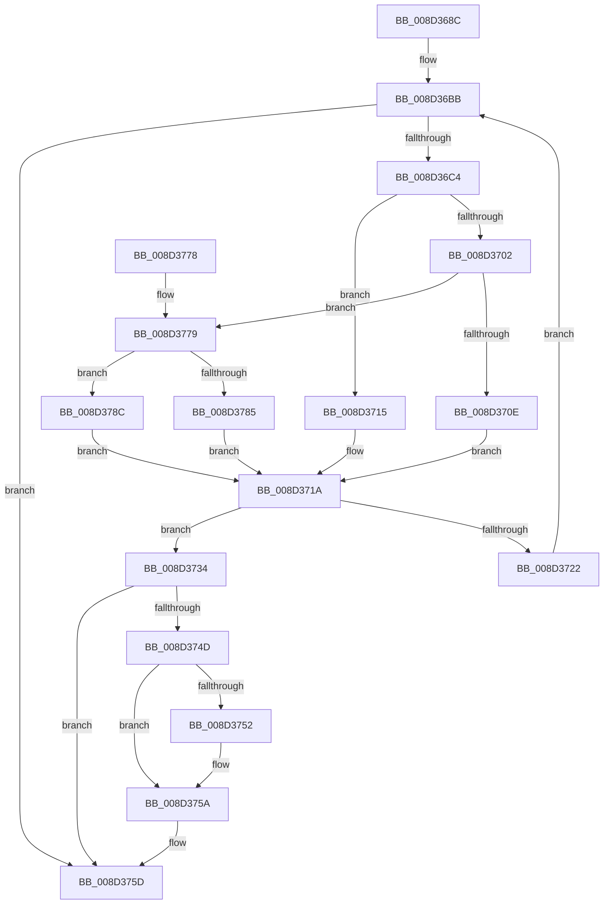

# sub_008D368C

- RVA: `0x008D368C`–`0x008D3796` (길이 `266` bytes)
- VA: `0x00000001408D368C`
- 실행 섹션: `PAGE`
- PDB 이름 있음: `아니요`; PDB Function 태그: `아니요`
- unwind 정보 RVA: `0x0007CD24`
- 디코드: `73`개 명령, `266/266` bytes 표시
- 미해석 바이트: `0` (있으면 어셈블리에 `.byte`로 보존)

> 이 문서는 커널 이미지의 기계어와 PDB 기호를 분석해 생성했습니다. 4번과 5번은 함수 원형과 자료형을 바이너리 사용 방식에서 추정한 C 해석이며 원본 소스 복구 결과는 아닙니다.

## 1. Dependencies

- 직접 호출 지점: **4**; 고유 호출 대상: **4**
- 직접 호출자로 확인된 함수: **1**
- RIP 상대 이미지 참조: **7**

### Outgoing calls
- `0x008D370E` → [sub_008D3F00](Unknown_function_008D3F00.md) (function, `0x008D3F00`)
- `0x008D3715` → [sub_008D3ED0](Unknown_function_008D3ED0.md) (function, `0x008D3ED0`)
- `0x008D3785` → [sub_008D3F30](Unknown_function_008D3F30.md) (function, `0x008D3F30`)
- `0x008D378F` → [guard_dispatch_icall](../../text/6B/guard_dispatch_icall_function_006BAAD0.md) (function, `0x006BAAD0`)

### Direct callers
- [sub_00907768](../90/Unknown_function_00907768.md) at `0x009077DE`

### Static image references
- `0x008D36A4` → RVA `0x00E3EA44` (`.data`; read)
- `0x008D36C4` → RVA `0x00E3EA60` (`.data`; read)
- `0x008D36E4` → RVA `0x00E3EA40` (`.data`; read)
- `0x008D36EB` → RVA `0x00E3EA50` (`.data`; read)
- `0x008D36F6` → RVA `0x008D3ED0` (`PAGE`; read)
- `0x008D3702` → RVA `0x008D3F00` (`PAGE`; read)
- `0x008D3779` → RVA `0x008D3F30` (`PAGE`; read)

## 2. Other-region calls and transfers

- 다른 실행 섹션으로 향하는 call: **1**
  - `0x008D378F` → [guard_dispatch_icall](../../text/6B/guard_dispatch_icall_function_006BAAD0.md) (`PAGE` → `.text`)
- 별도 외부 분기/꼬리 이동을 확인하지 못했습니다.

## 3. Assembly (complete function range)

```asm
008D368C  48 89 5C 24 08                  mov qword ptr [rsp + 8], rbx
008D3691  48 89 6C 24 10                  mov qword ptr [rsp + 0x10], rbp
008D3696  48 89 74 24 18                  mov qword ptr [rsp + 0x18], rsi
008D369B  57                              push rdi
008D369C  41 56                           push r14
008D369E  41 57                           push r15
008D36A0  48 83 EC 20                     sub rsp, 0x20
008D36A4  44 8B 35 99 B3 56 00            mov r14d, dword ptr [rip + 0x56b399]
008D36AB  33 FF                           xor edi, edi
008D36AD  41 FF CE                        dec r14d
008D36B0  4C 8B FA                        mov r15, rdx
008D36B3  48 8B E9                        mov rbp, rcx
008D36B6  BB 72 02 00 C0                  mov ebx, 0xc0000272
008D36BB  41 3B FE                        cmp edi, r14d
008D36BE  0F 8F 99 00 00 00               jg 0x1408d375d
008D36C4  4C 8B 0D 95 B3 56 00            mov r9, qword ptr [rip + 0x56b395]
008D36CB  41 8D 04 3E                     lea eax, [r14 + rdi]
008D36CF  99                              cdq
008D36D0  B9 02 00 00 00                  mov ecx, 2
008D36D5  F7 F9                           idiv ecx
008D36D7  41 B8 08 00 00 00               mov r8d, 8
008D36DD  48 8B D5                        mov rdx, rbp
008D36E0  8B C8                           mov ecx, eax
008D36E2  8B F0                           mov esi, eax
008D36E4  0F AF 0D 55 B3 56 00            imul ecx, dword ptr [rip + 0x56b355]
008D36EB  48 8B 05 5E B3 56 00            mov rax, qword ptr [rip + 0x56b35e]
008D36F2  48 8B 0C 01                     mov rcx, qword ptr [rcx + rax]
008D36F6  48 8D 05 D3 07 00 00            lea rax, [rip + 0x7d3]
008D36FD  4C 3B C8                        cmp r9, rax
008D3700  74 13                           je 0x1408d3715
008D3702  48 8D 05 F7 07 00 00            lea rax, [rip + 0x7f7]
008D3709  4C 3B C8                        cmp r9, rax
008D370C  75 6B                           jne 0x1408d3779
008D370E  E8 ED 07 00 00                  call 0x1408d3f00
008D3713  EB 05                           jmp 0x1408d371a
008D3715  E8 B6 07 00 00                  call 0x1408d3ed0
008D371A  48 8B C8                        mov rcx, rax
008D371D  48 85 C0                        test rax, rax
008D3720  74 12                           je 0x1408d3734
008D3722  8D 46 01                        lea eax, [rsi + 1]
008D3725  0F 49 F8                        cmovns edi, eax
008D3728  8D 46 FF                        lea eax, [rsi - 1]
008D372B  41 0F 49 C6                     cmovns eax, r14d
008D372F  44 8B F0                        mov r14d, eax
008D3732  EB 87                           jmp 0x1408d36bb
008D3734  0F AF 35 05 B3 56 00            imul esi, dword ptr [rip + 0x56b305]
008D373B  33 DB                           xor ebx, ebx
008D373D  48 8B 05 0C B3 56 00            mov rax, qword ptr [rip + 0x56b30c]
008D3744  48 8B 14 06                     mov rdx, qword ptr [rsi + rax]
008D3748  4D 85 FF                        test r15, r15
008D374B  74 10                           je 0x1408d375d
008D374D  48 85 D2                        test rdx, rdx
008D3750  74 08                           je 0x1408d375a
008D3752  F0 48 FF 82 E8 00 00 00         lock inc qword ptr [rdx + 0xe8]
008D375A  49 89 17                        mov qword ptr [r15], rdx
008D375D  48 8B 6C 24 48                  mov rbp, qword ptr [rsp + 0x48]
008D3762  8B C3                           mov eax, ebx
008D3764  48 8B 5C 24 40                  mov rbx, qword ptr [rsp + 0x40]
008D3769  48 8B 74 24 50                  mov rsi, qword ptr [rsp + 0x50]
008D376E  48 83 C4 20                     add rsp, 0x20
008D3772  41 5F                           pop r15
008D3774  41 5E                           pop r14
008D3776  5F                              pop rdi
008D3777  C3                              ret
008D3778  CC                              int3
008D3779  48 8D 05 B0 07 00 00            lea rax, [rip + 0x7b0]
008D3780  4C 3B C8                        cmp r9, rax
008D3783  75 07                           jne 0x1408d378c
008D3785  E8 A6 07 00 00                  call 0x1408d3f30
008D378A  EB 8E                           jmp 0x1408d371a
008D378C  49 8B C1                        mov rax, r9
008D378F  E8 3C 73 DE FF                  call 0x1406baad0
008D3794  EB 84                           jmp 0x1408d371a
```

## 4. C-style interpretation (structured pseudocode)

```c
__int64 __fastcall sub_008D368C(__int64 a1, __int64 a2)
{
    __int64 result;
    __int64 v_r14;
    __int64 v_rbx;
    __int64 v_rdi;
    __int64 v_rsi;
    __int64 v_rsp;
    unsigned __int64 v_stack_p10;
    unsigned __int64 v_stack_p18;
    unsigned __int64 v_stack_p8;

    v_stack_p8 = v_rbx;
    v_stack_p10 = v_rbp;
    v_stack_p18 = v_rsi;
    v_rsp = (v_rsp) - (32);
    v_rdi = 0;
    v_r14 = (unsigned int)(((unsigned int)(*(unsigned int *)(v_rip + 5682073))) - 1);
loc_008D36BB:
    if (0 > ((unsigned int)(v_r14))) goto loc_008D375D;
    a1 = (unsigned int)(((unsigned int)((unsigned int)(v_r14 + v_rdi * 1))) * (*(unsigned int *)(v_rip + 5682005)));
    if ((*(unsigned __int64 *)(v_rip + 5682069)) == (v_rip + 2003)) goto loc_008D3715;
    if ((*(unsigned __int64 *)(v_rip + 5682069)) != (v_rip + 2039)) goto loc_008D3779;
    result = sub_008D3F00(*(unsigned __int64 *)(a1 + *(unsigned __int64 *)(v_rip + 5682014) * 1), a1, 8, *(unsigned __int64 *)(v_rip + 5682069));
    goto loc_008D371A;
loc_008D3715:
    result = sub_008D3ED0(*(unsigned __int64 *)(a1 + *(unsigned __int64 *)(v_rip + 5682014) * 1), a1, 8, *(unsigned __int64 *)(v_rip + 5682069));
loc_008D371A:
    if (result == 0) goto loc_008D3734;
    if (!sign_flag) { v_rdi = (unsigned int)((unsigned int)((unsigned int)(v_r14 + v_rdi * 1)) + 1); }
    result = (unsigned int)((unsigned int)(v_r14 + v_rdi * 1)) - 1;
    if (!sign_flag) { result = (unsigned int)(v_r14); }
    goto loc_008D36BB;
loc_008D3734:
    v_rsi = (unsigned int)(((unsigned int)((unsigned int)(v_r14 + v_rdi * 1))) * (*(unsigned int *)(v_rip + 5681925)));
    v_rbx = 0;
    if (a2 == 0) goto loc_008D375D;
    if (*(unsigned __int64 *)(v_rsi + *(unsigned __int64 *)(v_rip + 5681932) * 1) != 0) {
    }
    *(unsigned __int64 *)(a2) = *(unsigned __int64 *)(v_rsi + *(unsigned __int64 *)(v_rip + 5681932) * 1);
loc_008D375D:
    v_rsp = (v_rsp) + (32);
    return 0;
loc_008D3779:
    if ((*(unsigned __int64 *)(v_rip + 5682069)) != (v_rip + 1968)) goto loc_008D378C;
    result = sub_008D3F30(result, *(unsigned __int64 *)(v_rsi + *(unsigned __int64 *)(v_rip + 5681932) * 1), 8, *(unsigned __int64 *)(v_rip + 5682069));
    goto loc_008D371A;
loc_008D378C:
    result = guard_dispatch_icall(result, *(unsigned __int64 *)(v_rsi + *(unsigned __int64 *)(v_rip + 5681932) * 1), 8, *(unsigned __int64 *)(v_rip + 5682069));
    goto loc_008D371A;
}
```

## 5. (Beta) C Style

```c
int64_t sub_008D368C(int64_t Arg1, int64_t Arg2)
{
    int64_t result;
    int64_t local_r14;
    int64_t local_rbx;
    int64_t local_rdi;
    int64_t local_rsi;
    int64_t local_rsp;
    uint64_t v_stack_p10;
    uint64_t v_stack_p18;
    uint64_t v_stack_p8;

    v_stack_p8 = local_rbx;
    v_stack_p10 = local_rbp;
    v_stack_p18 = local_rsi;
    local_rsp = (local_rsp) - (32);
    local_rdi = 0;
    local_r14 = (uint32_t)(((uint32_t)(*(uint32_t *)(v_rip + 0x56B399))) - 1);
loc_008D36BB:
    if (0 > ((uint32_t)(local_r14))) goto loc_008D375D;
    Arg1 = (uint32_t)(((uint32_t)((uint32_t)(local_r14 + local_rdi * 1))) * (*(uint32_t *)(v_rip + 0x56B355)));
    if ((*(uint64_t *)(v_rip + 0x56B395)) == (v_rip + 2003)) goto loc_008D3715;
    if ((*(uint64_t *)(v_rip + 0x56B395)) != (v_rip + 2039)) goto loc_008D3779;
    result = sub_008D3F00(*(uint64_t *)(Arg1 + *(uint64_t *)(v_rip + 0x56B35E) * 1), Arg1, 8, *(uint64_t *)(v_rip + 0x56B395));
    goto loc_008D371A;
loc_008D3715:
    result = sub_008D3ED0(*(uint64_t *)(Arg1 + *(uint64_t *)(v_rip + 0x56B35E) * 1), Arg1, 8, *(uint64_t *)(v_rip + 0x56B395));
loc_008D371A:
    if (result == 0) goto loc_008D3734;
    if (!sign_flag) { local_rdi = (uint32_t)((uint32_t)((uint32_t)(local_r14 + local_rdi * 1)) + 1); }
    result = (uint32_t)((uint32_t)(local_r14 + local_rdi * 1)) - 1;
    if (!sign_flag) { result = (uint32_t)(local_r14); }
    goto loc_008D36BB;
loc_008D3734:
    local_rsi = (uint32_t)(((uint32_t)((uint32_t)(local_r14 + local_rdi * 1))) * (*(uint32_t *)(v_rip + 0x56B305)));
    local_rbx = 0;
    if (Arg2 == 0) goto loc_008D375D;
    if (*(uint64_t *)(local_rsi + *(uint64_t *)(v_rip + 0x56B30C) * 1) != 0) {
    }
    *(uint64_t *)(Arg2) = *(uint64_t *)(local_rsi + *(uint64_t *)(v_rip + 0x56B30C) * 1);
loc_008D375D:
    local_rsp = (local_rsp) + (32);
    return 0;
loc_008D3779:
    if ((*(uint64_t *)(v_rip + 0x56B395)) != (v_rip + 1968)) goto loc_008D378C;
    result = sub_008D3F30(result, *(uint64_t *)(local_rsi + *(uint64_t *)(v_rip + 0x56B30C) * 1), 8, *(uint64_t *)(v_rip + 0x56B395));
    goto loc_008D371A;
loc_008D378C:
    result = guard_dispatch_icall(result, *(uint64_t *)(local_rsi + *(uint64_t *)(v_rip + 0x56B30C) * 1), 8, *(uint64_t *)(v_rip + 0x56B395));
    goto loc_008D371A;
}
```

## 6. Execution-region graph

[열기: 2D/3D 그래프와 함수 탐색 컨트롤 패널](../../../control-panel.html?section=page&rva=0x008D368C&view=graph)

- 2D 그래프는 위에서 아래로 흐르고, 3D 그래프는 빈 공간을 드래그해 회전합니다. Shift+드래그는 이동, 휠은 확대·축소, 함수 노드 선택은 대상 보고서 이동입니다.

### Static fallback


