# sub_008D379C

- RVA: `0x008D379C`–`0x008D3A8E` (길이 `754` bytes)
- VA: `0x00000001408D379C`
- 실행 섹션: `PAGE`
- PDB 이름 있음: `아니요`; PDB Function 태그: `아니요`
- unwind 정보 RVA: `0x00084E90`
- 디코드: `207`개 명령, `754/754` bytes 표시
- 미해석 바이트: `0` (있으면 어셈블리에 `.byte`로 보존)

> 이 문서는 커널 이미지의 기계어와 PDB 기호를 분석해 생성했습니다. 4번과 5번은 함수 원형과 자료형을 바이너리 사용 방식에서 추정한 C 해석이며 원본 소스 복구 결과는 아닙니다.

## 1. Dependencies

- 직접 호출 지점: **20**; 고유 호출 대상: **17**
- 직접 호출자로 확인된 함수: **2**
- RIP 상대 이미지 참조: **3**

### Outgoing calls
- `0x008D37F0` → [KeAbPreAcquire](../../text/21/KeAbPreAcquire_function_00210230.md) (function, `0x00210230`)
- `0x008D3810` → [ExfAcquirePushLockSharedEx](../../text/21/ExfAcquirePushLockSharedEx_function_0021044C.md) (function, `0x0021044C`)
- `0x008D387B` → [sub_008D3F00](Unknown_function_008D3F00.md) (function, `0x008D3F00`)
- `0x008D3885` → [sub_008D3ED0](Unknown_function_008D3ED0.md) (function, `0x008D3ED0`)
- `0x008D38E3` → [KeAbPostRelease](../../text/2E/KeAbPostRelease_function_002E1600.md) (function, `0x002E1600`)
- `0x008D3907` → [KiCheckForKernelApcDelivery](../../text/2E/KiCheckForKernelApcDelivery_function_002E2C80.md) (function, `0x002E2C80`)
- `0x008D3973` → [sub_008D3F30](Unknown_function_008D3F30.md) (function, `0x008D3F30`)
- `0x008D3988` → [sub_008D215C](Unknown_function_008D215C.md) (function, `0x008D215C`)
- `0x008D39A1` → [ExfReleasePushLockShared](../../text/26/ExfReleasePushLockShared_function_00263440.md) (function, `0x00263440`)
- `0x008D39AB` → [guard_dispatch_icall](../../text/6B/guard_dispatch_icall_function_006BAAD0.md) (function, `0x006BAAD0`)
- `0x008D39CF` → [KeAbPreAcquire](../../text/21/KeAbPreAcquire_function_00210230.md) (function, `0x00210230`)
- `0x008D39E8` → [ExfAcquirePushLockExclusiveEx](../../text/20/ExfAcquirePushLockExclusiveEx_function_0020FC90.md) (function, `0x0020FC90`)
- `0x008D3A11` → [sub_008D0970](Unknown_function_008D0970.md) (function, `0x008D0970`)
- `0x008D3A1F` → [sub_00A2266C](../A2/Unknown_function_00A2266C.md) (function, `0x00A2266C`)
- `0x008D3A35` → [KeAbPostRelease](../../text/2E/KeAbPostRelease_function_002E1600.md) (function, `0x002E1600`)
- `0x008D3A3A` → [KeLeaveGuardedRegion](../../text/2E/KeLeaveGuardedRegion_function_002E2C40.md) (function, `0x002E2C40`)
- `0x008D3A52` → [sub_008D2220](Unknown_function_008D2220.md) (function, `0x008D2220`)
- `0x008D3A63` → [PdcCloseEvent](PdcCloseEvent_function_008D2404.md) (function, `0x008D2404`)
- `0x008D3A6B` → [PdcCloseEvent](PdcCloseEvent_function_008D2404.md) (function, `0x008D2404`)
- `0x008D3A78` → [ExfTryToWakePushLock](../../text/26/ExfTryToWakePushLock_function_00265DD0.md) (function, `0x00265DD0`)

### Direct callers
- [sub_008D2508](Unknown_function_008D2508.md) at `0x008D253A`
- [sub_008D27AD](Unknown_function_008D27AD.md) at `0x008D2828`

### Static image references
- `0x008D385C` → RVA `0x008D3ED0` (`PAGE`; read)
- `0x008D3868` → RVA `0x008D3F00` (`PAGE`; read)
- `0x008D3964` → RVA `0x008D3F30` (`PAGE`; read)

## 2. Other-region calls and transfers

- 다른 실행 섹션으로 향하는 call: **11**
  - `0x008D37F0` → [KeAbPreAcquire](../../text/21/KeAbPreAcquire_function_00210230.md) (`PAGE` → `.text`)
  - `0x008D3810` → [ExfAcquirePushLockSharedEx](../../text/21/ExfAcquirePushLockSharedEx_function_0021044C.md) (`PAGE` → `.text`)
  - `0x008D38E3` → [KeAbPostRelease](../../text/2E/KeAbPostRelease_function_002E1600.md) (`PAGE` → `.text`)
  - `0x008D3907` → [KiCheckForKernelApcDelivery](../../text/2E/KiCheckForKernelApcDelivery_function_002E2C80.md) (`PAGE` → `.text`)
  - `0x008D39A1` → [ExfReleasePushLockShared](../../text/26/ExfReleasePushLockShared_function_00263440.md) (`PAGE` → `.text`)
  - `0x008D39AB` → [guard_dispatch_icall](../../text/6B/guard_dispatch_icall_function_006BAAD0.md) (`PAGE` → `.text`)
  - `0x008D39CF` → [KeAbPreAcquire](../../text/21/KeAbPreAcquire_function_00210230.md) (`PAGE` → `.text`)
  - `0x008D39E8` → [ExfAcquirePushLockExclusiveEx](../../text/20/ExfAcquirePushLockExclusiveEx_function_0020FC90.md) (`PAGE` → `.text`)
  - `0x008D3A35` → [KeAbPostRelease](../../text/2E/KeAbPostRelease_function_002E1600.md) (`PAGE` → `.text`)
  - `0x008D3A3A` → [KeLeaveGuardedRegion](../../text/2E/KeLeaveGuardedRegion_function_002E2C40.md) (`PAGE` → `.text`)
  - `0x008D3A78` → [ExfTryToWakePushLock](../../text/26/ExfTryToWakePushLock_function_00265DD0.md) (`PAGE` → `.text`)
- 별도 외부 분기/꼬리 이동을 확인하지 못했습니다.

## 3. Assembly (complete function range)

```asm
008D379C  48 89 5C 24 18                  mov qword ptr [rsp + 0x18], rbx
008D37A1  48 89 54 24 10                  mov qword ptr [rsp + 0x10], rdx
008D37A6  55                              push rbp
008D37A7  56                              push rsi
008D37A8  57                              push rdi
008D37A9  41 54                           push r12
008D37AB  41 55                           push r13
008D37AD  41 56                           push r14
008D37AF  41 57                           push r15
008D37B1  48 83 EC 30                     sub rsp, 0x30
008D37B5  65 4C 8B 3C 25 88 01 00 00      mov r15, qword ptr gs:[0x188]
008D37BE  4C 8B E9                        mov r13, rcx
008D37C1  65 48 8B 04 25 88 01 00 00      mov rax, qword ptr gs:[0x188]
008D37CA  48 83 C9 FF                     or rcx, 0xffffffffffffffff
008D37CE  4D 8B E0                        mov r12, r8
008D37D1  45 33 F6                        xor r14d, r14d
008D37D4  45 33 C0                        xor r8d, r8d
008D37D7  4C 89 74 24 78                  mov qword ptr [rsp + 0x78], r14
008D37DC  49 8D 9D 80 00 00 00            lea rbx, [r13 + 0x80]
008D37E3  33 D2                           xor edx, edx
008D37E5  66 01 88 E6 01 00 00            add word ptr [rax + 0x1e6], cx
008D37EC  48 8B CB                        mov rcx, rbx
008D37EF  90                              nop
008D37F0  E8 3B CA 93 FF                  call 0x140210230
008D37F5  48 8B F8                        mov rdi, rax
008D37F8  41 8D 4E 11                     lea ecx, [r14 + 0x11]
008D37FC  33 C0                           xor eax, eax
008D37FE  F0 48 0F B1 0B                  lock cmpxchg qword ptr [rbx], rcx
008D3803  74 10                           je 0x1408d3815
008D3805  4C 8B CB                        mov r9, rbx
008D3808  4C 8B C7                        mov r8, rdi
008D380B  33 D2                           xor edx, edx
008D380D  48 8B CB                        mov rcx, rbx
008D3810  E8 37 CC 93 FF                  call 0x14021044c
008D3815  B8 01 00 00 00                  mov eax, 1
008D381A  48 85 FF                        test rdi, rdi
008D381D  74 03                           je 0x1408d3822
008D381F  88 47 0A                        mov byte ptr [rdi + 0xa], al
008D3822  49 8D 6D 58                     lea rbp, [r13 + 0x58]
008D3826  41 8B F6                        mov esi, r14d
008D3829  8B 7D 04                        mov edi, dword ptr [rbp + 4]
008D382C  2B F8                           sub edi, eax
008D382E  41 B8 08 00 00 00               mov r8d, 8
008D3834  41 8D 48 FA                     lea ecx, [r8 - 6]
008D3838  3B F7                           cmp esi, edi
008D383A  0F 8F 3F 02 00 00               jg 0x1408d3a7f
008D3840  8D 04 37                        lea eax, [rdi + rsi]
008D3843  99                              cdq
008D3844  F7 F9                           idiv ecx
008D3846  48 8B 4D 10                     mov rcx, qword ptr [rbp + 0x10]
008D384A  44 8B F0                        mov r14d, eax
008D384D  48 8B 45 20                     mov rax, qword ptr [rbp + 0x20]
008D3851  41 8B D6                        mov edx, r14d
008D3854  0F AF 55 00                     imul edx, dword ptr [rbp]
008D3858  48 8B 0C 0A                     mov rcx, qword ptr [rdx + rcx]
008D385C  48 8D 15 6D 06 00 00            lea rdx, [rip + 0x66d]
008D3863  48 3B C2                        cmp rax, rdx
008D3866  74 1A                           je 0x1408d3882
008D3868  48 8D 15 91 06 00 00            lea rdx, [rip + 0x691]
008D386F  48 3B C2                        cmp rax, rdx
008D3872  0F 85 EC 00 00 00               jne 0x1408d3964
008D3878  49 8B D7                        mov rdx, r15
008D387B  E8 80 06 00 00                  call 0x1408d3f00
008D3880  EB 08                           jmp 0x1408d388a
008D3882  49 8B D7                        mov rdx, r15
008D3885  E8 46 06 00 00                  call 0x1408d3ed0
008D388A  48 8B C8                        mov rcx, rax
008D388D  48 85 C0                        test rax, rax
008D3890  74 18                           je 0x1408d38aa
008D3892  41 8D 46 01                     lea eax, [r14 + 1]
008D3896  0F 49 F0                        cmovns esi, eax
008D3899  41 8D 46 FF                     lea eax, [r14 - 1]
008D389D  45 33 F6                        xor r14d, r14d
008D38A0  48 85 C9                        test rcx, rcx
008D38A3  0F 49 C7                        cmovns eax, edi
008D38A6  8B F8                           mov edi, eax
008D38A8  EB 84                           jmp 0x1408d382e
008D38AA  44 0F AF 75 00                  imul r14d, dword ptr [rbp]
008D38AF  48 8B 45 10                     mov rax, qword ptr [rbp + 0x10]
008D38B3  49 8B 14 06                     mov rdx, qword ptr [r14 + rax]
008D38B7  45 33 F6                        xor r14d, r14d
008D38BA  41 8D 76 01                     lea esi, [r14 + 1]
008D38BE  48 85 D2                        test rdx, rdx
008D38C1  74 05                           je 0x1408d38c8
008D38C3  F0 48 01 72 08                  lock add qword ptr [rdx + 8], rsi
008D38C8  48 89 54 24 78                  mov qword ptr [rsp + 0x78], rdx
008D38CD  41 8B FE                        mov edi, r14d
008D38D0  B8 11 00 00 00                  mov eax, 0x11
008D38D5  F0 4C 0F B1 33                  lock cmpxchg qword ptr [rbx], r14
008D38DA  0F 85 BE 00 00 00               jne 0x1408d399e
008D38E0  48 8B CB                        mov rcx, rbx
008D38E3  E8 18 DD A0 FF                  call 0x1402e1600
008D38E8  65 48 8B 04 25 88 01 00 00      mov rax, qword ptr gs:[0x188]
008D38F1  90                              nop
008D38F2  66 01 B0 E6 01 00 00            add word ptr [rax + 0x1e6], si
008D38F9  75 11                           jne 0x1408d390c
008D38FB  48 05 98 00 00 00               add rax, 0x98
008D3901  90                              nop
008D3902  48 39 00                        cmp qword ptr [rax], rax
008D3905  74 05                           je 0x1408d390c
008D3907  E8 74 F3 A0 FF                  call 0x1402e2c80
008D390C  81 FF 72 02 00 C0               cmp edi, 0xc0000272
008D3912  74 69                           je 0x1408d397d
008D3914  49 83 CF FF                     or r15, 0xffffffffffffffff
008D3918  85 FF                           test edi, edi
008D391A  78 7B                           js 0x1408d3997
008D391C  4D 85 E4                        test r12, r12
008D391F  74 76                           je 0x1408d3997
008D3921  48 8B 44 24 78                  mov rax, qword ptr [rsp + 0x78]
008D3926  49 8B CE                        mov rcx, r14
008D3929  49 89 04 24                     mov qword ptr [r12], rax
008D392D  48 89 4C 24 78                  mov qword ptr [rsp + 0x78], rcx
008D3932  48 85 C9                        test rcx, rcx
008D3935  74 12                           je 0x1408d3949
008D3937  49 8B C7                        mov rax, r15
008D393A  F0 48 0F C1 41 08               lock xadd qword ptr [rcx + 8], rax
008D3940  49 03 C7                        add rax, r15
008D3943  0F 84 FB 00 00 00               je 0x1408d3a44
008D3949  48 8B 9C 24 80 00 00 00         mov rbx, qword ptr [rsp + 0x80]
008D3951  8B C7                           mov eax, edi
008D3953  48 83 C4 30                     add rsp, 0x30
008D3957  41 5F                           pop r15
008D3959  41 5E                           pop r14
008D395B  41 5D                           pop r13
008D395D  41 5C                           pop r12
008D395F  5F                              pop rdi
008D3960  5E                              pop rsi
008D3961  5D                              pop rbp
008D3962  C3                              ret
008D3963  CC                              int3
008D3964  48 8D 15 C5 05 00 00            lea rdx, [rip + 0x5c5]
008D396B  48 3B C2                        cmp rax, rdx
008D396E  49 8B D7                        mov rdx, r15
008D3971  75 38                           jne 0x1408d39ab
008D3973  E8 B8 05 00 00                  call 0x1408d3f30
008D3978  E9 0D FF FF FF                  jmp 0x1408d388a
008D397D  4C 8D 44 24 78                  lea r8, [rsp + 0x78]
008D3982  49 8B D7                        mov rdx, r15
008D3985  49 8B CD                        mov rcx, r13
008D3988  E8 CF E7 FF FF                  call 0x1408d215c
008D398D  49 83 CF FF                     or r15, 0xffffffffffffffff
008D3991  8B F8                           mov edi, eax
008D3993  85 C0                           test eax, eax
008D3995  79 1E                           jns 0x1408d39b5
008D3997  48 8B 4C 24 78                  mov rcx, qword ptr [rsp + 0x78]
008D399C  EB 94                           jmp 0x1408d3932
008D399E  48 8B CB                        mov rcx, rbx
008D39A1  E8 9A FA 98 FF                  call 0x140263440
008D39A6  E9 35 FF FF FF                  jmp 0x1408d38e0
008D39AB  E8 20 71 DE FF                  call 0x1406baad0
008D39B0  E9 D5 FE FF FF                  jmp 0x1408d388a
008D39B5  65 48 8B 04 25 88 01 00 00      mov rax, qword ptr gs:[0x188]
008D39BE  45 33 C0                        xor r8d, r8d
008D39C1  33 D2                           xor edx, edx
008D39C3  48 8B CB                        mov rcx, rbx
008D39C6  66 44 01 B8 E6 01 00 00         add word ptr [rax + 0x1e6], r15w
008D39CE  90                              nop
008D39CF  E8 5C C8 93 FF                  call 0x140210230
008D39D4  F0 48 0F BA 2B 00               lock bts qword ptr [rbx], 0
008D39DA  48 8B F8                        mov rdi, rax
008D39DD  73 0E                           jae 0x1408d39ed
008D39DF  4C 8B C3                        mov r8, rbx
008D39E2  48 8B D0                        mov rdx, rax
008D39E5  48 8B CB                        mov rcx, rbx
008D39E8  E8 A3 C2 93 FF                  call 0x14020fc90
008D39ED  48 85 FF                        test rdi, rdi
008D39F0  74 04                           je 0x1408d39f6
008D39F2  40 88 77 0A                     mov byte ptr [rdi + 0xa], sil
008D39F6  48 8B 74 24 78                  mov rsi, qword ptr [rsp + 0x78]
008D39FB  48 8B CD                        mov rcx, rbp
008D39FE  44 89 7C 24 28                  mov dword ptr [rsp + 0x28], r15d
008D3A03  48 8B D6                        mov rdx, rsi
008D3A06  C7 44 24 20 08 00 00 00         mov dword ptr [rsp + 0x20], 8
008D3A0E  4C 8B 0E                        mov r9, qword ptr [rsi]
008D3A11  E8 5A CF FF FF                  call 0x1408d0970
008D3A16  8B F8                           mov edi, eax
008D3A18  85 C0                           test eax, eax
008D3A1A  78 08                           js 0x1408d3a24
008D3A1C  48 8B CE                        mov rcx, rsi
008D3A1F  E8 48 EC 14 00                  call 0x140a2266c
008D3A24  49 8B C7                        mov rax, r15
008D3A27  F0 48 0F C1 03                  lock xadd qword ptr [rbx], rax
008D3A2C  24 06                           and al, 6
008D3A2E  3C 02                           cmp al, 2
008D3A30  74 43                           je 0x1408d3a75
008D3A32  48 8B CB                        mov rcx, rbx
008D3A35  E8 C6 DB A0 FF                  call 0x1402e1600
008D3A3A  E8 01 F2 A0 FF                  call 0x1402e2c40
008D3A3F  E9 D4 FE FF FF                  jmp 0x1408d3918
008D3A44  48 8B 5C 24 78                  mov rbx, qword ptr [rsp + 0x78]
008D3A49  45 8B C7                        mov r8d, r15d
008D3A4C  48 8B D3                        mov rdx, rbx
008D3A4F  49 8B CD                        mov rcx, r13
008D3A52  E8 C9 E7 FF FF                  call 0x1408d2220
008D3A57  85 C0                           test eax, eax
008D3A59  0F 88 EA FE FF FF               js 0x1408d3949
008D3A5F  48 8B 4B 18                     mov rcx, qword ptr [rbx + 0x18]
008D3A63  E8 9C E9 FF FF                  call 0x1408d2404
008D3A68  48 8B CB                        mov rcx, rbx
008D3A6B  E8 94 E9 FF FF                  call 0x1408d2404
008D3A70  E9 D4 FE FF FF                  jmp 0x1408d3949
008D3A75  48 8B CB                        mov rcx, rbx
008D3A78  E8 53 23 99 FF                  call 0x140265dd0
008D3A7D  EB B3                           jmp 0x1408d3a32
008D3A7F  BF 72 02 00 C0                  mov edi, 0xc0000272
008D3A84  BE 01 00 00 00                  mov esi, 1
008D3A89  E9 42 FE FF FF                  jmp 0x1408d38d0
```

## 4. C-style interpretation (structured pseudocode)

```c
__int64 __fastcall sub_008D379C(__int64 a1, __int64 a2, __int64 a3)
{
    __int64 result;
    __int64 v_r14;
    __int64 v_r15;
    __int64 v_rdi;
    __int64 v_rsi;
    __int64 v_rsp;
    unsigned __int64 v_stack_p10;
    unsigned __int64 v_stack_p18;
    unsigned int v_stack_p20;
    unsigned int v_stack_p28;
    unsigned __int64 v_stack_p78;

    v_stack_p18 = v_rbx;
    v_stack_p10 = a2;
    v_rsp = (v_rsp) - (48);
    a1 = (a1) | (-1);
    v_r14 = 0;
    a3 = 0;
    v_stack_p10 = 0;
    a2 = 0;
    result = KeAbPreAcquire(a1 + 128, a2, a3, a4);
    result = 0;
    if (!(condition_is_equal)) {
        a4 = a1 + 128;
        a3 = 0;
        a2 = 0;
        a1 = a1 + 128;
        result = ExfAcquirePushLockSharedEx(a1, a2, a3, a4);
    }
    if (result != 0) {
        *(unsigned __int8 *)(result + 10) = 1;
    }
    v_rdi = (unsigned int)(((unsigned int)(*(unsigned int *)(a1 + 88 + 4))) - (1));
loc_008D382E:
    if (0 > ((unsigned int)(v_rdi))) goto loc_008D3A7F;
    a2 = (unsigned int)(((unsigned int)((unsigned int)((unsigned int)((unsigned int)(v_rdi + 0 * 1))))) * (*(unsigned int *)(a1 + 88)));
    if ((*(unsigned __int64 *)(a1 + 88 + 32)) == (v_rip + 1645)) goto loc_008D3882;
    if ((*(unsigned __int64 *)(a1 + 88 + 32)) != (v_rip + 1681)) goto loc_008D3964;
    result = sub_008D3F00(*(unsigned __int64 *)(a2 + *(unsigned __int64 *)(a1 + 88 + 16) * 1), *(unsigned __int64 *)(gs_base + (0 + 392)), 8, a4);
    goto loc_008D388A;
loc_008D3882:
    result = sub_008D3ED0(*(unsigned __int64 *)(a2 + *(unsigned __int64 *)(a1 + 88 + 16) * 1), *(unsigned __int64 *)(gs_base + (0 + 392)), 8, a4);
loc_008D388A:
    if (result == 0) goto loc_008D38AA;
    v_rsi = 0;
    if (!sign_flag) { v_rsi = (unsigned int)((unsigned int)((unsigned int)(v_rdi + 0 * 1)) + 1); }
    v_r14 = 0;
    result = (unsigned int)((unsigned int)(v_rdi + 0 * 1)) - 1;
    if (!sign_flag) { result = (unsigned int)(v_rdi); }
    goto loc_008D382E;
loc_008D38AA:
    v_r14 = (unsigned int)((v_r14) * (*(unsigned int *)(a1 + 88)));
    v_r14 = 0;
    if (*(unsigned __int64 *)(v_r14 + *(unsigned __int64 *)(a1 + 88 + 16) * 1) != 0) {
    }
    v_stack_p10 = *(unsigned __int64 *)(v_r14 + *(unsigned __int64 *)(a1 + 88 + 16) * 1);
loc_008D38D0:
    if (*(unsigned __int64 *)(v_r14 + *(unsigned __int64 *)(a1 + 88 + 16) * 1) != 0) goto loc_008D399E;
loc_008D38E0:
    result = KeAbPostRelease(a1 + 128, *(unsigned __int64 *)(v_r14 + *(unsigned __int64 *)(a1 + 88 + 16) * 1), 8, a4);
    if (*(unsigned __int64 *)(v_r14 + *(unsigned __int64 *)(a1 + 88 + 16) * 1) != 0) goto loc_008D390C;
    result = (*(unsigned __int64 *)(gs_base + (0 + 392))) + (152);
    if ((*(unsigned __int64 *)(result)) != result) {
        result = KiCheckForKernelApcDelivery(a1 + 128, *(unsigned __int64 *)(v_r14 + *(unsigned __int64 *)(a1 + 88 + 16) * 1), 8, a4);
    }
    if (0 == 0xC0000272ULL) goto loc_008D397D;
    v_r15 = (*(unsigned __int64 *)(gs_base + (0 + 392))) | (-1);
loc_008D3918:
    if (sign_flag) goto loc_008D3997;
    if (a3 == 0) goto loc_008D3997;
    *(unsigned __int64 *)(a3) = v_stack_p10;
    v_stack_p10 = 0;
loc_008D3932:
    if (0 == 0) goto loc_008D3949;
    result = (v_r15) + (v_r15);
    if (condition_is_equal) goto loc_008D3A44;
loc_008D3949:
    v_rsp = (v_rsp) + (48);
    return 0;
loc_008D3964:
    if (0 != (v_rip + 1477)) goto loc_008D39AB;
    result = sub_008D3F30(0, v_r15, 8, a4);
    goto loc_008D388A;
loc_008D397D:
    result = sub_008D215C(a1, v_r15, v_stack_p78, a4);
    v_r15 = (v_r15) | (-1);
    if (!sign_flag) goto loc_008D39B5;
loc_008D3997:
    goto loc_008D3932;
loc_008D399E:
    result = ExfReleasePushLockShared(v_stack_p18, v_r15, v_stack_p78, a4);
    goto loc_008D38E0;
loc_008D39AB:
    result = guard_dispatch_icall(v_stack_p18, v_r15, v_stack_p78, a4);
    goto loc_008D388A;
loc_008D39B5:
    a3 = 0;
    a2 = 0;
    result = KeAbPreAcquire(v_stack_p18, a2, a3, a4);
    if (!(condition_is_above_or_equal)) {
        a3 = v_stack_p18;
        a2 = result;
        a1 = v_stack_p18;
        result = ExfAcquirePushLockExclusiveEx(a1, a2, a3, a4);
    }
    if (result != 0) {
        *(unsigned __int8 *)(result + 10) = (unsigned __int8)(v_r14 + 1);
    }
    v_stack_p28 = (unsigned int)(v_r15);
    v_stack_p20 = 8;
    result = sub_008D0970(a1 + 88, v_stack_p78, a3, *(unsigned __int64 *)(v_stack_p78));
    if (!(sign_flag)) {
        a1 = v_stack_p78;
        result = sub_00A2266C(a1, v_stack_p78, a3, *(unsigned __int64 *)(v_stack_p78));
    }
    result = (unsigned __int8)((v_r15) & (6));
    if (((unsigned __int8)(result)) == 2) goto loc_008D3A75;
loc_008D3A32:
    result = KeAbPostRelease(v_stack_p18, v_stack_p78, a3, *(unsigned __int64 *)(v_stack_p78));
    result = KeLeaveGuardedRegion(v_stack_p18, v_stack_p78, a3, *(unsigned __int64 *)(v_stack_p78));
    goto loc_008D3918;
loc_008D3A44:
    result = sub_008D2220(a1, v_stack_p78, (unsigned int)((unsigned int)(v_r15)), *(unsigned __int64 *)(v_stack_p78));
    if (sign_flag) goto loc_008D3949;
    result = PdcCloseEvent(*(unsigned __int64 *)(v_stack_p78 + 24), v_stack_p78, (unsigned int)((unsigned int)(v_r15)), *(unsigned __int64 *)(v_stack_p78));
    result = PdcCloseEvent(v_stack_p78, v_stack_p78, (unsigned int)((unsigned int)(v_r15)), *(unsigned __int64 *)(v_stack_p78));
    goto loc_008D3949;
loc_008D3A75:
    result = ExfTryToWakePushLock(v_stack_p78, v_stack_p78, (unsigned int)((unsigned int)(v_r15)), *(unsigned __int64 *)(v_stack_p78));
    goto loc_008D3A32;
loc_008D3A7F:
    goto loc_008D38D0;
}
```

## 5. (Beta) C Style

```c
int64_t sub_008D379C(void *Arg1, int64_t Arg2, int64_t Arg3)
{
    uint8_t *arg1 = (uint8_t *)Arg1;

    int64_t result;
    int64_t local_r14;
    int64_t local_r15;
    int64_t local_rdi;
    int64_t local_rsi;
    int64_t local_rsp;
    uint64_t v_stack_p10;
    uint64_t v_stack_p18;
    uint32_t v_stack_p20;
    uint32_t v_stack_p28;
    uint64_t v_stack_p78;

    v_stack_p18 = local_rbx;
    v_stack_p10 = Arg2;
    local_rsp = (local_rsp) - (48);
    Arg1 = (Arg1) | (-1);
    local_r14 = 0;
    Arg3 = 0;
    v_stack_p10 = 0;
    Arg2 = 0;
    result = KeAbPreAcquire(Arg1 + 128, Arg2, Arg3, a4);
    result = 0;
    if (!(condition_is_equal)) {
        a4 = Arg1 + 128;
        Arg3 = 0;
        Arg2 = 0;
        Arg1 = Arg1 + 128;
        result = ExfAcquirePushLockSharedEx(Arg1, Arg2, Arg3, a4);
    }
    if (result != 0) {
        *(uint8_t *)(result + 0xA) = 1;
    }
    local_rdi = (uint32_t)(((uint32_t)(*(uint32_t *)(arg1 + 0x58 + 0x4))) - (1));
loc_008D382E:
    if (0 > ((uint32_t)(local_rdi))) goto loc_008D3A7F;
    Arg2 = (uint32_t)(((uint32_t)((uint32_t)((uint32_t)((uint32_t)(local_rdi + 0 * 1))))) * (*(uint32_t *)(arg1 + 0x58)));
    if ((*(uint64_t *)(arg1 + 0x58 + 0x20)) == (v_rip + 1645)) goto loc_008D3882;
    if ((*(uint64_t *)(arg1 + 0x58 + 0x20)) != (v_rip + 1681)) goto loc_008D3964;
    result = sub_008D3F00(*(uint64_t *)(Arg2 + *(uint64_t *)(arg1 + 0x58 + 0x10) * 1), *(uint64_t *)(gs_base + (0 + 0x188)), 8, a4);
    goto loc_008D388A;
loc_008D3882:
    result = sub_008D3ED0(*(uint64_t *)(Arg2 + *(uint64_t *)(arg1 + 0x58 + 0x10) * 1), *(uint64_t *)(gs_base + (0 + 0x188)), 8, a4);
loc_008D388A:
    if (result == 0) goto loc_008D38AA;
    local_rsi = 0;
    if (!sign_flag) { local_rsi = (uint32_t)((uint32_t)((uint32_t)(local_rdi + 0 * 1)) + 1); }
    local_r14 = 0;
    result = (uint32_t)((uint32_t)(local_rdi + 0 * 1)) - 1;
    if (!sign_flag) { result = (uint32_t)(local_rdi); }
    goto loc_008D382E;
loc_008D38AA:
    local_r14 = (uint32_t)((local_r14) * (*(uint32_t *)(arg1 + 0x58)));
    local_r14 = 0;
    if (*(uint64_t *)(local_r14 + *(uint64_t *)(arg1 + 0x58 + 0x10) * 1) != 0) {
    }
    v_stack_p10 = *(uint64_t *)(local_r14 + *(uint64_t *)(arg1 + 0x58 + 0x10) * 1);
loc_008D38D0:
    if (*(uint64_t *)(local_r14 + *(uint64_t *)(arg1 + 0x58 + 0x10) * 1) != 0) goto loc_008D399E;
loc_008D38E0:
    result = KeAbPostRelease(Arg1 + 128, *(uint64_t *)(local_r14 + *(uint64_t *)(arg1 + 0x58 + 0x10) * 1), 8, a4);
    if (*(uint64_t *)(local_r14 + *(uint64_t *)(arg1 + 0x58 + 0x10) * 1) != 0) goto loc_008D390C;
    result = (*(uint64_t *)(gs_base + (0 + 0x188))) + (152);
    if ((*(uint64_t *)(result)) != result) {
        result = KiCheckForKernelApcDelivery(Arg1 + 128, *(uint64_t *)(local_r14 + *(uint64_t *)(arg1 + 0x58 + 0x10) * 1), 8, a4);
    }
    if (0 == 0xC0000272ULL) goto loc_008D397D;
    local_r15 = (*(uint64_t *)(gs_base + (0 + 0x188))) | (-1);
loc_008D3918:
    if (sign_flag) goto loc_008D3997;
    if (Arg3 == 0) goto loc_008D3997;
    *(uint64_t *)(Arg3) = v_stack_p10;
    v_stack_p10 = 0;
loc_008D3932:
    if (0 == 0) goto loc_008D3949;
    result = (local_r15) + (local_r15);
    if (condition_is_equal) goto loc_008D3A44;
loc_008D3949:
    local_rsp = (local_rsp) + (48);
    return 0;
loc_008D3964:
    if (0 != (v_rip + 1477)) goto loc_008D39AB;
    result = sub_008D3F30(0, local_r15, 8, a4);
    goto loc_008D388A;
loc_008D397D:
    result = sub_008D215C(Arg1, local_r15, v_stack_p78, a4);
    local_r15 = (local_r15) | (-1);
    if (!sign_flag) goto loc_008D39B5;
loc_008D3997:
    goto loc_008D3932;
loc_008D399E:
    result = ExfReleasePushLockShared(v_stack_p18, local_r15, v_stack_p78, a4);
    goto loc_008D38E0;
loc_008D39AB:
    result = guard_dispatch_icall(v_stack_p18, local_r15, v_stack_p78, a4);
    goto loc_008D388A;
loc_008D39B5:
    Arg3 = 0;
    Arg2 = 0;
    result = KeAbPreAcquire(v_stack_p18, Arg2, Arg3, a4);
    if (!(condition_is_above_or_equal)) {
        Arg3 = v_stack_p18;
        Arg2 = result;
        Arg1 = v_stack_p18;
        result = ExfAcquirePushLockExclusiveEx(Arg1, Arg2, Arg3, a4);
    }
    if (result != 0) {
        *(uint8_t *)(result + 0xA) = (uint8_t)(local_r14 + 1);
    }
    v_stack_p28 = (uint32_t)(local_r15);
    v_stack_p20 = 8;
    result = sub_008D0970(Arg1 + 88, v_stack_p78, Arg3, *(uint64_t *)(v_stack_p78));
    if (!(sign_flag)) {
        Arg1 = v_stack_p78;
        result = sub_00A2266C(Arg1, v_stack_p78, Arg3, *(uint64_t *)(v_stack_p78));
    }
    result = (uint8_t)((local_r15) & (6));
    if (((uint8_t)(result)) == 2) goto loc_008D3A75;
loc_008D3A32:
    result = KeAbPostRelease(v_stack_p18, v_stack_p78, Arg3, *(uint64_t *)(v_stack_p78));
    result = KeLeaveGuardedRegion(v_stack_p18, v_stack_p78, Arg3, *(uint64_t *)(v_stack_p78));
    goto loc_008D3918;
loc_008D3A44:
    result = sub_008D2220(Arg1, v_stack_p78, (uint32_t)((uint32_t)(local_r15)), *(uint64_t *)(v_stack_p78));
    if (sign_flag) goto loc_008D3949;
    result = PdcCloseEvent(*(uint64_t *)(v_stack_p78 + 0x18), v_stack_p78, (uint32_t)((uint32_t)(local_r15)), *(uint64_t *)(v_stack_p78));
    result = PdcCloseEvent(v_stack_p78, v_stack_p78, (uint32_t)((uint32_t)(local_r15)), *(uint64_t *)(v_stack_p78));
    goto loc_008D3949;
loc_008D3A75:
    result = ExfTryToWakePushLock(v_stack_p78, v_stack_p78, (uint32_t)((uint32_t)(local_r15)), *(uint64_t *)(v_stack_p78));
    goto loc_008D3A32;
loc_008D3A7F:
    goto loc_008D38D0;
}
```

### 관측된 메모리 오프셋

구조체 형식이 확인되지 않은 접근은 인자 기준의 오프셋으로만 기록했습니다.

| 기준 인자 | 오프셋 표현 | 폭 (bit) | 접근 |
|---|---:|---:|---|
| `Arg1` | `+ 0x0` | `32` | `R` |
| `Arg1` | `+ 0x0` | `64` | `R` |
| `Arg1` | `+ 0x0` | `64` | `R/W` |
| `Arg1` | `+ 0x4` | `32` | `R` |
| `Arg1` | `+ 0x10` | `64` | `R` |
| `Arg1` | `+ 0x20` | `64` | `R` |
| `Arg1` | `+ 0x58` | `64` | `R` |
| `Arg1` | `+ 0x80` | `64` | `R` |

## 6. Execution-region graph

[열기: 2D/3D 그래프와 함수 탐색 컨트롤 패널](../../../control-panel.html?section=page&rva=0x008D379C&view=graph)

- 2D 그래프는 위에서 아래로 흐르고, 3D 그래프는 빈 공간을 드래그해 회전합니다. Shift+드래그는 이동, 휠은 확대·축소, 함수 노드 선택은 대상 보고서 이동입니다.

### Static fallback

```mermaid
flowchart TD
  bb_008D379C[BB_008D379C]
  bb_008D3805[BB_008D3805]
  bb_008D3815[BB_008D3815]
  bb_008D381F[BB_008D381F]
  bb_008D3822[BB_008D3822]
  bb_008D382E[BB_008D382E]
  bb_008D3840[BB_008D3840]
  bb_008D3868[BB_008D3868]
  bb_008D3878[BB_008D3878]
  bb_008D3882[BB_008D3882]
  bb_008D388A[BB_008D388A]
  bb_008D3892[BB_008D3892]
  bb_008D38AA[BB_008D38AA]
  bb_008D38C3[BB_008D38C3]
  bb_008D38C8[BB_008D38C8]
  bb_008D38D0[BB_008D38D0]
  bb_008D38E0[BB_008D38E0]
  bb_008D38FB[BB_008D38FB]
  bb_008D3907[BB_008D3907]
  bb_008D390C[BB_008D390C]
  bb_008D3914[BB_008D3914]
  bb_008D3918[BB_008D3918]
  bb_008D391C[BB_008D391C]
  bb_008D3921[BB_008D3921]
  bb_008D3932[BB_008D3932]
  bb_008D3937[BB_008D3937]
  bb_008D3949[BB_008D3949]
  bb_008D3963[BB_008D3963]
  bb_008D3964[BB_008D3964]
  bb_008D3973[BB_008D3973]
  bb_008D397D[BB_008D397D]
  bb_008D3997[BB_008D3997]
  bb_008D399E[BB_008D399E]
  bb_008D39AB[BB_008D39AB]
  bb_008D39B5[BB_008D39B5]
  bb_008D39DF[BB_008D39DF]
  bb_008D39ED[BB_008D39ED]
  bb_008D39F2[BB_008D39F2]
  bb_008D39F6[BB_008D39F6]
  bb_008D3A1C[BB_008D3A1C]
  bb_008D3A24[BB_008D3A24]
  bb_008D3A32[BB_008D3A32]
  bb_008D3A44[BB_008D3A44]
  bb_008D3A5F[BB_008D3A5F]
  bb_008D3A75[BB_008D3A75]
  bb_008D3A7F[BB_008D3A7F]
  bb_008D379C -->|branch| bb_008D3815
  bb_008D379C -->|fallthrough| bb_008D3805
  bb_008D3805 -->|flow| bb_008D3815
  bb_008D3815 -->|branch| bb_008D3822
  bb_008D3815 -->|fallthrough| bb_008D381F
  bb_008D381F -->|flow| bb_008D3822
  bb_008D3822 -->|flow| bb_008D382E
  bb_008D382E -->|branch| bb_008D3A7F
  bb_008D382E -->|fallthrough| bb_008D3840
  bb_008D3840 -->|branch| bb_008D3882
  bb_008D3840 -->|fallthrough| bb_008D3868
  bb_008D3868 -->|branch| bb_008D3964
  bb_008D3868 -->|fallthrough| bb_008D3878
  bb_008D3878 -->|branch| bb_008D388A
  bb_008D3882 -->|flow| bb_008D388A
  bb_008D388A -->|branch| bb_008D38AA
  bb_008D388A -->|fallthrough| bb_008D3892
  bb_008D3892 -->|branch| bb_008D382E
  bb_008D38AA -->|branch| bb_008D38C8
  bb_008D38AA -->|fallthrough| bb_008D38C3
  bb_008D38C3 -->|flow| bb_008D38C8
  bb_008D38C8 -->|flow| bb_008D38D0
  bb_008D38D0 -->|branch| bb_008D399E
  bb_008D38D0 -->|fallthrough| bb_008D38E0
  bb_008D38E0 -->|branch| bb_008D390C
  bb_008D38E0 -->|fallthrough| bb_008D38FB
  bb_008D38FB -->|branch| bb_008D390C
  bb_008D38FB -->|fallthrough| bb_008D3907
  bb_008D3907 -->|flow| bb_008D390C
  bb_008D390C -->|branch| bb_008D397D
  bb_008D390C -->|fallthrough| bb_008D3914
  bb_008D3914 -->|flow| bb_008D3918
  bb_008D3918 -->|branch| bb_008D3997
  bb_008D3918 -->|fallthrough| bb_008D391C
  bb_008D391C -->|branch| bb_008D3997
  bb_008D391C -->|fallthrough| bb_008D3921
  bb_008D3921 -->|flow| bb_008D3932
  bb_008D3932 -->|branch| bb_008D3949
  bb_008D3932 -->|fallthrough| bb_008D3937
  bb_008D3937 -->|branch| bb_008D3A44
  bb_008D3937 -->|fallthrough| bb_008D3949
  bb_008D3963 -->|flow| bb_008D3964
  bb_008D3964 -->|branch| bb_008D39AB
  bb_008D3964 -->|fallthrough| bb_008D3973
  bb_008D3973 -->|branch| bb_008D388A
  bb_008D397D -->|branch| bb_008D39B5
  bb_008D397D -->|fallthrough| bb_008D3997
  bb_008D3997 -->|branch| bb_008D3932
  bb_008D399E -->|branch| bb_008D38E0
  bb_008D39AB -->|branch| bb_008D388A
  bb_008D39B5 -->|branch| bb_008D39ED
  bb_008D39B5 -->|fallthrough| bb_008D39DF
  bb_008D39DF -->|flow| bb_008D39ED
  bb_008D39ED -->|branch| bb_008D39F6
  bb_008D39ED -->|fallthrough| bb_008D39F2
  bb_008D39F2 -->|flow| bb_008D39F6
  bb_008D39F6 -->|branch| bb_008D3A24
  bb_008D39F6 -->|fallthrough| bb_008D3A1C
  bb_008D3A1C -->|flow| bb_008D3A24
  bb_008D3A24 -->|branch| bb_008D3A75
  bb_008D3A24 -->|fallthrough| bb_008D3A32
  bb_008D3A32 -->|branch| bb_008D3918
  bb_008D3A44 -->|branch| bb_008D3949
  bb_008D3A44 -->|fallthrough| bb_008D3A5F
  bb_008D3A5F -->|branch| bb_008D3949
  bb_008D3A75 -->|branch| bb_008D3A32
  bb_008D3A7F -->|branch| bb_008D38D0
```


