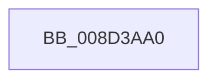

# sub_008D3AA0

- RVA: `0x008D3AA0`–`0x008D3AAB` (길이 `11` bytes)
- VA: `0x00000001408D3AA0`
- 실행 섹션: `PAGE`
- PDB 이름 있음: `아니요`; PDB Function 태그: `아니요`
- unwind 정보 RVA: `0x00084EAC`
- 디코드: `5`개 명령, `11/11` bytes 표시
- 미해석 바이트: `0` (있으면 어셈블리에 `.byte`로 보존)

> 이 문서는 커널 이미지의 기계어와 PDB 기호를 분석해 생성했습니다. 4번과 5번은 함수 원형과 자료형을 바이너리 사용 방식에서 추정한 C 해석이며 원본 소스 복구 결과는 아닙니다.

## 1. Dependencies

- 직접 호출 지점: **0**; 고유 호출 대상: **0**
- 직접 호출자로 확인된 함수: **1**
- RIP 상대 이미지 참조: **0**

### Outgoing calls
- 직접 디코드된 call 명령이 없습니다.

### Direct callers
- [sub_008D3420](Unknown_function_008D3420.md) at `0x008D3521`

### Static image references
- 디코드된 RIP-relative 메모리 참조가 없습니다.

## 2. Other-region calls and transfers

- 다른 실행 섹션으로 향하는 call: **0**
- 별도 외부 분기/꼬리 이동을 확인하지 못했습니다.

## 3. Assembly (complete function range)

```asm
008D3AA0  48 8B C4                        mov rax, rsp
008D3AA3  53                              push rbx
008D3AA4  55                              push rbp
008D3AA5  41 56                           push r14
008D3AA7  48 83 EC 50                     sub rsp, 0x50
```

## 4. C-style interpretation (structured pseudocode)

```c
__int64 __fastcall sub_008D3AA0(void)
{
    __int64 v_rsp;

    v_rsp = (v_rsp) - (80);
    return v_rsp;
}
```

## 5. (Beta) C Style

```c
void sub_008D3AA0(void)
{
    int64_t local_rsp;

    local_rsp = (local_rsp) - (80);
    return local_rsp;
}
```

## 6. Execution-region graph

[열기: 2D/3D 그래프와 함수 탐색 컨트롤 패널](../../../control-panel.html?section=page&rva=0x008D3AA0&view=graph)

- 2D 그래프는 위에서 아래로 흐르고, 3D 그래프는 빈 공간을 드래그해 회전합니다. Shift+드래그는 이동, 휠은 확대·축소, 함수 노드 선택은 대상 보고서 이동입니다.

### Static fallback


