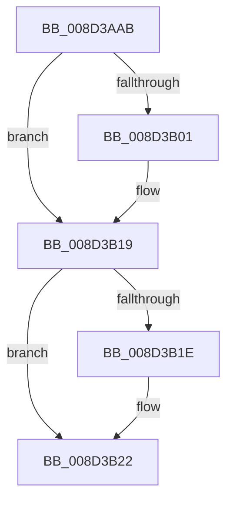

# sub_008D3AAB

- RVA: `0x008D3AAB`–`0x008D3B2C` (길이 `129` bytes)
- VA: `0x00000001408D3AAB`
- 실행 섹션: `PAGE`
- PDB 이름 있음: `아니요`; PDB Function 태그: `아니요`
- unwind 정보 RVA: `0x00084EB8`
- 디코드: `32`개 명령, `129/129` bytes 표시
- 미해석 바이트: `0` (있으면 어셈블리에 `.byte`로 보존)

> 이 문서는 커널 이미지의 기계어와 PDB 기호를 분석해 생성했습니다. 4번과 5번은 함수 원형과 자료형을 바이너리 사용 방식에서 추정한 C 해석이며 원본 소스 복구 결과는 아닙니다.

## 1. Dependencies

- 직접 호출 지점: **2**; 고유 호출 대상: **2**
- 직접 호출자로 확인된 함수: **0**
- RIP 상대 이미지 참조: **2**

### Outgoing calls
- `0x008D3AE7` → [KeAbPreAcquire](../../text/21/KeAbPreAcquire_function_00210230.md) (function, `0x00210230`)
- `0x008D3B14` → [ExfAcquirePushLockSharedEx](../../text/21/ExfAcquirePushLockSharedEx_function_0021044C.md) (function, `0x0021044C`)

### Direct callers
- 이 함수 시작 RVA로 연결되는 직접 call은 확인되지 않았습니다. 간접 호출은 완전히 역산할 수 없습니다.

### Static image references
- `0x008D3ABC` → RVA `0x00E3EA68` (`.data`; read)
- `0x008D3B22` → RVA `0x00E3EA44` (`.data`; read)

## 2. Other-region calls and transfers

- 다른 실행 섹션으로 향하는 call: **2**
  - `0x008D3AE7` → [KeAbPreAcquire](../../text/21/KeAbPreAcquire_function_00210230.md) (`PAGE` → `.text`)
  - `0x008D3B14` → [ExfAcquirePushLockSharedEx](../../text/21/ExfAcquirePushLockSharedEx_function_0021044C.md) (`PAGE` → `.text`)
- 별도 외부 분기/꼬리 이동을 확인하지 못했습니다.

## 3. Assembly (complete function range)

```asm
008D3AAB  48 89 78 10                     mov qword ptr [rax + 0x10], rdi
008D3AAF  33 ED                           xor ebp, ebp
008D3AB1  4C 89 60 18                     mov qword ptr [rax + 0x18], r12
008D3AB5  4C 8B E1                        mov r12, rcx
008D3AB8  4C 89 68 E0                     mov qword ptr [rax - 0x20], r13
008D3ABC  48 8D 0D A5 AF 56 00            lea rcx, [rip + 0x56afa5]
008D3AC3  4C 89 78 D8                     mov qword ptr [rax - 0x28], r15
008D3AC7  44 8B EA                        mov r13d, edx
008D3ACA  48 89 68 C8                     mov qword ptr [rax - 0x38], rbp
008D3ACE  4D 8B F8                        mov r15, r8
008D3AD1  65 48 8B 04 25 88 01 00 00      mov rax, qword ptr gs:[0x188]
008D3ADA  45 33 C0                        xor r8d, r8d
008D3ADD  33 D2                           xor edx, edx
008D3ADF  66 FF 88 E6 01 00 00            dec word ptr [rax + 0x1e6]
008D3AE6  90                              nop
008D3AE7  E8 44 C7 93 FF                  call 0x140210230
008D3AEC  48 8B D8                        mov rbx, rax
008D3AEF  B9 11 00 00 00                  mov ecx, 0x11
008D3AF4  33 C0                           xor eax, eax
008D3AF6  F0 48 0F B1 0D 69 AF 56 00      lock cmpxchg qword ptr [rip + 0x56af69], rcx
008D3AFF  74 18                           je 0x1408d3b19
008D3B01  4C 8D 0D 60 AF 56 00            lea r9, [rip + 0x56af60]
008D3B08  4C 8B C3                        mov r8, rbx
008D3B0B  33 D2                           xor edx, edx
008D3B0D  48 8D 0D 54 AF 56 00            lea rcx, [rip + 0x56af54]
008D3B14  E8 33 C9 93 FF                  call 0x14021044c
008D3B19  48 85 DB                        test rbx, rbx
008D3B1C  74 04                           je 0x1408d3b22
008D3B1E  C6 43 0A 01                     mov byte ptr [rbx + 0xa], 1
008D3B22  8B 3D 1C AF 56 00               mov edi, dword ptr [rip + 0x56af1c]
008D3B28  8B DD                           mov ebx, ebp
008D3B2A  FF CF                           dec edi
```

## 4. C-style interpretation (structured pseudocode)

```c
__int64 __fastcall sub_008D3AAB(__int64 a1, int a2, __int64 a3)
{
    __int64 result;
    __int64 v_rbp;
    __int64 v_rdi;

    *(unsigned __int64 *)(result + 16) = v_rdi;
    v_rbp = 0;
    *(unsigned __int64 *)(result + 24) = v_r12;
    *(unsigned __int64 *)(result - 32) = v_r13;
    *(unsigned __int64 *)(result - 40) = v_r15;
    *(unsigned __int64 *)(result - 56) = 0;
    a3 = 0;
    a2 = 0;
    result = KeAbPreAcquire(v_rip + 5681061, a2, a3, a4);
    result = 0;
    if (!(condition_is_equal)) {
        a4 = v_rip + 5680992;
        a3 = 0;
        a2 = 0;
        a1 = v_rip + 5680980;
        result = ExfAcquirePushLockSharedEx(a1, a2, a3, a4);
    }
    if (result != 0) {
        *(unsigned __int8 *)(result + 10) = 1;
    }
    v_rdi = (unsigned int)(((unsigned int)(*(unsigned int *)(v_rip + 5680924))) - 1);
    return result;
}
```

## 5. (Beta) C Style

```c
int64_t sub_008D3AAB(int64_t Arg1, int32_t Arg2, int64_t Arg3)
{
    int64_t result;
    int64_t local_rbp;
    int64_t local_rdi;

    *(uint64_t *)(result + 0x10) = local_rdi;
    local_rbp = 0;
    *(uint64_t *)(result + 0x18) = local_r12;
    *(uint64_t *)(result - 0x20) = local_r13;
    *(uint64_t *)(result - 0x28) = local_r15;
    *(uint64_t *)(result - 0x38) = 0;
    Arg3 = 0;
    Arg2 = 0;
    result = KeAbPreAcquire(v_rip + 5681061, Arg2, Arg3, a4);
    result = 0;
    if (!(condition_is_equal)) {
        a4 = v_rip + 5680992;
        Arg3 = 0;
        Arg2 = 0;
        Arg1 = v_rip + 5680980;
        result = ExfAcquirePushLockSharedEx(Arg1, Arg2, Arg3, a4);
    }
    if (result != 0) {
        *(uint8_t *)(result + 0xA) = 1;
    }
    local_rdi = (uint32_t)(((uint32_t)(*(uint32_t *)(v_rip + 0x56AF1C))) - 1);
    return result;
}
```

## 6. Execution-region graph

[열기: 2D/3D 그래프와 함수 탐색 컨트롤 패널](../../../control-panel.html?section=page&rva=0x008D3AAB&view=graph)

- 2D 그래프는 위에서 아래로 흐르고, 3D 그래프는 빈 공간을 드래그해 회전합니다. Shift+드래그는 이동, 휠은 확대·축소, 함수 노드 선택은 대상 보고서 이동입니다.

### Static fallback


