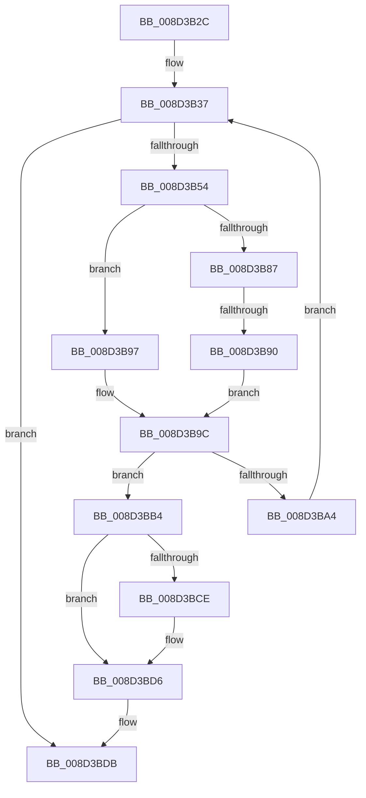

# sub_008D3B2C

- RVA: `0x008D3B2C`–`0x008D3BF4` (길이 `200` bytes)
- VA: `0x00000001408D3B2C`
- 실행 섹션: `PAGE`
- PDB 이름 있음: `아니요`; PDB Function 태그: `아니요`
- unwind 정보 RVA: `0x00084ED8`
- 디코드: `47`개 명령, `200/200` bytes 표시
- 미해석 바이트: `0` (있으면 어셈블리에 `.byte`로 보존)

> 이 문서는 커널 이미지의 기계어와 PDB 기호를 분석해 생성했습니다. 4번과 5번은 함수 원형과 자료형을 바이너리 사용 방식에서 추정한 C 해석이며 원본 소스 복구 결과는 아닙니다.

## 1. Dependencies

- 직접 호출 지점: **2**; 고유 호출 대상: **2**
- 직접 호출자로 확인된 함수: **0**
- RIP 상대 이미지 참조: **7**

### Outgoing calls
- `0x008D3B90` → [sub_008D3F00](Unknown_function_008D3F00.md) (function, `0x008D3F00`)
- `0x008D3B97` → [sub_008D3ED0](Unknown_function_008D3ED0.md) (function, `0x008D3ED0`)

### Direct callers
- 이 함수 시작 RVA로 연결되는 직접 call은 확인되지 않았습니다. 간접 호출은 완전히 역산할 수 없습니다.

### Static image references
- `0x008D3B37` → RVA `0x008D3F30` (`PAGE`; read)
- `0x008D3B3E` → RVA `0x008D3F00` (`PAGE`; read)
- `0x008D3B45` → RVA `0x008D3ED0` (`PAGE`; read)
- `0x008D3B54` → RVA `0x00E3EA50` (`.data`; read)
- `0x008D3B65` → RVA `0x00E3EA60` (`.data`; read)
- `0x008D3B6E` → RVA `0x00E3EA40` (`.data`; read)
- `0x008D3BE5` → RVA `0x00E3EA68` (`.data`; read)

## 2. Other-region calls and transfers

- 다른 실행 섹션으로 향하는 call: **0**
- call이 아닌 외부 분기/꼬리 이동: **2**
  - `0x008D3B8A` → [sub_008D3C8E](Unknown_function_008D3C8E.md) (`tail-transfer`)
  - `0x008D3BEE` → [sub_008D3C9D + 0xC](Unknown_function_008D3C9D.md) (`tail-transfer`)

## 3. Assembly (complete function range)

```asm
008D3B2C  48 89 74 24 70                  mov qword ptr [rsp + 0x70], rsi
008D3B31  41 BE 72 02 00 C0               mov r14d, 0xc0000272
008D3B37  4C 8D 15 F2 03 00 00            lea r10, [rip + 0x3f2]
008D3B3E  4C 8D 0D BB 03 00 00            lea r9, [rip + 0x3bb]
008D3B45  4C 8D 05 84 03 00 00            lea r8, [rip + 0x384]
008D3B4C  3B DF                           cmp ebx, edi
008D3B4E  0F 8F 87 00 00 00               jg 0x1408d3bdb
008D3B54  48 8B 0D F5 AE 56 00            mov rcx, qword ptr [rip + 0x56aef5]
008D3B5B  8D 04 1F                        lea eax, [rdi + rbx]
008D3B5E  99                              cdq
008D3B5F  2B C2                           sub eax, edx
008D3B61  D1 F8                           sar eax, 1
008D3B63  8B F0                           mov esi, eax
008D3B65  48 8B 05 F4 AE 56 00            mov rax, qword ptr [rip + 0x56aef4]
008D3B6C  8B D6                           mov edx, esi
008D3B6E  0F AF 15 CB AE 56 00            imul edx, dword ptr [rip + 0x56aecb]
008D3B75  49 3B C0                        cmp rax, r8
008D3B78  41 B8 08 00 00 00               mov r8d, 8
008D3B7E  48 8B 0C 0A                     mov rcx, qword ptr [rdx + rcx]
008D3B82  49 8B D4                        mov rdx, r12
008D3B85  74 10                           je 0x1408d3b97
008D3B87  49 3B C1                        cmp rax, r9
008D3B8A  0F 85 FE 00 00 00               jne 0x1408d3c8e
008D3B90  E8 6B 03 00 00                  call 0x1408d3f00
008D3B95  EB 05                           jmp 0x1408d3b9c
008D3B97  E8 34 03 00 00                  call 0x1408d3ed0
008D3B9C  48 8B C8                        mov rcx, rax
008D3B9F  48 85 C0                        test rax, rax
008D3BA2  74 10                           je 0x1408d3bb4
008D3BA4  8D 46 01                        lea eax, [rsi + 1]
008D3BA7  0F 49 D8                        cmovns ebx, eax
008D3BAA  8D 46 FF                        lea eax, [rsi - 1]
008D3BAD  0F 49 C7                        cmovns eax, edi
008D3BB0  8B F8                           mov edi, eax
008D3BB2  EB 83                           jmp 0x1408d3b37
008D3BB4  0F AF 35 85 AE 56 00            imul esi, dword ptr [rip + 0x56ae85]
008D3BBB  44 8B F5                        mov r14d, ebp
008D3BBE  48 8B 05 8B AE 56 00            mov rax, qword ptr [rip + 0x56ae8b]
008D3BC5  48 8B 14 06                     mov rdx, qword ptr [rsi + rax]
008D3BC9  48 85 D2                        test rdx, rdx
008D3BCC  74 08                           je 0x1408d3bd6
008D3BCE  F0 48 FF 82 E8 00 00 00         lock inc qword ptr [rdx + 0xe8]
008D3BD6  48 89 54 24 30                  mov qword ptr [rsp + 0x30], rdx
008D3BDB  48 8B 74 24 70                  mov rsi, qword ptr [rsp + 0x70]
008D3BE0  B8 11 00 00 00                  mov eax, 0x11
008D3BE5  F0 48 0F B1 2D 7A AE 56 00      lock cmpxchg qword ptr [rip + 0x56ae7a], rbp
008D3BEE  0F 85 B5 00 00 00               jne 0x1408d3ca9
```

## 4. C-style interpretation (structured pseudocode)

```c
__int64 __fastcall sub_008D3B2C(__int64 a1, int a2, __int64 a3, __int64 a4, __int64 a5, __int64 a6, __int64 a7, __int64 a8, __int64 a9, __int64 a10, __int64 a11, __int64 a12, __int64 a13, __int64 a14)
{
    __int64 result;
    __int64 v_rbx;
    __int64 v_rsi;
    unsigned __int64 v_stack_p30;
    unsigned __int64 v_stack_p70;

    v_stack_p70 = v_rsi;
loc_008D3B37:
    if (((unsigned int)(v_rbx)) > ((unsigned int)(v_rdi))) goto loc_008D3BDB;
    result = (unsigned int)((v_rdi + v_rbx * 1) - (a2));
    result = (unsigned int)((result) >> (1));
    a2 = (unsigned int)(((unsigned int)((unsigned int)((unsigned int)((unsigned int)(result))))) * (*(unsigned int *)(v_rip + 5680843)));
    if ((*(unsigned __int64 *)(v_rip + 5680884)) == (v_rip + 900)) goto loc_008D3B97;
    result = sub_008D3F00(*(unsigned __int64 *)(a2 + *(unsigned __int64 *)(v_rip + 5680885) * 1), v_r12, 8, v_rip + 955);
    goto loc_008D3B9C;
loc_008D3B97:
    result = sub_008D3ED0(*(unsigned __int64 *)(a2 + *(unsigned __int64 *)(v_rip + 5680885) * 1), v_r12, 8, v_rip + 955);
loc_008D3B9C:
    if (result == 0) goto loc_008D3BB4;
    if (!sign_flag) { v_rbx = (unsigned int)((unsigned int)((unsigned int)(result)) + 1); }
    result = (unsigned int)((unsigned int)(result)) - 1;
    if (!sign_flag) { result = (unsigned int)(v_rdi); }
    goto loc_008D3B37;
loc_008D3BB4:
    v_rsi = (unsigned int)(((unsigned int)((unsigned int)(result))) * (*(unsigned int *)(v_rip + 5680773)));
    if (*(unsigned __int64 *)(v_rsi + *(unsigned __int64 *)(v_rip + 5680779) * 1) != 0) {
    }
    v_stack_p30 = *(unsigned __int64 *)(v_rsi + *(unsigned __int64 *)(v_rip + 5680779) * 1);
loc_008D3BDB:
}
```

## 5. (Beta) C Style

```c
int64_t sub_008D3B2C(int64_t Arg1, int32_t Arg2, int64_t Arg3, int64_t Arg4, uint64_t Arg5, uint64_t Arg6, uint64_t Arg7, uint64_t Arg8, uint64_t Arg9, uint64_t Arg10, uint64_t Arg11, uint64_t Arg12, uint64_t Arg13, int64_t Arg14)
{
    int64_t result;
    int64_t local_rbx;
    int64_t local_rsi;
    uint64_t v_stack_p30;
    uint64_t v_stack_p70;

    v_stack_p70 = local_rsi;
loc_008D3B37:
    if (((uint32_t)(local_rbx)) > ((uint32_t)(local_rdi))) goto loc_008D3BDB;
    result = (uint32_t)((local_rdi + local_rbx * 1) - (Arg2));
    result = (uint32_t)((result) >> (1));
    Arg2 = (uint32_t)(((uint32_t)((uint32_t)((uint32_t)((uint32_t)(result))))) * (*(uint32_t *)(v_rip + 0x56AECB)));
    if ((*(uint64_t *)(v_rip + 0x56AEF4)) == (v_rip + 900)) goto loc_008D3B97;
    result = sub_008D3F00(*(uint64_t *)(Arg2 + *(uint64_t *)(v_rip + 0x56AEF5) * 1), local_r12, 8, v_rip + 955);
    goto loc_008D3B9C;
loc_008D3B97:
    result = sub_008D3ED0(*(uint64_t *)(Arg2 + *(uint64_t *)(v_rip + 0x56AEF5) * 1), local_r12, 8, v_rip + 955);
loc_008D3B9C:
    if (result == 0) goto loc_008D3BB4;
    if (!sign_flag) { local_rbx = (uint32_t)((uint32_t)((uint32_t)(result)) + 1); }
    result = (uint32_t)((uint32_t)(result)) - 1;
    if (!sign_flag) { result = (uint32_t)(local_rdi); }
    goto loc_008D3B37;
loc_008D3BB4:
    local_rsi = (uint32_t)(((uint32_t)((uint32_t)(result))) * (*(uint32_t *)(v_rip + 0x56AE85)));
    if (*(uint64_t *)(local_rsi + *(uint64_t *)(v_rip + 0x56AE8B) * 1) != 0) {
    }
    v_stack_p30 = *(uint64_t *)(local_rsi + *(uint64_t *)(v_rip + 0x56AE8B) * 1);
loc_008D3BDB:
}
```

## 6. Execution-region graph

[열기: 2D/3D 그래프와 함수 탐색 컨트롤 패널](../../../control-panel.html?section=page&rva=0x008D3B2C&view=graph)

- 2D 그래프는 위에서 아래로 흐르고, 3D 그래프는 빈 공간을 드래그해 회전합니다. Shift+드래그는 이동, 휠은 확대·축소, 함수 노드 선택은 대상 보고서 이동입니다.

### Static fallback


