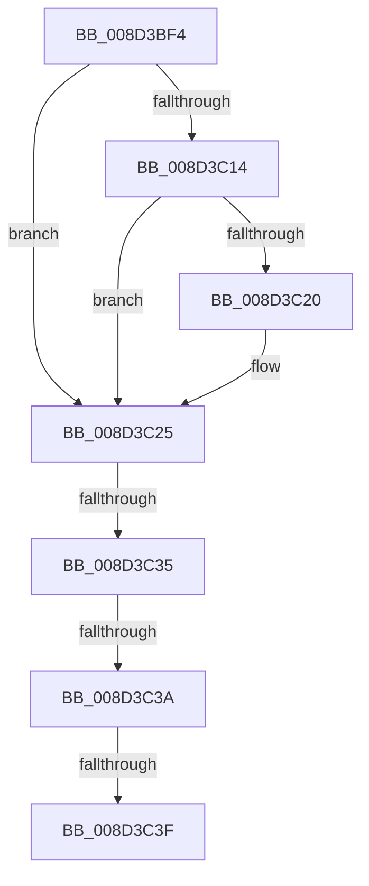

# sub_008D3BF4

- RVA: `0x008D3BF4`–`0x008D3C68` (길이 `116` bytes)
- VA: `0x00000001408D3BF4`
- 실행 섹션: `PAGE`
- PDB 이름 있음: `아니요`; PDB Function 태그: `아니요`
- unwind 정보 RVA: `0x00084EEC`
- 디코드: `27`개 명령, `116/116` bytes 표시
- 미해석 바이트: `0` (있으면 어셈블리에 `.byte`로 보존)

> 이 문서는 커널 이미지의 기계어와 PDB 기호를 분석해 생성했습니다. 4번과 5번은 함수 원형과 자료형을 바이너리 사용 방식에서 추정한 C 해석이며 원본 소스 복구 결과는 아닙니다.

## 1. Dependencies

- 직접 호출 지점: **2**; 고유 호출 대상: **2**
- 직접 호출자로 확인된 함수: **0**
- RIP 상대 이미지 참조: **1**

### Outgoing calls
- `0x008D3BFB` → [KeAbPostRelease](../../text/2E/KeAbPostRelease_function_002E1600.md) (function, `0x002E1600`)
- `0x008D3C20` → [KiCheckForKernelApcDelivery](../../text/2E/KiCheckForKernelApcDelivery_function_002E2C80.md) (function, `0x002E2C80`)

### Direct callers
- 이 함수 시작 RVA로 연결되는 직접 call은 확인되지 않았습니다. 간접 호출은 완전히 역산할 수 없습니다.

### Static image references
- `0x008D3BF4` → RVA `0x00E3EA68` (`.data`; read)

## 2. Other-region calls and transfers

- 다른 실행 섹션으로 향하는 call: **2**
  - `0x008D3BFB` → [KeAbPostRelease](../../text/2E/KeAbPostRelease_function_002E1600.md) (`PAGE` → `.text`)
  - `0x008D3C20` → [KiCheckForKernelApcDelivery](../../text/2E/KiCheckForKernelApcDelivery_function_002E2C80.md) (`PAGE` → `.text`)
- call이 아닌 외부 분기/꼬리 이동: **4**
  - `0x008D3C33` → [sub_008D3C9D](Unknown_function_008D3C9D.md) (`tail-transfer`)
  - `0x008D3C38` → [sub_008D3C9D + 0x5](Unknown_function_008D3C9D.md) (`tail-transfer`)
  - `0x008D3C3D` → [sub_008D3C9D + 0x5](Unknown_function_008D3C9D.md) (`tail-transfer`)
  - `0x008D3C66` → [sub_008D3C68 + 0x19](Unknown_function_008D3C68.md) (`tail-transfer`)

## 3. Assembly (complete function range)

```asm
008D3BF4  48 8D 0D 6D AE 56 00            lea rcx, [rip + 0x56ae6d]
008D3BFB  E8 00 DA A0 FF                  call 0x1402e1600
008D3C00  65 48 8B 04 25 88 01 00 00      mov rax, qword ptr gs:[0x188]
008D3C09  90                              nop
008D3C0A  66 83 80 E6 01 00 00 01         add word ptr [rax + 0x1e6], 1
008D3C12  75 11                           jne 0x1408d3c25
008D3C14  48 05 98 00 00 00               add rax, 0x98
008D3C1A  90                              nop
008D3C1B  48 39 00                        cmp qword ptr [rax], rax
008D3C1E  74 05                           je 0x1408d3c25
008D3C20  E8 5B F0 A0 FF                  call 0x1402e2c80
008D3C25  48 C7 C3 FF FF FF FF            mov rbx, 0xffffffffffffffff
008D3C2C  41 81 FE 72 02 00 C0            cmp r14d, 0xc0000272
008D3C33  74 68                           je 0x1408d3c9d
008D3C35  45 85 F6                        test r14d, r14d
008D3C38  78 68                           js 0x1408d3ca2
008D3C3A  4D 85 FF                        test r15, r15
008D3C3D  74 63                           je 0x1408d3ca2
008D3C3F  48 8B 44 24 30                  mov rax, qword ptr [rsp + 0x30]
008D3C44  49 89 07                        mov qword ptr [r15], rax
008D3C47  48 89 6C 24 30                  mov qword ptr [rsp + 0x30], rbp
008D3C4C  4C 8B 7C 24 40                  mov r15, qword ptr [rsp + 0x40]
008D3C51  4C 8B 6C 24 48                  mov r13, qword ptr [rsp + 0x48]
008D3C56  4C 8B A4 24 80 00 00 00         mov r12, qword ptr [rsp + 0x80]
008D3C5E  48 8B 7C 24 78                  mov rdi, qword ptr [rsp + 0x78]
008D3C63  48 85 ED                        test rbp, rbp
008D3C66  74 19                           je 0x1408d3c81
```

## 4. C-style interpretation (structured pseudocode)

```c
__int64 __fastcall sub_008D3BF4(__int64 a1, __int64 a2, __int64 a3, __int64 a4, __int64 a5, __int64 a6, __int64 a7, __int64 a8, __int64 a9, __int64 a10, __int64 a11, __int64 a12, __int64 a13, __int64 a14, __int64 a15, __int64 a16)
{
    __int64 result;
    unsigned __int64 v_stack_p30;

    result = KeAbPostRelease(v_rip + 5680749, a2, a3, a4);
    if (condition_is_not_equal) goto loc_008D3C25;
    result = (*(unsigned __int64 *)(gs_base + (0 + 392))) + (152);
    if ((*(unsigned __int64 *)(result)) != result) {
        result = KiCheckForKernelApcDelivery(v_rip + 5680749, a2, a3, a4);
    }
    *(unsigned __int64 *)(v_r15) = a6;
    v_stack_p30 = v_rbp;
}
```

## 5. (Beta) C Style

```c
int64_t sub_008D3BF4(int64_t Arg1, int64_t Arg2, int64_t Arg3, int64_t Arg4, uint64_t Arg5, int64_t Arg6, uint64_t Arg7, int64_t Arg8, int64_t Arg9, uint64_t Arg10, uint64_t Arg11, uint64_t Arg12, uint64_t Arg13, uint64_t Arg14, int64_t Arg15, int64_t Arg16)
{
    int64_t result;
    uint64_t v_stack_p30;

    result = KeAbPostRelease(v_rip + 5680749, Arg2, Arg3, Arg4);
    if (condition_is_not_equal) goto loc_008D3C25;
    result = (*(uint64_t *)(gs_base + (0 + 0x188))) + (152);
    if ((*(uint64_t *)(result)) != result) {
        result = KiCheckForKernelApcDelivery(v_rip + 5680749, Arg2, Arg3, Arg4);
    }
    *(uint64_t *)(local_r15) = Arg6;
    v_stack_p30 = local_rbp;
}
```

## 6. Execution-region graph

[열기: 2D/3D 그래프와 함수 탐색 컨트롤 패널](../../../control-panel.html?section=page&rva=0x008D3BF4&view=graph)

- 2D 그래프는 위에서 아래로 흐르고, 3D 그래프는 빈 공간을 드래그해 회전합니다. Shift+드래그는 이동, 휠은 확대·축소, 함수 노드 선택은 대상 보고서 이동입니다.

### Static fallback


