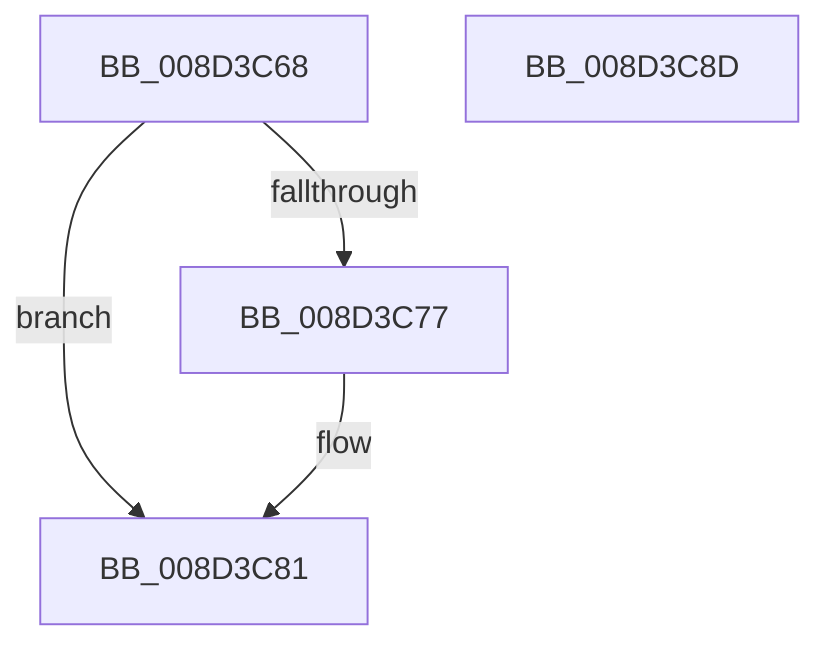

# sub_008D3C68

- RVA: `0x008D3C68`–`0x008D3C8E` (길이 `38` bytes)
- VA: `0x00000001408D3C68`
- 실행 섹션: `PAGE`
- PDB 이름 있음: `아니요`; PDB Function 태그: `아니요`
- unwind 정보 RVA: `0x00084EFC`
- 디코드: `12`개 명령, `38/38` bytes 표시
- 미해석 바이트: `0` (있으면 어셈블리에 `.byte`로 보존)

> 이 문서는 커널 이미지의 기계어와 PDB 기호를 분석해 생성했습니다. 4번과 5번은 함수 원형과 자료형을 바이너리 사용 방식에서 추정한 C 해석이며 원본 소스 복구 결과는 아닙니다.

## 1. Dependencies

- 직접 호출 지점: **1**; 고유 호출 대상: **1**
- 직접 호출자로 확인된 함수: **0**
- RIP 상대 이미지 참조: **0**

### Outgoing calls
- `0x008D3C7C` → [sub_008D4104](Unknown_function_008D4104.md) (function, `0x008D4104`)

### Direct callers
- 이 함수 시작 RVA로 연결되는 직접 call은 확인되지 않았습니다. 간접 호출은 완전히 역산할 수 없습니다.

### Static image references
- 디코드된 RIP-relative 메모리 참조가 없습니다.

## 2. Other-region calls and transfers

- 다른 실행 섹션으로 향하는 call: **0**
- 별도 외부 분기/꼬리 이동을 확인하지 못했습니다.

## 3. Assembly (complete function range)

```asm
008D3C68  F0 48 0F C1 9D E8 00 00 00      lock xadd qword ptr [rbp + 0xe8], rbx
008D3C71  48 83 FB 01                     cmp rbx, 1
008D3C75  75 0A                           jne 0x1408d3c81
008D3C77  48 8B 4C 24 30                  mov rcx, qword ptr [rsp + 0x30]
008D3C7C  E8 83 04 00 00                  call 0x1408d4104
008D3C81  41 8B C6                        mov eax, r14d
008D3C84  48 83 C4 50                     add rsp, 0x50
008D3C88  41 5E                           pop r14
008D3C8A  5D                              pop rbp
008D3C8B  5B                              pop rbx
008D3C8C  C3                              ret
008D3C8D  CC                              int3
```

## 4. C-style interpretation (structured pseudocode)

```c
__int64 __fastcall sub_008D3C68(__int64 a1, __int64 a2, __int64 a3, __int64 a4, __int64 a5, __int64 a6)
{
    __int64 result;
    __int64 v_rsp;

    if (v_rbx == 1) {
        a1 = a6;
        result = sub_008D4104(a1, a2, a3, a4);
    }
    v_rsp = (v_rsp) + (80);
    return (unsigned int)((unsigned int)(v_r14));
}
```

## 5. (Beta) C Style

```c
int64_t sub_008D3C68(int64_t Arg1, int64_t Arg2, int64_t Arg3, int64_t Arg4, uint64_t Arg5, int64_t Arg6)
{
    int64_t result;
    int64_t local_rsp;

    if (local_rbx == 1) {
        Arg1 = Arg6;
        result = sub_008D4104(Arg1, Arg2, Arg3, Arg4);
    }
    local_rsp = (local_rsp) + (80);
    return (uint32_t)((uint32_t)(local_r14));
}
```

## 6. Execution-region graph

[열기: 2D/3D 그래프와 함수 탐색 컨트롤 패널](../../../control-panel.html?section=page&rva=0x008D3C68&view=graph)

- 2D 그래프는 위에서 아래로 흐르고, 3D 그래프는 빈 공간을 드래그해 회전합니다. Shift+드래그는 이동, 휠은 확대·축소, 함수 노드 선택은 대상 보고서 이동입니다.

### Static fallback


