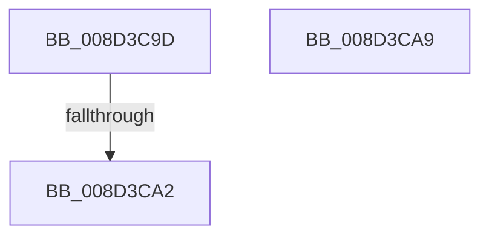

# sub_008D3C9D

- RVA: `0x008D3C9D`–`0x008D3CBA` (길이 `29` bytes)
- VA: `0x00000001408D3C9D`
- 실행 섹션: `PAGE`
- PDB 이름 있음: `아니요`; PDB Function 태그: `아니요`
- unwind 정보 RVA: `0x00084F34`
- 디코드: `7`개 명령, `29/29` bytes 표시
- 미해석 바이트: `0` (있으면 어셈블리에 `.byte`로 보존)

> 이 문서는 커널 이미지의 기계어와 PDB 기호를 분석해 생성했습니다. 4번과 5번은 함수 원형과 자료형을 바이너리 사용 방식에서 추정한 C 해석이며 원본 소스 복구 결과는 아닙니다.

## 1. Dependencies

- 직접 호출 지점: **1**; 고유 호출 대상: **1**
- 직접 호출자로 확인된 함수: **0**
- RIP 상대 이미지 참조: **1**

### Outgoing calls
- `0x008D3CB0` → [ExfReleasePushLockShared](../../text/26/ExfReleasePushLockShared_function_00263440.md) (function, `0x00263440`)

### Direct callers
- 이 함수 시작 RVA로 연결되는 직접 call은 확인되지 않았습니다. 간접 호출은 완전히 역산할 수 없습니다.

### Static image references
- `0x008D3CA9` → RVA `0x00E3EA68` (`.data`; read)

## 2. Other-region calls and transfers

- 다른 실행 섹션으로 향하는 call: **1**
  - `0x008D3CB0` → [ExfReleasePushLockShared](../../text/26/ExfReleasePushLockShared_function_00263440.md) (`PAGE` → `.text`)
- call이 아닌 외부 분기/꼬리 이동: **3**
  - `0x008D3CA0` → [sub_008D3CC4](Unknown_function_008D3CC4.md) (`tail-transfer`)
  - `0x008D3CA7` → [sub_008D3BF4 + 0x58](Unknown_function_008D3BF4.md) (`tail-transfer`)
  - `0x008D3CB5` → [sub_008D3BF4](Unknown_function_008D3BF4.md) (`tail-transfer`)

## 3. Assembly (complete function range)

```asm
008D3C9D  45 85 ED                        test r13d, r13d
008D3CA0  75 22                           jne 0x1408d3cc4
008D3CA2  48 8B 6C 24 30                  mov rbp, qword ptr [rsp + 0x30]
008D3CA7  EB A3                           jmp 0x1408d3c4c
008D3CA9  48 8D 0D B8 AD 56 00            lea rcx, [rip + 0x56adb8]
008D3CB0  E8 8B F7 98 FF                  call 0x140263440
008D3CB5  E9 3A FF FF FF                  jmp 0x1408d3bf4
```

## 4. C-style interpretation (structured pseudocode)

```c
__int64 __fastcall sub_008D3C9D(__int64 a1, __int64 a2, __int64 a3, __int64 a4, __int64 a5, __int64 a6)
{
}
```

## 5. (Beta) C Style

```c
int64_t sub_008D3C9D(int64_t Arg1, int64_t Arg2, int64_t Arg3, int64_t Arg4, uint64_t Arg5, int64_t Arg6)
{
}
```

## 6. Execution-region graph

[열기: 2D/3D 그래프와 함수 탐색 컨트롤 패널](../../../control-panel.html?section=page&rva=0x008D3C9D&view=graph)

- 2D 그래프는 위에서 아래로 흐르고, 3D 그래프는 빈 공간을 드래그해 회전합니다. Shift+드래그는 이동, 휠은 확대·축소, 함수 노드 선택은 대상 보고서 이동입니다.

### Static fallback


