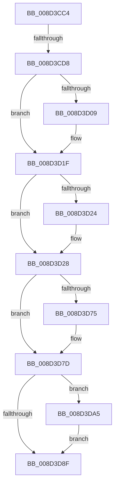

# sub_008D3CC4

- RVA: `0x008D3CC4`–`0x008D3DB3` (길이 `239` bytes)
- VA: `0x00000001408D3CC4`
- 실행 섹션: `PAGE`
- PDB 이름 있음: `아니요`; PDB Function 태그: `아니요`
- unwind 정보 RVA: `0x00084F78`
- 디코드: `52`개 명령, `239/239` bytes 표시
- 미해석 바이트: `0` (있으면 어셈블리에 `.byte`로 보존)

> 이 문서는 커널 이미지의 기계어와 PDB 기호를 분석해 생성했습니다. 4번과 5번은 함수 원형과 자료형을 바이너리 사용 방식에서 추정한 C 해석이며 원본 소스 복구 결과는 아닙니다.

## 1. Dependencies

- 직접 호출 지점: **8**; 고유 호출 대상: **8**
- 직접 호출자로 확인된 함수: **0**
- RIP 상대 이미지 참조: **3**

### Outgoing calls
- `0x008D3CCC` → [sub_00A8F270](../A8/Unknown_function_00A8F270.md) (function, `0x00A8F270`)
- `0x008D3CF5` → [KeAbPreAcquire](../../text/21/KeAbPreAcquire_function_00210230.md) (function, `0x00210230`)
- `0x008D3D1A` → [ExfAcquirePushLockExclusiveEx](../../text/20/ExfAcquirePushLockExclusiveEx_function_0020FC90.md) (function, `0x0020FC90`)
- `0x008D3D52` → [sub_008D3DC0](Unknown_function_008D3DC0.md) (function, `0x008D3DC0`)
- `0x008D3D69` → [sub_00702150](../70/Unknown_function_00702150.md) (function, `0x00702150`)
- `0x008D3D96` → [KeAbPostRelease](../../text/2E/KeAbPostRelease_function_002E1600.md) (function, `0x002E1600`)
- `0x008D3D9B` → [KeLeaveGuardedRegion](../../text/2E/KeLeaveGuardedRegion_function_002E2C40.md) (function, `0x002E2C40`)
- `0x008D3DAC` → [ExfTryToWakePushLock](../../text/26/ExfTryToWakePushLock_function_00265DD0.md) (function, `0x00265DD0`)

### Direct callers
- 이 함수 시작 RVA로 연결되는 직접 call은 확인되지 않았습니다. 간접 호출은 완전히 역산할 수 없습니다.

### Static image references
- `0x008D3CE1` → RVA `0x00E3EA68` (`.data`; read)
- `0x008D3CFA` → RVA `0x00E3EA68` (`.data`; read/write)
- `0x008D3D3F` → RVA `0x00E3EA40` (`.data`; read)

## 2. Other-region calls and transfers

- 다른 실행 섹션으로 향하는 call: **5**
  - `0x008D3CF5` → [KeAbPreAcquire](../../text/21/KeAbPreAcquire_function_00210230.md) (`PAGE` → `.text`)
  - `0x008D3D1A` → [ExfAcquirePushLockExclusiveEx](../../text/20/ExfAcquirePushLockExclusiveEx_function_0020FC90.md) (`PAGE` → `.text`)
  - `0x008D3D96` → [KeAbPostRelease](../../text/2E/KeAbPostRelease_function_002E1600.md) (`PAGE` → `.text`)
  - `0x008D3D9B` → [KeLeaveGuardedRegion](../../text/2E/KeLeaveGuardedRegion_function_002E2C40.md) (`PAGE` → `.text`)
  - `0x008D3DAC` → [ExfTryToWakePushLock](../../text/26/ExfTryToWakePushLock_function_00265DD0.md) (`PAGE` → `.text`)
- call이 아닌 외부 분기/꼬리 이동: **2**
  - `0x008D3CD6` → [sub_008D3C9D + 0x5](Unknown_function_008D3C9D.md) (`tail-transfer`)
  - `0x008D3DA0` → [sub_008D3BF4 + 0x41](Unknown_function_008D3BF4.md) (`tail-transfer`)

## 3. Assembly (complete function range)

```asm
008D3CC4  48 8D 54 24 30                  lea rdx, [rsp + 0x30]
008D3CC9  49 8B CC                        mov rcx, r12
008D3CCC  E8 9F B5 1B 00                  call 0x140a8f270
008D3CD1  44 8B F0                        mov r14d, eax
008D3CD4  85 C0                           test eax, eax
008D3CD6  78 CA                           js 0x1408d3ca2
008D3CD8  65 48 8B 04 25 88 01 00 00      mov rax, qword ptr gs:[0x188]
008D3CE1  48 8D 0D 80 AD 56 00            lea rcx, [rip + 0x56ad80]
008D3CE8  45 33 C0                        xor r8d, r8d
008D3CEB  33 D2                           xor edx, edx
008D3CED  66 FF 88 E6 01 00 00            dec word ptr [rax + 0x1e6]
008D3CF4  90                              nop
008D3CF5  E8 36 C5 93 FF                  call 0x140210230
008D3CFA  F0 48 0F BA 2D 64 AD 56 00 00   lock bts qword ptr [rip + 0x56ad64], 0
008D3D04  48 8B F8                        mov rdi, rax
008D3D07  73 16                           jae 0x1408d3d1f
008D3D09  4C 8D 05 58 AD 56 00            lea r8, [rip + 0x56ad58]
008D3D10  48 8B D0                        mov rdx, rax
008D3D13  48 8D 0D 4E AD 56 00            lea rcx, [rip + 0x56ad4e]
008D3D1A  E8 71 BF 93 FF                  call 0x14020fc90
008D3D1F  48 85 FF                        test rdi, rdi
008D3D22  74 04                           je 0x1408d3d28
008D3D24  C6 47 0A 01                     mov byte ptr [rdi + 0xa], 1
008D3D28  48 8B 7C 24 30                  mov rdi, qword ptr [rsp + 0x30]
008D3D2D  48 8D 84 24 88 00 00 00         lea rax, [rsp + 0x88]
008D3D35  45 33 C9                        xor r9d, r9d
008D3D38  89 9C 24 88 00 00 00            mov dword ptr [rsp + 0x88], ebx
008D3D3F  48 8D 0D FA AC 56 00            lea rcx, [rip + 0x56acfa]
008D3D46  48 89 44 24 20                  mov qword ptr [rsp + 0x20], rax
008D3D4B  48 8B 17                        mov rdx, qword ptr [rdi]
008D3D4E  45 8D 41 08                     lea r8d, [r9 + 8]
008D3D52  E8 69 00 00 00                  call 0x1408d3dc0
008D3D57  44 8B 8C 24 88 00 00 00         mov r9d, dword ptr [rsp + 0x88]
008D3D5F  48 8D 0D DA AC 56 00            lea rcx, [rip + 0x56acda]
008D3D66  48 8B D7                        mov rdx, rdi
008D3D69  E8 E2 E3 E2 FF                  call 0x140702150
008D3D6E  44 8B F0                        mov r14d, eax
008D3D71  85 C0                           test eax, eax
008D3D73  78 08                           js 0x1408d3d7d
008D3D75  F0 48 FF 87 E8 00 00 00         lock inc qword ptr [rdi + 0xe8]
008D3D7D  48 8B C3                        mov rax, rbx
008D3D80  F0 48 0F C1 05 DF AC 56 00      lock xadd qword ptr [rip + 0x56acdf], rax
008D3D89  24 06                           and al, 6
008D3D8B  3C 02                           cmp al, 2
008D3D8D  74 16                           je 0x1408d3da5
008D3D8F  48 8D 0D D2 AC 56 00            lea rcx, [rip + 0x56acd2]
008D3D96  E8 65 D8 A0 FF                  call 0x1402e1600
008D3D9B  E8 A0 EE A0 FF                  call 0x1402e2c40
008D3DA0  E9 90 FE FF FF                  jmp 0x1408d3c35
008D3DA5  48 8D 0D BC AC 56 00            lea rcx, [rip + 0x56acbc]
008D3DAC  E8 1F 20 99 FF                  call 0x140265dd0
008D3DB1  EB DC                           jmp 0x1408d3d8f
```

## 4. C-style interpretation (structured pseudocode)

```c
__int64 __fastcall sub_008D3CC4(__int64 a1, __int64 a2, int a3, int a4, __int64 a5, __int64 a6, __int64 a7, __int64 a8, __int64 a9, __int64 a10, __int64 a11, __int64 a12, __int64 a13, __int64 a14, __int64 a15, __int64 a16, unsigned int a17)
{
    __int64 result;
    unsigned __int64 v_stack_p20;
    unsigned int v_stack_p88;

    result = sub_00A8F270(v_r12, a6, a3, a4);
    a3 = 0;
    a2 = 0;
    result = KeAbPreAcquire(v_rip + 5680512, a2, a3, a4);
    if (!(condition_is_above_or_equal)) {
        a3 = v_rip + 5680472;
        a2 = result;
        a1 = v_rip + 5680462;
        result = ExfAcquirePushLockExclusiveEx(a1, a2, a3, a4);
    }
    if (result != 0) {
        *(unsigned __int8 *)(result + 10) = 1;
    }
    a4 = 0;
    v_stack_p88 = (unsigned int)(v_rbx);
    v_stack_p20 = a17;
    result = sub_008D3DC0(v_rip + 5680378, *(unsigned __int64 *)(a6), a4 + 8, a4);
    result = sub_00702150(v_rip + 5680346, a6, a4 + 8, (unsigned int)(a17));
    if (!(sign_flag)) {
    }
    result = (unsigned __int8)((v_rbx) & (6));
    if (((unsigned __int8)(result)) == 2) goto loc_008D3DA5;
loc_008D3D8F:
    result = KeAbPostRelease(v_rip + 5680338, a6, a4 + 8, (unsigned int)(a17));
    result = KeLeaveGuardedRegion(v_rip + 5680338, a6, a4 + 8, (unsigned int)(a17));
loc_008D3DA5:
    result = ExfTryToWakePushLock(v_rip + 5680316, a6, a4 + 8, (unsigned int)(a17));
    goto loc_008D3D8F;
}
```

## 5. (Beta) C Style

```c
int64_t sub_008D3CC4(int64_t Arg1, int64_t Arg2, int32_t Arg3, int32_t Arg4, uint64_t Arg5, void *Arg6, uint64_t Arg7, uint64_t Arg8, uint64_t Arg9, uint64_t Arg10, uint64_t Arg11, uint64_t Arg12, uint64_t Arg13, uint64_t Arg14, uint64_t Arg15, uint64_t Arg16, uint32_t Arg17)
{
    uint8_t *arg6 = (uint8_t *)Arg6;

    int64_t result;
    uint64_t v_stack_p20;
    uint32_t v_stack_p88;

    result = sub_00A8F270(local_r12, Arg6, Arg3, Arg4);
    Arg3 = 0;
    Arg2 = 0;
    result = KeAbPreAcquire(v_rip + 5680512, Arg2, Arg3, Arg4);
    if (!(condition_is_above_or_equal)) {
        Arg3 = v_rip + 5680472;
        Arg2 = result;
        Arg1 = v_rip + 5680462;
        result = ExfAcquirePushLockExclusiveEx(Arg1, Arg2, Arg3, Arg4);
    }
    if (result != 0) {
        *(uint8_t *)(result + 0xA) = 1;
    }
    Arg4 = 0;
    v_stack_p88 = (uint32_t)(local_rbx);
    v_stack_p20 = Arg17;
    result = sub_008D3DC0(v_rip + 5680378, *(uint64_t *)(arg6), Arg4 + 8, Arg4);
    result = sub_00702150(v_rip + 5680346, Arg6, Arg4 + 8, (uint32_t)(Arg17));
    if (!(sign_flag)) {
    }
    result = (uint8_t)((local_rbx) & (6));
    if (((uint8_t)(result)) == 2) goto loc_008D3DA5;
loc_008D3D8F:
    result = KeAbPostRelease(v_rip + 5680338, Arg6, Arg4 + 8, (uint32_t)(Arg17));
    result = KeLeaveGuardedRegion(v_rip + 5680338, Arg6, Arg4 + 8, (uint32_t)(Arg17));
loc_008D3DA5:
    result = ExfTryToWakePushLock(v_rip + 5680316, Arg6, Arg4 + 8, (uint32_t)(Arg17));
    goto loc_008D3D8F;
}
```

### 관측된 메모리 오프셋

구조체 형식이 확인되지 않은 접근은 인자 기준의 오프셋으로만 기록했습니다.

| 기준 인자 | 오프셋 표현 | 폭 (bit) | 접근 |
|---|---:|---:|---|
| `Arg6` | `+ 0x0` | `64` | `R` |
| `Arg6` | `+ 0xE8` | `64` | `R/W` |

## 6. Execution-region graph

[열기: 2D/3D 그래프와 함수 탐색 컨트롤 패널](../../../control-panel.html?section=page&rva=0x008D3CC4&view=graph)

- 2D 그래프는 위에서 아래로 흐르고, 3D 그래프는 빈 공간을 드래그해 회전합니다. Shift+드래그는 이동, 휠은 확대·축소, 함수 노드 선택은 대상 보고서 이동입니다.

### Static fallback


