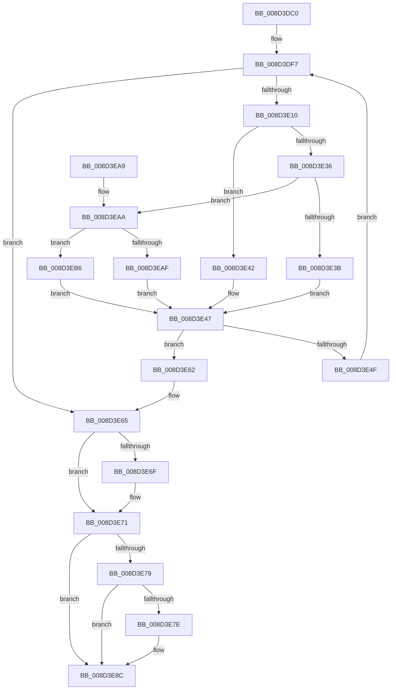

# sub_008D3DC0

- RVA: `0x008D3DC0`–`0x008D3EC0` (길이 `256` bytes)
- VA: `0x00000001408D3DC0`
- 실행 섹션: `PAGE`
- PDB 이름 있음: `아니요`; PDB Function 태그: `아니요`
- unwind 정보 RVA: `0x00084F98`
- 디코드: `84`개 명령, `256/256` bytes 표시
- 미해석 바이트: `0` (있으면 어셈블리에 `.byte`로 보존)

> 이 문서는 커널 이미지의 기계어와 PDB 기호를 분석해 생성했습니다. 4번과 5번은 함수 원형과 자료형을 바이너리 사용 방식에서 추정한 C 해석이며 원본 소스 복구 결과는 아닙니다.

## 1. Dependencies

- 직접 호출 지점: **4**; 고유 호출 대상: **4**
- 직접 호출자로 확인된 함수: **7**
- RIP 상대 이미지 참조: **3**

### Outgoing calls
- `0x008D3E3B` → [sub_008D3F00](Unknown_function_008D3F00.md) (function, `0x008D3F00`)
- `0x008D3E42` → [sub_008D3ED0](Unknown_function_008D3ED0.md) (function, `0x008D3ED0`)
- `0x008D3EAF` → [sub_008D3F30](Unknown_function_008D3F30.md) (function, `0x008D3F30`)
- `0x008D3EB9` → [guard_dispatch_icall](../../text/6B/guard_dispatch_icall_function_006BAAD0.md) (function, `0x006BAAD0`)

### Direct callers
- [sub_008D0970](Unknown_function_008D0970.md) at `0x008D09A5`
- [sub_008D22F4](Unknown_function_008D22F4.md) at `0x008D232A`
- [sub_008D2420](Unknown_function_008D2420.md) at `0x008D24AB`
- [sub_008D3CC4](Unknown_function_008D3CC4.md) at `0x008D3D52`
- [sub_00907768](../90/Unknown_function_00907768.md) at `0x00907874`
- [sub_009A03AC](../9A/Unknown_function_009A03AC.md) at `0x009A0447`
- [sub_00A67F9C](../A6/Unknown_function_00A67F9C.md) at `0x00A67FC8`

### Static image references
- `0x008D3DF7` → RVA `0x008D3F30` (`PAGE`; read)
- `0x008D3DFE` → RVA `0x008D3F00` (`PAGE`; read)
- `0x008D3E05` → RVA `0x008D3ED0` (`PAGE`; read)

## 2. Other-region calls and transfers

- 다른 실행 섹션으로 향하는 call: **1**
  - `0x008D3EB9` → [guard_dispatch_icall](../../text/6B/guard_dispatch_icall_function_006BAAD0.md) (`PAGE` → `.text`)
- 별도 외부 분기/꼬리 이동을 확인하지 못했습니다.

## 3. Assembly (complete function range)

```asm
008D3DC0  48 89 5C 24 08                  mov qword ptr [rsp + 8], rbx
008D3DC5  48 89 6C 24 10                  mov qword ptr [rsp + 0x10], rbp
008D3DCA  48 89 74 24 18                  mov qword ptr [rsp + 0x18], rsi
008D3DCF  57                              push rdi
008D3DD0  41 54                           push r12
008D3DD2  41 55                           push r13
008D3DD4  41 56                           push r14
008D3DD6  41 57                           push r15
008D3DD8  48 83 EC 20                     sub rsp, 0x20
008D3DDC  8B 79 04                        mov edi, dword ptr [rcx + 4]
008D3DDF  33 ED                           xor ebp, ebp
008D3DE1  FF CF                           dec edi
008D3DE3  4D 8B F9                        mov r15, r9
008D3DE6  33 DB                           xor ebx, ebx
008D3DE8  45 8B E0                        mov r12d, r8d
008D3DEB  4C 8B EA                        mov r13, rdx
008D3DEE  48 8B F1                        mov rsi, rcx
008D3DF1  41 BE 72 02 00 C0               mov r14d, 0xc0000272
008D3DF7  4C 8D 1D 32 01 00 00            lea r11, [rip + 0x132]
008D3DFE  4C 8D 15 FB 00 00 00            lea r10, [rip + 0xfb]
008D3E05  4C 8D 05 C4 00 00 00            lea r8, [rip + 0xc4]
008D3E0C  3B EF                           cmp ebp, edi
008D3E0E  7F 55                           jg 0x1408d3e65
008D3E10  4C 8B 4E 20                     mov r9, qword ptr [rsi + 0x20]
008D3E14  8D 04 2F                        lea eax, [rdi + rbp]
008D3E17  99                              cdq
008D3E18  2B C2                           sub eax, edx
008D3E1A  49 8B D5                        mov rdx, r13
008D3E1D  D1 F8                           sar eax, 1
008D3E1F  8B C8                           mov ecx, eax
008D3E21  8B D8                           mov ebx, eax
008D3E23  0F AF 0E                        imul ecx, dword ptr [rsi]
008D3E26  48 8B 46 10                     mov rax, qword ptr [rsi + 0x10]
008D3E2A  4D 3B C8                        cmp r9, r8
008D3E2D  45 8B C4                        mov r8d, r12d
008D3E30  48 8B 0C 01                     mov rcx, qword ptr [rcx + rax]
008D3E34  74 0C                           je 0x1408d3e42
008D3E36  4D 3B CA                        cmp r9, r10
008D3E39  75 6F                           jne 0x1408d3eaa
008D3E3B  E8 C0 00 00 00                  call 0x1408d3f00
008D3E40  EB 05                           jmp 0x1408d3e47
008D3E42  E8 89 00 00 00                  call 0x1408d3ed0
008D3E47  48 8B D0                        mov rdx, rax
008D3E4A  48 85 C0                        test rax, rax
008D3E4D  74 13                           je 0x1408d3e62
008D3E4F  8D 43 FF                        lea eax, [rbx - 1]
008D3E52  8D 4B 01                        lea ecx, [rbx + 1]
008D3E55  0F 49 C7                        cmovns eax, edi
008D3E58  8B F8                           mov edi, eax
008D3E5A  0F 49 E9                        cmovns ebp, ecx
008D3E5D  0F 49 D9                        cmovns ebx, ecx
008D3E60  EB 95                           jmp 0x1408d3df7
008D3E62  45 33 F6                        xor r14d, r14d
008D3E65  48 8B 44 24 70                  mov rax, qword ptr [rsp + 0x70]
008D3E6A  48 85 C0                        test rax, rax
008D3E6D  74 02                           je 0x1408d3e71
008D3E6F  89 18                           mov dword ptr [rax], ebx
008D3E71  41 8B C6                        mov eax, r14d
008D3E74  4D 85 FF                        test r15, r15
008D3E77  74 13                           je 0x1408d3e8c
008D3E79  45 85 F6                        test r14d, r14d
008D3E7C  78 0E                           js 0x1408d3e8c
008D3E7E  0F AF 1E                        imul ebx, dword ptr [rsi]
008D3E81  48 8B 4E 10                     mov rcx, qword ptr [rsi + 0x10]
008D3E85  48 8B 14 0B                     mov rdx, qword ptr [rbx + rcx]
008D3E89  49 89 17                        mov qword ptr [r15], rdx
008D3E8C  48 8B 5C 24 50                  mov rbx, qword ptr [rsp + 0x50]
008D3E91  48 8B 6C 24 58                  mov rbp, qword ptr [rsp + 0x58]
008D3E96  48 8B 74 24 60                  mov rsi, qword ptr [rsp + 0x60]
008D3E9B  48 83 C4 20                     add rsp, 0x20
008D3E9F  41 5F                           pop r15
008D3EA1  41 5E                           pop r14
008D3EA3  41 5D                           pop r13
008D3EA5  41 5C                           pop r12
008D3EA7  5F                              pop rdi
008D3EA8  C3                              ret
008D3EA9  CC                              int3
008D3EAA  4D 3B CB                        cmp r9, r11
008D3EAD  75 07                           jne 0x1408d3eb6
008D3EAF  E8 7C 00 00 00                  call 0x1408d3f30
008D3EB4  EB 91                           jmp 0x1408d3e47
008D3EB6  49 8B C1                        mov rax, r9
008D3EB9  E8 12 6C DE FF                  call 0x1406baad0
008D3EBE  EB 87                           jmp 0x1408d3e47
```

## 4. C-style interpretation (structured pseudocode)

```c
__int64 __fastcall sub_008D3DC0(__int64 a1, __int64 a2, int a3, __int64 a4, __int64 a5)
{
    __int64 result;
    __int64 v_r14;
    __int64 v_rbp;
    __int64 v_rbx;
    __int64 v_rdi;
    __int64 v_rsp;
    unsigned __int64 v_stack_p10;
    unsigned __int64 v_stack_p18;
    unsigned __int64 v_stack_p8;

    v_stack_p8 = v_rbx;
    v_stack_p10 = v_rbp;
    v_stack_p18 = v_rsi;
    v_rsp = (v_rsp) - (32);
    v_rbp = 0;
    v_rdi = (unsigned int)(((unsigned int)(*(unsigned int *)(a1 + 4))) - 1);
    v_rbx = 0;
loc_008D3DF7:
    if (0 > ((unsigned int)(v_rdi))) goto loc_008D3E65;
    result = (unsigned int)((v_rdi + v_rbp * 1) - ((unsigned int)(a2)));
    result = (unsigned int)((result) >> (1));
    a1 = (unsigned int)(((unsigned int)((unsigned int)(result))) * (*(unsigned int *)(a1)));
    if ((*(unsigned __int64 *)(a1 + 32)) == (v_rip + 196)) goto loc_008D3E42;
    if ((*(unsigned __int64 *)(a1 + 32)) != (v_rip + 251)) goto loc_008D3EAA;
    result = sub_008D3F00(*(unsigned __int64 *)(a1 + *(unsigned __int64 *)(a1 + 16) * 1), a2, (unsigned int)((unsigned int)((unsigned int)(a3))), *(unsigned __int64 *)(a1 + 32));
    goto loc_008D3E47;
loc_008D3E42:
    result = sub_008D3ED0(*(unsigned __int64 *)(a1 + *(unsigned __int64 *)(a1 + 16) * 1), a2, (unsigned int)((unsigned int)((unsigned int)(a3))), *(unsigned __int64 *)(a1 + 32));
loc_008D3E47:
    if (result == 0) goto loc_008D3E62;
    result = (unsigned int)((unsigned int)(result)) - 1;
    if (!sign_flag) {
        result = (unsigned int)(v_rdi);
        v_rbp = (unsigned int)((unsigned int)((unsigned int)(result)) + 1);
    }
    v_rbx = (unsigned int)((unsigned int)(result));
    if (!sign_flag) { v_rbx = (unsigned int)((unsigned int)((unsigned int)(result)) + 1); }
    goto loc_008D3DF7;
loc_008D3E62:
    v_r14 = 0;
loc_008D3E65:
    if (a5 != 0) {
        *(unsigned int *)(a5) = (unsigned int)(v_rbx);
    }
    if (a4 == 0) goto loc_008D3E8C;
    if (!(sign_flag)) {
        v_rbx = (unsigned int)((v_rbx) * (*(unsigned int *)(a1)));
        a1 = *(unsigned __int64 *)(a1 + 16);
        a2 = *(unsigned __int64 *)(v_rbx + a1 * 1);
        *(unsigned __int64 *)(a4) = a2;
    }
    v_rsp = (v_rsp) + (32);
    return 0;
loc_008D3EAA:
    if ((*(unsigned __int64 *)(a1 + 32)) != (v_rip + 306)) goto loc_008D3EB6;
    result = sub_008D3F30(a1, a2, (unsigned int)((unsigned int)((unsigned int)(a3))), *(unsigned __int64 *)(a1 + 32));
    goto loc_008D3E47;
loc_008D3EB6:
    result = guard_dispatch_icall(a1, a2, (unsigned int)((unsigned int)((unsigned int)(a3))), *(unsigned __int64 *)(a1 + 32));
    goto loc_008D3E47;
}
```

## 5. (Beta) C Style

```c
int64_t sub_008D3DC0(void *Arg1, int64_t Arg2, int32_t Arg3, int64_t Arg4, int64_t Arg5)
{
    uint8_t *arg1 = (uint8_t *)Arg1;

    int64_t result;
    int64_t local_r14;
    int64_t local_rbp;
    int64_t local_rbx;
    int64_t local_rdi;
    int64_t local_rsp;
    uint64_t v_stack_p10;
    uint64_t v_stack_p18;
    uint64_t v_stack_p8;

    v_stack_p8 = local_rbx;
    v_stack_p10 = local_rbp;
    v_stack_p18 = local_rsi;
    local_rsp = (local_rsp) - (32);
    local_rbp = 0;
    local_rdi = (uint32_t)(((uint32_t)(*(uint32_t *)(arg1 + 0x4))) - 1);
    local_rbx = 0;
loc_008D3DF7:
    if (0 > ((uint32_t)(local_rdi))) goto loc_008D3E65;
    result = (uint32_t)((local_rdi + local_rbp * 1) - ((uint32_t)(Arg2)));
    result = (uint32_t)((result) >> (1));
    Arg1 = (uint32_t)(((uint32_t)((uint32_t)(result))) * (*(uint32_t *)(arg1)));
    if ((*(uint64_t *)(arg1 + 0x20)) == (v_rip + 196)) goto loc_008D3E42;
    if ((*(uint64_t *)(arg1 + 0x20)) != (v_rip + 251)) goto loc_008D3EAA;
    result = sub_008D3F00(*(uint64_t *)(arg1 + *(uint64_t *)(arg1 + 0x10) * 1), Arg2, (uint32_t)((uint32_t)((uint32_t)(Arg3))), *(uint64_t *)(arg1 + 0x20));
    goto loc_008D3E47;
loc_008D3E42:
    result = sub_008D3ED0(*(uint64_t *)(arg1 + *(uint64_t *)(arg1 + 0x10) * 1), Arg2, (uint32_t)((uint32_t)((uint32_t)(Arg3))), *(uint64_t *)(arg1 + 0x20));
loc_008D3E47:
    if (result == 0) goto loc_008D3E62;
    result = (uint32_t)((uint32_t)(result)) - 1;
    if (!sign_flag) {
        result = (uint32_t)(local_rdi);
        local_rbp = (uint32_t)((uint32_t)((uint32_t)(result)) + 1);
    }
    local_rbx = (uint32_t)((uint32_t)(result));
    if (!sign_flag) { local_rbx = (uint32_t)((uint32_t)((uint32_t)(result)) + 1); }
    goto loc_008D3DF7;
loc_008D3E62:
    local_r14 = 0;
loc_008D3E65:
    if (Arg5 != 0) {
        *(uint32_t *)(Arg5) = (uint32_t)(local_rbx);
    }
    if (Arg4 == 0) goto loc_008D3E8C;
    if (!(sign_flag)) {
        local_rbx = (uint32_t)((local_rbx) * (*(uint32_t *)(arg1)));
        Arg1 = *(uint64_t *)(arg1 + 0x10);
        Arg2 = *(uint64_t *)(local_rbx + arg1 * 1);
        *(uint64_t *)(Arg4) = Arg2;
    }
    local_rsp = (local_rsp) + (32);
    return 0;
loc_008D3EAA:
    if ((*(uint64_t *)(arg1 + 0x20)) != (v_rip + 306)) goto loc_008D3EB6;
    result = sub_008D3F30(Arg1, Arg2, (uint32_t)((uint32_t)((uint32_t)(Arg3))), *(uint64_t *)(arg1 + 0x20));
    goto loc_008D3E47;
loc_008D3EB6:
    result = guard_dispatch_icall(Arg1, Arg2, (uint32_t)((uint32_t)((uint32_t)(Arg3))), *(uint64_t *)(arg1 + 0x20));
    goto loc_008D3E47;
}
```

### 관측된 메모리 오프셋

구조체 형식이 확인되지 않은 접근은 인자 기준의 오프셋으로만 기록했습니다.

| 기준 인자 | 오프셋 표현 | 폭 (bit) | 접근 |
|---|---:|---:|---|
| `Arg1` | `+ 0x0` | `32` | `R` |
| `Arg1` | `+ 0x4` | `32` | `R` |
| `Arg1` | `+ 0x10` | `64` | `R` |
| `Arg1` | `+ 0x20` | `64` | `R` |

## 6. Execution-region graph

[열기: 2D/3D 그래프와 함수 탐색 컨트롤 패널](../../../control-panel.html?section=page&rva=0x008D3DC0&view=graph)

- 2D 그래프는 위에서 아래로 흐르고, 3D 그래프는 빈 공간을 드래그해 회전합니다. Shift+드래그는 이동, 휠은 확대·축소, 함수 노드 선택은 대상 보고서 이동입니다.

### Static fallback


