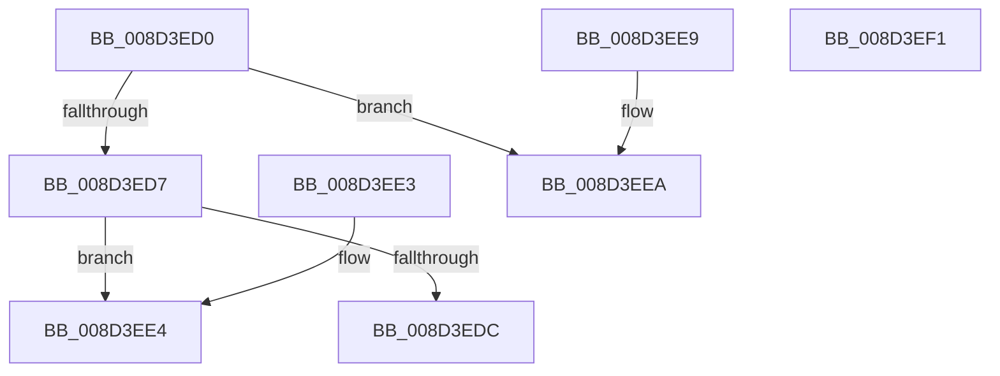

# sub_008D3ED0

- RVA: `0x008D3ED0`–`0x008D3EF2` (길이 `34` bytes)
- VA: `0x00000001408D3ED0`
- 실행 섹션: `PAGE`
- PDB 이름 있음: `아니요`; PDB Function 태그: `아니요`
- unwind 정보 RVA: `0x000DB714`
- 디코드: `16`개 명령, `34/34` bytes 표시
- 미해석 바이트: `0` (있으면 어셈블리에 `.byte`로 보존)

> 이 문서는 커널 이미지의 기계어와 PDB 기호를 분석해 생성했습니다. 4번과 5번은 함수 원형과 자료형을 바이너리 사용 방식에서 추정한 C 해석이며 원본 소스 복구 결과는 아닙니다.

## 1. Dependencies

- 직접 호출 지점: **0**; 고유 호출 대상: **0**
- 직접 호출자로 확인된 함수: **7**
- RIP 상대 이미지 참조: **0**

### Outgoing calls
- 직접 디코드된 call 명령이 없습니다.

### Direct callers
- [sub_008D2F2C](Unknown_function_008D2F2C.md) at `0x008D301B`
- [sub_008D32D4](Unknown_function_008D32D4.md) at `0x008D3368`
- [sub_008D368C](Unknown_function_008D368C.md) at `0x008D3715`
- [sub_008D379C](Unknown_function_008D379C.md) at `0x008D3885`
- [sub_008D3B2C](Unknown_function_008D3B2C.md) at `0x008D3B97`
- [sub_008D3DC0](Unknown_function_008D3DC0.md) at `0x008D3E42`
- [sub_0099FC70](../99/Unknown_function_0099FC70.md) at `0x0099FD54`

### Static image references
- 디코드된 RIP-relative 메모리 참조가 없습니다.

## 2. Other-region calls and transfers

- 다른 실행 섹션으로 향하는 call: **0**
- 별도 외부 분기/꼬리 이동을 확인하지 못했습니다.

## 3. Assembly (complete function range)

```asm
008D3ED0  33 C0                           xor eax, eax
008D3ED2  48 85 C9                        test rcx, rcx
008D3ED5  74 13                           je 0x1408d3eea
008D3ED7  48 85 D2                        test rdx, rdx
008D3EDA  74 08                           je 0x1408d3ee4
008D3EDC  48 8B C2                        mov rax, rdx
008D3EDF  48 2B 01                        sub rax, qword ptr [rcx]
008D3EE2  C3                              ret
008D3EE3  CC                              int3
008D3EE4  48 83 C8 FF                     or rax, 0xffffffffffffffff
008D3EE8  C3                              ret
008D3EE9  CC                              int3
008D3EEA  48 85 D2                        test rdx, rdx
008D3EED  0F 95 C0                        setne al
008D3EF0  C3                              ret
008D3EF1  CC                              int3
```

## 4. C-style interpretation (structured pseudocode)

```c
__int64 __fastcall sub_008D3ED0(__int64 a1, __int64 a2)
{
    __int64 result;

    result = 0;
    if (a1 == 0) goto loc_008D3EEA;
    if (a2 == 0) goto loc_008D3EE4;
    result = (a2) - (*(unsigned __int64 *)(a1));
    return result;
loc_008D3EE4:
    result = (result) | (-1);
    return result;
loc_008D3EEA:
    result = (a2 != 0) ? 1 : 0;
    return result;
}
```

## 5. (Beta) C Style

```c
int64_t sub_008D3ED0(int64_t Arg1, int64_t Arg2)
{
    int64_t result;

    result = 0;
    if (Arg1 == 0) goto loc_008D3EEA;
    if (Arg2 == 0) goto loc_008D3EE4;
    result = (Arg2) - (*(uint64_t *)(Arg1));
    return result;
loc_008D3EE4:
    result = (result) | (-1);
    return result;
loc_008D3EEA:
    result = (Arg2 != 0) ? 1 : 0;
    return result;
}
```

## 6. Execution-region graph

[열기: 2D/3D 그래프와 함수 탐색 컨트롤 패널](../../../control-panel.html?section=page&rva=0x008D3ED0&view=graph)

- 2D 그래프는 위에서 아래로 흐르고, 3D 그래프는 빈 공간을 드래그해 회전합니다. Shift+드래그는 이동, 휠은 확대·축소, 함수 노드 선택은 대상 보고서 이동입니다.

### Static fallback


