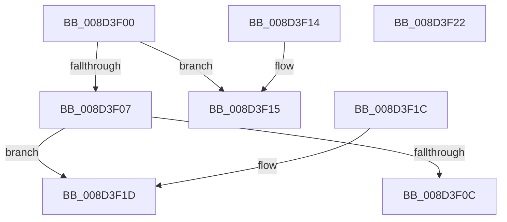

# sub_008D3F00

- RVA: `0x008D3F00`–`0x008D3F23` (길이 `35` bytes)
- VA: `0x00000001408D3F00`
- 실행 섹션: `PAGE`
- PDB 이름 있음: `아니요`; PDB Function 태그: `아니요`
- unwind 정보 RVA: `0x000DB714`
- 디코드: `16`개 명령, `35/35` bytes 표시
- 미해석 바이트: `0` (있으면 어셈블리에 `.byte`로 보존)

> 이 문서는 커널 이미지의 기계어와 PDB 기호를 분석해 생성했습니다. 4번과 5번은 함수 원형과 자료형을 바이너리 사용 방식에서 추정한 C 해석이며 원본 소스 복구 결과는 아닙니다.

## 1. Dependencies

- 직접 호출 지점: **0**; 고유 호출 대상: **0**
- 직접 호출자로 확인된 함수: **7**
- RIP 상대 이미지 참조: **0**

### Outgoing calls
- 직접 디코드된 call 명령이 없습니다.

### Direct callers
- [sub_008D2F2C](Unknown_function_008D2F2C.md) at `0x008D3011`
- [sub_008D32D4](Unknown_function_008D32D4.md) at `0x008D335E`
- [sub_008D368C](Unknown_function_008D368C.md) at `0x008D370E`
- [sub_008D379C](Unknown_function_008D379C.md) at `0x008D387B`
- [sub_008D3B2C](Unknown_function_008D3B2C.md) at `0x008D3B90`
- [sub_008D3DC0](Unknown_function_008D3DC0.md) at `0x008D3E3B`
- [sub_0099FC70](../99/Unknown_function_0099FC70.md) at `0x0099FD6C`

### Static image references
- 디코드된 RIP-relative 메모리 참조가 없습니다.

## 2. Other-region calls and transfers

- 다른 실행 섹션으로 향하는 call: **0**
- 별도 외부 분기/꼬리 이동을 확인하지 못했습니다.

## 3. Assembly (complete function range)

```asm
008D3F00  33 C0                           xor eax, eax
008D3F02  48 85 C9                        test rcx, rcx
008D3F05  74 0E                           je 0x1408d3f15
008D3F07  48 85 D2                        test rdx, rdx
008D3F0A  74 11                           je 0x1408d3f1d
008D3F0C  48 8B C2                        mov rax, rdx
008D3F0F  48 2B 41 30                     sub rax, qword ptr [rcx + 0x30]
008D3F13  C3                              ret
008D3F14  CC                              int3
008D3F15  48 85 D2                        test rdx, rdx
008D3F18  0F 95 C0                        setne al
008D3F1B  C3                              ret
008D3F1C  CC                              int3
008D3F1D  48 83 C8 FF                     or rax, 0xffffffffffffffff
008D3F21  C3                              ret
008D3F22  CC                              int3
```

## 4. C-style interpretation (structured pseudocode)

```c
__int64 __fastcall sub_008D3F00(__int64 a1, __int64 a2)
{
    __int64 result;

    result = 0;
    if (a1 == 0) goto loc_008D3F15;
    if (a2 == 0) goto loc_008D3F1D;
    result = (a2) - (*(unsigned __int64 *)(a1 + 48));
    return result;
loc_008D3F15:
    result = (a2 != 0) ? 1 : 0;
    return result;
loc_008D3F1D:
    result = (result) | (-1);
    return result;
}
```

## 5. (Beta) C Style

```c
int64_t sub_008D3F00(int64_t Arg1, int64_t Arg2)
{
    int64_t result;

    result = 0;
    if (Arg1 == 0) goto loc_008D3F15;
    if (Arg2 == 0) goto loc_008D3F1D;
    result = (Arg2) - (*(uint64_t *)(Arg1 + 0x30));
    return result;
loc_008D3F15:
    result = (Arg2 != 0) ? 1 : 0;
    return result;
loc_008D3F1D:
    result = (result) | (-1);
    return result;
}
```

## 6. Execution-region graph

[열기: 2D/3D 그래프와 함수 탐색 컨트롤 패널](../../../control-panel.html?section=page&rva=0x008D3F00&view=graph)

- 2D 그래프는 위에서 아래로 흐르고, 3D 그래프는 빈 공간을 드래그해 회전합니다. Shift+드래그는 이동, 휠은 확대·축소, 함수 노드 선택은 대상 보고서 이동입니다.

### Static fallback


