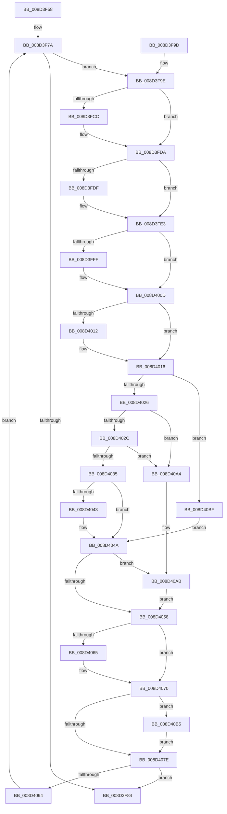

# sub_008D3F58

- RVA: `0x008D3F58`–`0x008D40C3` (길이 `363` bytes)
- VA: `0x00000001408D3F58`
- 실행 섹션: `PAGE`
- PDB 이름 있음: `아니요`; PDB Function 태그: `아니요`
- unwind 정보 RVA: `0x00073038`
- 디코드: `108`개 명령, `363/363` bytes 표시
- 미해석 바이트: `0` (있으면 어셈블리에 `.byte`로 보존)

> 이 문서는 커널 이미지의 기계어와 PDB 기호를 분석해 생성했습니다. 4번과 5번은 함수 원형과 자료형을 바이너리 사용 방식에서 추정한 C 해석이며 원본 소스 복구 결과는 아닙니다.

## 1. Dependencies

- 직접 호출 지점: **11**; 고유 호출 대상: **7**
- 직접 호출자로 확인된 함수: **1**
- RIP 상대 이미지 참조: **0**

### Outgoing calls
- `0x008D3FBC` → [KeAbPreAcquire](../../text/21/KeAbPreAcquire_function_00210230.md) (function, `0x00210230`)
- `0x008D3FD5` → [ExfAcquirePushLockExclusiveEx](../../text/20/ExfAcquirePushLockExclusiveEx_function_0020FC90.md) (function, `0x0020FC90`)
- `0x008D3FEF` → [KeAbPreAcquire](../../text/21/KeAbPreAcquire_function_00210230.md) (function, `0x00210230`)
- `0x008D4008` → [ExfAcquirePushLockExclusiveEx](../../text/20/ExfAcquirePushLockExclusiveEx_function_0020FC90.md) (function, `0x0020FC90`)
- `0x008D405B` → [KeAbPostRelease](../../text/2E/KeAbPostRelease_function_002E1600.md) (function, `0x002E1600`)
- `0x008D406B` → [sub_008D22F4](Unknown_function_008D22F4.md) (function, `0x008D22F4`)
- `0x008D4081` → [KeAbPostRelease](../../text/2E/KeAbPostRelease_function_002E1600.md) (function, `0x002E1600`)
- `0x008D4086` → [KeLeaveGuardedRegion](../../text/2E/KeLeaveGuardedRegion_function_002E2C40.md) (function, `0x002E2C40`)
- `0x008D409A` → [sub_008D23A4](Unknown_function_008D23A4.md) (function, `0x008D23A4`)
- `0x008D40AE` → [ExfTryToWakePushLock](../../text/26/ExfTryToWakePushLock_function_00265DD0.md) (function, `0x00265DD0`)
- `0x008D40B8` → [ExfTryToWakePushLock](../../text/26/ExfTryToWakePushLock_function_00265DD0.md) (function, `0x00265DD0`)

### Direct callers
- [sub_008D2F2C](Unknown_function_008D2F2C.md) at `0x008D2F5F`

### Static image references
- 디코드된 RIP-relative 메모리 참조가 없습니다.

## 2. Other-region calls and transfers

- 다른 실행 섹션으로 향하는 call: **9**
  - `0x008D3FBC` → [KeAbPreAcquire](../../text/21/KeAbPreAcquire_function_00210230.md) (`PAGE` → `.text`)
  - `0x008D3FD5` → [ExfAcquirePushLockExclusiveEx](../../text/20/ExfAcquirePushLockExclusiveEx_function_0020FC90.md) (`PAGE` → `.text`)
  - `0x008D3FEF` → [KeAbPreAcquire](../../text/21/KeAbPreAcquire_function_00210230.md) (`PAGE` → `.text`)
  - `0x008D4008` → [ExfAcquirePushLockExclusiveEx](../../text/20/ExfAcquirePushLockExclusiveEx_function_0020FC90.md) (`PAGE` → `.text`)
  - `0x008D405B` → [KeAbPostRelease](../../text/2E/KeAbPostRelease_function_002E1600.md) (`PAGE` → `.text`)
  - `0x008D4081` → [KeAbPostRelease](../../text/2E/KeAbPostRelease_function_002E1600.md) (`PAGE` → `.text`)
  - `0x008D4086` → [KeLeaveGuardedRegion](../../text/2E/KeLeaveGuardedRegion_function_002E2C40.md) (`PAGE` → `.text`)
  - `0x008D40AE` → [ExfTryToWakePushLock](../../text/26/ExfTryToWakePushLock_function_00265DD0.md) (`PAGE` → `.text`)
  - `0x008D40B8` → [ExfTryToWakePushLock](../../text/26/ExfTryToWakePushLock_function_00265DD0.md) (`PAGE` → `.text`)
- 별도 외부 분기/꼬리 이동을 확인하지 못했습니다.

## 3. Assembly (complete function range)

```asm
008D3F58  48 89 5C 24 08                  mov qword ptr [rsp + 8], rbx
008D3F5D  48 89 6C 24 10                  mov qword ptr [rsp + 0x10], rbp
008D3F62  48 89 74 24 18                  mov qword ptr [rsp + 0x18], rsi
008D3F67  57                              push rdi
008D3F68  41 56                           push r14
008D3F6A  41 57                           push r15
008D3F6C  48 83 EC 20                     sub rsp, 0x20
008D3F70  44 8B F2                        mov r14d, edx
008D3F73  48 8B E9                        mov rbp, rcx
008D3F76  49 83 CF FF                     or r15, 0xffffffffffffffff
008D3F7A  41 8B C6                        mov eax, r14d
008D3F7D  41 FF CE                        dec r14d
008D3F80  85 C0                           test eax, eax
008D3F82  7F 1A                           jg 0x1408d3f9e
008D3F84  48 8B 5C 24 40                  mov rbx, qword ptr [rsp + 0x40]
008D3F89  48 8B 6C 24 48                  mov rbp, qword ptr [rsp + 0x48]
008D3F8E  48 8B 74 24 50                  mov rsi, qword ptr [rsp + 0x50]
008D3F93  48 83 C4 20                     add rsp, 0x20
008D3F97  41 5F                           pop r15
008D3F99  41 5E                           pop r14
008D3F9B  5F                              pop rdi
008D3F9C  C3                              ret
008D3F9D  CC                              int3
008D3F9E  65 48 8B 04 25 88 01 00 00      mov rax, qword ptr gs:[0x188]
008D3FA7  48 8D 75 30                     lea rsi, [rbp + 0x30]
008D3FAB  45 33 C0                        xor r8d, r8d
008D3FAE  33 D2                           xor edx, edx
008D3FB0  48 8B CE                        mov rcx, rsi
008D3FB3  66 44 01 B8 E6 01 00 00         add word ptr [rax + 0x1e6], r15w
008D3FBB  90                              nop
008D3FBC  E8 6F C2 93 FF                  call 0x140210230
008D3FC1  F0 48 0F BA 2E 00               lock bts qword ptr [rsi], 0
008D3FC7  48 8B D8                        mov rbx, rax
008D3FCA  73 0E                           jae 0x1408d3fda
008D3FCC  4C 8B C6                        mov r8, rsi
008D3FCF  48 8B D0                        mov rdx, rax
008D3FD2  48 8B CE                        mov rcx, rsi
008D3FD5  E8 B6 BC 93 FF                  call 0x14020fc90
008D3FDA  48 85 DB                        test rbx, rbx
008D3FDD  74 04                           je 0x1408d3fe3
008D3FDF  C6 43 0A 01                     mov byte ptr [rbx + 0xa], 1
008D3FE3  48 8D 7D 50                     lea rdi, [rbp + 0x50]
008D3FE7  45 33 C0                        xor r8d, r8d
008D3FEA  48 8B CF                        mov rcx, rdi
008D3FED  33 D2                           xor edx, edx
008D3FEF  E8 3C C2 93 FF                  call 0x140210230
008D3FF4  F0 48 0F BA 2F 00               lock bts qword ptr [rdi], 0
008D3FFA  48 8B D8                        mov rbx, rax
008D3FFD  73 0E                           jae 0x1408d400d
008D3FFF  4C 8B C7                        mov r8, rdi
008D4002  48 8B D0                        mov rdx, rax
008D4005  48 8B CF                        mov rcx, rdi
008D4008  E8 83 BC 93 FF                  call 0x14020fc90
008D400D  48 85 DB                        test rbx, rbx
008D4010  74 04                           je 0x1408d4016
008D4012  C6 43 0A 01                     mov byte ptr [rbx + 0xa], 1
008D4016  48 8D 4D 40                     lea rcx, [rbp + 0x40]
008D401A  48 8B 01                        mov rax, qword ptr [rcx]
008D401D  48 3B C1                        cmp rax, rcx
008D4020  0F 84 99 00 00 00               je 0x1408d40bf
008D4026  48 39 48 08                     cmp qword ptr [rax + 8], rcx
008D402A  75 78                           jne 0x1408d40a4
008D402C  48 8B 10                        mov rdx, qword ptr [rax]
008D402F  48 39 42 08                     cmp qword ptr [rdx + 8], rax
008D4033  75 6F                           jne 0x1408d40a4
008D4035  33 DB                           xor ebx, ebx
008D4037  48 89 11                        mov qword ptr [rcx], rdx
008D403A  48 89 4A 08                     mov qword ptr [rdx + 8], rcx
008D403E  48 85 C0                        test rax, rax
008D4041  74 07                           je 0x1408d404a
008D4043  83 60 10 FE                     and dword ptr [rax + 0x10], 0xfffffffe
008D4047  48 8B D8                        mov rbx, rax
008D404A  49 8B C7                        mov rax, r15
008D404D  F0 48 0F C1 07                  lock xadd qword ptr [rdi], rax
008D4052  24 06                           and al, 6
008D4054  3C 02                           cmp al, 2
008D4056  74 53                           je 0x1408d40ab
008D4058  48 8B CF                        mov rcx, rdi
008D405B  E8 A0 D5 A0 FF                  call 0x1402e1600
008D4060  48 85 DB                        test rbx, rbx
008D4063  74 0B                           je 0x1408d4070
008D4065  48 8B D3                        mov rdx, rbx
008D4068  48 8B CD                        mov rcx, rbp
008D406B  E8 84 E2 FF FF                  call 0x1408d22f4
008D4070  49 8B C7                        mov rax, r15
008D4073  F0 48 0F C1 06                  lock xadd qword ptr [rsi], rax
008D4078  24 06                           and al, 6
008D407A  3C 02                           cmp al, 2
008D407C  74 37                           je 0x1408d40b5
008D407E  48 8B CE                        mov rcx, rsi
008D4081  E8 7A D5 A0 FF                  call 0x1402e1600
008D4086  E8 B5 EB A0 FF                  call 0x1402e2c40
008D408B  48 85 DB                        test rbx, rbx
008D408E  0F 84 F0 FE FF FF               je 0x1408d3f84
008D4094  48 8B D3                        mov rdx, rbx
008D4097  48 8B CD                        mov rcx, rbp
008D409A  E8 05 E3 FF FF                  call 0x1408d23a4
008D409F  E9 D6 FE FF FF                  jmp 0x1408d3f7a
008D40A4  B9 03 00 00 00                  mov ecx, 3
008D40A9  CD 29                           int 0x29
008D40AB  48 8B CF                        mov rcx, rdi
008D40AE  E8 1D 1D 99 FF                  call 0x140265dd0
008D40B3  EB A3                           jmp 0x1408d4058
008D40B5  48 8B CE                        mov rcx, rsi
008D40B8  E8 13 1D 99 FF                  call 0x140265dd0
008D40BD  EB BF                           jmp 0x1408d407e
008D40BF  33 DB                           xor ebx, ebx
008D40C1  EB 87                           jmp 0x1408d404a
```

## 4. C-style interpretation (structured pseudocode)

```c
__int64 __fastcall sub_008D3F58(__int64 a1, int a2, int a3)
{
    __int64 result;
    __int64 v_r14;
    __int64 v_r15;
    __int64 v_rbx;
    __int64 v_rsp;
    unsigned __int64 v_stack_p10;
    unsigned __int64 v_stack_p18;
    unsigned __int64 v_stack_p8;

    v_stack_p8 = v_rbx;
    v_stack_p10 = v_rbp;
    v_stack_p18 = v_rsi;
    v_rsp = (v_rsp) - (32);
    v_r15 = (v_r15) | (-1);
loc_008D3F7A:
    v_r14 = (unsigned int)(((unsigned int)(a2)) - 1);
    if (condition_is_greater) goto loc_008D3F9E;
loc_008D3F84:
    v_rsp = (v_rsp) + (32);
    return (unsigned int)((unsigned int)((unsigned int)(a2)));
loc_008D3F9E:
    a3 = 0;
    a2 = 0;
    result = KeAbPreAcquire(v_stack_p10 + 48, a2, a3, a4);
    if (!(condition_is_above_or_equal)) {
        a3 = v_stack_p10 + 48;
        a2 = result;
        a1 = v_stack_p10 + 48;
        result = ExfAcquirePushLockExclusiveEx(a1, a2, a3, a4);
    }
    if (result != 0) {
        *(unsigned __int8 *)(result + 10) = 1;
    }
    a3 = 0;
    a2 = 0;
    result = KeAbPreAcquire(v_stack_p10 + 80, a2, a3, a4);
    if (!(condition_is_above_or_equal)) {
        a3 = v_stack_p10 + 80;
        a2 = result;
        a1 = v_stack_p10 + 80;
        result = ExfAcquirePushLockExclusiveEx(a1, a2, a3, a4);
    }
    if (result != 0) {
        *(unsigned __int8 *)(result + 10) = 1;
    }
    if ((*(unsigned __int64 *)(v_stack_p10 + 64)) == (v_stack_p10 + 64)) goto loc_008D40BF;
    if ((*(unsigned __int64 *)(*(unsigned __int64 *)(v_stack_p10 + 64) + 8)) != (v_stack_p10 + 64)) goto loc_008D40A4;
    if ((*(unsigned __int64 *)(*(unsigned __int64 *)(*(unsigned __int64 *)(v_stack_p10 + 64)) + 8)) != (*(unsigned __int64 *)(v_stack_p10 + 64))) goto loc_008D40A4;
    v_rbx = 0;
    *(unsigned __int64 *)(v_stack_p10 + 64) = *(unsigned __int64 *)(*(unsigned __int64 *)(v_stack_p10 + 64));
    *(unsigned __int64 *)(*(unsigned __int64 *)(*(unsigned __int64 *)(v_stack_p10 + 64)) + 8) = v_stack_p10 + 64;
    if (*(unsigned __int64 *)(v_stack_p10 + 64) != 0) {
        v_rbx = *(unsigned __int64 *)(v_stack_p10 + 64);
    }
    result = (unsigned __int8)((v_r15) & (6));
    if (((unsigned __int8)(result)) == 2) goto loc_008D40AB;
loc_008D4058:
    result = KeAbPostRelease(v_stack_p10 + 80, *(unsigned __int64 *)(*(unsigned __int64 *)(v_stack_p10 + 64)), a3, a4);
    if (v_rbx != 0) {
        a2 = v_rbx;
        a1 = v_stack_p10;
        result = sub_008D22F4(a1, a2, a3, a4);
    }
    result = (unsigned __int8)((v_r15) & (6));
    if (((unsigned __int8)(result)) == 2) goto loc_008D40B5;
loc_008D407E:
    result = KeAbPostRelease(v_stack_p10 + 48, a2, a3, a4);
    result = KeLeaveGuardedRegion(v_stack_p10 + 48, a2, a3, a4);
    if (v_rbx == 0) goto loc_008D3F84;
    result = sub_008D23A4(v_stack_p10, v_rbx, a3, a4);
    goto loc_008D3F7A;
loc_008D40A4:
loc_008D40AB:
    result = ExfTryToWakePushLock(v_stack_p10 + 80, v_rbx, a3, a4);
    goto loc_008D4058;
loc_008D40B5:
    result = ExfTryToWakePushLock(v_stack_p10 + 48, v_rbx, a3, a4);
    goto loc_008D407E;
loc_008D40BF:
    v_rbx = 0;
    goto loc_008D404A;
}
```

## 5. (Beta) C Style

```c
int64_t sub_008D3F58(void *Arg1, int32_t Arg2, int32_t Arg3)
{
    uint8_t *arg1 = (uint8_t *)Arg1;

    int64_t result;
    int64_t local_r14;
    int64_t local_r15;
    int64_t local_rbx;
    int64_t local_rsp;
    uint64_t v_stack_p10;
    uint64_t v_stack_p18;
    uint64_t v_stack_p8;

    v_stack_p8 = local_rbx;
    v_stack_p10 = local_rbp;
    v_stack_p18 = local_rsi;
    local_rsp = (local_rsp) - (32);
    local_r15 = (local_r15) | (-1);
loc_008D3F7A:
    local_r14 = (uint32_t)(((uint32_t)(Arg2)) - 1);
    if (condition_is_greater) goto loc_008D3F9E;
loc_008D3F84:
    local_rsp = (local_rsp) + (32);
    return (uint32_t)((uint32_t)((uint32_t)(Arg2)));
loc_008D3F9E:
    Arg3 = 0;
    Arg2 = 0;
    result = KeAbPreAcquire(v_stack_p10 + 48, Arg2, Arg3, a4);
    if (!(condition_is_above_or_equal)) {
        Arg3 = v_stack_p10 + 48;
        Arg2 = result;
        Arg1 = v_stack_p10 + 48;
        result = ExfAcquirePushLockExclusiveEx(Arg1, Arg2, Arg3, a4);
    }
    if (result != 0) {
        *(uint8_t *)(result + 0xA) = 1;
    }
    Arg3 = 0;
    Arg2 = 0;
    result = KeAbPreAcquire(v_stack_p10 + 80, Arg2, Arg3, a4);
    if (!(condition_is_above_or_equal)) {
        Arg3 = v_stack_p10 + 80;
        Arg2 = result;
        Arg1 = v_stack_p10 + 80;
        result = ExfAcquirePushLockExclusiveEx(Arg1, Arg2, Arg3, a4);
    }
    if (result != 0) {
        *(uint8_t *)(result + 0xA) = 1;
    }
    if ((*(uint64_t *)(v_stack_p10 + 0x40)) == (v_stack_p10 + 64)) goto loc_008D40BF;
    if ((*(uint64_t *)(*(uint64_t *)(v_stack_p10 + 0x40) + 0x8)) != (v_stack_p10 + 64)) goto loc_008D40A4;
    if ((*(uint64_t *)(*(uint64_t *)(*(uint64_t *)(v_stack_p10 + 0x40)) + 0x8)) != (*(uint64_t *)(v_stack_p10 + 0x40))) goto loc_008D40A4;
    local_rbx = 0;
    *(uint64_t *)(v_stack_p10 + 0x40) = *(uint64_t *)(*(uint64_t *)(v_stack_p10 + 0x40));
    *(uint64_t *)(*(uint64_t *)(*(uint64_t *)(v_stack_p10 + 0x40)) + 0x8) = v_stack_p10 + 64;
    if (*(uint64_t *)(v_stack_p10 + 0x40) != 0) {
        local_rbx = *(uint64_t *)(v_stack_p10 + 0x40);
    }
    result = (uint8_t)((local_r15) & (6));
    if (((uint8_t)(result)) == 2) goto loc_008D40AB;
loc_008D4058:
    result = KeAbPostRelease(v_stack_p10 + 80, *(uint64_t *)(*(uint64_t *)(v_stack_p10 + 0x40)), Arg3, a4);
    if (local_rbx != 0) {
        Arg2 = local_rbx;
        Arg1 = v_stack_p10;
        result = sub_008D22F4(Arg1, Arg2, Arg3, a4);
    }
    result = (uint8_t)((local_r15) & (6));
    if (((uint8_t)(result)) == 2) goto loc_008D40B5;
loc_008D407E:
    result = KeAbPostRelease(v_stack_p10 + 48, Arg2, Arg3, a4);
    result = KeLeaveGuardedRegion(v_stack_p10 + 48, Arg2, Arg3, a4);
    if (local_rbx == 0) goto loc_008D3F84;
    result = sub_008D23A4(v_stack_p10, local_rbx, Arg3, a4);
    goto loc_008D3F7A;
loc_008D40A4:
loc_008D40AB:
    result = ExfTryToWakePushLock(v_stack_p10 + 80, local_rbx, Arg3, a4);
    goto loc_008D4058;
loc_008D40B5:
    result = ExfTryToWakePushLock(v_stack_p10 + 48, local_rbx, Arg3, a4);
    goto loc_008D407E;
loc_008D40BF:
    local_rbx = 0;
    goto loc_008D404A;
}
```

### 관측된 메모리 오프셋

구조체 형식이 확인되지 않은 접근은 인자 기준의 오프셋으로만 기록했습니다.

| 기준 인자 | 오프셋 표현 | 폭 (bit) | 접근 |
|---|---:|---:|---|
| `Arg1` | `+ 0x0` | `64` | `R` |
| `Arg1` | `+ 0x0` | `64` | `R/W` |
| `Arg1` | `+ 0x0` | `64` | `W` |
| `Arg1` | `+ 0x30` | `64` | `R` |
| `Arg1` | `+ 0x40` | `64` | `R` |
| `Arg1` | `+ 0x50` | `64` | `R` |

## 6. Execution-region graph

[열기: 2D/3D 그래프와 함수 탐색 컨트롤 패널](../../../control-panel.html?section=page&rva=0x008D3F58&view=graph)

- 2D 그래프는 위에서 아래로 흐르고, 3D 그래프는 빈 공간을 드래그해 회전합니다. Shift+드래그는 이동, 휠은 확대·축소, 함수 노드 선택은 대상 보고서 이동입니다.

### Static fallback


