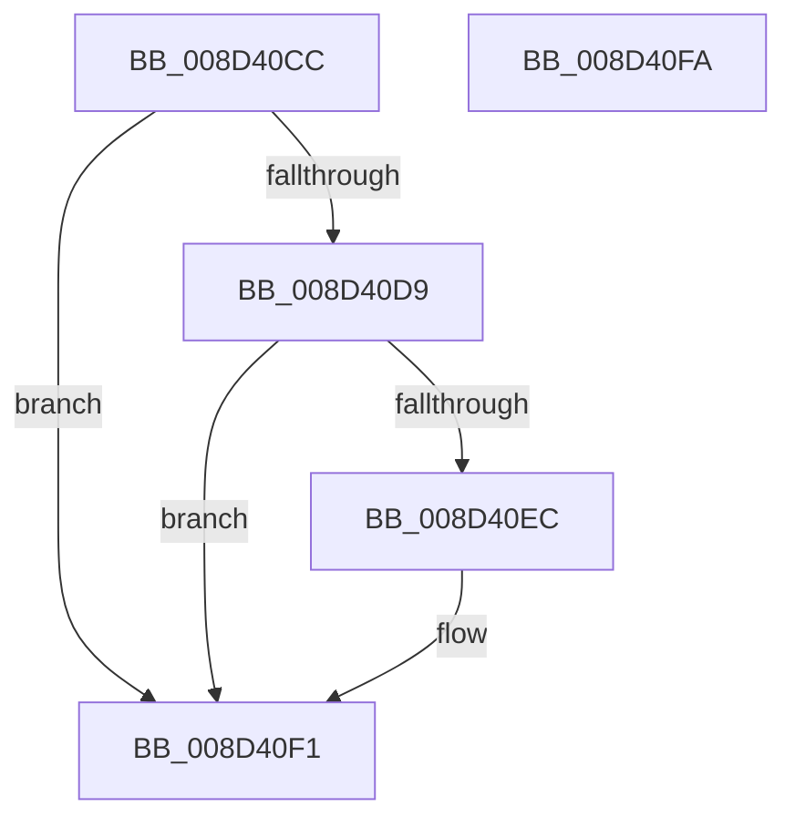

# sub_008D40CC

- RVA: `0x008D40CC`–`0x008D40FB` (길이 `47` bytes)
- VA: `0x00000001408D40CC`
- 실행 섹션: `PAGE`
- PDB 이름 있음: `아니요`; PDB Function 태그: `아니요`
- unwind 정보 RVA: `0x0005CF00`
- 디코드: `15`개 명령, `47/47` bytes 표시
- 미해석 바이트: `0` (있으면 어셈블리에 `.byte`로 보존)

> 이 문서는 커널 이미지의 기계어와 PDB 기호를 분석해 생성했습니다. 4번과 5번은 함수 원형과 자료형을 바이너리 사용 방식에서 추정한 C 해석이며 원본 소스 복구 결과는 아닙니다.

## 1. Dependencies

- 직접 호출 지점: **1**; 고유 호출 대상: **1**
- 직접 호출자로 확인된 함수: **2**
- RIP 상대 이미지 참조: **0**

### Outgoing calls
- `0x008D40EC` → [sub_008D4104](Unknown_function_008D4104.md) (function, `0x008D4104`)

### Direct callers
- [sub_00907768](../90/Unknown_function_00907768.md) at `0x009078F4`
- [sub_00A8F270](../A8/Unknown_function_00A8F270.md) at `0x00A8F3C0`

### Static image references
- 디코드된 RIP-relative 메모리 참조가 없습니다.

## 2. Other-region calls and transfers

- 다른 실행 섹션으로 향하는 call: **0**
- 별도 외부 분기/꼬리 이동을 확인하지 못했습니다.

## 3. Assembly (complete function range)

```asm
008D40CC  40 53                           push rbx
008D40CE  48 83 EC 20                     sub rsp, 0x20
008D40D2  33 DB                           xor ebx, ebx
008D40D4  48 85 C9                        test rcx, rcx
008D40D7  74 18                           je 0x1408d40f1
008D40D9  48 83 CB FF                     or rbx, 0xffffffffffffffff
008D40DD  F0 48 0F C1 99 E8 00 00 00      lock xadd qword ptr [rcx + 0xe8], rbx
008D40E6  48 83 EB 01                     sub rbx, 1
008D40EA  75 05                           jne 0x1408d40f1
008D40EC  E8 13 00 00 00                  call 0x1408d4104
008D40F1  48 8B C3                        mov rax, rbx
008D40F4  48 83 C4 20                     add rsp, 0x20
008D40F8  5B                              pop rbx
008D40F9  C3                              ret
008D40FA  CC                              int3
```

## 4. C-style interpretation (structured pseudocode)

```c
__int64 __fastcall sub_008D40CC(__int64 a1)
{
    __int64 result;
    __int64 v_rbx;
    __int64 v_rsp;

    v_rsp = (v_rsp) - (32);
    v_rbx = 0;
    if (a1 == 0) goto loc_008D40F1;
    v_rbx = (v_rbx) | (-1);
    v_rbx = (v_rbx) - (1);
    if (!(condition_is_not_equal)) {
        result = sub_008D4104(a1, a2, a3, a4);
    }
    v_rsp = (v_rsp) + (32);
    return v_rbx;
}
```

## 5. (Beta) C Style

```c
int64_t sub_008D40CC(int64_t Arg1)
{
    int64_t result;
    int64_t local_rbx;
    int64_t local_rsp;

    local_rsp = (local_rsp) - (32);
    local_rbx = 0;
    if (Arg1 == 0) goto loc_008D40F1;
    local_rbx = (local_rbx) | (-1);
    local_rbx = (local_rbx) - (1);
    if (!(condition_is_not_equal)) {
        result = sub_008D4104(Arg1, a2, a3, a4);
    }
    local_rsp = (local_rsp) + (32);
    return local_rbx;
}
```

## 6. Execution-region graph

[열기: 2D/3D 그래프와 함수 탐색 컨트롤 패널](../../../control-panel.html?section=page&rva=0x008D40CC&view=graph)

- 2D 그래프는 위에서 아래로 흐르고, 3D 그래프는 빈 공간을 드래그해 회전합니다. Shift+드래그는 이동, 휠은 확대·축소, 함수 노드 선택은 대상 보고서 이동입니다.

### Static fallback


