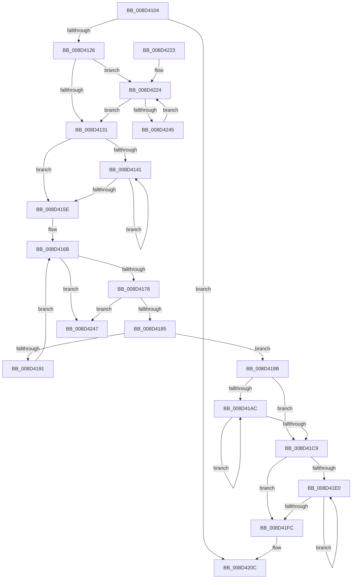

# sub_008D4104

- RVA: `0x008D4104`–`0x008D424E` (길이 `330` bytes)
- VA: `0x00000001408D4104`
- 실행 섹션: `PAGE`
- PDB 이름 있음: `아니요`; PDB Function 태그: `아니요`
- unwind 정보 RVA: `0x0007593C`
- 디코드: `91`개 명령, `330/330` bytes 표시
- 미해석 바이트: `0` (있으면 어셈블리에 `.byte`로 보존)

> 이 문서는 커널 이미지의 기계어와 PDB 기호를 분석해 생성했습니다. 4번과 5번은 함수 원형과 자료형을 바이너리 사용 방식에서 추정한 C 해석이며 원본 소스 복구 결과는 아닙니다.

## 1. Dependencies

- 직접 호출 지점: **10**; 고유 호출 대상: **6**
- 직접 호출자로 확인된 함수: **3**
- RIP 상대 이미지 참조: **0**

### Outgoing calls
- `0x008D4135` → [sub_00A8FC34](../A8/Unknown_function_00A8FC34.md) (function, `0x00A8FC34`)
- `0x008D4152` → [sub_008D23A4](Unknown_function_008D23A4.md) (function, `0x008D23A4`)
- `0x008D4162` → [sub_00A8FC34](../A8/Unknown_function_00A8FC34.md) (function, `0x00A8FC34`)
- `0x008D4194` → [sub_008D23A4](Unknown_function_008D23A4.md) (function, `0x008D23A4`)
- `0x008D41BA` → [sub_00AAB8F8](../AA/Unknown_function_00AAB8F8.md) (function, `0x00AAB8F8`)
- `0x008D41CC` → [sub_00A8FC34](../A8/Unknown_function_00A8FC34.md) (function, `0x00A8FC34`)
- `0x008D41ED` → [sub_009A0BF0](../9A/Unknown_function_009A0BF0.md) (function, `0x009A0BF0`)
- `0x008D41FF` → [sub_00A8FC34](../A8/Unknown_function_00A8FC34.md) (function, `0x00A8FC34`)
- `0x008D4207` → [PdcCloseEvent](PdcCloseEvent_function_008D2404.md) (function, `0x008D2404`)
- `0x008D4235` → [sub_00A0FA98](../A0/Unknown_function_00A0FA98.md) (function, `0x00A0FA98`)

### Direct callers
- [sub_008D3420](Unknown_function_008D3420.md) at `0x008D357C`
- [sub_008D3C68](Unknown_function_008D3C68.md) at `0x008D3C7C`
- [sub_008D40CC](Unknown_function_008D40CC.md) at `0x008D40EC`

### Static image references
- 디코드된 RIP-relative 메모리 참조가 없습니다.

## 2. Other-region calls and transfers

- 다른 실행 섹션으로 향하는 call: **0**
- 별도 외부 분기/꼬리 이동을 확인하지 못했습니다.

## 3. Assembly (complete function range)

```asm
008D4104  48 89 5C 24 08                  mov qword ptr [rsp + 8], rbx
008D4109  48 89 6C 24 10                  mov qword ptr [rsp + 0x10], rbp
008D410E  48 89 74 24 18                  mov qword ptr [rsp + 0x18], rsi
008D4113  57                              push rdi
008D4114  48 83 EC 20                     sub rsp, 0x20
008D4118  33 FF                           xor edi, edi
008D411A  48 8B D9                        mov rbx, rcx
008D411D  48 85 C9                        test rcx, rcx
008D4120  0F 84 E6 00 00 00               je 0x1408d420c
008D4126  8B F7                           mov esi, edi
008D4128  39 79 5C                        cmp dword ptr [rcx + 0x5c], edi
008D412B  0F 87 F3 00 00 00               ja 0x1408d4224
008D4131  48 8D 4B 58                     lea rcx, [rbx + 0x58]
008D4135  E8 FA BA 1B 00                  call 0x140a8fc34
008D413A  8B EF                           mov ebp, edi
008D413C  39 7B 0C                        cmp dword ptr [rbx + 0xc], edi
008D413F  76 1D                           jbe 0x1408d415e
008D4141  48 8B 53 18                     mov rdx, qword ptr [rbx + 0x18]
008D4145  8B C5                           mov eax, ebp
008D4147  0F AF 43 08                     imul eax, dword ptr [rbx + 8]
008D414B  48 8B CB                        mov rcx, rbx
008D414E  48 8B 14 10                     mov rdx, qword ptr [rax + rdx]
008D4152  E8 4D E2 FF FF                  call 0x1408d23a4
008D4157  FF C5                           inc ebp
008D4159  3B 6B 0C                        cmp ebp, dword ptr [rbx + 0xc]
008D415C  72 E3                           jb 0x1408d4141
008D415E  48 8D 4B 08                     lea rcx, [rbx + 8]
008D4162  E8 CD BA 1B 00                  call 0x140a8fc34
008D4167  48 8D 73 40                     lea rsi, [rbx + 0x40]
008D416B  48 8B 16                        mov rdx, qword ptr [rsi]
008D416E  48 39 72 08                     cmp qword ptr [rdx + 8], rsi
008D4172  0F 85 CF 00 00 00               jne 0x1408d4247
008D4178  48 8B 02                        mov rax, qword ptr [rdx]
008D417B  48 39 50 08                     cmp qword ptr [rax + 8], rdx
008D417F  0F 85 C2 00 00 00               jne 0x1408d4247
008D4185  48 89 06                        mov qword ptr [rsi], rax
008D4188  48 89 70 08                     mov qword ptr [rax + 8], rsi
008D418C  48 3B D6                        cmp rdx, rsi
008D418F  74 0A                           je 0x1408d419b
008D4191  48 8B CB                        mov rcx, rbx
008D4194  E8 0B E2 FF FF                  call 0x1408d23a4
008D4199  EB D0                           jmp 0x1408d416b
008D419B  48 8D AB 88 00 00 00            lea rbp, [rbx + 0x88]
008D41A2  8B F7                           mov esi, edi
008D41A4  39 BB 8C 00 00 00               cmp dword ptr [rbx + 0x8c], edi
008D41AA  76 1D                           jbe 0x1408d41c9
008D41AC  48 8B 4D 10                     mov rcx, qword ptr [rbp + 0x10]
008D41B0  8B C6                           mov eax, esi
008D41B2  0F AF 45 00                     imul eax, dword ptr [rbp]
008D41B6  48 8B 0C 08                     mov rcx, qword ptr [rax + rcx]
008D41BA  E8 39 77 1D 00                  call 0x140aab8f8
008D41BF  FF C6                           inc esi
008D41C1  3B B3 8C 00 00 00               cmp esi, dword ptr [rbx + 0x8c]
008D41C7  72 E3                           jb 0x1408d41ac
008D41C9  48 8B CD                        mov rcx, rbp
008D41CC  E8 63 BA 1B 00                  call 0x140a8fc34
008D41D1  48 8D B3 B8 00 00 00            lea rsi, [rbx + 0xb8]
008D41D8  39 BB BC 00 00 00               cmp dword ptr [rbx + 0xbc], edi
008D41DE  76 1C                           jbe 0x1408d41fc
008D41E0  48 8B 4E 10                     mov rcx, qword ptr [rsi + 0x10]
008D41E4  8B C7                           mov eax, edi
008D41E6  0F AF 06                        imul eax, dword ptr [rsi]
008D41E9  48 8B 0C 08                     mov rcx, qword ptr [rax + rcx]
008D41ED  E8 FE C9 0C 00                  call 0x1409a0bf0
008D41F2  FF C7                           inc edi
008D41F4  3B BB BC 00 00 00               cmp edi, dword ptr [rbx + 0xbc]
008D41FA  72 E4                           jb 0x1408d41e0
008D41FC  48 8B CE                        mov rcx, rsi
008D41FF  E8 30 BA 1B 00                  call 0x140a8fc34
008D4204  48 8B CB                        mov rcx, rbx
008D4207  E8 F8 E1 FF FF                  call 0x1408d2404
008D420C  48 8B 5C 24 30                  mov rbx, qword ptr [rsp + 0x30]
008D4211  33 C0                           xor eax, eax
008D4213  48 8B 6C 24 38                  mov rbp, qword ptr [rsp + 0x38]
008D4218  48 8B 74 24 40                  mov rsi, qword ptr [rsp + 0x40]
008D421D  48 83 C4 20                     add rsp, 0x20
008D4221  5F                              pop rdi
008D4222  C3                              ret
008D4223  CC                              int3
008D4224  48 8B 53 68                     mov rdx, qword ptr [rbx + 0x68]
008D4228  8B C6                           mov eax, esi
008D422A  0F AF 43 58                     imul eax, dword ptr [rbx + 0x58]
008D422E  48 8B CB                        mov rcx, rbx
008D4231  48 8B 14 10                     mov rdx, qword ptr [rax + rdx]
008D4235  E8 5E B8 13 00                  call 0x140a0fa98
008D423A  FF C6                           inc esi
008D423C  3B 73 5C                        cmp esi, dword ptr [rbx + 0x5c]
008D423F  0F 83 EC FE FF FF               jae 0x1408d4131
008D4245  EB DD                           jmp 0x1408d4224
008D4247  B9 03 00 00 00                  mov ecx, 3
008D424C  CD 29                           int 0x29
```

## 4. C-style interpretation (structured pseudocode)

```c
__int64 __fastcall sub_008D4104(__int64 a1)
{
    __int64 result;
    __int64 v_rbp;
    __int64 v_rdi;
    __int64 v_rsi;
    __int64 v_rsp;
    unsigned __int64 v_stack_p10;
    unsigned __int64 v_stack_p18;
    unsigned __int64 v_stack_p8;

    v_stack_p8 = v_rbx;
    v_stack_p10 = v_rbp;
    v_stack_p18 = v_rsi;
    v_rsp = (v_rsp) - (32);
    v_rdi = 0;
    if (a1 == 0) goto loc_008D420C;
    if ((*(unsigned int *)(a1 + 92)) > 0) goto loc_008D4224;
loc_008D4131:
    result = sub_00A8FC34(a1 + 88, a2, a3, a4);
    if ((*(unsigned int *)(a1 + 12)) <= 0) goto loc_008D415E;
loc_008D4141:
    result = (unsigned int)((0) * (*(unsigned int *)(a1 + 8)));
    result = sub_008D23A4(a1, *(unsigned __int64 *)(result + *(unsigned __int64 *)(a1 + 24) * 1), a3, a4);
    v_rbp = (unsigned int)((0) + 1);
    if (((unsigned int)(v_rbp)) < (*(unsigned int *)(a1 + 12))) goto loc_008D4141;
loc_008D415E:
    result = sub_00A8FC34(a1 + 8, *(unsigned __int64 *)(result + *(unsigned __int64 *)(a1 + 24) * 1), a3, a4);
loc_008D416B:
    if ((*(unsigned __int64 *)(*(unsigned __int64 *)(a1 + 64) + 8)) != (a1 + 64)) goto loc_008D4247;
    if ((*(unsigned __int64 *)(*(unsigned __int64 *)(*(unsigned __int64 *)(a1 + 64)) + 8)) != (*(unsigned __int64 *)(a1 + 64))) goto loc_008D4247;
    *(unsigned __int64 *)(a1 + 64) = *(unsigned __int64 *)(*(unsigned __int64 *)(a1 + 64));
    *(unsigned __int64 *)(*(unsigned __int64 *)(*(unsigned __int64 *)(a1 + 64)) + 8) = a1 + 64;
    if ((*(unsigned __int64 *)(a1 + 64)) == (a1 + 64)) goto loc_008D419B;
    result = sub_008D23A4(a1, *(unsigned __int64 *)(a1 + 64), a3, a4);
    goto loc_008D416B;
loc_008D419B:
    if ((*(unsigned int *)(a1 + 140)) <= 0) goto loc_008D41C9;
loc_008D41AC:
    result = (unsigned int)((0) * (*(unsigned int *)(a1 + 136)));
    result = sub_00AAB8F8(*(unsigned __int64 *)(result + *(unsigned __int64 *)(a1 + 136 + 16) * 1), *(unsigned __int64 *)(a1 + 64), a3, a4);
    v_rsi = (unsigned int)((0) + 1);
    if (((unsigned int)(v_rsi)) < (*(unsigned int *)(a1 + 140))) goto loc_008D41AC;
loc_008D41C9:
    result = sub_00A8FC34(a1 + 136, *(unsigned __int64 *)(a1 + 64), a3, a4);
    if ((*(unsigned int *)(a1 + 188)) <= 0) goto loc_008D41FC;
loc_008D41E0:
    result = (unsigned int)((0) * (*(unsigned int *)(a1 + 184)));
    result = sub_009A0BF0(*(unsigned __int64 *)(result + *(unsigned __int64 *)(a1 + 184 + 16) * 1), *(unsigned __int64 *)(a1 + 64), a3, a4);
    v_rdi = (unsigned int)((v_rdi) + 1);
    if (((unsigned int)(v_rdi)) < (*(unsigned int *)(a1 + 188))) goto loc_008D41E0;
loc_008D41FC:
    result = sub_00A8FC34(a1 + 184, *(unsigned __int64 *)(a1 + 64), a3, a4);
    result = PdcCloseEvent(a1, *(unsigned __int64 *)(a1 + 64), a3, a4);
loc_008D420C:
    result = 0;
    v_rsp = (v_rsp) + (32);
    return result;
loc_008D4224:
    result = (unsigned int)(((unsigned int)((unsigned int)(v_stack_p18))) * (*(unsigned int *)(v_stack_p8 + 88)));
    result = sub_00A0FA98(v_stack_p8, *(unsigned __int64 *)(result + *(unsigned __int64 *)(v_stack_p8 + 104) * 1), a3, a4);
    v_rsi = (unsigned int)((v_stack_p18) + 1);
    if (((unsigned int)(v_rsi)) >= (*(unsigned int *)(v_stack_p8 + 92))) goto loc_008D4131;
    goto loc_008D4224;
loc_008D4247:
    return result;
}
```

## 5. (Beta) C Style

```c
int64_t sub_008D4104(void *Arg1)
{
    uint8_t *arg1 = (uint8_t *)Arg1;

    int64_t result;
    int64_t local_rbp;
    int64_t local_rdi;
    int64_t local_rsi;
    int64_t local_rsp;
    uint64_t v_stack_p10;
    uint64_t v_stack_p18;
    uint64_t v_stack_p8;

    v_stack_p8 = local_rbx;
    v_stack_p10 = local_rbp;
    v_stack_p18 = local_rsi;
    local_rsp = (local_rsp) - (32);
    local_rdi = 0;
    if (Arg1 == NULL) goto loc_008D420C;
    if ((*(uint32_t *)(arg1 + 0x5C)) > 0) goto loc_008D4224;
loc_008D4131:
    result = sub_00A8FC34(Arg1 + 88, a2, a3, a4);
    if ((*(uint32_t *)(arg1 + 0xC)) <= 0) goto loc_008D415E;
loc_008D4141:
    result = (uint32_t)((0) * (*(uint32_t *)(arg1 + 0x8)));
    result = sub_008D23A4(Arg1, *(uint64_t *)(result + *(uint64_t *)(arg1 + 0x18) * 1), a3, a4);
    local_rbp = (uint32_t)((0) + 1);
    if (((uint32_t)(local_rbp)) < (*(uint32_t *)(arg1 + 0xC))) goto loc_008D4141;
loc_008D415E:
    result = sub_00A8FC34(Arg1 + 8, *(uint64_t *)(result + *(uint64_t *)(arg1 + 0x18) * 1), a3, a4);
loc_008D416B:
    if ((*(uint64_t *)(*(uint64_t *)(arg1 + 0x40) + 0x8)) != (Arg1 + 64)) goto loc_008D4247;
    if ((*(uint64_t *)(*(uint64_t *)(*(uint64_t *)(arg1 + 0x40)) + 0x8)) != (*(uint64_t *)(arg1 + 0x40))) goto loc_008D4247;
    *(uint64_t *)(arg1 + 0x40) = *(uint64_t *)(*(uint64_t *)(arg1 + 0x40));
    *(void **)(*(uint64_t *)(*(uint64_t *)(arg1 + 0x40)) + 0x8) = Arg1 + 64;
    if ((*(uint64_t *)(arg1 + 0x40)) == (Arg1 + 64)) goto loc_008D419B;
    result = sub_008D23A4(Arg1, *(uint64_t *)(arg1 + 0x40), a3, a4);
    goto loc_008D416B;
loc_008D419B:
    if ((*(uint32_t *)(arg1 + 0x8C)) <= 0) goto loc_008D41C9;
loc_008D41AC:
    result = (uint32_t)((0) * (*(uint32_t *)(arg1 + 0x88)));
    result = sub_00AAB8F8(*(uint64_t *)(result + *(uint64_t *)(arg1 + 0x88 + 0x10) * 1), *(uint64_t *)(arg1 + 0x40), a3, a4);
    local_rsi = (uint32_t)((0) + 1);
    if (((uint32_t)(local_rsi)) < (*(uint32_t *)(arg1 + 0x8C))) goto loc_008D41AC;
loc_008D41C9:
    result = sub_00A8FC34(Arg1 + 136, *(uint64_t *)(arg1 + 0x40), a3, a4);
    if ((*(uint32_t *)(arg1 + 0xBC)) <= 0) goto loc_008D41FC;
loc_008D41E0:
    result = (uint32_t)((0) * (*(uint32_t *)(arg1 + 0xB8)));
    result = sub_009A0BF0(*(uint64_t *)(result + *(uint64_t *)(arg1 + 0xB8 + 0x10) * 1), *(uint64_t *)(arg1 + 0x40), a3, a4);
    local_rdi = (uint32_t)((local_rdi) + 1);
    if (((uint32_t)(local_rdi)) < (*(uint32_t *)(arg1 + 0xBC))) goto loc_008D41E0;
loc_008D41FC:
    result = sub_00A8FC34(Arg1 + 184, *(uint64_t *)(arg1 + 0x40), a3, a4);
    result = PdcCloseEvent(Arg1, *(uint64_t *)(arg1 + 0x40), a3, a4);
loc_008D420C:
    result = 0;
    local_rsp = (local_rsp) + (32);
    return result;
loc_008D4224:
    result = (uint32_t)(((uint32_t)((uint32_t)(v_stack_p18))) * (*(uint32_t *)(v_stack_p8 + 0x58)));
    result = sub_00A0FA98(v_stack_p8, *(uint64_t *)(result + *(uint64_t *)(v_stack_p8 + 0x68) * 1), a3, a4);
    local_rsi = (uint32_t)((v_stack_p18) + 1);
    if (((uint32_t)(local_rsi)) >= (*(uint32_t *)(v_stack_p8 + 0x5C))) goto loc_008D4131;
    goto loc_008D4224;
loc_008D4247:
    return result;
}
```

### 관측된 메모리 오프셋

구조체 형식이 확인되지 않은 접근은 인자 기준의 오프셋으로만 기록했습니다.

| 기준 인자 | 오프셋 표현 | 폭 (bit) | 접근 |
|---|---:|---:|---|
| `Arg1` | `+ 0x0` | `32` | `R` |
| `Arg1` | `+ 0x0` | `64` | `R` |
| `Arg1` | `+ 0x0` | `64` | `W` |
| `Arg1` | `+ 0x8` | `32` | `R` |
| `Arg1` | `+ 0x8` | `64` | `R` |
| `Arg1` | `+ 0xC` | `32` | `R` |
| `Arg1` | `+ 0x10` | `64` | `R` |
| `Arg1` | `+ 0x18` | `64` | `R` |
| `Arg1` | `+ 0x40` | `64` | `R` |
| `Arg1` | `+ 0x58` | `32` | `R` |
| `Arg1` | `+ 0x58` | `64` | `R` |
| `Arg1` | `+ 0x5C` | `32` | `R` |
| `Arg1` | `+ 0x68` | `64` | `R` |
| `Arg1` | `+ 0x88` | `64` | `R` |
| `Arg1` | `+ 0x8C` | `32` | `R` |
| `Arg1` | `+ 0xB8` | `64` | `R` |
| `Arg1` | `+ 0xBC` | `32` | `R` |

## 6. Execution-region graph

[열기: 2D/3D 그래프와 함수 탐색 컨트롤 패널](../../../control-panel.html?section=page&rva=0x008D4104&view=graph)

- 2D 그래프는 위에서 아래로 흐르고, 3D 그래프는 빈 공간을 드래그해 회전합니다. Shift+드래그는 이동, 휠은 확대·축소, 함수 노드 선택은 대상 보고서 이동입니다.

### Static fallback


