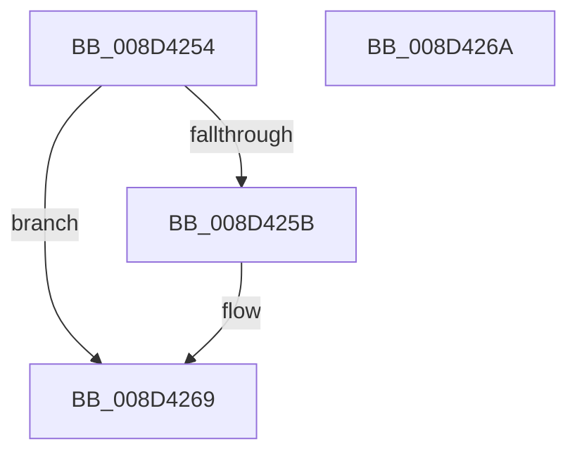

# sub_008D4254

- RVA: `0x008D4254`–`0x008D426B` (길이 `23` bytes)
- VA: `0x00000001408D4254`
- 실행 섹션: `PAGE`
- PDB 이름 있음: `아니요`; PDB Function 태그: `아니요`
- unwind 정보 RVA: `0x000DB714`
- 디코드: `8`개 명령, `23/23` bytes 표시
- 미해석 바이트: `0` (있으면 어셈블리에 `.byte`로 보존)

> 이 문서는 커널 이미지의 기계어와 PDB 기호를 분석해 생성했습니다. 4번과 5번은 함수 원형과 자료형을 바이너리 사용 방식에서 추정한 C 해석이며 원본 소스 복구 결과는 아닙니다.

## 1. Dependencies

- 직접 호출 지점: **0**; 고유 호출 대상: **0**
- 직접 호출자로 확인된 함수: **3**
- RIP 상대 이미지 참조: **0**

### Outgoing calls
- 직접 디코드된 call 명령이 없습니다.

### Direct callers
- [sub_008D0720](Unknown_function_008D0720.md) at `0x008D07CA`
- [sub_008D18D4](Unknown_function_008D18D4.md) at `0x008D1990`
- [sub_008D292D](Unknown_function_008D292D.md) at `0x008D2974`

### Static image references
- 디코드된 RIP-relative 메모리 참조가 없습니다.

## 2. Other-region calls and transfers

- 다른 실행 섹션으로 향하는 call: **0**
- 별도 외부 분기/꼬리 이동을 확인하지 못했습니다.

## 3. Assembly (complete function range)

```asm
008D4254  33 C0                           xor eax, eax
008D4256  48 85 C9                        test rcx, rcx
008D4259  74 0E                           je 0x1408d4269
008D425B  F0 48 83 41 50 01               lock add qword ptr [rcx + 0x50], 1
008D4261  B9 E5 00 00 C0                  mov ecx, 0xc00000e5
008D4266  0F 44 C1                        cmove eax, ecx
008D4269  C3                              ret
008D426A  CC                              int3
```

## 4. C-style interpretation (structured pseudocode)

```c
__int64 __fastcall sub_008D4254(__int64 a1)
{
    __int64 result;

    result = 0;
    if (a1 != 0) {
        a1 = 0xC00000E5ULL;
        if (a1 == 0) { result = (unsigned int)(a1); }
    }
    return result;
}
```

## 5. (Beta) C Style

```c
int64_t sub_008D4254(int64_t Arg1)
{
    int64_t result;

    result = 0;
    if (Arg1 != 0) {
        Arg1 = 0xC00000E5ULL;
        if (Arg1 == 0) { result = (uint32_t)(Arg1); }
    }
    return result;
}
```

## 6. Execution-region graph

[열기: 2D/3D 그래프와 함수 탐색 컨트롤 패널](../../../control-panel.html?section=page&rva=0x008D4254&view=graph)

- 2D 그래프는 위에서 아래로 흐르고, 3D 그래프는 빈 공간을 드래그해 회전합니다. Shift+드래그는 이동, 휠은 확대·축소, 함수 노드 선택은 대상 보고서 이동입니다.

### Static fallback


