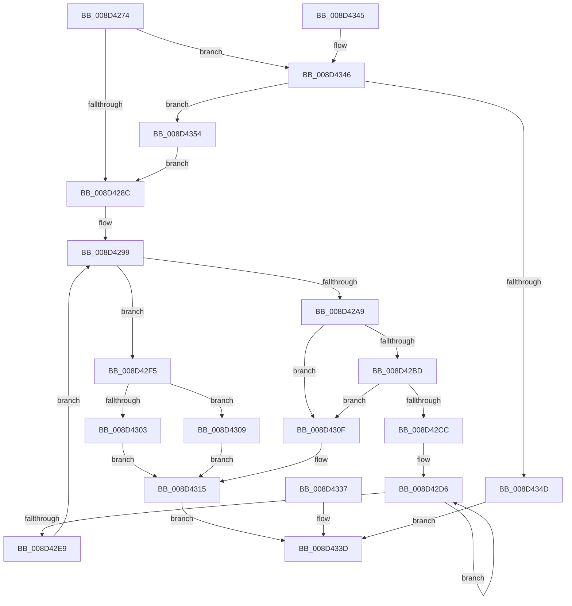

# sub_008D4274

- RVA: `0x008D4274`–`0x008D4361` (길이 `237` bytes)
- VA: `0x00000001408D4274`
- 실행 섹션: `PAGE`
- PDB 이름 있음: `아니요`; PDB Function 태그: `아니요`
- unwind 정보 RVA: `0x00084FB8`
- 디코드: `70`개 명령, `237/237` bytes 표시
- 미해석 바이트: `0` (있으면 어셈블리에 `.byte`로 보존)

> 이 문서는 커널 이미지의 기계어와 PDB 기호를 분석해 생성했습니다. 4번과 5번은 함수 원형과 자료형을 바이너리 사용 방식에서 추정한 C 해석이며 원본 소스 복구 결과는 아닙니다.

## 1. Dependencies

- 직접 호출 지점: **2**; 고유 호출 대상: **2**
- 직접 호출자로 확인된 함수: **1**
- RIP 상대 이미지 참조: **0**

### Outgoing calls
- `0x008D430F` → [ExRaiseAccessViolation](../8E/ExRaiseAccessViolation_function_008E9240.md) (function, `0x008E9240`)
- `0x008D4330` → [memcpy](../../text/6C/memcpy_function_006C6840.md) (function, `0x006C6840`)

### Direct callers
- [sub_008D292D](Unknown_function_008D292D.md) at `0x008D29AC`

### Static image references
- 디코드된 RIP-relative 메모리 참조가 없습니다.

## 2. Other-region calls and transfers

- 다른 실행 섹션으로 향하는 call: **1**
  - `0x008D4330` → [memcpy](../../text/6C/memcpy_function_006C6840.md) (`PAGE` → `.text`)
- 별도 외부 분기/꼬리 이동을 확인하지 못했습니다.

## 3. Assembly (complete function range)

```asm
008D4274  40 53                           push rbx
008D4276  48 83 EC 40                     sub rsp, 0x40
008D427A  4C 8B D1                        mov r10, rcx
008D427D  33 DB                           xor ebx, ebx
008D427F  48 39 99 28 01 00 00            cmp qword ptr [rcx + 0x128], rbx
008D4286  0F 85 BA 00 00 00               jne 0x1408d4346
008D428C  8B CB                           mov ecx, ebx
008D428E  89 5C 24 24                     mov dword ptr [rsp + 0x24], ebx
008D4292  49 C7 C3 00 F0 FF FF            mov r11, 0xfffffffffffff000
008D4299  41 8B 82 44 01 00 00            mov eax, dword ptr [r10 + 0x144]
008D42A0  C1 E8 0A                        shr eax, 0xa
008D42A3  FF C0                           inc eax
008D42A5  3B C8                           cmp ecx, eax
008D42A7  73 4C                           jae 0x1408d42f5
008D42A9  C1 E1 0A                        shl ecx, 0xa
008D42AC  8B C1                           mov eax, ecx
008D42AE  49 8B 08                        mov rcx, qword ptr [r8]
008D42B1  48 2B C8                        sub rcx, rax
008D42B4  48 8D 51 07                     lea rdx, [rcx + 7]
008D42B8  48 3B CA                        cmp rcx, rdx
008D42BB  77 52                           ja 0x1408d430f
008D42BD  48 B8 00 00 FF FF FF 7F 00 00   movabs rax, 0x7fffffff0000
008D42C7  48 3B D0                        cmp rdx, rax
008D42CA  73 43                           jae 0x1408d430f
008D42CC  49 23 D3                        and rdx, r11
008D42CF  48 81 C2 00 10 00 00            add rdx, 0x1000
008D42D6  8A 01                           mov al, byte ptr [rcx]
008D42D8  88 01                           mov byte ptr [rcx], al
008D42DA  49 23 CB                        and rcx, r11
008D42DD  48 81 C1 00 10 00 00            add rcx, 0x1000
008D42E4  48 3B CA                        cmp rcx, rdx
008D42E7  75 ED                           jne 0x1408d42d6
008D42E9  8B 4C 24 24                     mov ecx, dword ptr [rsp + 0x24]
008D42ED  FF C1                           inc ecx
008D42EF  89 4C 24 24                     mov dword ptr [rsp + 0x24], ecx
008D42F3  EB A4                           jmp 0x1408d4299
008D42F5  49 8B 10                        mov rdx, qword ptr [r8]
008D42F8  48 8D 42 E0                     lea rax, [rdx - 0x20]
008D42FC  49 89 00                        mov qword ptr [r8], rax
008D42FF  A8 0F                           test al, 0xf
008D4301  75 06                           jne 0x1408d4309
008D4303  48 83 C2 D8                     add rdx, -0x28
008D4307  EB 0C                           jmp 0x1408d4315
008D4309  48 83 C2 D0                     add rdx, -0x30
008D430D  EB 06                           jmp 0x1408d4315
008D430F  E8 2C 4F 01 00                  call 0x1408e9240
008D4314  CC                              int3
008D4315  49 89 10                        mov qword ptr [r8], rdx
008D4318  89 5C 24 28                     mov dword ptr [rsp + 0x28], ebx
008D431C  48 8B 4C 24 70                  mov rcx, qword ptr [rsp + 0x70]
008D4321  48 8D 41 10                     lea rax, [rcx + 0x10]
008D4325  48 89 02                        mov qword ptr [rdx], rax
008D4328  44 8B 44 24 78                  mov r8d, dword ptr [rsp + 0x78]
008D432D  49 8B D1                        mov rdx, r9
008D4330  E8 0B 25 DF FF                  call 0x1406c6840
008D4335  EB 06                           jmp 0x1408d433d
008D4337  8B D8                           mov ebx, eax
008D4339  89 44 24 28                     mov dword ptr [rsp + 0x28], eax
008D433D  8B C3                           mov eax, ebx
008D433F  48 83 C4 40                     add rsp, 0x40
008D4343  5B                              pop rbx
008D4344  C3                              ret
008D4345  CC                              int3
008D4346  83 7C 24 78 20                  cmp dword ptr [rsp + 0x78], 0x20
008D434B  73 07                           jae 0x1408d4354
008D434D  BB 05 00 00 80                  mov ebx, 0x80000005
008D4352  EB E9                           jmp 0x1408d433d
008D4354  48 8B 42 20                     mov rax, qword ptr [rdx + 0x20]
008D4358  49 89 41 18                     mov qword ptr [r9 + 0x18], rax
008D435C  E9 2B FF FF FF                  jmp 0x1408d428c
```

## 4. C-style interpretation (structured pseudocode)

```c
__int64 __fastcall sub_008D4274(__int64 a1, __int64 a2, __int64 a3, __int64 a4, __int64 a5, unsigned int a6)
{
    __int64 result;
    __int64 v_rbx;
    __int64 v_rsp;
    unsigned int v_stack_m20;
    unsigned int v_stack_m24;

    v_rsp = (v_rsp) - (64);
    v_rbx = 0;
    if ((*(unsigned __int64 *)(a1 + 296)) != 0) goto loc_008D4346;
loc_008D428C:
    v_stack_m24 = 0;
loc_008D4299:
    result = (unsigned int)(((unsigned int)(*(unsigned int *)(a1 + 324))) >> (10));
    result = (unsigned int)((result) + 1);
    if (0 >= ((unsigned int)(result))) goto loc_008D42F5;
    a1 = (unsigned int)((0) << (10));
    a1 = (*(unsigned __int64 *)(a3)) - ((unsigned int)((unsigned int)(a1)));
    if (a1 > (a1 + 7)) goto loc_008D430F;
    if ((a1 + 7) >= ((unsigned int)((unsigned int)(a1)))) goto loc_008D430F;
    a2 = (a1 + 7) & (0xFFFFFFFFFFFFF000ULL);
    a2 = (a2) + (0x1000ULL);
loc_008D42D6:
    *(unsigned __int8 *)(a1) = (unsigned __int8)(*(unsigned __int8 *)(a1));
    a1 = (a1) & (0xFFFFFFFFFFFFF000ULL);
    a1 = (a1) + (0x1000ULL);
    if (a1 != a2) goto loc_008D42D6;
    a1 = (unsigned int)(((unsigned int)(v_stack_m24)) + 1);
    v_stack_m24 = (unsigned int)(a1);
    goto loc_008D4299;
loc_008D42F5:
    *(unsigned __int64 *)(a3) = *(unsigned __int64 *)(a3) - 32;
    if ((((unsigned __int8)(*(unsigned __int64 *)(a3) - 32)) & (15)) != 0) goto loc_008D4309;
    a2 = (*(unsigned __int64 *)(a3)) + (-40);
    goto loc_008D4315;
loc_008D4309:
    a2 = (a2) + (-48);
    goto loc_008D4315;
loc_008D430F:
    result = ExRaiseAccessViolation(a1, a2, a3, a4);
loc_008D4315:
    *(unsigned __int64 *)(a3) = a2;
    v_stack_m20 = 0;
    *(unsigned __int64 *)(a2) = a5 + 16;
    result = memcpy(a5, a4, (unsigned int)(a6), a4);
    goto loc_008D433D;
loc_008D433D:
    v_rsp = (v_rsp) + (64);
    return 0;
loc_008D4346:
    if (a6 >= 32) goto loc_008D4354;
    goto loc_008D433D;
loc_008D4354:
    *(unsigned __int64 *)(a4 + 24) = *(unsigned __int64 *)(a4 + 32);
    goto loc_008D428C;
}
```

## 5. (Beta) C Style

```c
int64_t sub_008D4274(void *Arg1, void *Arg2, void *Arg3, void *Arg4, void *Arg5, uint32_t Arg6)
{
    uint8_t *arg1 = (uint8_t *)Arg1;
    uint8_t *arg2 = (uint8_t *)Arg2;
    uint8_t *arg3 = (uint8_t *)Arg3;
    uint8_t *arg4 = (uint8_t *)Arg4;
    uint8_t *arg5 = (uint8_t *)Arg5;

    int64_t result;
    int64_t local_rbx;
    int64_t local_rsp;
    uint32_t v_stack_m20;
    uint32_t v_stack_m24;

    local_rsp = (local_rsp) - (64);
    local_rbx = 0;
    if ((*(uint64_t *)(arg1 + 0x128)) != 0) goto loc_008D4346;
loc_008D428C:
    v_stack_m24 = 0;
loc_008D4299:
    result = (uint32_t)(((uint32_t)(*(uint32_t *)(arg1 + 0x144))) >> (10));
    result = (uint32_t)((result) + 1);
    if (0 >= ((uint32_t)(result))) goto loc_008D42F5;
    Arg1 = (uint32_t)((0) << (10));
    Arg1 = (*(uint64_t *)(arg3)) - ((uint32_t)((uint32_t)(Arg1)));
    if (Arg1 > (Arg1 + 7)) goto loc_008D430F;
    if ((Arg1 + 7) >= ((uint32_t)((uint32_t)(Arg1)))) goto loc_008D430F;
    Arg2 = (Arg1 + 7) & (0xFFFFFFFFFFFFF000ULL);
    Arg2 = (Arg2) + (0x1000ULL);
loc_008D42D6:
    *(uint8_t *)(arg1) = (uint8_t)(*(uint8_t *)(arg1));
    Arg1 = (Arg1) & (0xFFFFFFFFFFFFF000ULL);
    Arg1 = (Arg1) + (0x1000ULL);
    if (Arg1 != Arg2) goto loc_008D42D6;
    Arg1 = (uint32_t)(((uint32_t)(v_stack_m24)) + 1);
    v_stack_m24 = (uint32_t)(Arg1);
    goto loc_008D4299;
loc_008D42F5:
    *(uint64_t *)(arg3) = *(uint64_t *)(arg3) - 32;
    if ((((uint8_t)(*(uint64_t *)(arg3) - 32)) & (15)) != 0) goto loc_008D4309;
    Arg2 = (*(uint64_t *)(arg3)) + (-40);
    goto loc_008D4315;
loc_008D4309:
    Arg2 = (Arg2) + (-48);
    goto loc_008D4315;
loc_008D430F:
    result = ExRaiseAccessViolation(Arg1, Arg2, Arg3, Arg4);
loc_008D4315:
    *(void **)(arg3) = Arg2;
    v_stack_m20 = 0;
    *(void **)(arg2) = Arg5 + 16;
    result = memcpy(Arg5, Arg4, (uint32_t)(Arg6), Arg4);
    goto loc_008D433D;
loc_008D433D:
    local_rsp = (local_rsp) + (64);
    return 0;
loc_008D4346:
    if (Arg6 >= 32) goto loc_008D4354;
    goto loc_008D433D;
loc_008D4354:
    *(uint64_t *)(arg4 + 0x18) = *(uint64_t *)(arg4 + 0x20);
    goto loc_008D428C;
}
```

### 관측된 메모리 오프셋

구조체 형식이 확인되지 않은 접근은 인자 기준의 오프셋으로만 기록했습니다.

| 기준 인자 | 오프셋 표현 | 폭 (bit) | 접근 |
|---|---:|---:|---|
| `Arg1` | `+ 0x128` | `64` | `R` |
| `Arg1` | `+ 0x144` | `32` | `R` |
| `Arg2` | `+ 0x20` | `64` | `R` |
| `Arg3` | `+ 0x0` | `64` | `R` |
| `Arg3` | `+ 0x0` | `64` | `W` |
| `Arg4` | `+ 0x18` | `64` | `W` |
| `Arg5` | `+ 0x10` | `64` | `R` |

## 6. Execution-region graph

[열기: 2D/3D 그래프와 함수 탐색 컨트롤 패널](../../../control-panel.html?section=page&rva=0x008D4274&view=graph)

- 2D 그래프는 위에서 아래로 흐르고, 3D 그래프는 빈 공간을 드래그해 회전합니다. Shift+드래그는 이동, 휠은 확대·축소, 함수 노드 선택은 대상 보고서 이동입니다.

### Static fallback


