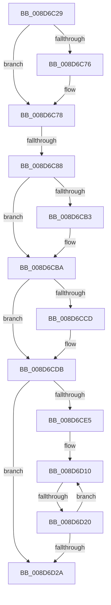

# sub_008D6C29

- RVA: `0x008D6C29`–`0x008D6D5D` (길이 `308` bytes)
- VA: `0x00000001408D6C29`
- 실행 섹션: `PAGE`
- PDB 이름 있음: `아니요`; PDB Function 태그: `아니요`
- unwind 정보 RVA: `0x0008539C`
- 디코드: `73`개 명령, `308/308` bytes 표시
- 미해석 바이트: `0` (있으면 어셈블리에 `.byte`로 보존)

> 이 문서는 커널 이미지의 기계어와 PDB 기호를 분석해 생성했습니다. 4번과 5번은 함수 원형과 자료형을 바이너리 사용 방식에서 추정한 C 해석이며 원본 소스 복구 결과는 아닙니다.

## 1. Dependencies

- 직접 호출 지점: **4**; 고유 호출 대상: **4**
- 직접 호출자로 확인된 함수: **0**
- RIP 상대 이미지 참조: **5**

### Outgoing calls
- `0x008D6C6D` → [KeAreAllApcsDisabled](../../text/2F/KeAreAllApcsDisabled_function_002F7AC0.md) (function, `0x002F7AC0`)
- `0x008D6C9E` → [guard_dispatch_icall](../../text/6B/guard_dispatch_icall_function_006BAAD0.md) (function, `0x006BAAD0`)
- `0x008D6CD6` → [PerfLogImageLoad](PerfLogImageLoad_function_008D6DE0.md) (function, `0x008D6DE0`)
- `0x008D6D13` → [ExReferenceCallBackBlock](../../text/2F/ExReferenceCallBackBlock_function_002F0040.md) (function, `0x002F0040`)

### Direct callers
- 이 함수 시작 RVA로 연결되는 직접 call은 확인되지 않았습니다. 간접 호출은 완전히 역산할 수 없습니다.

### Static image references
- `0x008D6C78` → RVA `0x00E65BF0` (`.data`; read)
- `0x008D6CBA` → RVA `0x00FC6B00` (`ALMOSTRO`; read)
- `0x008D6CDB` → RVA `0x00FD9A88` (`PAGEDATA`; read)
- `0x008D6CEC` → RVA `0x00F05F20` (`.data`; read)
- `0x008D6CFA` → RVA `0x008D70C0` (`EtwpCovSampImageNotify`; read)

## 2. Other-region calls and transfers

- 다른 실행 섹션으로 향하는 call: **3**
  - `0x008D6C6D` → [KeAreAllApcsDisabled](../../text/2F/KeAreAllApcsDisabled_function_002F7AC0.md) (`PAGE` → `.text`)
  - `0x008D6C9E` → [guard_dispatch_icall](../../text/6B/guard_dispatch_icall_function_006BAAD0.md) (`PAGE` → `.text`)
  - `0x008D6D13` → [ExReferenceCallBackBlock](../../text/2F/ExReferenceCallBackBlock_function_002F0040.md) (`PAGE` → `.text`)
- call이 아닌 외부 분기/꼬리 이동: **3**
  - `0x008D6C82` → [sub_008D6DCF](Unknown_function_008D6DCF.md) (`tail-transfer`)
  - `0x008D6D1E` → [sub_008D6D7D](Unknown_function_008D6D7D.md) (`tail-transfer`)
  - `0x008D6D5B` → [sub_008D6D5D + 0x10](Unknown_function_008D6D5D.md) (`tail-transfer`)

## 3. Assembly (complete function range)

```asm
008D6C29  48 89 58 08                     mov qword ptr [rax + 8], rbx
008D6C2D  0F 57 C0                        xorps xmm0, xmm0
008D6C30  48 89 68 18                     mov qword ptr [rax + 0x18], rbp
008D6C34  48 8B DA                        mov rbx, rdx
008D6C37  48 89 70 20                     mov qword ptr [rax + 0x20], rsi
008D6C3B  48 8B E9                        mov rbp, rcx
008D6C3E  0F 11 40 C8                     movups xmmword ptr [rax - 0x38], xmm0
008D6C42  65 4C 8B 2C 25 88 01 00 00      mov r13, qword ptr gs:[0x188]
008D6C4B  49 8B F1                        mov rsi, r9
008D6C4E  48 89 78 F0                     mov qword ptr [rax - 0x10], rdi
008D6C52  49 8B F8                        mov rdi, r8
008D6C55  4C 89 60 E8                     mov qword ptr [rax - 0x18], r12
008D6C59  45 33 E4                        xor r12d, r12d
008D6C5C  4C 89 78 D8                     mov qword ptr [rax - 0x28], r15
008D6C60  66 41 FF 8D E4 01 00 00         dec word ptr [r13 + 0x1e4]
008D6C68  90                              nop
008D6C69  4C 89 60 10                     mov qword ptr [rax + 0x10], r12
008D6C6D  E8 4E 0E A2 FF                  call 0x1402f7ac0
008D6C72  84 C0                           test al, al
008D6C74  74 02                           je 0x1408d6c78
008D6C76  CD 2C                           int 0x2c
008D6C78  48 8B 05 71 EF 58 00            mov rax, qword ptr [rip + 0x58ef71]
008D6C7F  48 85 C0                        test rax, rax
008D6C82  0F 84 47 01 00 00               je 0x1408d6dcf
008D6C88  48 8B 40 18                     mov rax, qword ptr [rax + 0x18]
008D6C8C  4C 8D 4C 24 78                  lea r9, [rsp + 0x78]
008D6C91  4C 8D 44 24 30                  lea r8, [rsp + 0x30]
008D6C96  BA 00 04 00 00                  mov edx, 0x400
008D6C9B  48 8B CE                        mov rcx, rsi
008D6C9E  E8 2D 3E DE FF                  call 0x1406baad0
008D6CA3  85 C0                           test eax, eax
008D6CA5  4C 8D 7C 24 30                  lea r15, [rsp + 0x30]
008D6CAA  4C 0F 48 FD                     cmovs r15, rbp
008D6CAE  48 85 DB                        test rbx, rbx
008D6CB1  74 07                           je 0x1408d6cba
008D6CB3  4C 8B A3 D0 01 00 00            mov r12, qword ptr [rbx + 0x1d0]
008D6CBA  8B 05 40 FE 6E 00               mov eax, dword ptr [rip + 0x6efe40]
008D6CC0  4C 89 74 24 48                  mov qword ptr [rsp + 0x48], r14
008D6CC5  4C 8D 77 08                     lea r14, [rdi + 8]
008D6CC9  A8 04                           test al, 4
008D6CCB  74 0E                           je 0x1408d6cdb
008D6CCD  4D 8B C6                        mov r8, r14
008D6CD0  48 8B D3                        mov rdx, rbx
008D6CD3  49 8B CF                        mov rcx, r15
008D6CD6  E8 05 01 00 00                  call 0x1408d6de0
008D6CDB  8B 05 A7 2D 70 00               mov eax, dword ptr [rip + 0x702da7]
008D6CE1  A8 01                           test al, 1
008D6CE3  74 45                           je 0x1408d6d2a
008D6CE5  41 81 0E 00 04 00 00            or dword ptr [r14], 0x400
008D6CEC  48 8D 1D 2D F2 62 00            lea rbx, [rip + 0x62f22d]
008D6CF3  48 C7 07 38 00 00 00            mov qword ptr [rdi], 0x38
008D6CFA  48 8D 2D BF 03 00 00            lea rbp, [rip + 0x3bf]
008D6D01  48 89 77 30                     mov qword ptr [rdi + 0x30], rsi
008D6D05  BF 40 00 00 00                  mov edi, 0x40
008D6D0A  66 0F 1F 44 00 00               nop word ptr [rax + rax]
008D6D10  48 8B CB                        mov rcx, rbx
008D6D13  E8 28 93 A1 FF                  call 0x1402f0040
008D6D18  48 8B F0                        mov rsi, rax
008D6D1B  48 85 C0                        test rax, rax
008D6D1E  75 5D                           jne 0x1408d6d7d
008D6D20  48 83 C3 08                     add rbx, 8
008D6D24  48 83 EF 01                     sub rdi, 1
008D6D28  75 E6                           jne 0x1408d6d10
008D6D2A  48 8B 4C 24 78                  mov rcx, qword ptr [rsp + 0x78]
008D6D2F  4C 8B 7C 24 40                  mov r15, qword ptr [rsp + 0x40]
008D6D34  4C 8B 74 24 48                  mov r14, qword ptr [rsp + 0x48]
008D6D39  4C 8B 64 24 50                  mov r12, qword ptr [rsp + 0x50]
008D6D3E  48 8B 7C 24 58                  mov rdi, qword ptr [rsp + 0x58]
008D6D43  48 8B B4 24 88 00 00 00         mov rsi, qword ptr [rsp + 0x88]
008D6D4B  48 8B AC 24 80 00 00 00         mov rbp, qword ptr [rsp + 0x80]
008D6D53  48 8B 5C 24 70                  mov rbx, qword ptr [rsp + 0x70]
008D6D58  48 85 C9                        test rcx, rcx
008D6D5B  74 10                           je 0x1408d6d6d
```

## 4. C-style interpretation (structured pseudocode)

```c
__int64 __fastcall sub_008D6C29(__int64 a1, __int64 a2, __int64 a3, __int64 a4, __int64 a5, __int64 a6, __int64 a7, __int64 a8, __int64 a9, __int64 a10, __int64 a11, __int64 a12, __int64 a13, __int64 a14, __int64 a15, __int64 a16, __int64 a17)
{
    __int64 result;
    __int64 v_r12;
    __int64 v_rbx;
    __int64 v_rdi;
    unsigned __int64 v_stack_p48;

    *(unsigned __int64 *)(result + 8) = v_rbx;
    *(unsigned __int64 *)(result + 24) = v_rbp;
    *(unsigned __int64 *)(result + 32) = v_rsi;
    *(unsigned __int64 *)(result - 56) = v_xmm0;
    *(unsigned __int64 *)(result - 16) = v_rdi;
    *(unsigned __int64 *)(result - 24) = v_r12;
    v_r12 = 0;
    *(unsigned __int64 *)(result - 40) = v_r15;
    *(unsigned __int64 *)(result + 16) = 0;
    result = KeAreAllApcsDisabled(a1, a2, a3, a4);
    if ((unsigned __int8)(result) != 0) {
    }
    result = guard_dispatch_icall(a4, (unsigned int)(0x400ULL), a6, a15);
    if (sign_flag) { a6 = a1; }
    if (a2 != 0) {
        v_r12 = *(unsigned __int64 *)(a2 + 464);
    }
    v_stack_p48 = v_r14;
    result = (unsigned int)(*(unsigned int *)(v_rip + 7274048));
    if ((((unsigned __int8)((unsigned int)(*(unsigned int *)(v_rip + 7274048)))) & (4)) != 0) {
        a3 = a3 + 8;
        a2 = a2;
        a1 = a6;
        result = PerfLogImageLoad(a1, a2, a3, a15);
    }
    if ((((unsigned __int8)((unsigned int)(*(unsigned int *)(v_rip + 7351719)))) & (1)) == 0) goto loc_008D6D2A;
    *(unsigned __int64 *)(a3) = 56;
    *(unsigned __int64 *)(a3 + 48) = a4;
loc_008D6D10:
    result = ExReferenceCallBackBlock(v_rip + 6484525, a2, a3, a15);
    v_rbx = (v_rip + 6484525) + (8);
    v_rdi = (64) - (1);
    if (condition_is_not_equal) goto loc_008D6D10;
loc_008D6D2A:
}
```

## 5. (Beta) C Style

```c
int64_t sub_008D6C29(int64_t Arg1, int64_t Arg2, void *Arg3, int64_t Arg4, uint64_t Arg5, int64_t Arg6, uint64_t Arg7, int64_t Arg8, int64_t Arg9, int64_t Arg10, int64_t Arg11, uint64_t Arg12, uint64_t Arg13, int64_t Arg14, int64_t Arg15, int64_t Arg16, int64_t Arg17)
{
    uint8_t *arg3 = (uint8_t *)Arg3;

    int64_t result;
    int64_t local_r12;
    int64_t local_rbx;
    int64_t local_rdi;
    uint64_t v_stack_p48;

    *(uint64_t *)(result + 0x8) = local_rbx;
    *(uint64_t *)(result + 0x18) = local_rbp;
    *(uint64_t *)(result + 0x20) = local_rsi;
    *(uint64_t *)(result - 0x38) = v_xmm0;
    *(uint64_t *)(result - 0x10) = local_rdi;
    *(uint64_t *)(result - 0x18) = local_r12;
    local_r12 = 0;
    *(uint64_t *)(result - 0x28) = local_r15;
    *(uint64_t *)(result + 0x10) = 0;
    result = KeAreAllApcsDisabled(Arg1, Arg2, Arg3, Arg4);
    if ((uint8_t)(result) != 0) {
    }
    result = guard_dispatch_icall(Arg4, (uint32_t)(0x400ULL), Arg6, Arg15);
    if (sign_flag) { Arg6 = Arg1; }
    if (Arg2 != 0) {
        local_r12 = *(uint64_t *)(Arg2 + 0x1D0);
    }
    v_stack_p48 = local_r14;
    result = (uint32_t)(*(uint32_t *)(v_rip + 0x6EFE40));
    if ((((uint8_t)((uint32_t)(*(uint32_t *)(v_rip + 0x6EFE40)))) & (4)) != 0) {
        Arg3 = Arg3 + 8;
        Arg2 = Arg2;
        Arg1 = Arg6;
        result = PerfLogImageLoad(Arg1, Arg2, Arg3, Arg15);
    }
    if ((((uint8_t)((uint32_t)(*(uint32_t *)(v_rip + 0x702DA7)))) & (1)) == 0) goto loc_008D6D2A;
    *(uint64_t *)(arg3) = 56;
    *(uint64_t *)(arg3 + 0x30) = Arg4;
loc_008D6D10:
    result = ExReferenceCallBackBlock(v_rip + 6484525, Arg2, Arg3, Arg15);
    local_rbx = (v_rip + 6484525) + (8);
    local_rdi = (64) - (1);
    if (condition_is_not_equal) goto loc_008D6D10;
loc_008D6D2A:
}
```

### 관측된 메모리 오프셋

구조체 형식이 확인되지 않은 접근은 인자 기준의 오프셋으로만 기록했습니다.

| 기준 인자 | 오프셋 표현 | 폭 (bit) | 접근 |
|---|---:|---:|---|
| `Arg3` | `+ 0x0` | `32` | `R/W` |
| `Arg3` | `+ 0x0` | `64` | `W` |
| `Arg3` | `+ 0x8` | `64` | `R` |
| `Arg3` | `+ 0x30` | `64` | `W` |

## 6. Execution-region graph

[열기: 2D/3D 그래프와 함수 탐색 컨트롤 패널](../../../control-panel.html?section=page&rva=0x008D6C29&view=graph)

- 2D 그래프는 위에서 아래로 흐르고, 3D 그래프는 빈 공간을 드래그해 회전합니다. Shift+드래그는 이동, 휠은 확대·축소, 함수 노드 선택은 대상 보고서 이동입니다.

### Static fallback


