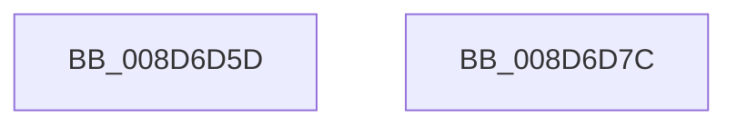

# sub_008D6D5D

- RVA: `0x008D6D5D`–`0x008D6D7D` (길이 `32` bytes)
- VA: `0x00000001408D6D5D`
- 실행 섹션: `PAGE`
- PDB 이름 있음: `아니요`; PDB Function 태그: `아니요`
- unwind 정보 RVA: `0x000853C8`
- 디코드: `9`개 명령, `32/32` bytes 표시
- 미해석 바이트: `0` (있으면 어셈블리에 `.byte`로 보존)

> 이 문서는 커널 이미지의 기계어와 PDB 기호를 분석해 생성했습니다. 4번과 5번은 함수 원형과 자료형을 바이너리 사용 방식에서 추정한 C 해석이며 원본 소스 복구 결과는 아닙니다.

## 1. Dependencies

- 직접 호출 지점: **2**; 고유 호출 대상: **2**
- 직접 호출자로 확인된 함수: **0**
- RIP 상대 이미지 참조: **1**

### Outgoing calls
- `0x008D6D68` → [guard_dispatch_icall](../../text/6B/guard_dispatch_icall_function_006BAAD0.md) (function, `0x006BAAD0`)
- `0x008D6D70` → [KeLeaveCriticalRegionThread](../../text/25/KeLeaveCriticalRegionThread_function_0025EFF0.md) (function, `0x0025EFF0`)

### Direct callers
- 이 함수 시작 RVA로 연결되는 직접 call은 확인되지 않았습니다. 간접 호출은 완전히 역산할 수 없습니다.

### Static image references
- `0x008D6D5D` → RVA `0x00E65BF0` (`.data`; read)

## 2. Other-region calls and transfers

- 다른 실행 섹션으로 향하는 call: **2**
  - `0x008D6D68` → [guard_dispatch_icall](../../text/6B/guard_dispatch_icall_function_006BAAD0.md) (`PAGE` → `.text`)
  - `0x008D6D70` → [KeLeaveCriticalRegionThread](../../text/25/KeLeaveCriticalRegionThread_function_0025EFF0.md) (`PAGE` → `.text`)
- 별도 외부 분기/꼬리 이동을 확인하지 못했습니다.

## 3. Assembly (complete function range)

```asm
008D6D5D  48 8B 05 8C EE 58 00            mov rax, qword ptr [rip + 0x58ee8c]
008D6D64  48 8B 40 20                     mov rax, qword ptr [rax + 0x20]
008D6D68  E8 63 3D DE FF                  call 0x1406baad0
008D6D6D  49 8B CD                        mov rcx, r13
008D6D70  E8 7B 82 98 FF                  call 0x14025eff0
008D6D75  48 83 C4 60                     add rsp, 0x60
008D6D79  41 5D                           pop r13
008D6D7B  C3                              ret
008D6D7C  CC                              int3
```

## 4. C-style interpretation (structured pseudocode)

```c
__int64 __fastcall sub_008D6D5D(void)
{
    __int64 result;
    __int64 v_rsp;

    result = guard_dispatch_icall(a1, a2, a3, a4);
    result = KeLeaveCriticalRegionThread(v_r13, a2, a3, a4);
    v_rsp = (v_rsp) + (96);
    return result;
}
```

## 5. (Beta) C Style

```c
void sub_008D6D5D(void)
{
    int64_t result;
    int64_t local_rsp;

    result = guard_dispatch_icall(a1, a2, a3, a4);
    result = KeLeaveCriticalRegionThread(local_r13, a2, a3, a4);
    local_rsp = (local_rsp) + (96);
    return result;
}
```

## 6. Execution-region graph

[열기: 2D/3D 그래프와 함수 탐색 컨트롤 패널](../../../control-panel.html?section=page&rva=0x008D6D5D&view=graph)

- 2D 그래프는 위에서 아래로 흐르고, 3D 그래프는 빈 공간을 드래그해 회전합니다. Shift+드래그는 이동, 휠은 확대·축소, 함수 노드 선택은 대상 보고서 이동입니다.

### Static fallback


