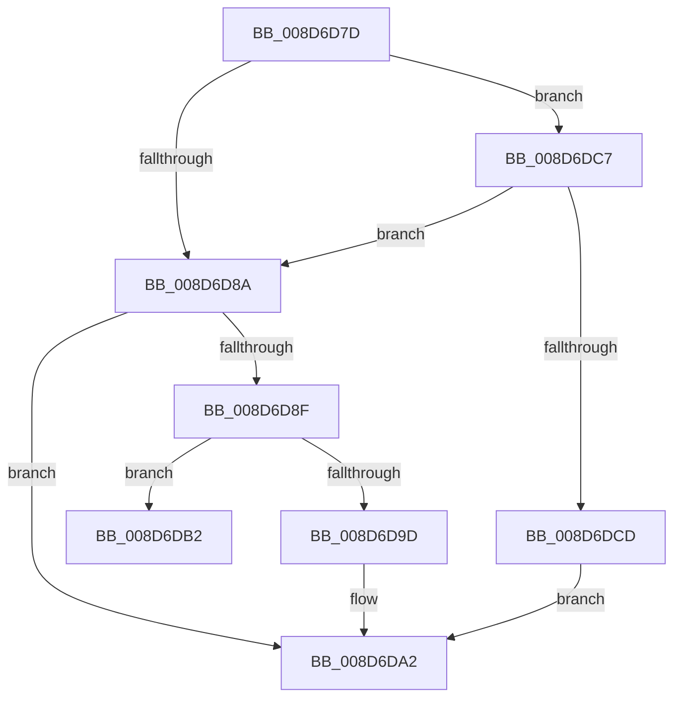

# sub_008D6D7D

- RVA: `0x008D6D7D`–`0x008D6DCF` (길이 `82` bytes)
- VA: `0x00000001408D6D7D`
- 실행 섹션: `PAGE`
- PDB 이름 있음: `아니요`; PDB Function 태그: `아니요`
- unwind 정보 RVA: `0x000853DC`
- 디코드: `23`개 명령, `82/82` bytes 표시
- 미해석 바이트: `0` (있으면 어셈블리에 `.byte`로 보존)

> 이 문서는 커널 이미지의 기계어와 PDB 기호를 분석해 생성했습니다. 4번과 5번은 함수 원형과 자료형을 바이너리 사용 방식에서 추정한 C 해석이며 원본 소스 복구 결과는 아닙니다.

## 1. Dependencies

- 직접 호출 지점: **4**; 고유 호출 대상: **3**
- 직접 호출자로 확인된 함수: **0**
- RIP 상대 이미지 참조: **0**

### Outgoing calls
- `0x008D6D9D` → [guard_dispatch_icall](../../text/6B/guard_dispatch_icall_function_006BAAD0.md) (function, `0x006BAAD0`)
- `0x008D6DA8` → [ExDereferenceCallBackBlock](../../text/44/ExDereferenceCallBackBlock_function_0044D730.md) (function, `0x0044D730`)
- `0x008D6DB2` → [EtwpCovSampImageNotify](EtwpCovSampImageNotify_function_008D70C0.md) (function, `0x008D70C0`)
- `0x008D6DBD` → [ExDereferenceCallBackBlock](../../text/44/ExDereferenceCallBackBlock_function_0044D730.md) (function, `0x0044D730`)

### Direct callers
- 이 함수 시작 RVA로 연결되는 직접 call은 확인되지 않았습니다. 간접 호출은 완전히 역산할 수 없습니다.

### Static image references
- 디코드된 RIP-relative 메모리 참조가 없습니다.

## 2. Other-region calls and transfers

- 다른 실행 섹션으로 향하는 call: **3**
  - `0x008D6D9D` → [guard_dispatch_icall](../../text/6B/guard_dispatch_icall_function_006BAAD0.md) (`PAGE` → `.text`)
  - `0x008D6DA8` → [ExDereferenceCallBackBlock](../../text/44/ExDereferenceCallBackBlock_function_0044D730.md) (`PAGE` → `.text`)
  - `0x008D6DBD` → [ExDereferenceCallBackBlock](../../text/44/ExDereferenceCallBackBlock_function_0044D730.md) (`PAGE` → `.text`)
- call이 아닌 외부 분기/꼬리 이동: **2**
  - `0x008D6DAD` → [sub_008D6C29 + 0xF7](Unknown_function_008D6C29.md) (`tail-transfer`)
  - `0x008D6DC2` → [sub_008D6C29 + 0xF7](Unknown_function_008D6C29.md) (`tail-transfer`)

## 3. Assembly (complete function range)

```asm
008D6D7D  41 F7 06 00 08 00 00            test dword ptr [r14], 0x800
008D6D84  48 8B 40 08                     mov rax, qword ptr [rax + 8]
008D6D88  75 3D                           jne 0x1408d6dc7
008D6D8A  48 85 C0                        test rax, rax
008D6D8D  74 13                           je 0x1408d6da2
008D6D8F  4D 8B C6                        mov r8, r14
008D6D92  49 8B D4                        mov rdx, r12
008D6D95  49 8B CF                        mov rcx, r15
008D6D98  48 3B C5                        cmp rax, rbp
008D6D9B  74 15                           je 0x1408d6db2
008D6D9D  E8 2E 3D DE FF                  call 0x1406baad0
008D6DA2  48 8B D6                        mov rdx, rsi
008D6DA5  48 8B CB                        mov rcx, rbx
008D6DA8  E8 83 69 B7 FF                  call 0x14044d730
008D6DAD  E9 6E FF FF FF                  jmp 0x1408d6d20
008D6DB2  E8 09 03 00 00                  call 0x1408d70c0
008D6DB7  48 8B D6                        mov rdx, rsi
008D6DBA  48 8B CB                        mov rcx, rbx
008D6DBD  E8 6E 69 B7 FF                  call 0x14044d730
008D6DC2  E9 59 FF FF FF                  jmp 0x1408d6d20
008D6DC7  F6 46 10 01                     test byte ptr [rsi + 0x10], 1
008D6DCB  75 BD                           jne 0x1408d6d8a
008D6DCD  EB D3                           jmp 0x1408d6da2
```

## 4. C-style interpretation (structured pseudocode)

```c
__int64 __fastcall sub_008D6D7D(void)
{
    __int64 result;

    if (((*(unsigned int *)(v_r14)) & (0x800ULL)) != 0) goto loc_008D6DC7;
loc_008D6D8A:
    if (*(unsigned __int64 *)(result + 8) == 0) goto loc_008D6DA2;
    if ((*(unsigned __int64 *)(result + 8)) == v_rbp) goto loc_008D6DB2;
    result = guard_dispatch_icall(v_r15, v_r12, v_r14, a4);
loc_008D6DA2:
    result = ExDereferenceCallBackBlock(v_rbx, v_rsi, v_r14, a4);
loc_008D6DB2:
    result = EtwpCovSampImageNotify(v_rbx, v_rsi, v_r14, a4);
    result = ExDereferenceCallBackBlock(v_rbx, v_rsi, v_r14, a4);
loc_008D6DC7:
    if (((*(unsigned __int8 *)(v_rsi + 16)) & (1)) != 0) goto loc_008D6D8A;
    goto loc_008D6DA2;
}
```

## 5. (Beta) C Style

```c
void sub_008D6D7D(void)
{
    int64_t result;

    if (((*(uint32_t *)(local_r14)) & (0x800ULL)) != 0) goto loc_008D6DC7;
loc_008D6D8A:
    if (*(uint64_t *)(result + 0x8) == 0) goto loc_008D6DA2;
    if ((*(uint64_t *)(result + 0x8)) == local_rbp) goto loc_008D6DB2;
    result = guard_dispatch_icall(local_r15, local_r12, local_r14, a4);
loc_008D6DA2:
    result = ExDereferenceCallBackBlock(local_rbx, local_rsi, local_r14, a4);
loc_008D6DB2:
    result = EtwpCovSampImageNotify(local_rbx, local_rsi, local_r14, a4);
    result = ExDereferenceCallBackBlock(local_rbx, local_rsi, local_r14, a4);
loc_008D6DC7:
    if (((*(uint8_t *)(local_rsi + 0x10)) & (1)) != 0) goto loc_008D6D8A;
    goto loc_008D6DA2;
}
```

## 6. Execution-region graph

[열기: 2D/3D 그래프와 함수 탐색 컨트롤 패널](../../../control-panel.html?section=page&rva=0x008D6D7D&view=graph)

- 2D 그래프는 위에서 아래로 흐르고, 3D 그래프는 빈 공간을 드래그해 회전합니다. Shift+드래그는 이동, 휠은 확대·축소, 함수 노드 선택은 대상 보고서 이동입니다.

### Static fallback


