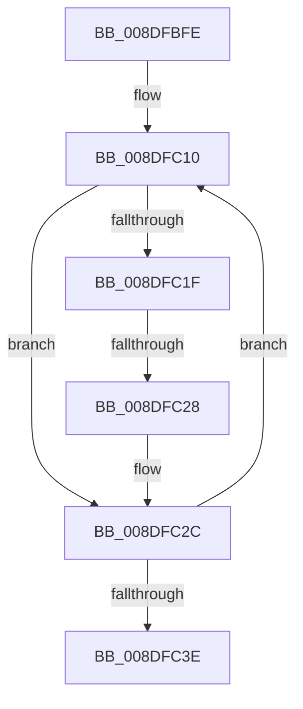

# sub_008DFBFE

- RVA: `0x008DFBFE`–`0x008DFC46` (길이 `72` bytes)
- VA: `0x00000001408DFBFE`
- 실행 섹션: `PAGE`
- PDB 이름 있음: `아니요`; PDB Function 태그: `아니요`
- unwind 정보 RVA: `0x00085C4C`
- 디코드: `17`개 명령, `72/72` bytes 표시
- 미해석 바이트: `0` (있으면 어셈블리에 `.byte`로 보존)

> 이 문서는 커널 이미지의 기계어와 PDB 기호를 분석해 생성했습니다. 4번과 5번은 함수 원형과 자료형을 바이너리 사용 방식에서 추정한 C 해석이며 원본 소스 복구 결과는 아닙니다.

## 1. Dependencies

- 직접 호출 지점: **0**; 고유 호출 대상: **0**
- 직접 호출자로 확인된 함수: **0**
- RIP 상대 이미지 참조: **0**

### Outgoing calls
- 직접 디코드된 call 명령이 없습니다.

### Direct callers
- 이 함수 시작 RVA로 연결되는 직접 call은 확인되지 않았습니다. 간접 호출은 완전히 역산할 수 없습니다.

### Static image references
- 디코드된 RIP-relative 메모리 참조가 없습니다.

## 2. Other-region calls and transfers

- 다른 실행 섹션으로 향하는 call: **0**
- call이 아닌 외부 분기/꼬리 이동: **1**
  - `0x008DFC22` → [sub_008DFCB2](Unknown_function_008DFCB2.md) (`tail-transfer`)

## 3. Assembly (complete function range)

```asm
008DFBFE  48 89 AC 24 E0 00 00 00         mov qword ptr [rsp + 0xe0], rbp
008DFC06  BD C0 00 00 00                  mov ebp, 0xc0
008DFC0B  0F 1F 44 00 00                  nop dword ptr [rax + rax]
008DFC10  0F B7 03                        movzx eax, word ptr [rbx]
008DFC13  48 8D 5B 02                     lea rbx, [rbx + 2]
008DFC17  41 FF CA                        dec r10d
008DFC1A  83 F8 61                        cmp eax, 0x61
008DFC1D  72 0D                           jb 0x1408dfc2c
008DFC1F  83 F8 7A                        cmp eax, 0x7a
008DFC22  0F 87 8A 00 00 00               ja 0x1408dfcb2
008DFC28  66 83 E8 20                     sub ax, 0x20
008DFC2C  45 69 C9 3F 00 01 00            imul r9d, r9d, 0x1003f
008DFC33  0F B7 C8                        movzx ecx, ax
008DFC36  44 03 C9                        add r9d, ecx
008DFC39  45 85 D2                        test r10d, r10d
008DFC3C  75 D2                           jne 0x1408dfc10
008DFC3E  48 8B AC 24 E0 00 00 00         mov rbp, qword ptr [rsp + 0xe0]
```

## 4. C-style interpretation (structured pseudocode)

```c
__int64 __fastcall sub_008DFBFE(__int64 a1, __int64 a2, __int64 a3, int a4, __int64 a5, __int64 a6, __int64 a7, __int64 a8, __int64 a9, __int64 a10, __int64 a11, __int64 a12, __int64 a13, __int64 a14, __int64 a15, __int64 a16, __int64 a17, __int64 a18, __int64 a19, __int64 a20, __int64 a21, __int64 a22, __int64 a23, __int64 a24, __int64 a25, __int64 a26, __int64 a27, __int64 a28)
{
    __int64 result;
    __int64 v_r10;
    unsigned __int64 v_stack_pE0;

    v_stack_pE0 = v_rbp;
loc_008DFC10:
    v_r10 = (unsigned int)((v_r10) - 1);
    if (((unsigned int)(*(unsigned __int16 *)(v_rbx))) < 97) goto loc_008DFC2C;
    result = (unsigned __int16)((*(unsigned __int16 *)(v_rbx)) - (32));
loc_008DFC2C:
    a4 = (unsigned int)((a4) * (a4));
    a4 = (unsigned int)((a4) + ((unsigned int)((unsigned __int16)(result))));
    if ((unsigned int)(v_r10) != 0) goto loc_008DFC10;
    return result;
}
```

## 5. (Beta) C Style

```c
int64_t sub_008DFBFE(int64_t Arg1, int64_t Arg2, int64_t Arg3, int32_t Arg4, uint64_t Arg5, uint64_t Arg6, uint64_t Arg7, uint64_t Arg8, uint64_t Arg9, uint64_t Arg10, uint64_t Arg11, uint64_t Arg12, uint64_t Arg13, uint64_t Arg14, uint64_t Arg15, uint64_t Arg16, uint64_t Arg17, uint64_t Arg18, uint64_t Arg19, uint64_t Arg20, uint64_t Arg21, uint64_t Arg22, uint64_t Arg23, uint64_t Arg24, uint64_t Arg25, uint64_t Arg26, uint64_t Arg27, int64_t Arg28)
{
    int64_t result;
    int64_t local_r10;
    uint64_t v_stack_pE0;

    v_stack_pE0 = local_rbp;
loc_008DFC10:
    local_r10 = (uint32_t)((local_r10) - 1);
    if (((uint32_t)(*(uint16_t *)(local_rbx))) < 97) goto loc_008DFC2C;
    result = (uint16_t)((*(uint16_t *)(local_rbx)) - (32));
loc_008DFC2C:
    Arg4 = (uint32_t)((Arg4) * (Arg4));
    Arg4 = (uint32_t)((Arg4) + ((uint32_t)((uint16_t)(result))));
    if ((uint32_t)(local_r10) != 0) goto loc_008DFC10;
    return result;
}
```

## 6. Execution-region graph

[열기: 2D/3D 그래프와 함수 탐색 컨트롤 패널](../../../control-panel.html?section=page&rva=0x008DFBFE&view=graph)

- 2D 그래프는 위에서 아래로 흐르고, 3D 그래프는 빈 공간을 드래그해 회전합니다. Shift+드래그는 이동, 휠은 확대·축소, 함수 노드 선택은 대상 보고서 이동입니다.

### Static fallback


