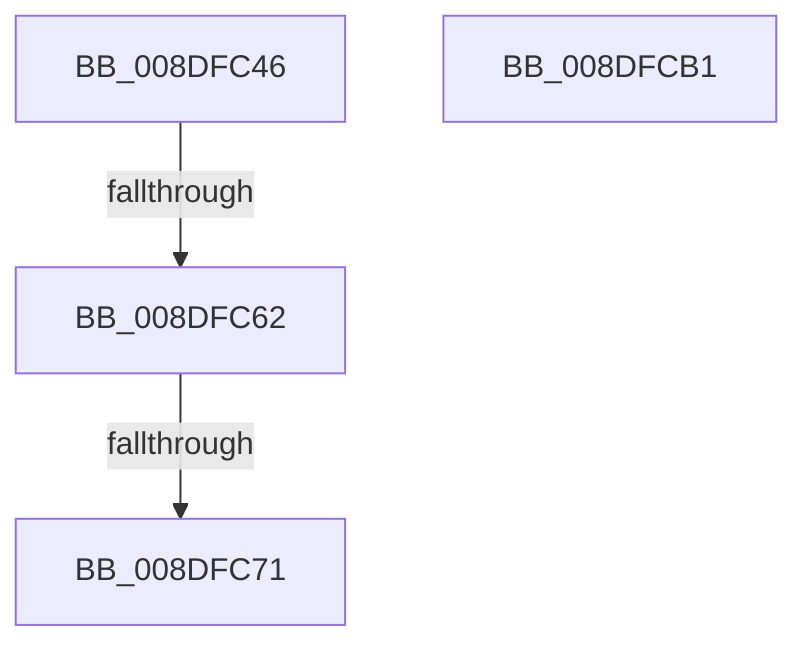

# sub_008DFC46

- RVA: `0x008DFC46`–`0x008DFCB2` (길이 `108` bytes)
- VA: `0x00000001408DFC46`
- 실행 섹션: `PAGE`
- PDB 이름 있음: `아니요`; PDB Function 태그: `아니요`
- unwind 정보 RVA: `0x00085C60`
- 디코드: `26`개 명령, `108/108` bytes 표시
- 미해석 바이트: `0` (있으면 어셈블리에 `.byte`로 보존)

> 이 문서는 커널 이미지의 기계어와 PDB 기호를 분석해 생성했습니다. 4번과 5번은 함수 원형과 자료형을 바이너리 사용 방식에서 추정한 C 해석이며 원본 소스 복구 결과는 아닙니다.

## 1. Dependencies

- 직접 호출 지점: **4**; 고유 호출 대상: **4**
- 직접 호출자로 확인된 함수: **0**
- RIP 상대 이미지 참조: **0**

### Outgoing calls
- `0x008DFC54` → [RtlLookupElementGenericTableAvl](../../text/3F/RtlLookupElementGenericTableAvl_function_003FEFB0.md) (function, `0x003FEFB0`)
- `0x008DFC78` → [ExReleaseResourceLite](../../text/25/ExReleaseResourceLite_function_0025FA10.md) (function, `0x0025FA10`)
- `0x008DFC86` → [KeLeaveCriticalRegionThread](../../text/25/KeLeaveCriticalRegionThread_function_0025EFF0.md) (function, `0x0025EFF0`)
- `0x008DFC98` → [_security_check_cookie](../../text/6A/_security_check_cookie_function_006AC640.md) (function, `0x006AC640`)

### Direct callers
- 이 함수 시작 RVA로 연결되는 직접 call은 확인되지 않았습니다. 간접 호출은 완전히 역산할 수 없습니다.

### Static image references
- 디코드된 RIP-relative 메모리 참조가 없습니다.

## 2. Other-region calls and transfers

- 다른 실행 섹션으로 향하는 call: **4**
  - `0x008DFC54` → [RtlLookupElementGenericTableAvl](../../text/3F/RtlLookupElementGenericTableAvl_function_003FEFB0.md) (`PAGE` → `.text`)
  - `0x008DFC78` → [ExReleaseResourceLite](../../text/25/ExReleaseResourceLite_function_0025FA10.md) (`PAGE` → `.text`)
  - `0x008DFC86` → [KeLeaveCriticalRegionThread](../../text/25/KeLeaveCriticalRegionThread_function_0025EFF0.md) (`PAGE` → `.text`)
  - `0x008DFC98` → [_security_check_cookie](../../text/6A/_security_check_cookie_function_006AC640.md) (`PAGE` → `.text`)
- call이 아닌 외부 분기/꼬리 이동: **2**
  - `0x008DFC5C` → [sub_008DFCF3](Unknown_function_008DFCF3.md) (`tail-transfer`)
  - `0x008DFC6B` → [sub_008DFCF3 + 0x3](Unknown_function_008DFCF3.md) (`tail-transfer`)

## 3. Assembly (complete function range)

```asm
008DFC46  44 89 4C 24 58                  mov dword ptr [rsp + 0x58], r9d
008DFC4B  48 8D 4E 68                     lea rcx, [rsi + 0x68]
008DFC4F  48 8D 54 24 30                  lea rdx, [rsp + 0x30]
008DFC54  E8 57 F3 B1 FF                  call 0x1403fefb0
008DFC59  48 85 C0                        test rax, rax
008DFC5C  0F 84 91 00 00 00               je 0x1408dfcf3
008DFC62  48 8B 00                        mov rax, qword ptr [rax]
008DFC65  49 89 06                        mov qword ptr [r14], rax
008DFC68  48 85 C0                        test rax, rax
008DFC6B  0F 84 85 00 00 00               je 0x1408dfcf6
008DFC71  F0 FF 40 08                     lock inc dword ptr [rax + 8]
008DFC75  48 8B CE                        mov rcx, rsi
008DFC78  E8 93 FD 97 FF                  call 0x14025fa10
008DFC7D  65 48 8B 0C 25 88 01 00 00      mov rcx, qword ptr gs:[0x188]
008DFC86  E8 65 F3 97 FF                  call 0x14025eff0
008DFC8B  8B C7                           mov eax, edi
008DFC8D  48 8B 8C 24 B0 00 00 00         mov rcx, qword ptr [rsp + 0xb0]
008DFC95  48 33 CC                        xor rcx, rsp
008DFC98  E8 A3 C9 DC FF                  call 0x1406ac640
008DFC9D  48 8B 9C 24 E8 00 00 00         mov rbx, qword ptr [rsp + 0xe8]
008DFCA5  48 81 C4 C0 00 00 00            add rsp, 0xc0
008DFCAC  41 5E                           pop r14
008DFCAE  5F                              pop rdi
008DFCAF  5E                              pop rsi
008DFCB0  C3                              ret
008DFCB1  CC                              int3
```

## 4. C-style interpretation (structured pseudocode)

```c
__int64 __fastcall sub_008DFC46(__int64 a1, __int64 a2, __int64 a3, int a4, __int64 a5, __int64 a6, __int64 a7, __int64 a8, __int64 a9, __int64 a10, __int64 a11, __int64 a12, __int64 a13, __int64 a14, __int64 a15, __int64 a16, __int64 a17, __int64 a18, __int64 a19, __int64 a20, __int64 a21, __int64 a22, __int64 a23, __int64 a24, __int64 a25, __int64 a26, __int64 a27, __int64 a28, __int64 a29)
{
    __int64 result;
    __int64 v_rsp;
    unsigned int v_stack_p58;

    v_stack_p58 = a4;
    result = RtlLookupElementGenericTableAvl(v_rsi + 104, a6, a3, a4);
    *(unsigned __int64 *)(v_r14) = *(unsigned __int64 *)(result);
    result = ExReleaseResourceLite(v_rsi, a6, a3, a4);
    result = KeLeaveCriticalRegionThread(*(unsigned __int64 *)(gs_base + (0 + 392)), a6, a3, a4);
    a1 = (a22) ^ (v_rsp);
    result = _security_check_cookie(a1, a6, a3, a4);
    v_rsp = (v_rsp) + (192);
    return result;
}
```

## 5. (Beta) C Style

```c
int64_t sub_008DFC46(int64_t Arg1, int64_t Arg2, int64_t Arg3, int32_t Arg4, uint64_t Arg5, int64_t Arg6, uint64_t Arg7, uint64_t Arg8, uint64_t Arg9, uint64_t Arg10, uint64_t Arg11, uint64_t Arg12, uint64_t Arg13, uint64_t Arg14, uint64_t Arg15, uint64_t Arg16, uint64_t Arg17, uint64_t Arg18, uint64_t Arg19, uint64_t Arg20, uint64_t Arg21, int64_t Arg22, uint64_t Arg23, uint64_t Arg24, uint64_t Arg25, uint64_t Arg26, uint64_t Arg27, uint64_t Arg28, int64_t Arg29)
{
    int64_t result;
    int64_t local_rsp;
    uint32_t v_stack_p58;

    v_stack_p58 = Arg4;
    result = RtlLookupElementGenericTableAvl(local_rsi + 104, Arg6, Arg3, Arg4);
    *(uint64_t *)(local_r14) = *(uint64_t *)(result);
    result = ExReleaseResourceLite(local_rsi, Arg6, Arg3, Arg4);
    result = KeLeaveCriticalRegionThread(*(uint64_t *)(gs_base + (0 + 0x188)), Arg6, Arg3, Arg4);
    Arg1 = (Arg22) ^ (local_rsp);
    result = _security_check_cookie(Arg1, Arg6, Arg3, Arg4);
    local_rsp = (local_rsp) + (192);
    return result;
}
```

## 6. Execution-region graph

[열기: 2D/3D 그래프와 함수 탐색 컨트롤 패널](../../../control-panel.html?section=page&rva=0x008DFC46&view=graph)

- 2D 그래프는 위에서 아래로 흐르고, 3D 그래프는 빈 공간을 드래그해 회전합니다. Shift+드래그는 이동, 휠은 확대·축소, 함수 노드 선택은 대상 보고서 이동입니다.

### Static fallback


