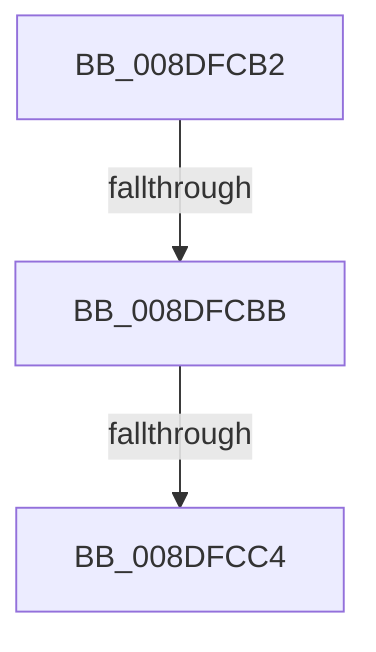

# sub_008DFCB2

- RVA: `0x008DFCB2`–`0x008DFCF3` (길이 `65` bytes)
- VA: `0x00000001408DFCB2`
- 실행 섹션: `PAGE`
- PDB 이름 있음: `아니요`; PDB Function 태그: `아니요`
- unwind 정보 RVA: `0x00085C74`
- 디코드: `17`개 명령, `65/65` bytes 표시
- 미해석 바이트: `0` (있으면 어셈블리에 `.byte`로 보존)

> 이 문서는 커널 이미지의 기계어와 PDB 기호를 분석해 생성했습니다. 4번과 5번은 함수 원형과 자료형을 바이너리 사용 방식에서 추정한 C 해석이며 원본 소스 복구 결과는 아닙니다.

## 1. Dependencies

- 직접 호출 지점: **0**; 고유 호출 대상: **0**
- 직접 호출자로 확인된 함수: **0**
- RIP 상대 이미지 참조: **0**

### Outgoing calls
- 직접 디코드된 call 명령이 없습니다.

### Direct callers
- 이 함수 시작 RVA로 연결되는 직접 call은 확인되지 않았습니다. 간접 호출은 완전히 역산할 수 없습니다.

### Static image references
- 디코드된 RIP-relative 메모리 참조가 없습니다.

## 2. Other-region calls and transfers

- 다른 실행 섹션으로 향하는 call: **0**
- call이 아닌 외부 분기/꼬리 이동: **3**
  - `0x008DFCB5` → [sub_008DFBFE + 0x2E](Unknown_function_008DFBFE.md) (`tail-transfer`)
  - `0x008DFCBE` → [sub_008DFBFE + 0x2E](Unknown_function_008DFBFE.md) (`tail-transfer`)
  - `0x008DFCEE` → [sub_008DFBFE + 0x2E](Unknown_function_008DFBFE.md) (`tail-transfer`)

## 3. Assembly (complete function range)

```asm
008DFCB2  4D 85 DB                        test r11, r11
008DFCB5  0F 84 71 FF FF FF               je 0x1408dfc2c
008DFCBB  66 3B C5                        cmp ax, bp
008DFCBE  0F 82 68 FF FF FF               jb 0x1408dfc2c
008DFCC4  48 8B C8                        mov rcx, rax
008DFCC7  44 8B C0                        mov r8d, eax
008DFCCA  48 C1 E9 08                     shr rcx, 8
008DFCCE  41 83 E0 0F                     and r8d, 0xf
008DFCD2  41 0F B7 14 4B                  movzx edx, word ptr [r11 + rcx*2]
008DFCD7  8B C8                           mov ecx, eax
008DFCD9  C1 E9 04                        shr ecx, 4
008DFCDC  83 E1 0F                        and ecx, 0xf
008DFCDF  03 D1                           add edx, ecx
008DFCE1  41 0F B7 14 53                  movzx edx, word ptr [r11 + rdx*2]
008DFCE6  41 03 D0                        add edx, r8d
008DFCE9  66 41 03 04 53                  add ax, word ptr [r11 + rdx*2]
008DFCEE  E9 39 FF FF FF                  jmp 0x1408dfc2c
```

## 4. C-style interpretation (structured pseudocode)

```c
__int64 __fastcall sub_008DFCB2(void)
{
    __int64 result;

    a1 = (result) >> (8);
    a3 = (unsigned int)(((unsigned int)((unsigned int)(result))) & (15));
    a1 = (unsigned int)(((unsigned int)((unsigned int)(result))) >> (4));
    a1 = (unsigned int)((a1) & (15));
    a2 = (unsigned int)((*(unsigned __int16 *)(v_r11 + a1 * 2)) + ((unsigned int)(a1)));
    a2 = (unsigned int)((*(unsigned __int16 *)(v_r11 + a2 * 2)) + ((unsigned int)(a3)));
    result = (unsigned __int16)((result) + (*(unsigned __int16 *)(v_r11 + a2 * 2)));
}
```

## 5. (Beta) C Style

```c
void sub_008DFCB2(void)
{
    int64_t result;

    a1 = (result) >> (8);
    a3 = (uint32_t)(((uint32_t)((uint32_t)(result))) & (15));
    a1 = (uint32_t)(((uint32_t)((uint32_t)(result))) >> (4));
    a1 = (uint32_t)((a1) & (15));
    a2 = (uint32_t)((*(uint16_t *)(local_r11 + a1 * 2)) + ((uint32_t)(a1)));
    a2 = (uint32_t)((*(uint16_t *)(local_r11 + a2 * 2)) + ((uint32_t)(a3)));
    result = (uint16_t)((result) + (*(uint16_t *)(local_r11 + a2 * 2)));
}
```

## 6. Execution-region graph

[열기: 2D/3D 그래프와 함수 탐색 컨트롤 패널](../../../control-panel.html?section=page&rva=0x008DFCB2&view=graph)

- 2D 그래프는 위에서 아래로 흐르고, 3D 그래프는 빈 공간을 드래그해 회전합니다. Shift+드래그는 이동, 휠은 확대·축소, 함수 노드 선택은 대상 보고서 이동입니다.

### Static fallback


