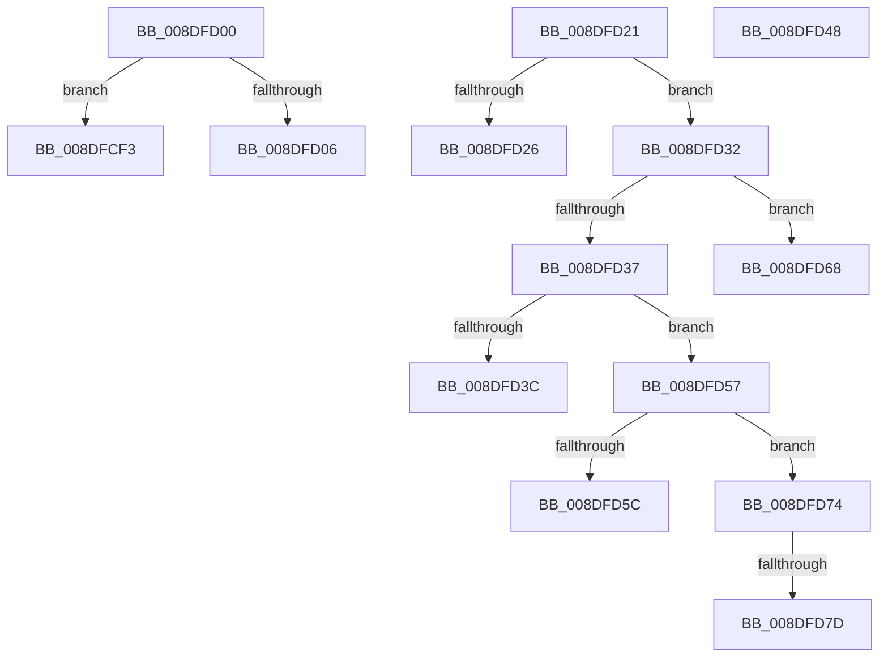

# sub_008DFCF3

- RVA: `0x008DFCF3`–`0x008DFD89` (길이 `150` bytes)
- VA: `0x00000001408DFCF3`
- 실행 섹션: `PAGE`
- PDB 이름 있음: `아니요`; PDB Function 태그: `아니요`
- unwind 정보 RVA: `0x00085C88`
- 디코드: `34`개 명령, `150/150` bytes 표시
- 미해석 바이트: `0` (있으면 어셈블리에 `.byte`로 보존)

> 이 문서는 커널 이미지의 기계어와 PDB 기호를 분석해 생성했습니다. 4번과 5번은 함수 원형과 자료형을 바이너리 사용 방식에서 추정한 C 해석이며 원본 소스 복구 결과는 아닙니다.

## 1. Dependencies

- 직접 호출 지점: **0**; 고유 호출 대상: **0**
- 직접 호출자로 확인된 함수: **0**
- RIP 상대 이미지 참조: **5**

### Outgoing calls
- 직접 디코드된 call 명령이 없습니다.

### Direct callers
- 이 함수 시작 RVA로 연결되는 직접 call은 확인되지 않았습니다. 간접 호출은 완전히 역산할 수 없습니다.

### Static image references
- `0x008DFD26` → RVA `0x00F8B880` (`.data`; read)
- `0x008DFD3C` → RVA `0x00F8B6C0` (`.data`; read)
- `0x008DFD5C` → RVA `0x00F8B5E0` (`.data`; read)
- `0x008DFD68` → RVA `0x00F8B500` (`.data`; read)
- `0x008DFD7D` → RVA `0x00F8B420` (`.data`; read)

## 2. Other-region calls and transfers

- 다른 실행 섹션으로 향하는 call: **0**
- call이 아닌 외부 분기/꼬리 이동: **9**
  - `0x008DFCFB` → [sub_008DFC46 + 0x2F](Unknown_function_008DFC46.md) (`tail-transfer`)
  - `0x008DFD1C` → [PiDmGetObject + 0x102](PiDmGetObject_function_008DFAE0.md) (`tail-transfer`)
  - `0x008DFD2D` → [PiDmGetObject + 0x3C](PiDmGetObject_function_008DFAE0.md) (`tail-transfer`)
  - `0x008DFD43` → [PiDmGetObject + 0x3C](PiDmGetObject_function_008DFAE0.md) (`tail-transfer`)
  - `0x008DFD52` → [PiDmGetObject + 0xF0](PiDmGetObject_function_008DFAE0.md) (`tail-transfer`)
  - `0x008DFD63` → [PiDmGetObject + 0x3C](PiDmGetObject_function_008DFAE0.md) (`tail-transfer`)
  - `0x008DFD6F` → [PiDmGetObject + 0x3C](PiDmGetObject_function_008DFAE0.md) (`tail-transfer`)
  - `0x008DFD77` → [PiDmGetObject + 0x3C](PiDmGetObject_function_008DFAE0.md) (`tail-transfer`)
  - `0x008DFD84` → [PiDmGetObject + 0x3C](PiDmGetObject_function_008DFAE0.md) (`tail-transfer`)

## 3. Assembly (complete function range)

```asm
008DFCF3  49 89 3E                        mov qword ptr [r14], rdi
008DFCF6  BF 34 00 00 C0                  mov edi, 0xc0000034
008DFCFB  E9 75 FF FF FF                  jmp 0x1408dfc75
008DFD00  66 83 FA 08                     cmp dx, 8
008DFD04  76 ED                           jbe 0x1408dfcf3
008DFD06  B8 F8 FF 00 00                  mov eax, 0xfff8
008DFD0B  66 03 D0                        add dx, ax
008DFD0E  48 83 C3 08                     add rbx, 8
008DFD12  66 89 54 24 20                  mov word ptr [rsp + 0x20], dx
008DFD17  48 89 5C 24 28                  mov qword ptr [rsp + 0x28], rbx
008DFD1C  E9 C1 FE FF FF                  jmp 0x1408dfbe2
008DFD21  83 E9 01                        sub ecx, 1
008DFD24  75 0C                           jne 0x1408dfd32
008DFD26  48 8D 35 53 BB 6A 00            lea rsi, [rip + 0x6abb53]
008DFD2D  E9 EA FD FF FF                  jmp 0x1408dfb1c
008DFD32  83 E9 01                        sub ecx, 1
008DFD35  74 31                           je 0x1408dfd68
008DFD37  83 E9 02                        sub ecx, 2
008DFD3A  75 1B                           jne 0x1408dfd57
008DFD3C  48 8D 35 7D B9 6A 00            lea rsi, [rip + 0x6ab97d]
008DFD43  E9 D4 FD FF FF                  jmp 0x1408dfb1c
008DFD48  48 8B 5C 24 28                  mov rbx, qword ptr [rsp + 0x28]
008DFD4D  0F B7 54 24 20                  movzx edx, word ptr [rsp + 0x20]
008DFD52  E9 79 FE FF FF                  jmp 0x1408dfbd0
008DFD57  83 E9 01                        sub ecx, 1
008DFD5A  75 18                           jne 0x1408dfd74
008DFD5C  48 8D 35 7D B8 6A 00            lea rsi, [rip + 0x6ab87d]
008DFD63  E9 B4 FD FF FF                  jmp 0x1408dfb1c
008DFD68  48 8D 35 91 B7 6A 00            lea rsi, [rip + 0x6ab791]
008DFD6F  E9 A8 FD FF FF                  jmp 0x1408dfb1c
008DFD74  83 F9 01                        cmp ecx, 1
008DFD77  0F 85 9F FD FF FF               jne 0x1408dfb1c
008DFD7D  48 8D 35 9C B6 6A 00            lea rsi, [rip + 0x6ab69c]
008DFD84  E9 93 FD FF FF                  jmp 0x1408dfb1c
```

## 4. C-style interpretation (structured pseudocode)

```c
__int64 __fastcall sub_008DFCF3(int a1, unsigned __int16 a2)
{
    unsigned __int16 v_stack_p20;
    unsigned __int64 v_stack_p28;

    *(unsigned __int64 *)(v_r14) = v_rdi;
}
```

## 5. (Beta) C Style

```c
int64_t sub_008DFCF3(int32_t Arg1, uint16_t Arg2)
{
    uint16_t v_stack_p20;
    uint64_t v_stack_p28;

    *(uint64_t *)(local_r14) = local_rdi;
}
```

## 6. Execution-region graph

[열기: 2D/3D 그래프와 함수 탐색 컨트롤 패널](../../../control-panel.html?section=page&rva=0x008DFCF3&view=graph)

- 2D 그래프는 위에서 아래로 흐르고, 3D 그래프는 빈 공간을 드래그해 회전합니다. Shift+드래그는 이동, 휠은 확대·축소, 함수 노드 선택은 대상 보고서 이동입니다.

### Static fallback


