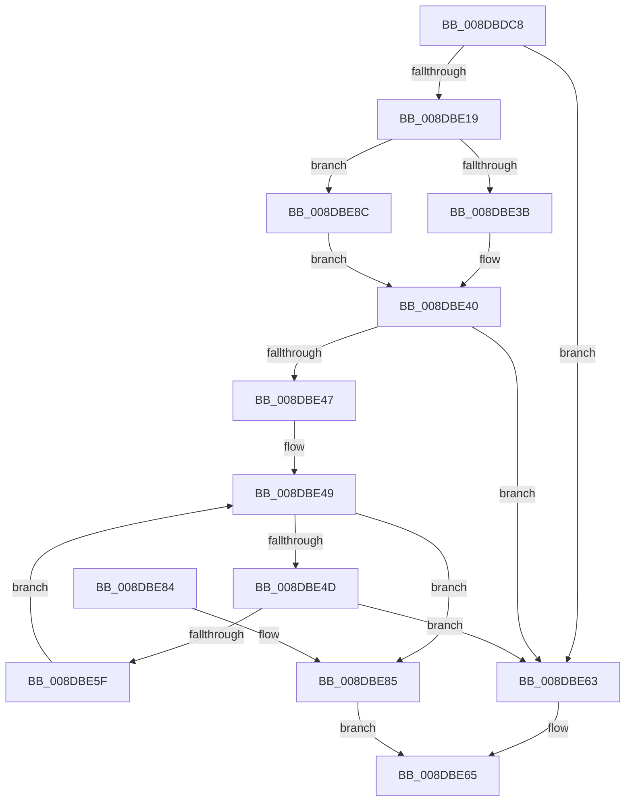

# ValidFilter

- RVA: `0x008DBDC8`–`0x008DBE93` (길이 `203` bytes)
- VA: `0x00000001408DBDC8`
- 실행 섹션: `PAGE`
- PDB 이름 있음: `예`; PDB Function 태그: `아니요`
- unwind 정보 RVA: `0x00085894`
- 디코드: `59`개 명령, `203/203` bytes 표시
- 미해석 바이트: `0` (있으면 어셈블리에 `.byte`로 보존)

> 이 문서는 커널 이미지의 기계어와 PDB 기호를 분석해 생성했습니다. 4번과 5번은 함수 원형과 자료형을 바이너리 사용 방식에서 추정한 C 해석이며 원본 소스 복구 결과는 아닙니다.

## 1. Dependencies

- 직접 호출 지점: **4**; 고유 호출 대상: **4**
- 직접 호출자로 확인된 함수: **1**
- RIP 상대 이미지 참조: **2**

### Outgoing calls
- `0x008DBE3B` → [FilterEvalStrict](../8E/FilterEvalStrict_function_008E0ADC.md) (function, `0x008E0ADC`)
- `0x008DBE56` → [ValidFilterExpression](../../text/49/ValidFilterExpression_function_00491EE4.md) (function, `0x00491EE4`)
- `0x008DBE6C` → [_security_check_cookie](../../text/6A/_security_check_cookie_function_006AC640.md) (function, `0x006AC640`)
- `0x008DBE8C` → [FilterEvalImpliedAnd](FilterEvalImpliedAnd_function_008DE898.md) (function, `0x008DE898`)

### Direct callers
- [PiDqQueryValidateQueryData](PiDqQueryValidateQueryData_function_008DC67C.md) at `0x008DC7B4`

### Static image references
- `0x008DBDDA` → RVA `0x00E0A740` (`.data`; read)
- `0x008DBE32` → RVA `0x00A51A30` (`GetPropertyFromPropArray`; read)

## 2. Other-region calls and transfers

- 다른 실행 섹션으로 향하는 call: **2**
  - `0x008DBE56` → [ValidFilterExpression](../../text/49/ValidFilterExpression_function_00491EE4.md) (`PAGE` → `.text`)
  - `0x008DBE6C` → [_security_check_cookie](../../text/6A/_security_check_cookie_function_006AC640.md) (`PAGE` → `.text`)
- 별도 외부 분기/꼬리 이동을 확인하지 못했습니다.

## 3. Assembly (complete function range)

```asm
008DBDC8  48 89 5C 24 18                  mov qword ptr [rsp + 0x18], rbx
008DBDCD  55                              push rbp
008DBDCE  56                              push rsi
008DBDCF  57                              push rdi
008DBDD0  48 8B EC                        mov rbp, rsp
008DBDD3  48 81 EC 80 00 00 00            sub rsp, 0x80
008DBDDA  48 8B 05 5F E9 52 00            mov rax, qword ptr [rip + 0x52e95f]
008DBDE1  48 33 C4                        xor rax, rsp
008DBDE4  48 89 45 F8                     mov qword ptr [rbp - 8], rax
008DBDE8  83 65 B0 00                     and dword ptr [rbp - 0x50], 0
008DBDEC  48 8D 45 C8                     lea rax, [rbp - 0x38]
008DBDF0  0F 57 C0                        xorps xmm0, xmm0
008DBDF3  48 C7 45 B8 01 00 00 00         mov qword ptr [rbp - 0x48], 1
008DBDFB  83 65 BC 00                     and dword ptr [rbp - 0x44], 0
008DBDFF  48 8B FA                        mov rdi, rdx
008DBE02  48 89 45 C0                     mov qword ptr [rbp - 0x40], rax
008DBE06  8B F1                           mov esi, ecx
008DBE08  0F 11 45 C8                     movups xmmword ptr [rbp - 0x38], xmm0
008DBE0C  0F 11 45 D8                     movups xmmword ptr [rbp - 0x28], xmm0
008DBE10  0F 11 45 E8                     movups xmmword ptr [rbp - 0x18], xmm0
008DBE14  83 F9 01                        cmp ecx, 1
008DBE17  72 4A                           jb 0x1408dbe63
008DBE19  F7 02 00 00 F0 0F               test dword ptr [rdx], 0xff00000
008DBE1F  48 8D 45 B0                     lea rax, [rbp - 0x50]
008DBE23  4C 8B CA                        mov r9, rdx
008DBE26  48 89 44 24 20                  mov qword ptr [rsp + 0x20], rax
008DBE2B  44 8B C1                        mov r8d, ecx
008DBE2E  48 8D 55 B8                     lea rdx, [rbp - 0x48]
008DBE32  48 8D 0D F7 5B 17 00            lea rcx, [rip + 0x175bf7]
008DBE39  74 51                           je 0x1408dbe8c
008DBE3B  E8 9C 4C 00 00                  call 0x1408e0adc
008DBE40  3D 0D 00 00 C0                  cmp eax, 0xc000000d
008DBE45  74 1C                           je 0x1408dbe63
008DBE47  33 DB                           xor ebx, ebx
008DBE49  3B DE                           cmp ebx, esi
008DBE4B  73 38                           jae 0x1408dbe85
008DBE4D  8B C3                           mov eax, ebx
008DBE4F  48 6B C8 38                     imul rcx, rax, 0x38
008DBE53  48 03 CF                        add rcx, rdi
008DBE56  E8 89 60 BB FF                  call 0x140491ee4
008DBE5B  85 C0                           test eax, eax
008DBE5D  74 04                           je 0x1408dbe63
008DBE5F  FF C3                           inc ebx
008DBE61  EB E6                           jmp 0x1408dbe49
008DBE63  33 C0                           xor eax, eax
008DBE65  48 8B 4D F8                     mov rcx, qword ptr [rbp - 8]
008DBE69  48 33 CC                        xor rcx, rsp
008DBE6C  E8 CF 07 DD FF                  call 0x1406ac640
008DBE71  48 8B 9C 24 B0 00 00 00         mov rbx, qword ptr [rsp + 0xb0]
008DBE79  48 81 C4 80 00 00 00            add rsp, 0x80
008DBE80  5F                              pop rdi
008DBE81  5E                              pop rsi
008DBE82  5D                              pop rbp
008DBE83  C3                              ret
008DBE84  CC                              int3
008DBE85  B8 01 00 00 00                  mov eax, 1
008DBE8A  EB D9                           jmp 0x1408dbe65
008DBE8C  E8 07 2A 00 00                  call 0x1408de898
008DBE91  EB AD                           jmp 0x1408dbe40
```

## 4. C-style interpretation (structured pseudocode)

```c
__int64 __fastcall ValidFilter(int a1, __int64 a2)
{
    __int64 result;
    __int64 v_rbx;
    __int64 v_rsp;
    unsigned __int64 v_stack_m20;
    unsigned __int64 v_stack_m30;
    unsigned __int64 v_stack_m40;
    unsigned __int64 v_stack_m50;
    unsigned __int64 v_stack_m58;
    unsigned int v_stack_m5C;
    unsigned __int64 v_stack_m60;
    unsigned int v_stack_m68;
    unsigned __int64 v_stack_m78;
    unsigned __int64 v_stack_p18;

    v_stack_p18 = v_rbx;
    v_rsp = (v_rsp) - (128);
    result = (*(unsigned __int64 *)(v_rip + 5433695)) ^ (v_rsp);
    v_stack_m20 = result;
    v_stack_m60 = 1;
    v_stack_m58 = v_stack_m50;
    v_stack_m50 = v_xmm0;
    v_stack_m40 = v_xmm0;
    v_stack_m30 = v_xmm0;
    if (a1 < 1) goto loc_008DBE63;
    v_stack_m78 = v_stack_m68;
    if (((*(unsigned int *)(a2)) & (0xFF00000ULL)) == 0) goto loc_008DBE8C;
    result = FilterEvalStrict(v_rip + 1530871, v_stack_m60, (unsigned int)(a1), a2);
loc_008DBE40:
    if (((unsigned int)(result)) == 0xC000000DULL) goto loc_008DBE63;
    v_rbx = 0;
loc_008DBE49:
    if (0 >= ((unsigned int)((unsigned int)(a1)))) goto loc_008DBE85;
    a1 = (v_rip + 1530871) * (0);
    a1 = (a1) + (a2);
    result = ValidFilterExpression(a1, v_stack_m60, (unsigned int)(a1), a2);
    if ((unsigned int)(result) == 0) goto loc_008DBE63;
    v_rbx = (unsigned int)((v_rbx) + 1);
    goto loc_008DBE49;
loc_008DBE63:
    result = 0;
loc_008DBE65:
    a1 = (v_stack_m20) ^ (v_rsp);
    result = _security_check_cookie(a1, v_stack_m60, (unsigned int)(a1), a2);
    v_rsp = (v_rsp) + (128);
    return result;
loc_008DBE85:
    goto loc_008DBE65;
loc_008DBE8C:
    result = FilterEvalImpliedAnd(a1, v_stack_m60, (unsigned int)(a1), a2);
    goto loc_008DBE40;
}
```

## 5. (Beta) C Style

```c
int64_t ValidFilter(int32_t Arg1, void *Arg2)
{
    uint8_t *arg2 = (uint8_t *)Arg2;

    int64_t result;
    int64_t local_rbx;
    int64_t local_rsp;
    uint64_t v_stack_m20;
    uint64_t v_stack_m30;
    uint64_t v_stack_m40;
    uint64_t v_stack_m50;
    uint64_t v_stack_m58;
    uint32_t v_stack_m5C;
    uint64_t v_stack_m60;
    uint32_t v_stack_m68;
    uint64_t v_stack_m78;
    uint64_t v_stack_p18;

    v_stack_p18 = local_rbx;
    local_rsp = (local_rsp) - (128);
    result = (*(uint64_t *)(v_rip + 0x52E95F)) ^ (local_rsp);
    v_stack_m20 = result;
    v_stack_m60 = 1;
    v_stack_m58 = v_stack_m50;
    v_stack_m50 = v_xmm0;
    v_stack_m40 = v_xmm0;
    v_stack_m30 = v_xmm0;
    if (Arg1 < 1) goto loc_008DBE63;
    v_stack_m78 = v_stack_m68;
    if (((*(uint32_t *)(arg2)) & (0xFF00000ULL)) == 0) goto loc_008DBE8C;
    result = FilterEvalStrict(v_rip + 1530871, v_stack_m60, (uint32_t)(Arg1), Arg2);
loc_008DBE40:
    if (((uint32_t)(result)) == 0xC000000DULL) goto loc_008DBE63;
    local_rbx = 0;
loc_008DBE49:
    if (0 >= ((uint32_t)((uint32_t)(Arg1)))) goto loc_008DBE85;
    Arg1 = (v_rip + 1530871) * (0);
    Arg1 = (Arg1) + (Arg2);
    result = ValidFilterExpression(Arg1, v_stack_m60, (uint32_t)(Arg1), Arg2);
    if ((uint32_t)(result) == 0) goto loc_008DBE63;
    local_rbx = (uint32_t)((local_rbx) + 1);
    goto loc_008DBE49;
loc_008DBE63:
    result = 0;
loc_008DBE65:
    Arg1 = (v_stack_m20) ^ (local_rsp);
    result = _security_check_cookie(Arg1, v_stack_m60, (uint32_t)(Arg1), Arg2);
    local_rsp = (local_rsp) + (128);
    return result;
loc_008DBE85:
    goto loc_008DBE65;
loc_008DBE8C:
    result = FilterEvalImpliedAnd(Arg1, v_stack_m60, (uint32_t)(Arg1), Arg2);
    goto loc_008DBE40;
}
```

### 관측된 메모리 오프셋

구조체 형식이 확인되지 않은 접근은 인자 기준의 오프셋으로만 기록했습니다.

| 기준 인자 | 오프셋 표현 | 폭 (bit) | 접근 |
|---|---:|---:|---|
| `Arg2` | `+ 0x0` | `32` | `R` |

## 6. Execution-region graph

[열기: 2D/3D 그래프와 함수 탐색 컨트롤 패널](../../../control-panel.html?section=page&rva=0x008DBDC8&view=graph)

- 2D 그래프는 위에서 아래로 흐르고, 3D 그래프는 빈 공간을 드래그해 회전합니다. Shift+드래그는 이동, 휠은 확대·축소, 함수 노드 선택은 대상 보고서 이동입니다.

### Static fallback


