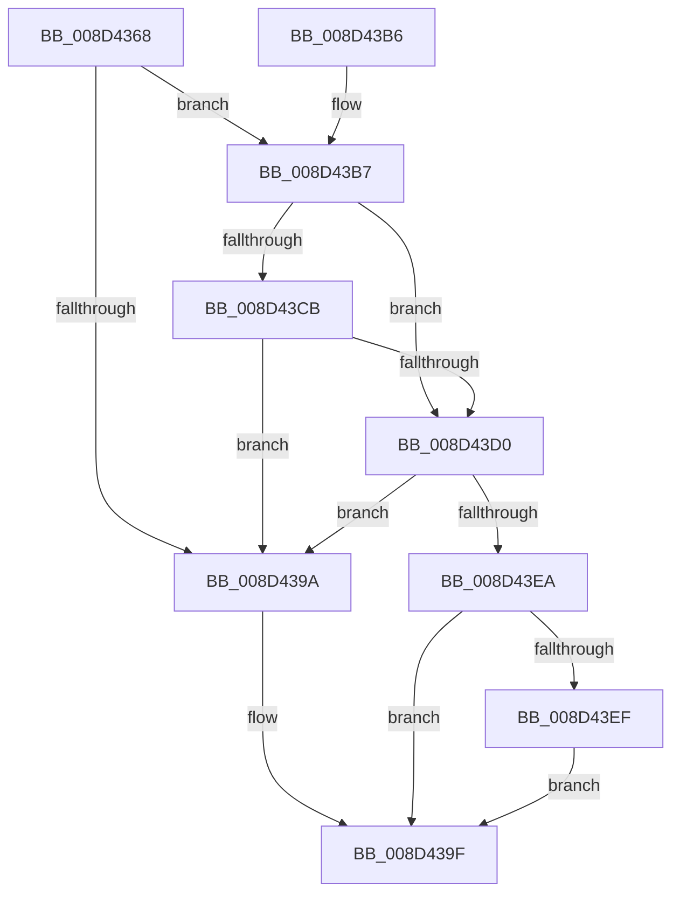

# WbDisableTracing

- RVA: `0x008D4368`–`0x008D43F6` (길이 `142` bytes)
- VA: `0x00000001408D4368`
- 실행 섹션: `PAGE`
- PDB 이름 있음: `예`; PDB Function 태그: `아니요`
- unwind 정보 RVA: `0x00084FE8`
- 디코드: `36`개 명령, `142/142` bytes 표시
- 미해석 바이트: `0` (있으면 어셈블리에 `.byte`로 보존)

> 이 문서는 커널 이미지의 기계어와 PDB 기호를 분석해 생성했습니다. 4번과 5번은 함수 원형과 자료형을 바이너리 사용 방식에서 추정한 C 해석이며 원본 소스 복구 결과는 아닙니다.

## 1. Dependencies

- 직접 호출 지점: **1**; 고유 호출 대상: **1**
- 직접 호출자로 확인된 함수: **1**
- RIP 상대 이미지 참조: **0**

### Outgoing calls
- `0x008D43E0` → [PsWow64GetProcessMachine](PsWow64GetProcessMachine_function_008D2130.md) (function, `0x008D2130`)

### Direct callers
- [sub_008D292D](Unknown_function_008D292D.md) at `0x008D29C0`

### Static image references
- 디코드된 RIP-relative 메모리 참조가 없습니다.

## 2. Other-region calls and transfers

- 다른 실행 섹션으로 향하는 call: **0**
- 별도 외부 분기/꼬리 이동을 확인하지 못했습니다.

## 3. Assembly (complete function range)

```asm
008D4368  48 89 5C 24 08                  mov qword ptr [rsp + 8], rbx
008D436D  48 89 6C 24 10                  mov qword ptr [rsp + 0x10], rbp
008D4372  48 89 74 24 18                  mov qword ptr [rsp + 0x18], rsi
008D4377  57                              push rdi
008D4378  48 83 EC 20                     sub rsp, 0x20
008D437C  65 48 8B 04 25 88 01 00 00      mov rax, qword ptr gs:[0x188]
008D4385  48 8B D9                        mov rbx, rcx
008D4388  33 FF                           xor edi, edi
008D438A  48 8B 88 B8 00 00 00            mov rcx, qword ptr [rax + 0xb8]
008D4391  48 39 B9 10 03 00 00            cmp qword ptr [rcx + 0x310], rdi
008D4398  75 1D                           jne 0x1408d43b7
008D439A  0F BA 73 10 08                  btr dword ptr [rbx + 0x10], 8
008D439F  48 8B 5C 24 30                  mov rbx, qword ptr [rsp + 0x30]
008D43A4  8B C7                           mov eax, edi
008D43A6  48 8B 6C 24 38                  mov rbp, qword ptr [rsp + 0x38]
008D43AB  48 8B 74 24 40                  mov rsi, qword ptr [rsp + 0x40]
008D43B0  48 83 C4 20                     add rsp, 0x20
008D43B4  5F                              pop rdi
008D43B5  C3                              ret
008D43B6  CC                              int3
008D43B7  0F B7 81 EC 06 00 00            movzx eax, word ptr [rcx + 0x6ec]
008D43BE  BD 4C 01 00 00                  mov ebp, 0x14c
008D43C3  8D 75 78                        lea esi, [rbp + 0x78]
008D43C6  66 3B C5                        cmp ax, bp
008D43C9  74 05                           je 0x1408d43d0
008D43CB  66 3B C6                        cmp ax, si
008D43CE  75 CA                           jne 0x1408d439a
008D43D0  65 48 8B 0C 25 88 01 00 00      mov rcx, qword ptr gs:[0x188]
008D43D9  48 8B 89 B8 00 00 00            mov rcx, qword ptr [rcx + 0xb8]
008D43E0  E8 4B DD FF FF                  call 0x1408d2130
008D43E5  66 3B C5                        cmp ax, bp
008D43E8  74 B0                           je 0x1408d439a
008D43EA  66 3B C6                        cmp ax, si
008D43ED  74 B0                           je 0x1408d439f
008D43EF  BF BB 00 00 C0                  mov edi, 0xc00000bb
008D43F4  EB A9                           jmp 0x1408d439f
```

## 4. C-style interpretation (structured pseudocode)

```c
__int64 __fastcall WbDisableTracing(__int64 a1)
{
    __int64 result;
    __int64 v_rdi;
    __int64 v_rsp;
    unsigned __int64 v_stack_p10;
    unsigned __int64 v_stack_p18;
    unsigned __int64 v_stack_p8;

    v_stack_p8 = v_rbx;
    v_stack_p10 = v_rbp;
    v_stack_p18 = v_rsi;
    v_rsp = (v_rsp) - (32);
    v_rdi = 0;
    if ((*(unsigned __int64 *)(*(unsigned __int64 *)(*(unsigned __int64 *)(gs_base + (0 + 392)) + 184) + 784)) != 0) goto loc_008D43B7;
loc_008D439A:
loc_008D439F:
    v_rsp = (v_rsp) + (32);
    return 0;
loc_008D43B7:
    if (((unsigned __int16)(*(unsigned __int16 *)(*(unsigned __int64 *)(*(unsigned __int64 *)(gs_base + (0 + 392)) + 184) + 1772))) == 332) goto loc_008D43D0;
    if (((unsigned __int16)(*(unsigned __int16 *)(*(unsigned __int64 *)(*(unsigned __int64 *)(gs_base + (0 + 392)) + 184) + 1772))) != ((unsigned __int16)(332 + 120))) goto loc_008D439A;
loc_008D43D0:
    result = PsWow64GetProcessMachine(*(unsigned __int64 *)(*(unsigned __int64 *)(gs_base + (0 + 392)) + 184), a2, a3, a4);
    if (((unsigned __int16)(result)) == 332) goto loc_008D439A;
    if (((unsigned __int16)(result)) == ((unsigned __int16)(332 + 120))) goto loc_008D439F;
    goto loc_008D439F;
}
```

## 5. (Beta) C Style

```c
int64_t WbDisableTracing(void *Arg1)
{
    uint8_t *arg1 = (uint8_t *)Arg1;

    int64_t result;
    int64_t local_rdi;
    int64_t local_rsp;
    uint64_t v_stack_p10;
    uint64_t v_stack_p18;
    uint64_t v_stack_p8;

    v_stack_p8 = local_rbx;
    v_stack_p10 = local_rbp;
    v_stack_p18 = local_rsi;
    local_rsp = (local_rsp) - (32);
    local_rdi = 0;
    if ((*(uint64_t *)(*(uint64_t *)(*(uint64_t *)(gs_base + (0 + 0x188)) + 0xB8) + 0x310)) != 0) goto loc_008D43B7;
loc_008D439A:
loc_008D439F:
    local_rsp = (local_rsp) + (32);
    return 0;
loc_008D43B7:
    if (((uint16_t)(*(uint16_t *)(*(uint64_t *)(*(uint64_t *)(gs_base + (0 + 0x188)) + 0xB8) + 0x6EC))) == 332) goto loc_008D43D0;
    if (((uint16_t)(*(uint16_t *)(*(uint64_t *)(*(uint64_t *)(gs_base + (0 + 0x188)) + 0xB8) + 0x6EC))) != ((uint16_t)(332 + 120))) goto loc_008D439A;
loc_008D43D0:
    result = PsWow64GetProcessMachine(*(uint64_t *)(*(uint64_t *)(gs_base + (0 + 0x188)) + 0xB8), a2, a3, a4);
    if (((uint16_t)(result)) == 332) goto loc_008D439A;
    if (((uint16_t)(result)) == ((uint16_t)(332 + 120))) goto loc_008D439F;
    goto loc_008D439F;
}
```

### 관측된 메모리 오프셋

구조체 형식이 확인되지 않은 접근은 인자 기준의 오프셋으로만 기록했습니다.

| 기준 인자 | 오프셋 표현 | 폭 (bit) | 접근 |
|---|---:|---:|---|
| `Arg1` | `+ 0x10` | `32` | `R/W` |

## 6. Execution-region graph

[열기: 2D/3D 그래프와 함수 탐색 컨트롤 패널](../../../control-panel.html?section=page&rva=0x008D4368&view=graph)

- 2D 그래프는 위에서 아래로 흐르고, 3D 그래프는 빈 공간을 드래그해 회전합니다. Shift+드래그는 이동, 휠은 확대·축소, 함수 노드 선택은 대상 보고서 이동입니다.

### Static fallback


