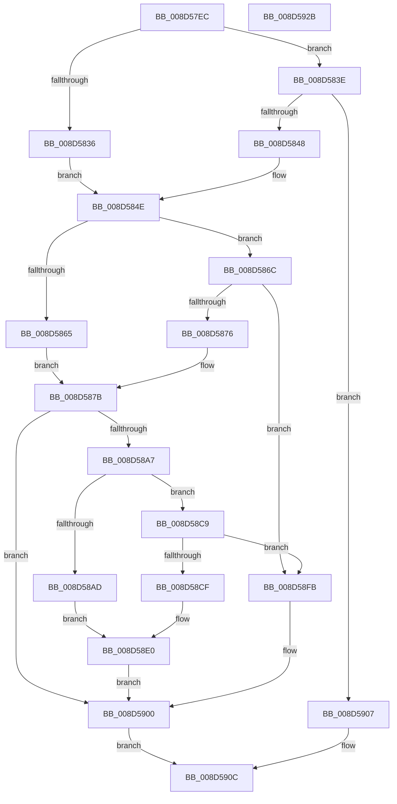

# WbSetWowTrapFrame

- RVA: `0x008D57EC`–`0x008D592C` (길이 `320` bytes)
- VA: `0x00000001408D57EC`
- 실행 섹션: `PAGE`
- PDB 이름 있음: `예`; PDB Function 태그: `아니요`
- unwind 정보 RVA: `0x00075C18`
- 디코드: `86`개 명령, `320/320` bytes 표시
- 미해석 바이트: `0` (있으면 어셈블리에 `.byte`로 보존)

> 이 문서는 커널 이미지의 기계어와 PDB 기호를 분석해 생성했습니다. 4번과 5번은 함수 원형과 자료형을 바이너리 사용 방식에서 추정한 C 해석이며 원본 소스 복구 결과는 아닙니다.

## 1. Dependencies

- 직접 호출 지점: **4**; 고유 호출 대상: **4**
- 직접 호출자로 확인된 함수: **2**
- RIP 상대 이미지 참조: **0**

### Outgoing calls
- `0x008D581E` → [PsWow64GetProcessMachine](PsWow64GetProcessMachine_function_008D2130.md) (function, `0x008D2130`)
- `0x008D589C` → [PspWow64GetContextThread](../A1/PspWow64GetContextThread_function_00A11E90.md) (function, `0x00A11E90`)
- `0x008D58F2` → [PspWow64SetContextThread](../8C/PspWow64SetContextThread_function_008CCC88.md) (function, `0x008CCC88`)
- `0x008D5900` → [KeLeaveGuardedRegion](../../text/2E/KeLeaveGuardedRegion_function_002E2C40.md) (function, `0x002E2C40`)

### Direct callers
- [sub_008D2508](Unknown_function_008D2508.md) at `0x008D26FE`
- [sub_008D2B19](Unknown_function_008D2B19.md) at `0x008D2B73`

### Static image references
- 디코드된 RIP-relative 메모리 참조가 없습니다.

## 2. Other-region calls and transfers

- 다른 실행 섹션으로 향하는 call: **1**
  - `0x008D5900` → [KeLeaveGuardedRegion](../../text/2E/KeLeaveGuardedRegion_function_002E2C40.md) (`PAGE` → `.text`)
- 별도 외부 분기/꼬리 이동을 확인하지 못했습니다.

## 3. Assembly (complete function range)

```asm
008D57EC  48 89 5C 24 08                  mov qword ptr [rsp + 8], rbx
008D57F1  48 89 6C 24 10                  mov qword ptr [rsp + 0x10], rbp
008D57F6  48 89 74 24 18                  mov qword ptr [rsp + 0x18], rsi
008D57FB  57                              push rdi
008D57FC  41 54                           push r12
008D57FE  41 55                           push r13
008D5800  41 56                           push r14
008D5802  41 57                           push r15
008D5804  48 83 EC 20                     sub rsp, 0x20
008D5808  48 8B F9                        mov rdi, rcx
008D580B  48 8B F2                        mov rsi, rdx
008D580E  65 48 8B 0C 25 88 01 00 00      mov rcx, qword ptr gs:[0x188]
008D5817  48 8B 89 B8 00 00 00            mov rcx, qword ptr [rcx + 0xb8]
008D581E  E8 0D C9 FF FF                  call 0x1408d2130
008D5823  41 BD 4C 01 00 00               mov r13d, 0x14c
008D5829  0F B7 E8                        movzx ebp, ax
008D582C  45 8D 65 78                     lea r12d, [r13 + 0x78]
008D5830  66 41 3B C5                     cmp ax, r13w
008D5834  75 08                           jne 0x1408d583e
008D5836  41 BE CC 02 00 00               mov r14d, 0x2cc
008D583C  EB 10                           jmp 0x1408d584e
008D583E  66 41 3B EC                     cmp bp, r12w
008D5842  0F 85 BF 00 00 00               jne 0x1408d5907
008D5848  41 BE A0 01 00 00               mov r14d, 0x1a0
008D584E  65 48 8B 04 25 88 01 00 00      mov rax, qword ptr gs:[0x188]
008D5857  66 FF 88 E6 01 00 00            dec word ptr [rax + 0x1e6]
008D585E  90                              nop
008D585F  66 41 3B ED                     cmp bp, r13w
008D5863  75 07                           jne 0x1408d586c
008D5865  B9 01 00 01 00                  mov ecx, 0x10001
008D586A  EB 0F                           jmp 0x1408d587b
008D586C  66 41 3B EC                     cmp bp, r12w
008D5870  0F 85 85 00 00 00               jne 0x1408d58fb
008D5876  B9 01 00 20 00                  mov ecx, 0x200001
008D587B  B8 30 00 00 00                  mov eax, 0x30
008D5880  48 8B D7                        mov rdx, rdi
008D5883  45 33 C9                        xor r9d, r9d
008D5886  45 8B C6                        mov r8d, r14d
008D5889  4C 8D 3C 10                     lea r15, [rax + rdx]
008D588D  41 89 0F                        mov dword ptr [r15], ecx
008D5890  49 8B D7                        mov rdx, r15
008D5893  65 48 8B 0C 25 88 01 00 00      mov rcx, qword ptr gs:[0x188]
008D589C  E8 EF C5 13 00                  call 0x140a11e90
008D58A1  8B D8                           mov ebx, eax
008D58A3  85 C0                           test eax, eax
008D58A5  78 59                           js 0x1408d5900
008D58A7  66 41 3B ED                     cmp bp, r13w
008D58AB  75 1C                           jne 0x1408d58c9
008D58AD  8B 46 08                        mov eax, dword ptr [rsi + 8]
008D58B0  89 87 E8 00 00 00               mov dword ptr [rdi + 0xe8], eax
008D58B6  8B 06                           mov eax, dword ptr [rsi]
008D58B8  89 87 F4 00 00 00               mov dword ptr [rdi + 0xf4], eax
008D58BE  8B 46 10                        mov eax, dword ptr [rsi + 0x10]
008D58C1  89 87 F0 00 00 00               mov dword ptr [rdi + 0xf0], eax
008D58C7  EB 17                           jmp 0x1408d58e0
008D58C9  66 41 3B EC                     cmp bp, r12w
008D58CD  75 2C                           jne 0x1408d58fb
008D58CF  8B 46 08                        mov eax, dword ptr [rsi + 8]
008D58D2  89 47 70                        mov dword ptr [rdi + 0x70], eax
008D58D5  8B 06                           mov eax, dword ptr [rsi]
008D58D7  89 47 68                        mov dword ptr [rdi + 0x68], eax
008D58DA  8B 46 10                        mov eax, dword ptr [rsi + 0x10]
008D58DD  89 47 74                        mov dword ptr [rdi + 0x74], eax
008D58E0  65 48 8B 0C 25 88 01 00 00      mov rcx, qword ptr gs:[0x188]
008D58E9  45 33 C9                        xor r9d, r9d
008D58EC  45 8B C6                        mov r8d, r14d
008D58EF  49 8B D7                        mov rdx, r15
008D58F2  E8 91 73 FF FF                  call 0x1408ccc88
008D58F7  8B D8                           mov ebx, eax
008D58F9  EB 05                           jmp 0x1408d5900
008D58FB  BB BB 00 00 C0                  mov ebx, 0xc00000bb
008D5900  E8 3B D3 A0 FF                  call 0x1402e2c40
008D5905  EB 05                           jmp 0x1408d590c
008D5907  BB BB 00 00 C0                  mov ebx, 0xc00000bb
008D590C  48 8B 6C 24 58                  mov rbp, qword ptr [rsp + 0x58]
008D5911  8B C3                           mov eax, ebx
008D5913  48 8B 5C 24 50                  mov rbx, qword ptr [rsp + 0x50]
008D5918  48 8B 74 24 60                  mov rsi, qword ptr [rsp + 0x60]
008D591D  48 83 C4 20                     add rsp, 0x20
008D5921  41 5F                           pop r15
008D5923  41 5E                           pop r14
008D5925  41 5D                           pop r13
008D5927  41 5C                           pop r12
008D5929  5F                              pop rdi
008D592A  C3                              ret
008D592B  CC                              int3
```

## 4. C-style interpretation (structured pseudocode)

```c
__int64 __fastcall WbSetWowTrapFrame(__int64 a1, __int64 a2, __int64 a3, int a4)
{
    __int64 result;
    __int64 v_rsp;
    unsigned __int64 v_stack_p10;
    unsigned __int64 v_stack_p18;
    unsigned __int64 v_stack_p8;

    v_stack_p8 = v_rbx;
    v_stack_p10 = v_rbp;
    v_stack_p18 = v_rsi;
    v_rsp = (v_rsp) - (32);
    result = PsWow64GetProcessMachine(*(unsigned __int64 *)(*(unsigned __int64 *)(gs_base + (0 + 392)) + 184), a2, a3, a4);
    if (((unsigned __int16)(result)) != 332) goto loc_008D583E;
    goto loc_008D584E;
loc_008D583E:
    if (((unsigned __int16)((unsigned __int16)(result))) != ((unsigned __int16)(332 + 120))) goto loc_008D5907;
loc_008D584E:
    if (((unsigned __int16)((unsigned __int16)(result))) != 332) goto loc_008D586C;
    goto loc_008D587B;
loc_008D586C:
    if (((unsigned __int16)((unsigned __int16)(result))) != ((unsigned __int16)(332 + 120))) goto loc_008D58FB;
loc_008D587B:
    a4 = 0;
    *(unsigned int *)(48 + a1 * 1) = (unsigned int)((unsigned int)(0x200001ULL));
    result = PspWow64GetContextThread(*(unsigned __int64 *)(gs_base + (0 + 392)), 48 + a1 * 1, 416, a4);
    if (sign_flag) goto loc_008D5900;
    if (((unsigned __int16)((unsigned __int16)(result))) != 332) goto loc_008D58C9;
    *(unsigned int *)(a1 + 232) = (unsigned int)((unsigned int)(*(unsigned int *)(a2 + 8)));
    *(unsigned int *)(a1 + 244) = (unsigned int)((unsigned int)(*(unsigned int *)(a2)));
    *(unsigned int *)(a1 + 240) = (unsigned int)((unsigned int)(*(unsigned int *)(a2 + 16)));
    goto loc_008D58E0;
loc_008D58C9:
    if (((unsigned __int16)((unsigned __int16)(result))) != ((unsigned __int16)(332 + 120))) goto loc_008D58FB;
    *(unsigned int *)(a1 + 112) = (unsigned int)((unsigned int)(*(unsigned int *)(a2 + 8)));
    *(unsigned int *)(a1 + 104) = (unsigned int)((unsigned int)(*(unsigned int *)(a2)));
    *(unsigned int *)(a1 + 116) = (unsigned int)((unsigned int)(*(unsigned int *)(a2 + 16)));
loc_008D58E0:
    a4 = 0;
    result = PspWow64SetContextThread(*(unsigned __int64 *)(gs_base + (0 + 392)), 48 + a1 * 1, 416, a4);
    goto loc_008D5900;
loc_008D58FB:
loc_008D5900:
    result = KeLeaveGuardedRegion(*(unsigned __int64 *)(gs_base + (0 + 392)), 48 + a1 * 1, 416, a4);
    goto loc_008D590C;
loc_008D5907:
loc_008D590C:
    v_rsp = (v_rsp) + (32);
    return (unsigned int)((unsigned int)((unsigned int)(0xC00000BBULL)));
}
```

## 5. (Beta) C Style

```c
int64_t WbSetWowTrapFrame(void *Arg1, void *Arg2, int64_t Arg3, int32_t Arg4)
{
    uint8_t *arg1 = (uint8_t *)Arg1;
    uint8_t *arg2 = (uint8_t *)Arg2;

    int64_t result;
    int64_t local_rsp;
    uint64_t v_stack_p10;
    uint64_t v_stack_p18;
    uint64_t v_stack_p8;

    v_stack_p8 = local_rbx;
    v_stack_p10 = local_rbp;
    v_stack_p18 = local_rsi;
    local_rsp = (local_rsp) - (32);
    result = PsWow64GetProcessMachine(*(uint64_t *)(*(uint64_t *)(gs_base + (0 + 0x188)) + 0xB8), Arg2, Arg3, Arg4);
    if (((uint16_t)(result)) != 332) goto loc_008D583E;
    goto loc_008D584E;
loc_008D583E:
    if (((uint16_t)((uint16_t)(result))) != ((uint16_t)(332 + 120))) goto loc_008D5907;
loc_008D584E:
    if (((uint16_t)((uint16_t)(result))) != 332) goto loc_008D586C;
    goto loc_008D587B;
loc_008D586C:
    if (((uint16_t)((uint16_t)(result))) != ((uint16_t)(332 + 120))) goto loc_008D58FB;
loc_008D587B:
    Arg4 = 0;
    *(uint32_t *)(48 + arg1 * 1) = (uint32_t)((uint32_t)(0x200001ULL));
    result = PspWow64GetContextThread(*(uint64_t *)(gs_base + (0 + 0x188)), 48 + Arg1 * 1, 416, Arg4);
    if (sign_flag) goto loc_008D5900;
    if (((uint16_t)((uint16_t)(result))) != 332) goto loc_008D58C9;
    *(uint32_t *)(arg1 + 0xE8) = (uint32_t)((uint32_t)(*(uint32_t *)(arg2 + 0x8)));
    *(uint32_t *)(arg1 + 0xF4) = (uint32_t)((uint32_t)(*(uint32_t *)(arg2)));
    *(uint32_t *)(arg1 + 0xF0) = (uint32_t)((uint32_t)(*(uint32_t *)(arg2 + 0x10)));
    goto loc_008D58E0;
loc_008D58C9:
    if (((uint16_t)((uint16_t)(result))) != ((uint16_t)(332 + 120))) goto loc_008D58FB;
    *(uint32_t *)(arg1 + 0x70) = (uint32_t)((uint32_t)(*(uint32_t *)(arg2 + 0x8)));
    *(uint32_t *)(arg1 + 0x68) = (uint32_t)((uint32_t)(*(uint32_t *)(arg2)));
    *(uint32_t *)(arg1 + 0x74) = (uint32_t)((uint32_t)(*(uint32_t *)(arg2 + 0x10)));
loc_008D58E0:
    Arg4 = 0;
    result = PspWow64SetContextThread(*(uint64_t *)(gs_base + (0 + 0x188)), 48 + Arg1 * 1, 416, Arg4);
    goto loc_008D5900;
loc_008D58FB:
loc_008D5900:
    result = KeLeaveGuardedRegion(*(uint64_t *)(gs_base + (0 + 0x188)), 48 + Arg1 * 1, 416, Arg4);
    goto loc_008D590C;
loc_008D5907:
loc_008D590C:
    local_rsp = (local_rsp) + (32);
    return (uint32_t)((uint32_t)((uint32_t)(0xC00000BBULL)));
}
```

### 관측된 메모리 오프셋

구조체 형식이 확인되지 않은 접근은 인자 기준의 오프셋으로만 기록했습니다.

| 기준 인자 | 오프셋 표현 | 폭 (bit) | 접근 |
|---|---:|---:|---|
| `Arg1` | `+ 0x68` | `32` | `W` |
| `Arg1` | `+ 0x70` | `32` | `W` |
| `Arg1` | `+ 0x74` | `32` | `W` |
| `Arg1` | `+ 0xE8` | `32` | `W` |
| `Arg1` | `+ 0xF0` | `32` | `W` |
| `Arg1` | `+ 0xF4` | `32` | `W` |
| `Arg2` | `+ 0x0` | `32` | `R` |
| `Arg2` | `+ 0x8` | `32` | `R` |
| `Arg2` | `+ 0x10` | `32` | `R` |

## 6. Execution-region graph

[열기: 2D/3D 그래프와 함수 탐색 컨트롤 패널](../../../control-panel.html?section=page&rva=0x008D57EC&view=graph)

- 2D 그래프는 위에서 아래로 흐르고, 3D 그래프는 빈 공간을 드래그해 회전합니다. Shift+드래그는 이동, 휠은 확대·축소, 함수 노드 선택은 대상 보고서 이동입니다.

### Static fallback


