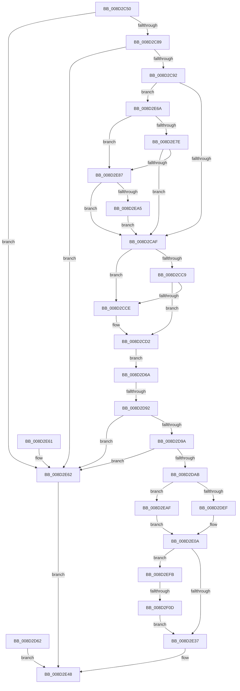

# WbValidateHeapExecuteCallArguments

- RVA: `0x008D2C50`–`0x008D2F24` (길이 `724` bytes)
- VA: `0x00000001408D2C50`
- 실행 섹션: `PAGE`
- PDB 이름 있음: `예`; PDB Function 태그: `예`
- unwind 정보 RVA: `0x00084DB4`
- 디코드: `162`개 명령, `724/724` bytes 표시
- 미해석 바이트: `0` (있으면 어셈블리에 `.byte`로 보존)

> 이 문서는 커널 이미지의 기계어와 PDB 기호를 분석해 생성했습니다. 4번과 5번은 함수 원형과 자료형을 바이너리 사용 방식에서 추정한 C 해석이며 원본 소스 복구 결과는 아닙니다.

## 1. Dependencies

- 직접 호출 지점: **2**; 고유 호출 대상: **2**
- 직접 호출자로 확인된 함수: **1**
- RIP 상대 이미지 참조: **0**

### Outgoing calls
- `0x008D2C7B` → [memset](../../text/6C/memset_function_006C6C40.md) (function, `0x006C6C40`)
- `0x008D2E97` → [PsWow64GetProcessMachine](PsWow64GetProcessMachine_function_008D2130.md) (function, `0x008D2130`)

### Direct callers
- [sub_008D27AD](Unknown_function_008D27AD.md) at `0x008D27F5`

### Static image references
- 디코드된 RIP-relative 메모리 참조가 없습니다.

## 2. Other-region calls and transfers

- 다른 실행 섹션으로 향하는 call: **1**
  - `0x008D2C7B` → [memset](../../text/6C/memset_function_006C6C40.md) (`PAGE` → `.text`)
- call이 아닌 외부 분기/꼬리 이동: **2**
  - `0x008D2D8C` → [sub_00B1B900](../B1/Unknown_function_00B1B900.md) (`tail-transfer`)
  - `0x008D2F07` → [sub_00B1B900 + 0xD3](../B1/Unknown_function_00B1B900.md) (`tail-transfer`)

## 3. Assembly (complete function range)

```asm
008D2C50  48 89 5C 24 08                  mov qword ptr [rsp + 8], rbx
008D2C55  48 89 74 24 10                  mov qword ptr [rsp + 0x10], rsi
008D2C5A  48 89 7C 24 18                  mov qword ptr [rsp + 0x18], rdi
008D2C5F  41 56                           push r14
008D2C61  48 83 EC 40                     sub rsp, 0x40
008D2C65  49 8B D8                        mov rbx, r8
008D2C68  8B FA                           mov edi, edx
008D2C6A  48 8B F1                        mov rsi, rcx
008D2C6D  45 33 F6                        xor r14d, r14d
008D2C70  33 D2                           xor edx, edx
008D2C72  41 B8 50 01 00 00               mov r8d, 0x150
008D2C78  48 8B CB                        mov rcx, rbx
008D2C7B  E8 C0 3F DF FF                  call 0x1406c6c40
008D2C80  83 FF 18                        cmp edi, 0x18
008D2C83  0F 82 D9 01 00 00               jb 0x1408d2e62
008D2C89  83 3E 03                        cmp dword ptr [rsi], 3
008D2C8C  0F 85 D0 01 00 00               jne 0x1408d2e62
008D2C92  65 48 8B 04 25 88 01 00 00      mov rax, qword ptr gs:[0x188]
008D2C9B  48 8B 88 B8 00 00 00            mov rcx, qword ptr [rax + 0xb8]
008D2CA2  4C 39 B1 10 03 00 00            cmp qword ptr [rcx + 0x310], r14
008D2CA9  0F 85 BB 01 00 00               jne 0x1408d2e6a
008D2CAF  48 8B 46 08                     mov rax, qword ptr [rsi + 8]
008D2CB3  48 8D 88 F0 00 00 00            lea rcx, [rax + 0xf0]
008D2CBA  49 B9 00 00 FF FF FF 7F 00 00   movabs r9, 0x7fffffff0000
008D2CC4  49 3B C9                        cmp rcx, r9
008D2CC7  77 05                           ja 0x1408d2cce
008D2CC9  48 3B C8                        cmp rcx, rax
008D2CCC  73 04                           jae 0x1408d2cd2
008D2CCE  41 0F B6 01                     movzx eax, byte ptr [r9]
008D2CD2  4C 8D 43 10                     lea r8, [rbx + 0x10]
008D2CD6  48 8B 46 08                     mov rax, qword ptr [rsi + 8]
008D2CDA  0F 10 00                        movups xmm0, xmmword ptr [rax]
008D2CDD  41 0F 11 00                     movups xmmword ptr [r8], xmm0
008D2CE1  0F 10 48 10                     movups xmm1, xmmword ptr [rax + 0x10]
008D2CE5  41 0F 11 48 10                  movups xmmword ptr [r8 + 0x10], xmm1
008D2CEA  0F 10 40 20                     movups xmm0, xmmword ptr [rax + 0x20]
008D2CEE  41 0F 11 40 20                  movups xmmword ptr [r8 + 0x20], xmm0
008D2CF3  0F 10 48 30                     movups xmm1, xmmword ptr [rax + 0x30]
008D2CF7  41 0F 11 48 30                  movups xmmword ptr [r8 + 0x30], xmm1
008D2CFC  0F 10 40 40                     movups xmm0, xmmword ptr [rax + 0x40]
008D2D00  41 0F 11 40 40                  movups xmmword ptr [r8 + 0x40], xmm0
008D2D05  0F 10 48 50                     movups xmm1, xmmword ptr [rax + 0x50]
008D2D09  41 0F 11 48 50                  movups xmmword ptr [r8 + 0x50], xmm1
008D2D0E  0F 10 40 60                     movups xmm0, xmmword ptr [rax + 0x60]
008D2D12  41 0F 11 40 60                  movups xmmword ptr [r8 + 0x60], xmm0
008D2D17  49 8D 88 80 00 00 00            lea rcx, [r8 + 0x80]
008D2D1E  0F 10 40 70                     movups xmm0, xmmword ptr [rax + 0x70]
008D2D22  0F 11 41 F0                     movups xmmword ptr [rcx - 0x10], xmm0
008D2D26  48 83 E8 80                     sub rax, -0x80
008D2D2A  0F 10 08                        movups xmm1, xmmword ptr [rax]
008D2D2D  0F 11 09                        movups xmmword ptr [rcx], xmm1
008D2D30  0F 10 40 10                     movups xmm0, xmmword ptr [rax + 0x10]
008D2D34  0F 11 41 10                     movups xmmword ptr [rcx + 0x10], xmm0
008D2D38  0F 10 48 20                     movups xmm1, xmmword ptr [rax + 0x20]
008D2D3C  0F 11 49 20                     movups xmmword ptr [rcx + 0x20], xmm1
008D2D40  0F 10 40 30                     movups xmm0, xmmword ptr [rax + 0x30]
008D2D44  0F 11 41 30                     movups xmmword ptr [rcx + 0x30], xmm0
008D2D48  0F 10 48 40                     movups xmm1, xmmword ptr [rax + 0x40]
008D2D4C  0F 11 49 40                     movups xmmword ptr [rcx + 0x40], xmm1
008D2D50  0F 10 40 50                     movups xmm0, xmmword ptr [rax + 0x50]
008D2D54  0F 11 41 50                     movups xmmword ptr [rcx + 0x50], xmm0
008D2D58  0F 10 48 60                     movups xmm1, xmmword ptr [rax + 0x60]
008D2D5C  0F 11 49 60                     movups xmmword ptr [rcx + 0x60], xmm1
008D2D60  EB 08                           jmp 0x1408d2d6a
008D2D62  44 8B F0                        mov r14d, eax
008D2D65  E9 DE 00 00 00                  jmp 0x1408d2e48
008D2D6A  48 8B 46 08                     mov rax, qword ptr [rsi + 8]
008D2D6E  48 89 83 48 01 00 00            mov qword ptr [rbx + 0x148], rax
008D2D75  8B 43 34                        mov eax, dword ptr [rbx + 0x34]
008D2D78  8B D0                           mov edx, eax
008D2D7A  83 E2 0F                        and edx, 0xf
008D2D7D  89 53 08                        mov dword ptr [rbx + 8], edx
008D2D80  C1 E8 04                        shr eax, 4
008D2D83  83 E0 0F                        and eax, 0xf
008D2D86  89 43 0C                        mov dword ptr [rbx + 0xc], eax
008D2D89  83 FA 01                        cmp edx, 1
008D2D8C  0F 84 6E 8B 24 00               je 0x140b1b900
008D2D92  85 D2                           test edx, edx
008D2D94  0F 85 C8 00 00 00               jne 0x1408d2e62
008D2D9A  44 8B 4B 48                     mov r9d, dword ptr [rbx + 0x48]
008D2D9E  41 F7 C1 FF FF FF 0F            test r9d, 0xfffffff
008D2DA5  0F 86 B7 00 00 00               jbe 0x1408d2e62
008D2DAB  48 8B 46 08                     mov rax, qword ptr [rsi + 8]
008D2DAF  8B 48 28                        mov ecx, dword ptr [rax + 0x28]
008D2DB2  81 E1 FF FF FF 0F               and ecx, 0xfffffff
008D2DB8  4C 8B 93 48 01 00 00            mov r10, qword ptr [rbx + 0x148]
008D2DBF  4C 2B D1                        sub r10, rcx
008D2DC2  4C 89 13                        mov qword ptr [rbx], r10
008D2DC5  8B 43 3C                        mov eax, dword ptr [rbx + 0x3c]
008D2DC8  B9 00 10 00 00                  mov ecx, 0x1000
008D2DCD  3B C1                           cmp eax, ecx
008D2DCF  0F 47 C8                        cmova ecx, eax
008D2DD2  89 8B 44 01 00 00               mov dword ptr [rbx + 0x144], ecx
008D2DD8  8B 7B 4C                        mov edi, dword ptr [rbx + 0x4c]
008D2DDB  44 8B C7                        mov r8d, edi
008D2DDE  41 81 E0 FF FF FF 0F            and r8d, 0xfffffff
008D2DE5  44 8B 5B 44                     mov r11d, dword ptr [rbx + 0x44]
008D2DE9  0F 85 C0 00 00 00               jne 0x1408d2eaf
008D2DEF  41 8B C3                        mov eax, r11d
008D2DF2  25 FF FF FF 0F                  and eax, 0xfffffff
008D2DF7  45 8B C3                        mov r8d, r11d
008D2DFA  41 81 E0 FF FF FF 0F            and r8d, 0xfffffff
008D2E01  41 8B C9                        mov ecx, r9d
008D2E04  81 E1 FF FF FF 0F               and ecx, 0xfffffff
008D2E0A  41 B9 10 00 00 00               mov r9d, 0x10
008D2E10  44 89 8B 20 01 00 00            mov dword ptr [rbx + 0x120], r9d
008D2E17  89 8B 1C 01 00 00               mov dword ptr [rbx + 0x11c], ecx
008D2E1D  44 89 83 18 01 00 00            mov dword ptr [rbx + 0x118], r8d
008D2E24  49 03 C2                        add rax, r10
008D2E27  48 89 83 10 01 00 00            mov qword ptr [rbx + 0x110], rax
008D2E2E  83 FA 01                        cmp edx, 1
008D2E31  0F 84 C4 00 00 00               je 0x1408d2efb
008D2E37  8B 83 34 01 00 00               mov eax, dword ptr [rbx + 0x134]
008D2E3D  83 C0 10                        add eax, 0x10
008D2E40  03 C8                           add ecx, eax
008D2E42  89 8B 40 01 00 00               mov dword ptr [rbx + 0x140], ecx
008D2E48  41 8B C6                        mov eax, r14d
008D2E4B  48 8B 5C 24 50                  mov rbx, qword ptr [rsp + 0x50]
008D2E50  48 8B 74 24 58                  mov rsi, qword ptr [rsp + 0x58]
008D2E55  48 8B 7C 24 60                  mov rdi, qword ptr [rsp + 0x60]
008D2E5A  48 83 C4 40                     add rsp, 0x40
008D2E5E  41 5E                           pop r14
008D2E60  C3                              ret
008D2E61  CC                              int3
008D2E62  41 BE 0D 00 00 C0               mov r14d, 0xc000000d
008D2E68  EB DE                           jmp 0x1408d2e48
008D2E6A  0F B7 81 EC 06 00 00            movzx eax, word ptr [rcx + 0x6ec]
008D2E71  B9 4C 01 00 00                  mov ecx, 0x14c
008D2E76  8D 79 78                        lea edi, [rcx + 0x78]
008D2E79  66 3B C1                        cmp ax, cx
008D2E7C  74 09                           je 0x1408d2e87
008D2E7E  66 3B C7                        cmp ax, di
008D2E81  0F 85 28 FE FF FF               jne 0x1408d2caf
008D2E87  65 48 8B 04 25 88 01 00 00      mov rax, qword ptr gs:[0x188]
008D2E90  48 8B 88 B8 00 00 00            mov rcx, qword ptr [rax + 0xb8]
008D2E97  E8 94 F2 FF FF                  call 0x1408d2130
008D2E9C  66 3B C7                        cmp ax, di
008D2E9F  0F 85 0A FE FF FF               jne 0x1408d2caf
008D2EA5  48 83 66 08 FE                  and qword ptr [rsi + 8], 0xfffffffffffffffe
008D2EAA  E9 00 FE FF FF                  jmp 0x1408d2caf
008D2EAF  8B 4B 50                        mov ecx, dword ptr [rbx + 0x50]
008D2EB2  81 E1 FF FF FF 0F               and ecx, 0xfffffff
008D2EB8  8D 41 10                        lea eax, [rcx + 0x10]
008D2EBB  89 83 38 01 00 00               mov dword ptr [rbx + 0x138], eax
008D2EC1  41 81 E1 FF FF FF 0F            and r9d, 0xfffffff
008D2EC8  44 89 8B 34 01 00 00            mov dword ptr [rbx + 0x134], r9d
008D2ECF  41 8B C3                        mov eax, r11d
008D2ED2  25 FF FF FF 0F                  and eax, 0xfffffff
008D2ED7  89 83 30 01 00 00               mov dword ptr [rbx + 0x130], eax
008D2EDD  41 81 E3 FF FF FF 0F            and r11d, 0xfffffff
008D2EE4  4D 03 DA                        add r11, r10
008D2EE7  4C 89 9B 28 01 00 00            mov qword ptr [rbx + 0x128], r11
008D2EEE  48 8B C7                        mov rax, rdi
008D2EF1  25 FF FF FF 0F                  and eax, 0xfffffff
008D2EF6  E9 0F FF FF FF                  jmp 0x1408d2e0a
008D2EFB  8B 93 00 01 00 00               mov edx, dword ptr [rbx + 0x100]
008D2F01  F7 C7 FF FF FF 0F               test edi, 0xfffffff
008D2F07  0F 84 C6 8A 24 00               je 0x140b1b9d3
008D2F0D  8B 83 04 01 00 00               mov eax, dword ptr [rbx + 0x104]
008D2F13  89 83 24 01 00 00               mov dword ptr [rbx + 0x124], eax
008D2F19  89 93 3C 01 00 00               mov dword ptr [rbx + 0x13c], edx
008D2F1F  E9 13 FF FF FF                  jmp 0x1408d2e37
```

## 4. C-style interpretation (structured pseudocode)

```c
__int64 __fastcall WbValidateHeapExecuteCallArguments(__int64 a1, int a2, __int64 a3)
{
    __int64 result;
    __int64 v_r10;
    __int64 v_r11;
    __int64 v_r14;
    __int64 v_rsp;
    unsigned __int64 v_stack_p10;
    unsigned __int64 v_stack_p18;
    unsigned __int64 v_stack_p8;

    v_stack_p8 = v_rbx;
    v_stack_p10 = v_rsi;
    v_stack_p18 = v_rdi;
    v_rsp = (v_rsp) - (64);
    v_r14 = 0;
    a2 = 0;
    result = memset(a3, a2, 336, a4);
    if (((unsigned int)((unsigned int)(a2))) < 24) goto loc_008D2E62;
    if ((*(unsigned int *)(a1)) != 3) goto loc_008D2E62;
    if ((*(unsigned __int64 *)(*(unsigned __int64 *)(*(unsigned __int64 *)(gs_base + (0 + 392)) + 184) + 784)) != 0) goto loc_008D2E6A;
loc_008D2CAF:
    if ((*(unsigned __int64 *)(a1 + 8) + 240) > a4) goto loc_008D2CCE;
    result = *(unsigned __int64 *)(a1 + 8);
    if ((*(unsigned __int64 *)(a1 + 8) + 240) < (*(unsigned __int64 *)(a1 + 8))) {
        result = *(unsigned __int8 *)(a4);
    }
    *(unsigned __int64 *)(a3 + 16) = v_xmm0;
    *(unsigned __int64 *)(a3 + 16 + 16) = v_xmm1;
    *(unsigned __int64 *)(a3 + 16 + 32) = v_xmm0;
    *(unsigned __int64 *)(a3 + 16 + 48) = v_xmm1;
    *(unsigned __int64 *)(a3 + 16 + 64) = v_xmm0;
    *(unsigned __int64 *)(a3 + 16 + 80) = v_xmm1;
    *(unsigned __int64 *)(a3 + 16 + 96) = v_xmm0;
    *(unsigned __int64 *)(a3 + 16 + 128 - 16) = v_xmm0;
    result = (*(unsigned __int64 *)(a1 + 8)) - (-128);
    *(unsigned __int64 *)(a3 + 16 + 128) = v_xmm1;
    *(unsigned __int64 *)(a3 + 16 + 128 + 16) = v_xmm0;
    *(unsigned __int64 *)(a3 + 16 + 128 + 32) = v_xmm1;
    *(unsigned __int64 *)(a3 + 16 + 128 + 48) = v_xmm0;
    *(unsigned __int64 *)(a3 + 16 + 128 + 64) = v_xmm1;
    *(unsigned __int64 *)(a3 + 16 + 128 + 80) = v_xmm0;
    *(unsigned __int64 *)(a3 + 16 + 128 + 96) = v_xmm1;
    goto loc_008D2D6A;
loc_008D2D6A:
    *(unsigned __int64 *)(a3 + 328) = *(unsigned __int64 *)(a1 + 8);
    a2 = (unsigned int)(((unsigned int)((unsigned int)((unsigned int)(*(unsigned int *)(a3 + 52))))) & (15));
    *(unsigned int *)(a3 + 8) = a2;
    result = (unsigned int)(((unsigned int)(*(unsigned int *)(a3 + 52))) >> (4));
    result = (unsigned int)((result) & (15));
    *(unsigned int *)(a3 + 12) = (unsigned int)(result);
    if (a2 != 0) goto loc_008D2E62;
    if (condition_is_below_or_equal) goto loc_008D2E62;
    a1 = (unsigned int)(((unsigned int)(*(unsigned int *)(*(unsigned __int64 *)(a1 + 8) + 40))) & (0xFFFFFFFULL));
    v_r10 = (*(unsigned __int64 *)(a3 + 328)) - (a1);
    *(unsigned __int64 *)(a3) = v_r10;
    a1 = (unsigned int)(0x1000ULL);
    if (((unsigned int)((unsigned int)(*(unsigned int *)(a3 + 60)))) > ((unsigned int)((unsigned int)(0x1000ULL)))) { a1 = (unsigned int)((unsigned int)(*(unsigned int *)(a3 + 60))); }
    *(unsigned int *)(a3 + 324) = (unsigned int)(a1);
    a3 = (unsigned int)(((unsigned int)((unsigned int)((unsigned int)(*(unsigned int *)(a3 + 76))))) & (0xFFFFFFFULL));
    if (condition_is_not_equal) goto loc_008D2EAF;
    result = (unsigned int)(((unsigned int)((unsigned int)((unsigned int)(*(unsigned int *)(a3 + 68))))) & (0xFFFFFFFULL));
    a3 = (unsigned int)(((unsigned int)((unsigned int)((unsigned int)(*(unsigned int *)(a3 + 68))))) & (0xFFFFFFFULL));
    a1 = (unsigned int)(((unsigned int)((unsigned int)((unsigned int)(*(unsigned int *)(a3 + 72))))) & (0xFFFFFFFULL));
loc_008D2E0A:
    *(unsigned int *)(a3 + 288) = 16;
    *(unsigned int *)(a3 + 284) = (unsigned int)(a1);
    *(unsigned int *)(a3 + 280) = (unsigned int)(a3);
    result = (result) + (v_r10);
    *(unsigned __int64 *)(a3 + 272) = result;
    if (a2 == 1) goto loc_008D2EFB;
loc_008D2E37:
    result = (unsigned int)(((unsigned int)(*(unsigned int *)(a3 + 308))) + (16));
    a1 = (unsigned int)((a1) + ((unsigned int)(result)));
    *(unsigned int *)(a3 + 320) = (unsigned int)(a1);
loc_008D2E48:
    v_rsp = (v_rsp) + (64);
    return 0;
loc_008D2E62:
    goto loc_008D2E48;
loc_008D2E6A:
    if (((unsigned __int16)(*(unsigned __int16 *)(a1 + 1772))) == 332) goto loc_008D2E87;
    if (((unsigned __int16)(*(unsigned __int16 *)(a1 + 1772))) != ((unsigned __int16)(332 + 120))) goto loc_008D2CAF;
loc_008D2E87:
    result = PsWow64GetProcessMachine(*(unsigned __int64 *)(*(unsigned __int64 *)(gs_base + (0 + 392)) + 184), a2, a3, 16);
    if (((unsigned __int16)(result)) != ((unsigned __int16)(332 + 120))) goto loc_008D2CAF;
    goto loc_008D2CAF;
loc_008D2EAF:
    a1 = (unsigned int)(((unsigned int)(*(unsigned int *)(v_stack_p8 + 80))) & (0xFFFFFFFULL));
    *(unsigned int *)(v_stack_p8 + 312) = (unsigned int)(a1 + 16);
    a4 = (unsigned int)((16) & (0xFFFFFFFULL));
    *(unsigned int *)(v_stack_p8 + 308) = (unsigned int)(a4);
    result = (unsigned int)(((unsigned int)((unsigned int)((unsigned int)(*(unsigned int *)(a3 + 68))))) & (0xFFFFFFFULL));
    *(unsigned int *)(v_stack_p8 + 304) = (unsigned int)(result);
    v_r11 = (unsigned int)(((unsigned int)(*(unsigned int *)(a3 + 68))) & (0xFFFFFFFULL));
    v_r11 = (v_r11) + (v_r10);
    *(unsigned __int64 *)(v_stack_p8 + 296) = v_r11;
    result = (unsigned int)((332 + 120) & (0xFFFFFFFULL));
    goto loc_008D2E0A;
loc_008D2EFB:
    *(unsigned int *)(v_stack_p8 + 292) = (unsigned int)((unsigned int)(*(unsigned int *)(v_stack_p8 + 260)));
    *(unsigned int *)(v_stack_p8 + 316) = (unsigned int)((unsigned int)(*(unsigned int *)(v_stack_p8 + 256)));
    goto loc_008D2E37;
}
```

## 5. (Beta) C Style

```c
int64_t WbValidateHeapExecuteCallArguments(void *Arg1, int32_t Arg2, void *Arg3)
{
    uint8_t *arg1 = (uint8_t *)Arg1;
    uint8_t *arg3 = (uint8_t *)Arg3;

    int64_t result;
    int64_t local_r10;
    int64_t local_r11;
    int64_t local_r14;
    int64_t local_rsp;
    uint64_t v_stack_p10;
    uint64_t v_stack_p18;
    uint64_t v_stack_p8;

    v_stack_p8 = local_rbx;
    v_stack_p10 = local_rsi;
    v_stack_p18 = local_rdi;
    local_rsp = (local_rsp) - (64);
    local_r14 = 0;
    Arg2 = 0;
    result = memset(Arg3, Arg2, 336, a4);
    if (((uint32_t)((uint32_t)(Arg2))) < 24) goto loc_008D2E62;
    if ((*(uint32_t *)(arg1)) != 3) goto loc_008D2E62;
    if ((*(uint64_t *)(*(uint64_t *)(*(uint64_t *)(gs_base + (0 + 0x188)) + 0xB8) + 0x310)) != 0) goto loc_008D2E6A;
loc_008D2CAF:
    if ((*(uint64_t *)(arg1 + 0x8) + 240) > a4) goto loc_008D2CCE;
    result = *(uint64_t *)(arg1 + 0x8);
    if ((*(uint64_t *)(arg1 + 0x8) + 240) < (*(uint64_t *)(arg1 + 0x8))) {
        result = *(uint8_t *)(a4);
    }
    *(uint64_t *)(arg3 + 0x10) = v_xmm0;
    *(uint64_t *)(arg3 + 0x10 + 0x10) = v_xmm1;
    *(uint64_t *)(arg3 + 0x10 + 0x20) = v_xmm0;
    *(uint64_t *)(arg3 + 0x10 + 0x30) = v_xmm1;
    *(uint64_t *)(arg3 + 0x10 + 0x40) = v_xmm0;
    *(uint64_t *)(arg3 + 0x10 + 0x50) = v_xmm1;
    *(uint64_t *)(arg3 + 0x10 + 0x60) = v_xmm0;
    *(uint64_t *)(arg3 + 0x10 + 0x80 - 0x10) = v_xmm0;
    result = (*(uint64_t *)(arg1 + 0x8)) - (-128);
    *(uint64_t *)(arg3 + 0x10 + 0x80) = v_xmm1;
    *(uint64_t *)(arg3 + 0x10 + 0x80 + 0x10) = v_xmm0;
    *(uint64_t *)(arg3 + 0x10 + 0x80 + 0x20) = v_xmm1;
    *(uint64_t *)(arg3 + 0x10 + 0x80 + 0x30) = v_xmm0;
    *(uint64_t *)(arg3 + 0x10 + 0x80 + 0x40) = v_xmm1;
    *(uint64_t *)(arg3 + 0x10 + 0x80 + 0x50) = v_xmm0;
    *(uint64_t *)(arg3 + 0x10 + 0x80 + 0x60) = v_xmm1;
    goto loc_008D2D6A;
loc_008D2D6A:
    *(uint64_t *)(arg3 + 0x148) = *(uint64_t *)(arg1 + 0x8);
    Arg2 = (uint32_t)(((uint32_t)((uint32_t)((uint32_t)(*(uint32_t *)(arg3 + 0x34))))) & (15));
    *(uint32_t *)(arg3 + 0x8) = Arg2;
    result = (uint32_t)(((uint32_t)(*(uint32_t *)(arg3 + 0x34))) >> (4));
    result = (uint32_t)((result) & (15));
    *(uint32_t *)(arg3 + 0xC) = (uint32_t)(result);
    if (Arg2 != 0) goto loc_008D2E62;
    if (condition_is_below_or_equal) goto loc_008D2E62;
    Arg1 = (uint32_t)(((uint32_t)(*(uint32_t *)(*(uint64_t *)(arg1 + 0x8) + 0x28))) & (0xFFFFFFFULL));
    local_r10 = (*(uint64_t *)(arg3 + 0x148)) - (Arg1);
    *(uint64_t *)(arg3) = local_r10;
    Arg1 = (uint32_t)(0x1000ULL);
    if (((uint32_t)((uint32_t)(*(uint32_t *)(arg3 + 0x3C)))) > ((uint32_t)((uint32_t)(0x1000ULL)))) { Arg1 = (uint32_t)((uint32_t)(*(uint32_t *)(arg3 + 0x3C))); }
    *(uint32_t *)(arg3 + 0x144) = (uint32_t)(Arg1);
    Arg3 = (uint32_t)(((uint32_t)((uint32_t)((uint32_t)(*(uint32_t *)(arg3 + 0x4C))))) & (0xFFFFFFFULL));
    if (condition_is_not_equal) goto loc_008D2EAF;
    result = (uint32_t)(((uint32_t)((uint32_t)((uint32_t)(*(uint32_t *)(arg3 + 0x44))))) & (0xFFFFFFFULL));
    Arg3 = (uint32_t)(((uint32_t)((uint32_t)((uint32_t)(*(uint32_t *)(arg3 + 0x44))))) & (0xFFFFFFFULL));
    Arg1 = (uint32_t)(((uint32_t)((uint32_t)((uint32_t)(*(uint32_t *)(arg3 + 0x48))))) & (0xFFFFFFFULL));
loc_008D2E0A:
    *(uint32_t *)(arg3 + 0x120) = 16;
    *(uint32_t *)(arg3 + 0x11C) = (uint32_t)(Arg1);
    *(uint32_t *)(arg3 + 0x118) = (uint32_t)(Arg3);
    result = (result) + (local_r10);
    *(uint64_t *)(arg3 + 0x110) = result;
    if (Arg2 == 1) goto loc_008D2EFB;
loc_008D2E37:
    result = (uint32_t)(((uint32_t)(*(uint32_t *)(arg3 + 0x134))) + (16));
    Arg1 = (uint32_t)((Arg1) + ((uint32_t)(result)));
    *(uint32_t *)(arg3 + 0x140) = (uint32_t)(Arg1);
loc_008D2E48:
    local_rsp = (local_rsp) + (64);
    return 0;
loc_008D2E62:
    goto loc_008D2E48;
loc_008D2E6A:
    if (((uint16_t)(*(uint16_t *)(arg1 + 0x6EC))) == 332) goto loc_008D2E87;
    if (((uint16_t)(*(uint16_t *)(arg1 + 0x6EC))) != ((uint16_t)(332 + 120))) goto loc_008D2CAF;
loc_008D2E87:
    result = PsWow64GetProcessMachine(*(uint64_t *)(*(uint64_t *)(gs_base + (0 + 0x188)) + 0xB8), Arg2, Arg3, 16);
    if (((uint16_t)(result)) != ((uint16_t)(332 + 120))) goto loc_008D2CAF;
    goto loc_008D2CAF;
loc_008D2EAF:
    Arg1 = (uint32_t)(((uint32_t)(*(uint32_t *)(v_stack_p8 + 0x50))) & (0xFFFFFFFULL));
    *(uint32_t *)(v_stack_p8 + 0x138) = (uint32_t)(Arg1 + 16);
    a4 = (uint32_t)((16) & (0xFFFFFFFULL));
    *(uint32_t *)(v_stack_p8 + 0x134) = (uint32_t)(a4);
    result = (uint32_t)(((uint32_t)((uint32_t)((uint32_t)(*(uint32_t *)(arg3 + 0x44))))) & (0xFFFFFFFULL));
    *(uint32_t *)(v_stack_p8 + 0x130) = (uint32_t)(result);
    local_r11 = (uint32_t)(((uint32_t)(*(uint32_t *)(arg3 + 0x44))) & (0xFFFFFFFULL));
    local_r11 = (local_r11) + (local_r10);
    *(uint64_t *)(v_stack_p8 + 0x128) = local_r11;
    result = (uint32_t)((332 + 120) & (0xFFFFFFFULL));
    goto loc_008D2E0A;
loc_008D2EFB:
    *(uint32_t *)(v_stack_p8 + 0x124) = (uint32_t)((uint32_t)(*(uint32_t *)(v_stack_p8 + 0x104)));
    *(uint32_t *)(v_stack_p8 + 0x13C) = (uint32_t)((uint32_t)(*(uint32_t *)(v_stack_p8 + 0x100)));
    goto loc_008D2E37;
}
```

### 관측된 메모리 오프셋

구조체 형식이 확인되지 않은 접근은 인자 기준의 오프셋으로만 기록했습니다.

| 기준 인자 | 오프셋 표현 | 폭 (bit) | 접근 |
|---|---:|---:|---|
| `Arg1` | `+ 0x0` | `32` | `R` |
| `Arg1` | `+ 0x8` | `64` | `R` |
| `Arg1` | `+ 0x8` | `64` | `R/W` |
| `Arg3` | `- 0x10` | `128` | `R` |
| `Arg3` | `+ 0x0` | `64` | `W` |
| `Arg3` | `+ 0x0` | `128` | `R` |
| `Arg3` | `+ 0x8` | `32` | `W` |
| `Arg3` | `+ 0xC` | `32` | `W` |
| `Arg3` | `+ 0x10` | `64` | `R` |
| `Arg3` | `+ 0x10` | `128` | `R` |
| `Arg3` | `+ 0x20` | `128` | `R` |
| `Arg3` | `+ 0x30` | `128` | `R` |
| `Arg3` | `+ 0x34` | `32` | `R` |
| `Arg3` | `+ 0x3C` | `32` | `R` |
| `Arg3` | `+ 0x40` | `128` | `R` |
| `Arg3` | `+ 0x44` | `32` | `R` |
| `Arg3` | `+ 0x48` | `32` | `R` |
| `Arg3` | `+ 0x4C` | `32` | `R` |
| `Arg3` | `+ 0x50` | `32` | `R` |
| `Arg3` | `+ 0x50` | `128` | `R` |
| `Arg3` | `+ 0x60` | `128` | `R` |
| `Arg3` | `+ 0x80` | `64` | `R` |
| `Arg3` | `+ 0x100` | `32` | `R` |
| `Arg3` | `+ 0x104` | `32` | `R` |
| `Arg3` | `+ 0x110` | `64` | `W` |
| `Arg3` | `+ 0x118` | `32` | `W` |
| `Arg3` | `+ 0x11C` | `32` | `W` |
| `Arg3` | `+ 0x120` | `32` | `W` |
| `Arg3` | `+ 0x124` | `32` | `W` |
| `Arg3` | `+ 0x128` | `64` | `W` |
| `Arg3` | `+ 0x130` | `32` | `W` |
| `Arg3` | `+ 0x134` | `32` | `R` |

추가 오프셋 7개는 표에서 생략했습니다.

## 6. Execution-region graph

[열기: 2D/3D 그래프와 함수 탐색 컨트롤 패널](../../../control-panel.html?section=page&rva=0x008D2C50&view=graph)

- 2D 그래프는 위에서 아래로 흐르고, 3D 그래프는 빈 공간을 드래그해 회전합니다. Shift+드래그는 이동, 휠은 확대·축소, 함수 노드 선택은 대상 보고서 이동입니다.

### Static fallback


