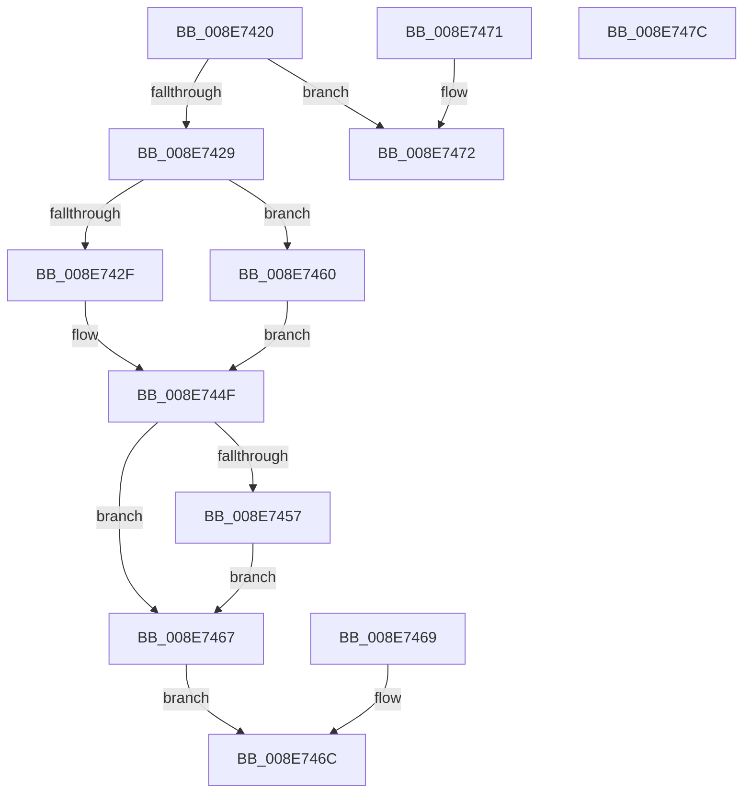

# AlpcpPortQueryBasicInfo

- RVA: `0x008E7420`–`0x008E747D` (길이 `93` bytes)
- VA: `0x00000001408E7420`
- 실행 섹션: `PAGE`
- PDB 이름 있음: `예`; PDB Function 태그: `아니요`
- unwind 정보 RVA: `0x0008687C`
- 디코드: `29`개 명령, `93/93` bytes 표시
- 미해석 바이트: `0` (있으면 어셈블리에 `.byte`로 보존)

> 이 문서는 커널 이미지의 기계어와 PDB 기호를 분석해 생성했습니다. 4번과 5번은 함수 원형과 자료형을 바이너리 사용 방식에서 추정한 C 해석이며 원본 소스 복구 결과는 아닙니다.

## 1. Dependencies

- 직접 호출 지점: **0**; 고유 호출 대상: **0**
- 직접 호출자로 확인된 함수: **1**
- RIP 상대 이미지 참조: **0**

### Outgoing calls
- 직접 디코드된 call 명령이 없습니다.

### Direct callers
- [NtAlpcQueryInformation](NtAlpcQueryInformation_function_008E7200.md) at `0x008E7342`

### Static image references
- 디코드된 RIP-relative 메모리 참조가 없습니다.

## 2. Other-region calls and transfers

- 다른 실행 섹션으로 향하는 call: **0**
- 별도 외부 분기/꼬리 이동을 확인하지 못했습니다.

## 3. Assembly (complete function range)

```asm
008E7420  48 83 EC 18                     sub rsp, 0x18
008E7424  48 85 C9                        test rcx, rcx
008E7427  74 49                           je 0x1408e7472
008E7429  41 83 F8 10                     cmp r8d, 0x10
008E742D  72 31                           jb 0x1408e7460
008E742F  8B 81 00 01 00 00               mov eax, dword ptr [rcx + 0x100]
008E7435  25 00 00 FF 03                  and eax, 0x3ff0000
008E743A  89 02                           mov dword ptr [rdx], eax
008E743C  8B 81 90 01 00 00               mov eax, dword ptr [rcx + 0x190]
008E7442  89 42 04                        mov dword ptr [rdx + 4], eax
008E7445  48 8B 41 38                     mov rax, qword ptr [rcx + 0x38]
008E7449  48 89 42 08                     mov qword ptr [rdx + 8], rax
008E744D  33 C0                           xor eax, eax
008E744F  89 04 24                        mov dword ptr [rsp], eax
008E7452  4D 85 C9                        test r9, r9
008E7455  74 10                           je 0x1408e7467
008E7457  41 C7 01 10 00 00 00            mov dword ptr [r9], 0x10
008E745E  EB 07                           jmp 0x1408e7467
008E7460  B8 04 00 00 C0                  mov eax, 0xc0000004
008E7465  EB E8                           jmp 0x1408e744f
008E7467  EB 03                           jmp 0x1408e746c
008E7469  89 04 24                        mov dword ptr [rsp], eax
008E746C  48 83 C4 18                     add rsp, 0x18
008E7470  C3                              ret
008E7471  CC                              int3
008E7472  B8 0D 00 00 C0                  mov eax, 0xc000000d
008E7477  48 83 C4 18                     add rsp, 0x18
008E747B  C3                              ret
008E747C  CC                              int3
```

## 4. C-style interpretation (structured pseudocode)

```c
__int64 __fastcall AlpcpPortQueryBasicInfo(__int64 a1, __int64 a2, int a3, __int64 a4)
{
    __int64 result;
    __int64 v_rsp;
    unsigned int v_stack_m18;

    v_rsp = (v_rsp) - (24);
    if (a1 == 0) goto loc_008E7472;
    if (a3 < 16) goto loc_008E7460;
    result = (unsigned int)(((unsigned int)(*(unsigned int *)(a1 + 256))) & (0x3FF0000ULL));
    *(unsigned int *)(a2) = (unsigned int)(result);
    *(unsigned int *)(a2 + 4) = (unsigned int)((unsigned int)(*(unsigned int *)(a1 + 400)));
    *(unsigned __int64 *)(a2 + 8) = *(unsigned __int64 *)(a1 + 56);
    result = 0;
loc_008E744F:
    v_stack_m18 = 0;
    if (a4 == 0) goto loc_008E7467;
    *(unsigned int *)(a4) = 16;
    goto loc_008E7467;
loc_008E7460:
    goto loc_008E744F;
loc_008E7467:
    goto loc_008E746C;
loc_008E746C:
    v_rsp = (v_rsp) + (24);
    return (unsigned int)(0xC0000004ULL);
loc_008E7472:
    v_rsp = (v_rsp) + (24);
    return (unsigned int)(0xC000000DULL);
}
```

## 5. (Beta) C Style

```c
int64_t AlpcpPortQueryBasicInfo(int64_t Arg1, void *Arg2, int32_t Arg3, int64_t Arg4)
{
    uint8_t *arg2 = (uint8_t *)Arg2;

    int64_t result;
    int64_t local_rsp;
    uint32_t v_stack_m18;

    local_rsp = (local_rsp) - (24);
    if (Arg1 == 0) goto loc_008E7472;
    if (Arg3 < 16) goto loc_008E7460;
    result = (uint32_t)(((uint32_t)(*(uint32_t *)(Arg1 + 0x100))) & (0x3FF0000ULL));
    *(uint32_t *)(arg2) = (uint32_t)(result);
    *(uint32_t *)(arg2 + 0x4) = (uint32_t)((uint32_t)(*(uint32_t *)(Arg1 + 0x190)));
    *(uint64_t *)(arg2 + 0x8) = *(uint64_t *)(Arg1 + 0x38);
    result = 0;
loc_008E744F:
    v_stack_m18 = 0;
    if (Arg4 == 0) goto loc_008E7467;
    *(uint32_t *)(Arg4) = 16;
    goto loc_008E7467;
loc_008E7460:
    goto loc_008E744F;
loc_008E7467:
    goto loc_008E746C;
loc_008E746C:
    local_rsp = (local_rsp) + (24);
    return (uint32_t)(0xC0000004ULL);
loc_008E7472:
    local_rsp = (local_rsp) + (24);
    return (uint32_t)(0xC000000DULL);
}
```

### 관측된 메모리 오프셋

구조체 형식이 확인되지 않은 접근은 인자 기준의 오프셋으로만 기록했습니다.

| 기준 인자 | 오프셋 표현 | 폭 (bit) | 접근 |
|---|---:|---:|---|
| `Arg2` | `+ 0x0` | `32` | `W` |
| `Arg2` | `+ 0x4` | `32` | `W` |
| `Arg2` | `+ 0x8` | `64` | `W` |

## 6. Execution-region graph

[열기: 2D/3D 그래프와 함수 탐색 컨트롤 패널](../../../control-panel.html?section=page&rva=0x008E7420&view=graph)

- 2D 그래프는 위에서 아래로 흐르고, 3D 그래프는 빈 공간을 드래그해 회전합니다. Shift+드래그는 이동, 휠은 확대·축소, 함수 노드 선택은 대상 보고서 이동입니다.

### Static fallback


