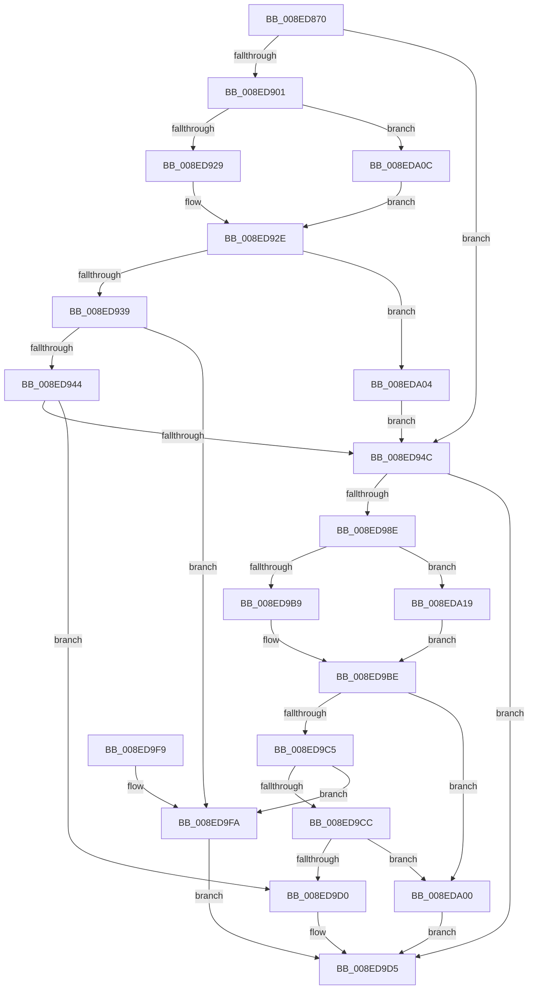

# CmGetDeviceRegProp

- RVA: `0x008ED870`–`0x008EDA23` (길이 `435` bytes)
- VA: `0x00000001408ED870`
- 실행 섹션: `PAGE`
- PDB 이름 있음: `예`; PDB Function 태그: `아니요`
- unwind 정보 RVA: `0x00086DF0`
- 디코드: `110`개 명령, `435/435` bytes 표시
- 미해석 바이트: `0` (있으면 어셈블리에 `.byte`로 보존)

> 이 문서는 커널 이미지의 기계어와 PDB 기호를 분석해 생성했습니다. 4번과 5번은 함수 원형과 자료형을 바이너리 사용 방식에서 추정한 C 해석이며 원본 소스 복구 결과는 아닙니다.

## 1. Dependencies

- 직접 호출 지점: **7**; 고유 호출 대상: **5**
- 직접 호출자로 확인된 함수: **60**
- RIP 상대 이미지 참조: **2**

### Outgoing calls
- `0x008ED8C5` → [memset](../../text/6C/memset_function_006C6C40.md) (function, `0x006C6C40`)
- `0x008ED929` → [PiPnpRtlCmActionCallback](PiPnpRtlCmActionCallback_function_008EF110.md) (function, `0x008EF110`)
- `0x008ED982` → [_CmGetDeviceRegPropWorker](_CmGetDeviceRegPropWorker_function_008EDA30.md) (function, `0x008EDA30`)
- `0x008ED9B9` → [PiPnpRtlCmActionCallback](PiPnpRtlCmActionCallback_function_008EF110.md) (function, `0x008EF110`)
- `0x008ED9E0` → [_security_check_cookie](../../text/6A/_security_check_cookie_function_006AC640.md) (function, `0x006AC640`)
- `0x008EDA0F` → [guard_dispatch_icall](../../text/6B/guard_dispatch_icall_function_006BAAD0.md) (function, `0x006BAAD0`)
- `0x008EDA1C` → [guard_dispatch_icall](../../text/6B/guard_dispatch_icall_function_006BAAD0.md) (function, `0x006BAAD0`)

### Direct callers
- [IopIsReportedAlready](../72/IopIsReportedAlready_function_00726C6C.md) at `0x00726D19`
- [PiPnpRtlGatherDeviceDeleteInfo](../72/PiPnpRtlGatherDeviceDeleteInfo_function_0072FC04.md) at `0x0072FCFA`
- [PiDcResetChildDeviceContainerCallback](../73/PiDcResetChildDeviceContainerCallback_function_00730DE0.md) at `0x00730EAD`
- [PiDcResetChildDeviceContainers](../73/PiDcResetChildDeviceContainers_function_00731030.md) at `0x00731103`
- [PiDevCfgCheckDeviceNeedsUpdate](../73/PiDevCfgCheckDeviceNeedsUpdate_function_00731DDC.md) at `0x00731ED8`
- [PiDevCfgInitDeviceCallback](../73/PiDevCfgInitDeviceCallback_function_00733800.md) at `0x007338B0`
- [PiDevCfgProcessDeviceCallback](../73/PiDevCfgProcessDeviceCallback_function_00734080.md) at `0x00734157`
- [PpDevCfgProcessDeviceClass](../73/PpDevCfgProcessDeviceClass_function_00736824.md) at `0x00736B86`
- [PpDevCfgProcessDeviceExtensions](../73/PpDevCfgProcessDeviceExtensions_function_00736C2C.md) at `0x007372D2`
- [PiInitializeDevice](../73/PiInitializeDevice_function_0073EC5C.md) at `0x0073EE30`
- [PiInitializeDevice](../73/PiInitializeDevice_function_0073EC5C.md) at `0x0073EF08`
- [CmClassFilterCallback](../82/CmClassFilterCallback_function_0082C6F0.md) at `0x0082C7A2`
- [CmServiceFilterCallback](../82/CmServiceFilterCallback_function_0082D7A0.md) at `0x0082D869`
- [CmServiceFilterCallback](../82/CmServiceFilterCallback_function_0082D7A0.md) at `0x0082D9A1`
- [CmServiceFilterCallback](../82/CmServiceFilterCallback_function_0082D7A0.md) at `0x0082DA18`
- [PiCMValidateDeviceInstance](PiCMValidateDeviceInstance_function_008E799C.md) at `0x008E7D09`
- [PiCMHandleIoctl](PiCMHandleIoctl_function_008EB880.md) at `0x008EBB08`
- [sub_008EDC5D](Unknown_function_008EDC5D.md) at `0x008EDCC1`
- [PiPnpRtlCmActionCallback](PiPnpRtlCmActionCallback_function_008EF110.md) at `0x008EF4C1`
- [IoGetDeviceProperty](../8F/IoGetDeviceProperty_function_008FA720.md) at `0x008FAA54`
- [PiGetDeviceRegProperty](../8F/PiGetDeviceRegProperty_function_008FAC6C.md) at `0x008FACF0`
- [PiGetDeviceRegProperty](../8F/PiGetDeviceRegProperty_function_008FAC6C.md) at `0x008FAEE2`
- [PiDcUpdateDeviceContainerMembership](../8F/PiDcUpdateDeviceContainerMembership_function_008FD0A8.md) at `0x008FD13E`
- [PpDevCfgProcessDeviceReset](../96/PpDevCfgProcessDeviceReset_function_00965498.md) at `0x009656D4`
- [PnpCheckDeviceIdsChanged](../97/PnpCheckDeviceIdsChanged_function_00972938.md) at `0x009729D0`
- [PnpCheckDeviceIdsChanged](../97/PnpCheckDeviceIdsChanged_function_00972938.md) at `0x00972A35`
- [PiDevCfgProcessDevice](../97/PiDevCfgProcessDevice_function_00976D34.md) at `0x00976F68`
- [_CmGetDeviceSoftwareKeyPath](../99/_CmGetDeviceSoftwareKeyPath_function_00991090.md) at `0x00991128`
- [_CmGetDeviceSoftwareKeyPath](../99/_CmGetDeviceSoftwareKeyPath_function_00991090.md) at `0x0099126F`
- [_CmGetDeviceSoftwareKeyPath](../99/_CmGetDeviceSoftwareKeyPath_function_00991090.md) at `0x009912F9`
- [PipGetRegistryDwordWithFallback](../99/PipGetRegistryDwordWithFallback_function_00995350.md) at `0x009953A1`
- [PipGetRegistrySecurityWithFallback](../99/PipGetRegistrySecurityWithFallback_function_0099542C.md) at `0x009954B2`
- [PipGetRegistrySecurityWithFallback](../99/PipGetRegistrySecurityWithFallback_function_0099542C.md) at `0x0099561A`
- [PnpCallDriverQueryServiceHelper](../99/PnpCallDriverQueryServiceHelper_function_00995FB0.md) at `0x009960E6`
- [CmIsDeviceSafeRemovalRequired](../9D/CmIsDeviceSafeRemovalRequired_function_009D1040.md) at `0x009D1109`
- [CmIsDeviceSafeRemovalRequired](../9D/CmIsDeviceSafeRemovalRequired_function_009D1040.md) at `0x009D1259`
- [CmGetDeviceStatus](../9D/CmGetDeviceStatus_function_009D154C.md) at `0x009D1613`
- [_CmGetDeviceMappedPropertyFromComposite](../9D/_CmGetDeviceMappedPropertyFromComposite_function_009D1684.md) at `0x009D290C`
- [sub_009D2B5A](../9D/Unknown_function_009D2B5A.md) at `0x009D2BC2`
- [sub_009D2CEA](../9D/Unknown_function_009D2CEA.md) at `0x009D2D27`
- [sub_009D2CEA](../9D/Unknown_function_009D2CEA.md) at `0x009D2E00`
- [sub_009D2CEA](../9D/Unknown_function_009D2CEA.md) at `0x009D2EAE`
- [PiDeviceRegistration](../A0/PiDeviceRegistration_function_00A07A60.md) at `0x00A07BAC`
- [PpForEachDeviceInstanceDriver](../A0/PpForEachDeviceInstanceDriver_function_00A07D2C.md) at `0x00A07E97`
- [PpForEachDeviceInstanceDriver](../A0/PpForEachDeviceInstanceDriver_function_00A07D2C.md) at `0x00A080C6`
- [PpForEachDeviceInstanceDriver](../A0/PpForEachDeviceInstanceDriver_function_00A07D2C.md) at `0x00A081DC`
- [_CmDeleteDeviceWorker](../A0/_CmDeleteDeviceWorker_function_00A08F48.md) at `0x00A0901C`
- [PiPnpRtlServiceFilterCallback](../A0/PiPnpRtlServiceFilterCallback_function_00A0DB80.md) at `0x00A0DC4A`
- [PiPnpRtlServiceFilterCallback](../A0/PiPnpRtlServiceFilterCallback_function_00A0DB80.md) at `0x00A0DD91`
- [PipCallDriverAddDevice](../A2/PipCallDriverAddDevice_function_00A272E0.md) at `0x00A27538`
- [PipCallDriverAddDevice](../A2/PipCallDriverAddDevice_function_00A272E0.md) at `0x00A27586`
- [PiProcessNewDeviceNode](../A2/PiProcessNewDeviceNode_function_00A28F20.md) at `0x00A29A4D`
- [IopPnPDispatch](../A7/IopPnPDispatch_function_00A74B90.md) at `0x00A74D79`
- [PnpIsDeviceInstanceEnabled](../A7/PnpIsDeviceInstanceEnabled_function_00A75A3C.md) at `0x00A75BAF`
- [PpHotSwapUpdateRemovalPolicy](../A8/PpHotSwapUpdateRemovalPolicy_function_00A85E40.md) at `0x00A85F35`
- [PipGenerateContainerID](../A8/PipGenerateContainerID_function_00A87694.md) at `0x00A877DA`
- [CmIsLocalMachineContainer](../A8/CmIsLocalMachineContainer_function_00A8EA34.md) at `0x00A8EA93`
- [PiDevCfgResolveVariableKeyHandle](../AB/PiDevCfgResolveVariableKeyHandle_function_00AB2A24.md) at `0x00AB2B9D`
- [PiCreateDriverSwDeviceCallback](../AB/PiCreateDriverSwDeviceCallback_function_00ABB420.md) at `0x00ABB8F6`
- [PiCMCreateDevice](../AC/PiCMCreateDevice_function_00ACB824.md) at `0x00ACBCB4`
- [PiCMCreateDevice](../AC/PiCMCreateDevice_function_00ACB824.md) at `0x00ACBEAD`
- [PiCMQueryRemove](../AD/PiCMQueryRemove_function_00AD43F4.md) at `0x00AD460C`
- [sub_00B1EBE0](../B1/Unknown_function_00B1EBE0.md) at `0x00B1ED62`
- [sub_00B1F3CA](../B1/Unknown_function_00B1F3CA.md) at `0x00B1F3FB`
- [sub_00B1F622](../B1/Unknown_function_00B1F622.md) at `0x00B1F710`
- [sub_00B266CA](../B2/Unknown_function_00B266CA.md) at `0x00B26777`
- [sub_00B266CA](../B2/Unknown_function_00B266CA.md) at `0x00B2684D`
- [sub_00B280B0](../B2/Unknown_function_00B280B0.md) at `0x00B28101`
- [sub_00B286C8](../B2/Unknown_function_00B286C8.md) at `0x00B28706`
- [sub_00B29934](../B2/Unknown_function_00B29934.md) at `0x00B299C7`
- [sub_00B29934](../B2/Unknown_function_00B29934.md) at `0x00B29C4C`
- [sub_00B2C332](../B2/Unknown_function_00B2C332.md) at `0x00B2C3CF`
- [sub_00B3807C](../B3/Unknown_function_00B3807C.md) at `0x00B3819E`
- [sub_00B3807C](../B3/Unknown_function_00B3807C.md) at `0x00B383C7`
- [sub_00B3807C](../B3/Unknown_function_00B3807C.md) at `0x00B3869B`
- [sub_00B38904](../B3/Unknown_function_00B38904.md) at `0x00B3896F`
- [sub_00B420B0](../B4/Unknown_function_00B420B0.md) at `0x00B421EA`
- [sub_00B47D18](../B4/Unknown_function_00B47D18.md) at `0x00B47DC1`
- [PipMigrateResetDeviceCallback](../../init/C3/PipMigrateResetDeviceCallback_function_00C31D40.md) at `0x00C31DAD`
- [PipResetDevice](../../init/C3/PipResetDevice_function_00C31F90.md) at `0x00C32020`
- [PipResetDevice](../../init/C3/PipResetDevice_function_00C31F90.md) at `0x00C32106`

### Static image references
- `0x008ED884` → RVA `0x00E0A740` (`.data`; read)
- `0x008ED8DD` → RVA `0x008EF110` (`PiPnpRtlCmActionCallback`; read)

## 2. Other-region calls and transfers

- 다른 실행 섹션으로 향하는 call: **4**
  - `0x008ED8C5` → [memset](../../text/6C/memset_function_006C6C40.md) (`PAGE` → `.text`)
  - `0x008ED9E0` → [_security_check_cookie](../../text/6A/_security_check_cookie_function_006AC640.md) (`PAGE` → `.text`)
  - `0x008EDA0F` → [guard_dispatch_icall](../../text/6B/guard_dispatch_icall_function_006BAAD0.md) (`PAGE` → `.text`)
  - `0x008EDA1C` → [guard_dispatch_icall](../../text/6B/guard_dispatch_icall_function_006BAAD0.md) (`PAGE` → `.text`)
- 별도 외부 분기/꼬리 이동을 확인하지 못했습니다.

## 3. Assembly (complete function range)

```asm
008ED870  40 53                           push rbx
008ED872  55                              push rbp
008ED873  56                              push rsi
008ED874  57                              push rdi
008ED875  41 54                           push r12
008ED877  41 55                           push r13
008ED879  41 56                           push r14
008ED87B  41 57                           push r15
008ED87D  48 81 EC B8 00 00 00            sub rsp, 0xb8
008ED884  48 8B 05 B5 CE 51 00            mov rax, qword ptr [rip + 0x51ceb5]
008ED88B  48 33 C4                        xor rax, rsp
008ED88E  48 89 84 24 A0 00 00 00         mov qword ptr [rsp + 0xa0], rax
008ED896  48 8B 9C 24 20 01 00 00         mov rbx, qword ptr [rsp + 0x120]
008ED89E  4C 8B E2                        mov r12, rdx
008ED8A1  48 8B BC 24 28 01 00 00         mov rdi, qword ptr [rsp + 0x128]
008ED8A9  33 D2                           xor edx, edx
008ED8AB  48 8B B4 24 30 01 00 00         mov rsi, qword ptr [rsp + 0x130]
008ED8B3  49 8B E8                        mov rbp, r8
008ED8B6  4C 8B E9                        mov r13, rcx
008ED8B9  45 8B F1                        mov r14d, r9d
008ED8BC  48 8D 4C 24 40                  lea rcx, [rsp + 0x40]
008ED8C1  44 8D 42 58                     lea r8d, [rdx + 0x58]
008ED8C5  E8 76 93 DD FF                  call 0x1406c6c40
008ED8CA  4D 8B BD F8 01 00 00            mov r15, qword ptr [r13 + 0x1f8]
008ED8D1  8B 84 24 38 01 00 00            mov eax, dword ptr [rsp + 0x138]
008ED8D8  48 89 7C 24 68                  mov qword ptr [rsp + 0x68], rdi
008ED8DD  48 8D 3D 2C 18 00 00            lea rdi, [rip + 0x182c]
008ED8E4  48 89 6C 24 50                  mov qword ptr [rsp + 0x50], rbp
008ED8E9  44 89 74 24 58                  mov dword ptr [rsp + 0x58], r14d
008ED8EE  48 89 5C 24 60                  mov qword ptr [rsp + 0x60], rbx
008ED8F3  48 89 74 24 70                  mov qword ptr [rsp + 0x70], rsi
008ED8F8  89 44 24 78                     mov dword ptr [rsp + 0x78], eax
008ED8FC  4D 85 FF                        test r15, r15
008ED8FF  74 4B                           je 0x1408ed94c
008ED901  48 8D 44 24 40                  lea rax, [rsp + 0x40]
008ED906  41 B9 09 00 00 00               mov r9d, 9
008ED90C  48 89 44 24 28                  mov qword ptr [rsp + 0x28], rax
008ED911  49 8B D4                        mov rdx, r12
008ED914  49 8B CD                        mov rcx, r13
008ED917  45 8D 41 F8                     lea r8d, [r9 - 8]
008ED91B  44 89 44 24 20                  mov dword ptr [rsp + 0x20], r8d
008ED920  4C 3B FF                        cmp r15, rdi
008ED923  0F 85 E3 00 00 00               jne 0x1408eda0c
008ED929  E8 E2 17 00 00                  call 0x1408ef110
008ED92E  3D 02 00 00 C0                  cmp eax, 0xc0000002
008ED933  0F 84 CB 00 00 00               je 0x1408eda04
008ED939  3D 20 01 00 C0                  cmp eax, 0xc0000120
008ED93E  0F 84 B6 00 00 00               je 0x1408ed9fa
008ED944  85 C0                           test eax, eax
008ED946  0F 85 84 00 00 00               jne 0x1408ed9d0
008ED94C  8B 44 24 78                     mov eax, dword ptr [rsp + 0x78]
008ED950  49 8B D4                        mov rdx, r12
008ED953  44 8B 4C 24 58                  mov r9d, dword ptr [rsp + 0x58]
008ED958  49 8B CD                        mov rcx, r13
008ED95B  4C 8B 44 24 50                  mov r8, qword ptr [rsp + 0x50]
008ED960  89 44 24 38                     mov dword ptr [rsp + 0x38], eax
008ED964  48 8B 44 24 70                  mov rax, qword ptr [rsp + 0x70]
008ED969  48 89 44 24 30                  mov qword ptr [rsp + 0x30], rax
008ED96E  48 8B 44 24 68                  mov rax, qword ptr [rsp + 0x68]
008ED973  48 89 44 24 28                  mov qword ptr [rsp + 0x28], rax
008ED978  48 8B 44 24 60                  mov rax, qword ptr [rsp + 0x60]
008ED97D  48 89 44 24 20                  mov qword ptr [rsp + 0x20], rax
008ED982  E8 A9 00 00 00                  call 0x1408eda30
008ED987  8B D8                           mov ebx, eax
008ED989  4D 85 FF                        test r15, r15
008ED98C  74 47                           je 0x1408ed9d5
008ED98E  89 44 24 40                     mov dword ptr [rsp + 0x40], eax
008ED992  41 B9 09 00 00 00               mov r9d, 9
008ED998  48 8D 44 24 40                  lea rax, [rsp + 0x40]
008ED99D  49 8B D4                        mov rdx, r12
008ED9A0  48 89 44 24 28                  mov qword ptr [rsp + 0x28], rax
008ED9A5  49 8B CD                        mov rcx, r13
008ED9A8  C7 44 24 20 02 00 00 00         mov dword ptr [rsp + 0x20], 2
008ED9B0  45 8D 41 F8                     lea r8d, [r9 - 8]
008ED9B4  4C 3B FF                        cmp r15, rdi
008ED9B7  75 60                           jne 0x1408eda19
008ED9B9  E8 52 17 00 00                  call 0x1408ef110
008ED9BE  3D 02 00 00 C0                  cmp eax, 0xc0000002
008ED9C3  74 3B                           je 0x1408eda00
008ED9C5  3D 20 01 00 C0                  cmp eax, 0xc0000120
008ED9CA  74 2E                           je 0x1408ed9fa
008ED9CC  85 C0                           test eax, eax
008ED9CE  74 30                           je 0x1408eda00
008ED9D0  B8 E5 00 00 C0                  mov eax, 0xc00000e5
008ED9D5  48 8B 8C 24 A0 00 00 00         mov rcx, qword ptr [rsp + 0xa0]
008ED9DD  48 33 CC                        xor rcx, rsp
008ED9E0  E8 5B EC DB FF                  call 0x1406ac640
008ED9E5  48 81 C4 B8 00 00 00            add rsp, 0xb8
008ED9EC  41 5F                           pop r15
008ED9EE  41 5E                           pop r14
008ED9F0  41 5D                           pop r13
008ED9F2  41 5C                           pop r12
008ED9F4  5F                              pop rdi
008ED9F5  5E                              pop rsi
008ED9F6  5D                              pop rbp
008ED9F7  5B                              pop rbx
008ED9F8  C3                              ret
008ED9F9  CC                              int3
008ED9FA  8B 44 24 40                     mov eax, dword ptr [rsp + 0x40]
008ED9FE  EB D5                           jmp 0x1408ed9d5
008EDA00  8B C3                           mov eax, ebx
008EDA02  EB D1                           jmp 0x1408ed9d5
008EDA04  45 33 FF                        xor r15d, r15d
008EDA07  E9 40 FF FF FF                  jmp 0x1408ed94c
008EDA0C  49 8B C7                        mov rax, r15
008EDA0F  E8 BC D0 DC FF                  call 0x1406baad0
008EDA14  E9 15 FF FF FF                  jmp 0x1408ed92e
008EDA19  49 8B C7                        mov rax, r15
008EDA1C  E8 AF D0 DC FF                  call 0x1406baad0
008EDA21  EB 9B                           jmp 0x1408ed9be
```

## 4. C-style interpretation (structured pseudocode)

```c
__int64 __fastcall CmGetDeviceRegProp(__int64 a1, __int64 a2, __int64 a3, int a4, __int64 a5, __int64 a6, __int64 a7, unsigned int a8)
{
    __int64 result;
    __int64 v_r15;
    __int64 v_rsp;
    unsigned __int64 v_stack_m58;
    unsigned int v_stack_m80;
    unsigned __int64 v_stack_m88;
    unsigned __int64 v_stack_m90;
    unsigned __int64 v_stack_m98;
    unsigned int v_stack_mA0;
    unsigned __int64 v_stack_mA8;
    unsigned __int64 v_stack_mB8;
    unsigned int v_stack_mC0;
    unsigned __int64 v_stack_mC8;
    unsigned __int64 v_stack_mD0;
    unsigned int v_stack_mD8;
    unsigned int v_stack_p40;

    v_rsp = (v_rsp) - (184);
    result = (*(unsigned __int64 *)(v_rip + 5361333)) ^ (v_rsp);
    v_stack_m58 = result;
    a2 = 0;
    result = memset(v_stack_mB8, a2, a2 + 88, a4);
    v_stack_m90 = a6;
    v_stack_mA8 = a3;
    v_stack_mA0 = (unsigned int)((unsigned int)(a4));
    v_stack_m98 = a5;
    v_stack_m88 = a7;
    v_stack_m80 = (unsigned int)((unsigned int)(a8));
    if (*(unsigned __int64 *)(a1 + 504) == 0) goto loc_008ED94C;
    v_stack_mD0 = v_stack_mB8;
    v_stack_mD8 = (unsigned int)(9 - 8);
    if ((*(unsigned __int64 *)(a1 + 504)) != (v_rip + 6188)) goto loc_008EDA0C;
    result = PiPnpRtlCmActionCallback(a1, 0, 9 - 8, 9);
loc_008ED92E:
    if (((unsigned int)(result)) == 0xC0000002ULL) goto loc_008EDA04;
    if (((unsigned int)(result)) == 0xC0000120ULL) goto loc_008ED9FA;
    if ((unsigned int)(result) != 0) goto loc_008ED9D0;
loc_008ED94C:
    v_stack_mC0 = (unsigned int)((unsigned int)(v_stack_m80));
    v_stack_mC8 = v_stack_m88;
    v_stack_mD0 = v_stack_m90;
    v_stack_mD8 = v_stack_m98;
    result = _CmGetDeviceRegPropWorker(a1, 0, v_stack_mA8, (unsigned int)(v_stack_mA0));
    if (*(unsigned __int64 *)(a1 + 504) == 0) goto loc_008ED9D5;
    v_stack_mB8 = (unsigned int)(result);
    v_stack_mD0 = v_stack_mB8;
    v_stack_mD8 = 2;
    if ((*(unsigned __int64 *)(a1 + 504)) != (v_rip + 6188)) goto loc_008EDA19;
    result = PiPnpRtlCmActionCallback(a1, 0, 9 - 8, 9);
loc_008ED9BE:
    if (((unsigned int)(result)) == 0xC0000002ULL) goto loc_008EDA00;
    if (((unsigned int)(result)) == 0xC0000120ULL) goto loc_008ED9FA;
    if ((unsigned int)(result) == 0) goto loc_008EDA00;
loc_008ED9D0:
loc_008ED9D5:
    a1 = (v_stack_m58) ^ (v_rsp);
    result = _security_check_cookie(a1, 0, 9 - 8, 9);
    v_rsp = (v_rsp) + (184);
    return result;
loc_008ED9FA:
    goto loc_008ED9D5;
loc_008EDA00:
    goto loc_008ED9D5;
loc_008EDA04:
    v_r15 = 0;
    goto loc_008ED94C;
loc_008EDA0C:
    result = guard_dispatch_icall(a1, 0, 9 - 8, 9);
    goto loc_008ED92E;
loc_008EDA19:
    result = guard_dispatch_icall(a1, 0, 9 - 8, 9);
    goto loc_008ED9BE;
}
```

## 5. (Beta) C Style

```c
int64_t CmGetDeviceRegProp(void *Arg1, int64_t Arg2, int64_t Arg3, int32_t Arg4, int64_t Arg5, int64_t Arg6, int64_t Arg7, uint32_t Arg8)
{
    uint8_t *arg1 = (uint8_t *)Arg1;

    int64_t result;
    int64_t local_r15;
    int64_t local_rsp;
    uint64_t v_stack_m58;
    uint32_t v_stack_m80;
    uint64_t v_stack_m88;
    uint64_t v_stack_m90;
    uint64_t v_stack_m98;
    uint32_t v_stack_mA0;
    uint64_t v_stack_mA8;
    uint64_t v_stack_mB8;
    uint32_t v_stack_mC0;
    uint64_t v_stack_mC8;
    uint64_t v_stack_mD0;
    uint32_t v_stack_mD8;
    uint32_t v_stack_p40;

    local_rsp = (local_rsp) - (184);
    result = (*(uint64_t *)(v_rip + 0x51CEB5)) ^ (local_rsp);
    v_stack_m58 = result;
    Arg2 = 0;
    result = memset(v_stack_mB8, Arg2, Arg2 + 88, Arg4);
    v_stack_m90 = Arg6;
    v_stack_mA8 = Arg3;
    v_stack_mA0 = (uint32_t)((uint32_t)(Arg4));
    v_stack_m98 = Arg5;
    v_stack_m88 = Arg7;
    v_stack_m80 = (uint32_t)((uint32_t)(Arg8));
    if (*(uint64_t *)(arg1 + 0x1F8) == 0) goto loc_008ED94C;
    v_stack_mD0 = v_stack_mB8;
    v_stack_mD8 = (uint32_t)(9 - 8);
    if ((*(uint64_t *)(arg1 + 0x1F8)) != (v_rip + 6188)) goto loc_008EDA0C;
    result = PiPnpRtlCmActionCallback(Arg1, 0, 9 - 8, 9);
loc_008ED92E:
    if (((uint32_t)(result)) == 0xC0000002ULL) goto loc_008EDA04;
    if (((uint32_t)(result)) == 0xC0000120ULL) goto loc_008ED9FA;
    if ((uint32_t)(result) != 0) goto loc_008ED9D0;
loc_008ED94C:
    v_stack_mC0 = (uint32_t)((uint32_t)(v_stack_m80));
    v_stack_mC8 = v_stack_m88;
    v_stack_mD0 = v_stack_m90;
    v_stack_mD8 = v_stack_m98;
    result = _CmGetDeviceRegPropWorker(Arg1, 0, v_stack_mA8, (uint32_t)(v_stack_mA0));
    if (*(uint64_t *)(arg1 + 0x1F8) == 0) goto loc_008ED9D5;
    v_stack_mB8 = (uint32_t)(result);
    v_stack_mD0 = v_stack_mB8;
    v_stack_mD8 = 2;
    if ((*(uint64_t *)(arg1 + 0x1F8)) != (v_rip + 6188)) goto loc_008EDA19;
    result = PiPnpRtlCmActionCallback(Arg1, 0, 9 - 8, 9);
loc_008ED9BE:
    if (((uint32_t)(result)) == 0xC0000002ULL) goto loc_008EDA00;
    if (((uint32_t)(result)) == 0xC0000120ULL) goto loc_008ED9FA;
    if ((uint32_t)(result) == 0) goto loc_008EDA00;
loc_008ED9D0:
loc_008ED9D5:
    Arg1 = (v_stack_m58) ^ (local_rsp);
    result = _security_check_cookie(Arg1, 0, 9 - 8, 9);
    local_rsp = (local_rsp) + (184);
    return result;
loc_008ED9FA:
    goto loc_008ED9D5;
loc_008EDA00:
    goto loc_008ED9D5;
loc_008EDA04:
    local_r15 = 0;
    goto loc_008ED94C;
loc_008EDA0C:
    result = guard_dispatch_icall(Arg1, 0, 9 - 8, 9);
    goto loc_008ED92E;
loc_008EDA19:
    result = guard_dispatch_icall(Arg1, 0, 9 - 8, 9);
    goto loc_008ED9BE;
}
```

### 관측된 메모리 오프셋

구조체 형식이 확인되지 않은 접근은 인자 기준의 오프셋으로만 기록했습니다.

| 기준 인자 | 오프셋 표현 | 폭 (bit) | 접근 |
|---|---:|---:|---|
| `Arg1` | `+ 0x1F8` | `64` | `R` |

## 6. Execution-region graph

[열기: 2D/3D 그래프와 함수 탐색 컨트롤 패널](../../../control-panel.html?section=page&rva=0x008ED870&view=graph)

- 2D 그래프는 위에서 아래로 흐르고, 3D 그래프는 빈 공간을 드래그해 회전합니다. Shift+드래그는 이동, 휠은 확대·축소, 함수 노드 선택은 대상 보고서 이동입니다.

### Static fallback


