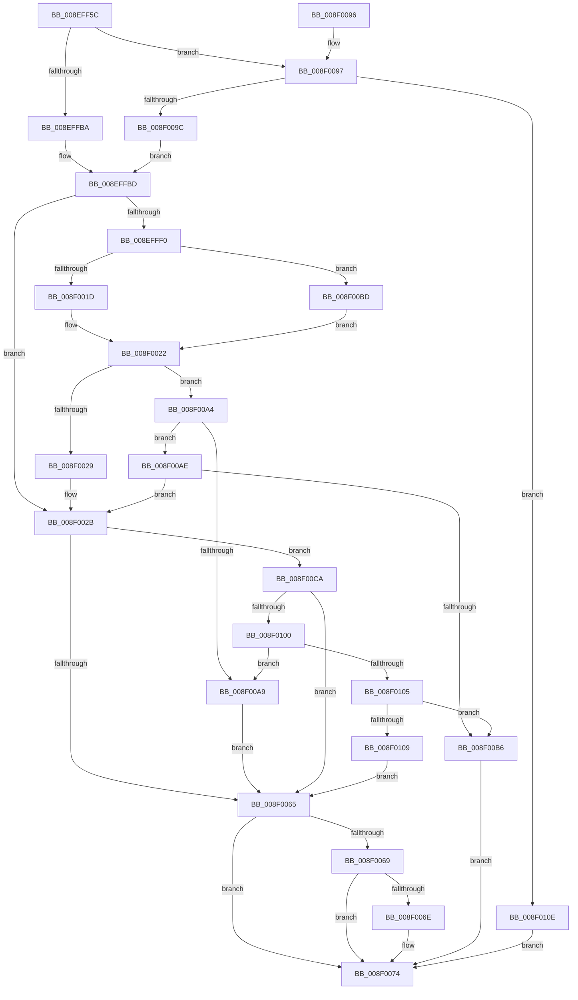

# CmOpenCommonClassRegKey

- RVA: `0x008EFF5C`–`0x008F0118` (길이 `444` bytes)
- VA: `0x00000001408EFF5C`
- 실행 섹션: `PAGE`
- PDB 이름 있음: `예`; PDB Function 태그: `아니요`
- unwind 정보 RVA: `0x000871C0`
- 디코드: `126`개 명령, `444/444` bytes 표시
- 미해석 바이트: `0` (있으면 어셈블리에 `.byte`로 보존)

> 이 문서는 커널 이미지의 기계어와 PDB 기호를 분석해 생성했습니다. 4번과 5번은 함수 원형과 자료형을 바이너리 사용 방식에서 추정한 C 해석이며 원본 소스 복구 결과는 아닙니다.

## 1. Dependencies

- 직접 호출 지점: **6**; 고유 호출 대상: **5**
- 직접 호출자로 확인된 함수: **10**
- RIP 상대 이미지 참조: **2**

### Outgoing calls
- `0x008EFFA9` → [memset](../../text/6C/memset_function_006C6C40.md) (function, `0x006C6C40`)
- `0x008F001D` → [PiPnpRtlCmActionCallback](PiPnpRtlCmActionCallback_function_008EF110.md) (function, `0x008EF110`)
- `0x008F0059` → [_CmOpenCommonClassRegKeyWorker](../8F/_CmOpenCommonClassRegKeyWorker_function_008F0A1C.md) (function, `0x008F0A1C`)
- `0x008F007D` → [_security_check_cookie](../../text/6A/_security_check_cookie_function_006AC640.md) (function, `0x006AC640`)
- `0x008F00C0` → [guard_dispatch_icall](../../text/6B/guard_dispatch_icall_function_006BAAD0.md) (function, `0x006BAAD0`)
- `0x008F00F0` → [guard_dispatch_icall](../../text/6B/guard_dispatch_icall_function_006BAAD0.md) (function, `0x006BAAD0`)

### Direct callers
- [_CmCreateInterfaceClassWorker](../90/_CmCreateInterfaceClassWorker_function_009019CC.md) at `0x00901A23`
- [PiCMOpenClassKey](../96/PiCMOpenClassKey_function_009617A8.md) at `0x009618BE`
- [PiCMOpenClassKey](../96/PiCMOpenClassKey_function_009617A8.md) at `0x009619A5`
- [_CmGetDeviceSoftwareKeyPath](../99/_CmGetDeviceSoftwareKeyPath_function_00991090.md) at `0x0099133F`
- [_CmGetInterfaceClassMappedPropertyFromRegValue](../99/_CmGetInterfaceClassMappedPropertyFromRegValue_function_00993EB8.md) at `0x009940C5`
- [CmGetInstallerClassRegPropWorker](../99/CmGetInstallerClassRegPropWorker_function_00994AF4.md) at `0x00994BB5`
- [_CmGetInstallerClassCompoundFilters](../9D/_CmGetInstallerClassCompoundFilters_function_009D3C84.md) at `0x009D3CF1`
- [_CmGetInstallerClassMappedPropertyFromRegValue](../9D/_CmGetInstallerClassMappedPropertyFromRegValue_function_009D4058.md) at `0x009D4144`
- [CmOpenInstallerClassRegKey](../9D/CmOpenInstallerClassRegKey_function_009D4474.md) at `0x009D44A9`
- [PpForEachDeviceInstanceDriver](../A0/PpForEachDeviceInstanceDriver_function_00A07D2C.md) at `0x00A07ED8`
- [CmOpenInterfaceClassRegKey](../A3/CmOpenInterfaceClassRegKey_function_00A304F8.md) at `0x00A3052D`

### Static image references
- `0x008EFF75` → RVA `0x00E0A740` (`.data`; read)
- `0x008EFFF0` → RVA `0x008EF110` (`PiPnpRtlCmActionCallback`; read)

## 2. Other-region calls and transfers

- 다른 실행 섹션으로 향하는 call: **4**
  - `0x008EFFA9` → [memset](../../text/6C/memset_function_006C6C40.md) (`PAGE` → `.text`)
  - `0x008F007D` → [_security_check_cookie](../../text/6A/_security_check_cookie_function_006AC640.md) (`PAGE` → `.text`)
  - `0x008F00C0` → [guard_dispatch_icall](../../text/6B/guard_dispatch_icall_function_006BAAD0.md) (`PAGE` → `.text`)
  - `0x008F00F0` → [guard_dispatch_icall](../../text/6B/guard_dispatch_icall_function_006BAAD0.md) (`PAGE` → `.text`)
- 별도 외부 분기/꼬리 이동을 확인하지 못했습니다.

## 3. Assembly (complete function range)

```asm
008EFF5C  40 55                           push rbp
008EFF5E  53                              push rbx
008EFF5F  56                              push rsi
008EFF60  57                              push rdi
008EFF61  41 54                           push r12
008EFF63  41 55                           push r13
008EFF65  41 56                           push r14
008EFF67  41 57                           push r15
008EFF69  48 8D 6C 24 F9                  lea rbp, [rsp - 7]
008EFF6E  48 81 EC C8 00 00 00            sub rsp, 0xc8
008EFF75  48 8B 05 C4 A7 51 00            mov rax, qword ptr [rip + 0x51a7c4]
008EFF7C  48 33 C4                        xor rax, rsp
008EFF7F  48 89 45 EF                     mov qword ptr [rbp - 0x11], rax
008EFF83  48 8B 45 7F                     mov rax, qword ptr [rbp + 0x7f]
008EFF87  4C 8B E2                        mov r12, rdx
008EFF8A  4C 8B BD 87 00 00 00            mov r15, qword ptr [rbp + 0x87]
008EFF91  33 D2                           xor edx, edx
008EFF93  41 8B D8                        mov ebx, r8d
008EFF96  48 89 44 24 40                  mov qword ptr [rsp + 0x40], rax
008EFF9B  4C 8B F1                        mov r14, rcx
008EFF9E  45 8B E9                        mov r13d, r9d
008EFFA1  48 8D 4D 8F                     lea rcx, [rbp - 0x71]
008EFFA5  44 8D 42 58                     lea r8d, [rdx + 0x58]
008EFFA9  E8 92 6C DD FF                  call 0x1406c6c40
008EFFAE  0F B6 C3                        movzx eax, bl
008EFFB1  83 F8 20                        cmp eax, 0x20
008EFFB4  0F 85 DD 00 00 00               jne 0x1408f0097
008EFFBA  8D 70 E2                        lea esi, [rax - 0x1e]
008EFFBD  8B 45 6F                        mov eax, dword ptr [rbp + 0x6f]
008EFFC0  B9 0B 00 00 00                  mov ecx, 0xb
008EFFC5  49 8B BE F8 01 00 00            mov rdi, qword ptr [r14 + 0x1f8]
008EFFCC  89 45 A7                        mov dword ptr [rbp - 0x59], eax
008EFFCF  8A 45 77                        mov al, byte ptr [rbp + 0x77]
008EFFD2  88 45 AB                        mov byte ptr [rbp - 0x55], al
008EFFD5  48 8B 44 24 40                  mov rax, qword ptr [rsp + 0x40]
008EFFDA  44 89 6D A3                     mov dword ptr [rbp - 0x5d], r13d
008EFFDE  41 BD 20 01 00 C0               mov r13d, 0xc0000120
008EFFE4  48 89 45 AF                     mov qword ptr [rbp - 0x51], rax
008EFFE8  89 5D 9F                        mov dword ptr [rbp - 0x61], ebx
008EFFEB  48 85 FF                        test rdi, rdi
008EFFEE  74 3B                           je 0x1408f002b
008EFFF0  48 8D 05 19 F1 FF FF            lea rax, [rip - 0xee7]
008EFFF7  44 8B C9                        mov r9d, ecx
008EFFFA  48 3B F8                        cmp rdi, rax
008EFFFD  44 8B C6                        mov r8d, esi
008F0000  48 8D 45 8F                     lea rax, [rbp - 0x71]
008F0004  49 8B D4                        mov rdx, r12
008F0007  48 89 44 24 28                  mov qword ptr [rsp + 0x28], rax
008F000C  49 8B CE                        mov rcx, r14
008F000F  C7 44 24 20 01 00 00 00         mov dword ptr [rsp + 0x20], 1
008F0017  0F 85 A0 00 00 00               jne 0x1408f00bd
008F001D  E8 EE F0 FF FF                  call 0x1408ef110
008F0022  3D 02 00 00 C0                  cmp eax, 0xc0000002
008F0027  75 7B                           jne 0x1408f00a4
008F0029  33 FF                           xor edi, edi
008F002B  44 8B 4D A3                     mov r9d, dword ptr [rbp - 0x5d]
008F002F  48 8D 45 B7                     lea rax, [rbp - 0x49]
008F0033  44 8B 45 9F                     mov r8d, dword ptr [rbp - 0x61]
008F0037  49 8B D4                        mov rdx, r12
008F003A  48 89 44 24 38                  mov qword ptr [rsp + 0x38], rax
008F003F  49 8B CE                        mov rcx, r14
008F0042  48 8B 45 AF                     mov rax, qword ptr [rbp - 0x51]
008F0046  48 89 44 24 30                  mov qword ptr [rsp + 0x30], rax
008F004B  8A 45 AB                        mov al, byte ptr [rbp - 0x55]
008F004E  88 44 24 28                     mov byte ptr [rsp + 0x28], al
008F0052  8B 45 A7                        mov eax, dword ptr [rbp - 0x59]
008F0055  89 44 24 20                     mov dword ptr [rsp + 0x20], eax
008F0059  E8 BE 09 00 00                  call 0x1408f0a1c
008F005E  8B D8                           mov ebx, eax
008F0060  48 85 FF                        test rdi, rdi
008F0063  75 65                           jne 0x1408f00ca
008F0065  85 DB                           test ebx, ebx
008F0067  78 0B                           js 0x1408f0074
008F0069  4D 85 FF                        test r15, r15
008F006C  74 06                           je 0x1408f0074
008F006E  8B 45 B7                        mov eax, dword ptr [rbp - 0x49]
008F0071  41 89 07                        mov dword ptr [r15], eax
008F0074  8B C3                           mov eax, ebx
008F0076  48 8B 4D EF                     mov rcx, qword ptr [rbp - 0x11]
008F007A  48 33 CC                        xor rcx, rsp
008F007D  E8 BE C5 DB FF                  call 0x1406ac640
008F0082  48 81 C4 C8 00 00 00            add rsp, 0xc8
008F0089  41 5F                           pop r15
008F008B  41 5E                           pop r14
008F008D  41 5D                           pop r13
008F008F  41 5C                           pop r12
008F0091  5F                              pop rdi
008F0092  5E                              pop rsi
008F0093  5B                              pop rbx
008F0094  5D                              pop rbp
008F0095  C3                              ret
008F0096  CC                              int3
008F0097  83 F8 40                        cmp eax, 0x40
008F009A  75 72                           jne 0x1408f010e
008F009C  8D 70 C4                        lea esi, [rax - 0x3c]
008F009F  E9 19 FF FF FF                  jmp 0x1408effbd
008F00A4  41 3B C5                        cmp eax, r13d
008F00A7  75 05                           jne 0x1408f00ae
008F00A9  8B 5D 8F                        mov ebx, dword ptr [rbp - 0x71]
008F00AC  EB B7                           jmp 0x1408f0065
008F00AE  85 C0                           test eax, eax
008F00B0  0F 84 75 FF FF FF               je 0x1408f002b
008F00B6  BB E5 00 00 C0                  mov ebx, 0xc00000e5
008F00BB  EB B7                           jmp 0x1408f0074
008F00BD  48 8B C7                        mov rax, rdi
008F00C0  E8 0B AA DC FF                  call 0x1406baad0
008F00C5  E9 58 FF FF FF                  jmp 0x1408f0022
008F00CA  89 45 8F                        mov dword ptr [rbp - 0x71], eax
008F00CD  41 B9 0B 00 00 00               mov r9d, 0xb
008F00D3  48 8D 45 8F                     lea rax, [rbp - 0x71]
008F00D7  44 8B C6                        mov r8d, esi
008F00DA  48 89 44 24 28                  mov qword ptr [rsp + 0x28], rax
008F00DF  49 8B D4                        mov rdx, r12
008F00E2  48 8B C7                        mov rax, rdi
008F00E5  C7 44 24 20 02 00 00 00         mov dword ptr [rsp + 0x20], 2
008F00ED  49 8B CE                        mov rcx, r14
008F00F0  E8 DB A9 DC FF                  call 0x1406baad0
008F00F5  3D 02 00 00 C0                  cmp eax, 0xc0000002
008F00FA  0F 84 65 FF FF FF               je 0x1408f0065
008F0100  41 3B C5                        cmp eax, r13d
008F0103  74 A4                           je 0x1408f00a9
008F0105  85 C0                           test eax, eax
008F0107  75 AD                           jne 0x1408f00b6
008F0109  E9 57 FF FF FF                  jmp 0x1408f0065
008F010E  BB 0D 00 00 C0                  mov ebx, 0xc000000d
008F0113  E9 5C FF FF FF                  jmp 0x1408f0074
```

## 4. C-style interpretation (structured pseudocode)

```c
__int64 __fastcall CmOpenCommonClassRegKey(__int64 a1, __int64 a2, int a3, int a4, unsigned int a5, unsigned __int8 a6, __int64 a7, __int64 a8)
{
    __int64 result;
    __int64 v_rdi;
    __int64 v_rsp;
    unsigned __int64 v_stack_m47;
    unsigned __int64 v_stack_m58;
    unsigned __int64 v_stack_m90;
    unsigned __int64 v_stack_m98;
    unsigned __int8 v_stack_m9C;
    unsigned int v_stack_mA0;
    unsigned int v_stack_mA4;
    unsigned int v_stack_mA8;
    unsigned __int64 v_stack_mB8;
    unsigned __int64 v_stack_mC8;
    unsigned __int64 v_stack_mD0;
    unsigned __int64 v_stack_mD8;
    unsigned __int64 v_stack_mE0;
    unsigned int v_stack_mE8;
    unsigned int v_stack_p20;
    unsigned __int64 v_stack_p28;

    v_rsp = (v_rsp) - (200);
    result = (*(unsigned __int64 *)(v_rip + 5351364)) ^ (v_rsp);
    v_stack_m58 = result;
    a2 = 0;
    v_stack_mC8 = a7;
    result = memset(v_stack_mB8, a2, a2 + 88, a4);
    if (((unsigned int)((unsigned __int8)((unsigned int)(a3)))) != 32) goto loc_008F0097;
loc_008EFFBD:
    v_stack_mA0 = (unsigned int)((unsigned int)(a5));
    v_stack_m9C = a6;
    v_stack_mA4 = (unsigned int)((unsigned int)(a4));
    v_stack_m98 = v_stack_mC8;
    v_stack_mA8 = (unsigned int)((unsigned int)(a3));
    if (*(unsigned __int64 *)(a1 + 504) == 0) goto loc_008F002B;
    v_stack_mE0 = v_stack_mB8;
    v_stack_mE8 = 1;
    if ((*(unsigned __int64 *)(a1 + 504)) != (v_rip - 3815)) goto loc_008F00BD;
    result = PiPnpRtlCmActionCallback(a1, 0, (unsigned int)((unsigned int)((unsigned __int8)((unsigned int)(a3)) - 30)), 11);
loc_008F0022:
    if (((unsigned int)(result)) != 0xC0000002ULL) goto loc_008F00A4;
    v_rdi = 0;
loc_008F002B:
    v_stack_mD0 = v_stack_m90;
    v_stack_mD8 = v_stack_m98;
    v_stack_mE0 = (unsigned __int8)(v_stack_m9C);
    v_stack_mE8 = (unsigned int)((unsigned int)(v_stack_mA0));
    result = _CmOpenCommonClassRegKeyWorker(a1, 0, (unsigned int)(v_stack_mA8), (unsigned int)(v_stack_mA4));
    if (0 != 0) goto loc_008F00CA;
loc_008F0065:
    if (sign_flag) goto loc_008F0074;
    if (a8 != 0) {
        result = v_stack_m90;
        *(unsigned int *)(a8) = (unsigned int)(result);
    }
    a1 = (v_stack_m58) ^ (v_rsp);
    result = _security_check_cookie(a1, 0, (unsigned int)(v_stack_mA8), (unsigned int)(v_stack_mA4));
    v_rsp = (v_rsp) + (200);
    return result;
loc_008F0097:
    if (((unsigned int)(result)) != 64) goto loc_008F010E;
    goto loc_008EFFBD;
loc_008F00A4:
    if (((unsigned int)(result)) != ((unsigned int)((unsigned int)(0xC0000120ULL)))) goto loc_008F00AE;
loc_008F00A9:
    goto loc_008F0065;
loc_008F00AE:
    if ((unsigned int)(result) == 0) goto loc_008F002B;
loc_008F00B6:
    goto loc_008F0074;
loc_008F00BD:
    result = guard_dispatch_icall(a1, 0, (unsigned int)(v_stack_mA8), (unsigned int)(v_stack_mA4));
    goto loc_008F0022;
loc_008F00CA:
    v_stack_mB8 = (unsigned int)(result);
    v_stack_p28 = v_stack_mB8;
    v_stack_p20 = 2;
    result = guard_dispatch_icall(a1, 0, (unsigned int)((unsigned int)(result - 60)), 11);
    if (((unsigned int)(result)) == 0xC0000002ULL) goto loc_008F0065;
    if (((unsigned int)(result)) == ((unsigned int)((unsigned int)(0xC0000120ULL)))) goto loc_008F00A9;
    if ((unsigned int)(result) != 0) goto loc_008F00B6;
    goto loc_008F0065;
loc_008F010E:
    goto loc_008F0074;
}
```

## 5. (Beta) C Style

```c
int64_t CmOpenCommonClassRegKey(void *Arg1, int64_t Arg2, int32_t Arg3, int32_t Arg4, uint32_t Arg5, uint8_t Arg6, int64_t Arg7, int64_t Arg8)
{
    uint8_t *arg1 = (uint8_t *)Arg1;

    int64_t result;
    int64_t local_rdi;
    int64_t local_rsp;
    uint64_t v_stack_m47;
    uint64_t v_stack_m58;
    uint64_t v_stack_m90;
    uint64_t v_stack_m98;
    uint8_t v_stack_m9C;
    uint32_t v_stack_mA0;
    uint32_t v_stack_mA4;
    uint32_t v_stack_mA8;
    uint64_t v_stack_mB8;
    uint64_t v_stack_mC8;
    uint64_t v_stack_mD0;
    uint64_t v_stack_mD8;
    uint64_t v_stack_mE0;
    uint32_t v_stack_mE8;
    uint32_t v_stack_p20;
    uint64_t v_stack_p28;

    local_rsp = (local_rsp) - (200);
    result = (*(uint64_t *)(v_rip + 0x51A7C4)) ^ (local_rsp);
    v_stack_m58 = result;
    Arg2 = 0;
    v_stack_mC8 = Arg7;
    result = memset(v_stack_mB8, Arg2, Arg2 + 88, Arg4);
    if (((uint32_t)((uint8_t)((uint32_t)(Arg3)))) != 32) goto loc_008F0097;
loc_008EFFBD:
    v_stack_mA0 = (uint32_t)((uint32_t)(Arg5));
    v_stack_m9C = Arg6;
    v_stack_mA4 = (uint32_t)((uint32_t)(Arg4));
    v_stack_m98 = v_stack_mC8;
    v_stack_mA8 = (uint32_t)((uint32_t)(Arg3));
    if (*(uint64_t *)(arg1 + 0x1F8) == 0) goto loc_008F002B;
    v_stack_mE0 = v_stack_mB8;
    v_stack_mE8 = 1;
    if ((*(uint64_t *)(arg1 + 0x1F8)) != (v_rip - 3815)) goto loc_008F00BD;
    result = PiPnpRtlCmActionCallback(Arg1, 0, (uint32_t)((uint32_t)((uint8_t)((uint32_t)(Arg3)) - 30)), 11);
loc_008F0022:
    if (((uint32_t)(result)) != 0xC0000002ULL) goto loc_008F00A4;
    local_rdi = 0;
loc_008F002B:
    v_stack_mD0 = v_stack_m90;
    v_stack_mD8 = v_stack_m98;
    v_stack_mE0 = (uint8_t)(v_stack_m9C);
    v_stack_mE8 = (uint32_t)((uint32_t)(v_stack_mA0));
    result = _CmOpenCommonClassRegKeyWorker(Arg1, 0, (uint32_t)(v_stack_mA8), (uint32_t)(v_stack_mA4));
    if (0 != 0) goto loc_008F00CA;
loc_008F0065:
    if (sign_flag) goto loc_008F0074;
    if (Arg8 != 0) {
        result = v_stack_m90;
        *(uint32_t *)(Arg8) = (uint32_t)(result);
    }
    Arg1 = (v_stack_m58) ^ (local_rsp);
    result = _security_check_cookie(Arg1, 0, (uint32_t)(v_stack_mA8), (uint32_t)(v_stack_mA4));
    local_rsp = (local_rsp) + (200);
    return result;
loc_008F0097:
    if (((uint32_t)(result)) != 64) goto loc_008F010E;
    goto loc_008EFFBD;
loc_008F00A4:
    if (((uint32_t)(result)) != ((uint32_t)((uint32_t)(0xC0000120ULL)))) goto loc_008F00AE;
loc_008F00A9:
    goto loc_008F0065;
loc_008F00AE:
    if ((uint32_t)(result) == 0) goto loc_008F002B;
loc_008F00B6:
    goto loc_008F0074;
loc_008F00BD:
    result = guard_dispatch_icall(Arg1, 0, (uint32_t)(v_stack_mA8), (uint32_t)(v_stack_mA4));
    goto loc_008F0022;
loc_008F00CA:
    v_stack_mB8 = (uint32_t)(result);
    v_stack_p28 = v_stack_mB8;
    v_stack_p20 = 2;
    result = guard_dispatch_icall(Arg1, 0, (uint32_t)((uint32_t)(result - 60)), 11);
    if (((uint32_t)(result)) == 0xC0000002ULL) goto loc_008F0065;
    if (((uint32_t)(result)) == ((uint32_t)((uint32_t)(0xC0000120ULL)))) goto loc_008F00A9;
    if ((uint32_t)(result) != 0) goto loc_008F00B6;
    goto loc_008F0065;
loc_008F010E:
    goto loc_008F0074;
}
```

### 관측된 메모리 오프셋

구조체 형식이 확인되지 않은 접근은 인자 기준의 오프셋으로만 기록했습니다.

| 기준 인자 | 오프셋 표현 | 폭 (bit) | 접근 |
|---|---:|---:|---|
| `Arg1` | `+ 0x1F8` | `64` | `R` |

## 6. Execution-region graph

[열기: 2D/3D 그래프와 함수 탐색 컨트롤 패널](../../../control-panel.html?section=page&rva=0x008EFF5C&view=graph)

- 2D 그래프는 위에서 아래로 흐르고, 3D 그래프는 빈 공간을 드래그해 회전합니다. Shift+드래그는 이동, 휠은 확대·축소, 함수 노드 선택은 대상 보고서 이동입니다.

### Static fallback


