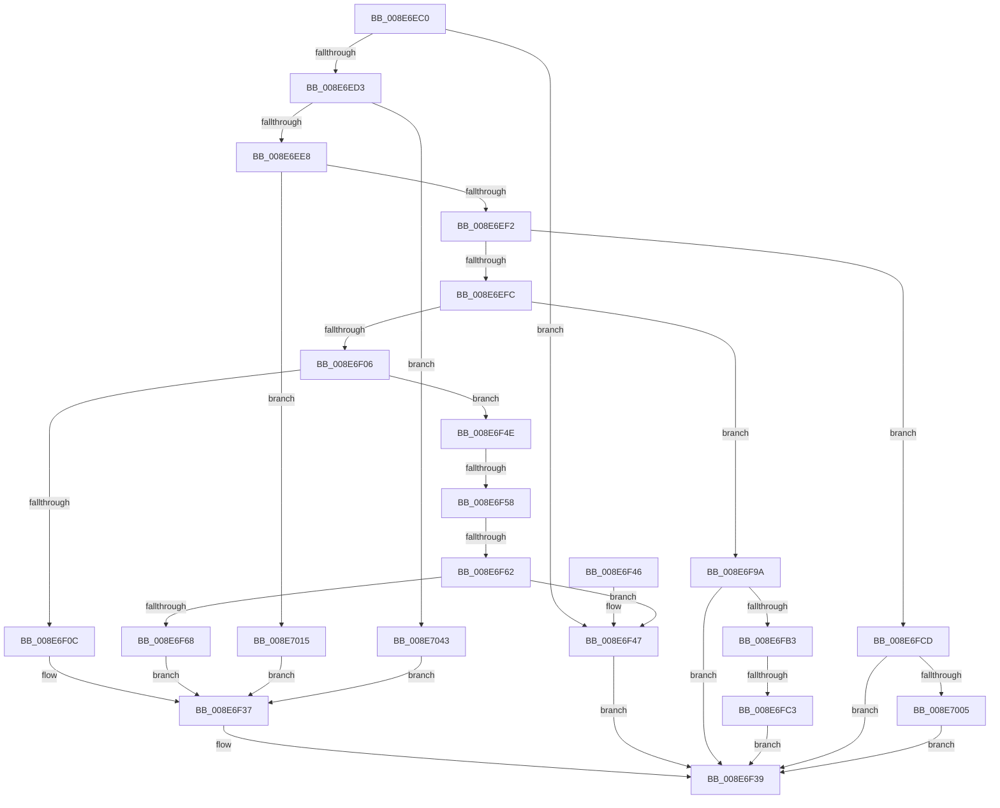

# DrvDbDispatchDriverDatabase

- RVA: `0x008E6EC0`–`0x008E704D` (길이 `397` bytes)
- VA: `0x00000001408E6EC0`
- 실행 섹션: `PAGE`
- PDB 이름 있음: `예`; PDB Function 태그: `예`
- unwind 정보 RVA: `0x00086810`
- 디코드: `97`개 명령, `397/397` bytes 표시
- 미해석 바이트: `0` (있으면 어셈블리에 `.byte`로 보존)

> 이 문서는 커널 이미지의 기계어와 PDB 기호를 분석해 생성했습니다. 4번과 5번은 함수 원형과 자료형을 바이너리 사용 방식에서 추정한 C 해석이며 원본 소스 복구 결과는 아닙니다.

## 1. Dependencies

- 직접 호출 지점: **6**; 고유 호출 대상: **5**
- 직접 호출자로 확인된 함수: **1**
- RIP 상대 이미지 참조: **0**

### Outgoing calls
- `0x008E6F32` → [DrvDbGetDriverDatabaseList](DrvDbGetDriverDatabaseList_function_008E7054.md) (function, `0x008E7054`)
- `0x008E6F93` → [DrvDbSetDriverDatabaseMappedProperty](../83/DrvDbSetDriverDatabaseMappedProperty_function_00834014.md) (function, `0x00834014`)
- `0x008E6FA8` → [DrvDbFindDatabaseNode](../93/DrvDbFindDatabaseNode_function_00932628.md) (function, `0x00932628`)
- `0x008E6FF6` → [DrvDbOpenDriverDatabaseRegKey](../AA/DrvDbOpenDriverDatabaseRegKey_function_00AA0FB8.md) (function, `0x00AA0FB8`)
- `0x008E7039` → [DrvDbOpenDriverDatabaseRegKey](../AA/DrvDbOpenDriverDatabaseRegKey_function_00AA0FB8.md) (function, `0x00AA0FB8`)
- `0x008E7043` → [DrvDbValidateDriverDatabaseName](../83/DrvDbValidateDriverDatabaseName_function_00834ED8.md) (function, `0x00834ED8`)

### Direct callers
- [PnpGetObjectList](PnpGetObjectList_function_008E7520.md) at `0x008E7659`

### Static image references
- 디코드된 RIP-relative 메모리 참조가 없습니다.

## 2. Other-region calls and transfers

- 다른 실행 섹션으로 향하는 call: **0**
- call이 아닌 외부 분기/꼬리 이동: **3**
  - `0x008E6F52` → [sub_00B1D6D0 + 0x40](../B1/Unknown_function_00B1D6D0.md) (`tail-transfer`)
  - `0x008E6F5C` → [sub_00B1D6D0](../B1/Unknown_function_00B1D6D0.md) (`tail-transfer`)
  - `0x008E6FBD` → [sub_00B1D6D0 + 0x6E](../B1/Unknown_function_00B1D6D0.md) (`tail-transfer`)

## 3. Assembly (complete function range)

```asm
008E6EC0  48 89 5C 24 08                  mov qword ptr [rsp + 8], rbx
008E6EC5  57                              push rdi
008E6EC6  48 83 EC 50                     sub rsp, 0x50
008E6ECA  41 8D 40 FF                     lea eax, [r8 - 1]
008E6ECE  83 F8 0A                        cmp eax, 0xa
008E6ED1  77 74                           ja 0x1408e6f47
008E6ED3  49 63 C0                        movsxd rax, r8d
008E6ED6  48 8B 9C C1 88 01 00 00         mov rbx, qword ptr [rcx + rax*8 + 0x188]
008E6EDE  41 83 E9 01                     sub r9d, 1
008E6EE2  0F 84 5B 01 00 00               je 0x1408e7043
008E6EE8  41 83 E9 01                     sub r9d, 1
008E6EEC  0F 84 23 01 00 00               je 0x1408e7015
008E6EF2  41 83 E9 01                     sub r9d, 1
008E6EF6  0F 84 D1 00 00 00               je 0x1408e6fcd
008E6EFC  41 83 E9 01                     sub r9d, 1
008E6F00  0F 84 94 00 00 00               je 0x1408e6f9a
008E6F06  41 83 E9 01                     sub r9d, 1
008E6F0A  75 42                           jne 0x1408e6f4e
008E6F0C  48 8B 94 24 80 00 00 00         mov rdx, qword ptr [rsp + 0x80]
008E6F14  48 8B CB                        mov rcx, rbx
008E6F17  48 8B 42 20                     mov rax, qword ptr [rdx + 0x20]
008E6F1B  4C 8B 4A 10                     mov r9, qword ptr [rdx + 0x10]
008E6F1F  4C 8B 42 08                     mov r8, qword ptr [rdx + 8]
008E6F23  48 89 44 24 28                  mov qword ptr [rsp + 0x28], rax
008E6F28  8B 42 18                        mov eax, dword ptr [rdx + 0x18]
008E6F2B  48 8B 12                        mov rdx, qword ptr [rdx]
008E6F2E  89 44 24 20                     mov dword ptr [rsp + 0x20], eax
008E6F32  E8 1D 01 00 00                  call 0x1408e7054
008E6F37  8B C8                           mov ecx, eax
008E6F39  48 8B 5C 24 60                  mov rbx, qword ptr [rsp + 0x60]
008E6F3E  8B C1                           mov eax, ecx
008E6F40  48 83 C4 50                     add rsp, 0x50
008E6F44  5F                              pop rdi
008E6F45  C3                              ret
008E6F46  CC                              int3
008E6F47  B9 0D 00 00 C0                  mov ecx, 0xc000000d
008E6F4C  EB EB                           jmp 0x1408e6f39
008E6F4E  41 83 E9 01                     sub r9d, 1
008E6F52  0F 84 B8 67 23 00               je 0x140b1d710
008E6F58  41 83 E9 02                     sub r9d, 2
008E6F5C  0F 84 6E 67 23 00               je 0x140b1d6d0
008E6F62  41 83 F9 01                     cmp r9d, 1
008E6F66  75 DF                           jne 0x1408e6f47
008E6F68  4C 8B 84 24 80 00 00 00         mov r8, qword ptr [rsp + 0x80]
008E6F70  48 8B CB                        mov rcx, rbx
008E6F73  41 8B 40 28                     mov eax, dword ptr [r8 + 0x28]
008E6F77  4D 8B 48 10                     mov r9, qword ptr [r8 + 0x10]
008E6F7B  89 44 24 30                     mov dword ptr [rsp + 0x30], eax
008E6F7F  49 8B 40 20                     mov rax, qword ptr [r8 + 0x20]
008E6F83  48 89 44 24 28                  mov qword ptr [rsp + 0x28], rax
008E6F88  41 8B 40 18                     mov eax, dword ptr [r8 + 0x18]
008E6F8C  4D 8B 00                        mov r8, qword ptr [r8]
008E6F8F  89 44 24 20                     mov dword ptr [rsp + 0x20], eax
008E6F93  E8 7C D0 F4 FF                  call 0x140834014
008E6F98  EB 9D                           jmp 0x1408e6f37
008E6F9A  48 83 64 24 40 00               and qword ptr [rsp + 0x40], 0
008E6FA0  4C 8D 44 24 40                  lea r8, [rsp + 0x40]
008E6FA5  48 8B CB                        mov rcx, rbx
008E6FA8  E8 7B B6 04 00                  call 0x140932628
008E6FAD  8B C8                           mov ecx, eax
008E6FAF  85 C0                           test eax, eax
008E6FB1  78 86                           js 0x1408e6f39
008E6FB3  48 8B 54 24 40                  mov rdx, qword ptr [rsp + 0x40]
008E6FB8  8B 42 40                        mov eax, dword ptr [rdx + 0x40]
008E6FBB  A8 10                           test al, 0x10
008E6FBD  0F 85 7B 67 23 00               jne 0x140b1d73e
008E6FC3  B9 22 00 00 C0                  mov ecx, 0xc0000022
008E6FC8  E9 6C FF FF FF                  jmp 0x1408e6f39
008E6FCD  48 8B BC 24 80 00 00 00         mov rdi, qword ptr [rsp + 0x80]
008E6FD5  48 8D 4C 24 70                  lea rcx, [rsp + 0x70]
008E6FDA  83 64 24 70 00                  and dword ptr [rsp + 0x70], 0
008E6FDF  41 B1 01                        mov r9b, 1
008E6FE2  48 89 4C 24 28                  mov qword ptr [rsp + 0x28], rcx
008E6FE7  48 8B CB                        mov rcx, rbx
008E6FEA  44 8B 07                        mov r8d, dword ptr [rdi]
008E6FED  48 8D 47 08                     lea rax, [rdi + 8]
008E6FF1  48 89 44 24 20                  mov qword ptr [rsp + 0x20], rax
008E6FF6  E8 BD 9F 1B 00                  call 0x140aa0fb8
008E6FFB  8B C8                           mov ecx, eax
008E6FFD  85 C0                           test eax, eax
008E6FFF  0F 88 34 FF FF FF               js 0x1408e6f39
008E7005  83 7C 24 70 01                  cmp dword ptr [rsp + 0x70], 1
008E700A  0F 94 C0                        sete al
008E700D  88 47 10                        mov byte ptr [rdi + 0x10], al
008E7010  E9 24 FF FF FF                  jmp 0x1408e6f39
008E7015  4C 8B 84 24 80 00 00 00         mov r8, qword ptr [rsp + 0x80]
008E701D  48 8B CB                        mov rcx, rbx
008E7020  45 8A 48 04                     mov r9b, byte ptr [r8 + 4]
008E7024  49 8D 40 10                     lea rax, [r8 + 0x10]
008E7028  48 89 44 24 28                  mov qword ptr [rsp + 0x28], rax
008E702D  49 8B 40 08                     mov rax, qword ptr [r8 + 8]
008E7031  45 8B 00                        mov r8d, dword ptr [r8]
008E7034  48 89 44 24 20                  mov qword ptr [rsp + 0x20], rax
008E7039  E8 7A 9F 1B 00                  call 0x140aa0fb8
008E703E  E9 F4 FE FF FF                  jmp 0x1408e6f37
008E7043  E8 90 DE F4 FF                  call 0x140834ed8
008E7048  E9 EA FE FF FF                  jmp 0x1408e6f37
```

## 4. C-style interpretation (structured pseudocode)

```c
__int64 __fastcall DrvDbDispatchDriverDatabase(__int64 a1, __int64 a2, __int64 a3, int a4, __int64 a5)
{
    __int64 result;
    __int64 v_rsp;
    unsigned __int64 v_stack_m30;
    unsigned int v_stack_m38;
    unsigned int v_stack_p20;
    unsigned __int64 v_stack_p28;
    unsigned int v_stack_p30;
    unsigned __int64 v_stack_p40;
    unsigned __int64 v_stack_p70;
    unsigned __int64 v_stack_p8;

    v_stack_p8 = v_rbx;
    v_rsp = (v_rsp) - (80);
    if (((unsigned int)(a3 - 1)) > 10) goto loc_008E6F47;
    a4 = (unsigned int)((a4) - (1));
    if (condition_is_equal) goto loc_008E7043;
    a4 = (unsigned int)((a4) - (1));
    if (condition_is_equal) goto loc_008E7015;
    a4 = (unsigned int)((a4) - (1));
    if (condition_is_equal) goto loc_008E6FCD;
    a4 = (unsigned int)((a4) - (1));
    if (condition_is_equal) goto loc_008E6F9A;
    a4 = (unsigned int)((a4) - (1));
    if (condition_is_not_equal) goto loc_008E6F4E;
    v_stack_m30 = *(unsigned __int64 *)(a5 + 32);
    v_stack_m38 = (unsigned int)((unsigned int)(*(unsigned int *)(a5 + 24)));
    result = DrvDbGetDriverDatabaseList(*(unsigned __int64 *)(a1 + (int)((unsigned int)(a3)) * 8 + 392), *(unsigned __int64 *)(a5), *(unsigned __int64 *)(a5 + 8), *(unsigned __int64 *)(a5 + 16));
loc_008E6F37:
loc_008E6F39:
    v_rsp = (v_rsp) + (80);
    return (unsigned int)((unsigned int)((unsigned int)((unsigned int)(result))));
loc_008E6F47:
    goto loc_008E6F39;
loc_008E6F4E:
    a4 = (unsigned int)((*(unsigned __int64 *)(a5 + 16)) - (1));
    a4 = (unsigned int)((a4) - (2));
    if (a4 != 1) goto loc_008E6F47;
    v_stack_p30 = (unsigned int)((unsigned int)(*(unsigned int *)(a5 + 40)));
    v_stack_p28 = *(unsigned __int64 *)(a5 + 32);
    v_stack_p20 = (unsigned int)((unsigned int)(*(unsigned int *)(a5 + 24)));
    result = DrvDbSetDriverDatabaseMappedProperty(v_stack_p8, *(unsigned __int64 *)(a5), *(unsigned __int64 *)(a5), *(unsigned __int64 *)(a5 + 16));
    goto loc_008E6F37;
loc_008E6F9A:
    result = DrvDbFindDatabaseNode(v_stack_p8, *(unsigned __int64 *)(a5), v_stack_p40, *(unsigned __int64 *)(a5 + 16));
    if (sign_flag) goto loc_008E6F39;
    goto loc_008E6F39;
loc_008E6FCD:
    v_stack_p28 = v_stack_p70;
    v_stack_p20 = a5 + 8;
    result = DrvDbOpenDriverDatabaseRegKey(v_stack_p8, v_stack_p40, (unsigned int)(*(unsigned int *)(a5)), 1);
    if (sign_flag) goto loc_008E6F39;
    result = (v_stack_p70 == 1) ? 1 : 0;
    *(unsigned __int8 *)(a5 + 16) = (unsigned __int8)(result);
    goto loc_008E6F39;
loc_008E7015:
    v_stack_p28 = a5 + 16;
    v_stack_p20 = *(unsigned __int64 *)(a5 + 8);
    result = DrvDbOpenDriverDatabaseRegKey(v_stack_p8, v_stack_p40, (unsigned int)(*(unsigned int *)(a5)), *(unsigned __int8 *)(a5 + 4));
    goto loc_008E6F37;
loc_008E7043:
    result = DrvDbValidateDriverDatabaseName(v_stack_p8, v_stack_p40, (unsigned int)(*(unsigned int *)(a5)), *(unsigned __int8 *)(a5 + 4));
    goto loc_008E6F37;
}
```

## 5. (Beta) C Style

```c
int64_t DrvDbDispatchDriverDatabase(void *Arg1, int64_t Arg2, void *Arg3, int32_t Arg4, void *Arg5)
{
    uint8_t *arg1 = (uint8_t *)Arg1;
    uint8_t *arg3 = (uint8_t *)Arg3;
    uint8_t *arg5 = (uint8_t *)Arg5;

    int64_t result;
    int64_t local_rsp;
    uint64_t v_stack_m30;
    uint32_t v_stack_m38;
    uint32_t v_stack_p20;
    uint64_t v_stack_p28;
    uint32_t v_stack_p30;
    uint64_t v_stack_p40;
    uint64_t v_stack_p70;
    uint64_t v_stack_p8;

    v_stack_p8 = local_rbx;
    local_rsp = (local_rsp) - (80);
    if (((uint32_t)(Arg3 - 1)) > 10) goto loc_008E6F47;
    Arg4 = (uint32_t)((Arg4) - (1));
    if (condition_is_equal) goto loc_008E7043;
    Arg4 = (uint32_t)((Arg4) - (1));
    if (condition_is_equal) goto loc_008E7015;
    Arg4 = (uint32_t)((Arg4) - (1));
    if (condition_is_equal) goto loc_008E6FCD;
    Arg4 = (uint32_t)((Arg4) - (1));
    if (condition_is_equal) goto loc_008E6F9A;
    Arg4 = (uint32_t)((Arg4) - (1));
    if (condition_is_not_equal) goto loc_008E6F4E;
    v_stack_m30 = *(uint64_t *)(arg5 + 0x20);
    v_stack_m38 = (uint32_t)((uint32_t)(*(uint32_t *)(arg5 + 0x18)));
    result = DrvDbGetDriverDatabaseList(*(uint64_t *)(arg1 + (int32_t)((uint32_t)(arg3)) * 8 + 0x188), *(uint64_t *)(arg5), *(uint64_t *)(arg5 + 0x8), *(uint64_t *)(arg5 + 0x10));
loc_008E6F37:
loc_008E6F39:
    local_rsp = (local_rsp) + (80);
    return (uint32_t)((uint32_t)((uint32_t)((uint32_t)(result))));
loc_008E6F47:
    goto loc_008E6F39;
loc_008E6F4E:
    Arg4 = (uint32_t)((*(uint64_t *)(arg5 + 0x10)) - (1));
    Arg4 = (uint32_t)((Arg4) - (2));
    if (Arg4 != 1) goto loc_008E6F47;
    v_stack_p30 = (uint32_t)((uint32_t)(*(uint32_t *)(arg5 + 0x28)));
    v_stack_p28 = *(uint64_t *)(arg5 + 0x20);
    v_stack_p20 = (uint32_t)((uint32_t)(*(uint32_t *)(arg5 + 0x18)));
    result = DrvDbSetDriverDatabaseMappedProperty(v_stack_p8, *(uint64_t *)(arg5), *(uint64_t *)(arg5), *(uint64_t *)(arg5 + 0x10));
    goto loc_008E6F37;
loc_008E6F9A:
    result = DrvDbFindDatabaseNode(v_stack_p8, *(uint64_t *)(arg5), v_stack_p40, *(uint64_t *)(arg5 + 0x10));
    if (sign_flag) goto loc_008E6F39;
    goto loc_008E6F39;
loc_008E6FCD:
    v_stack_p28 = v_stack_p70;
    v_stack_p20 = Arg5 + 8;
    result = DrvDbOpenDriverDatabaseRegKey(v_stack_p8, v_stack_p40, (uint32_t)(*(uint32_t *)(arg5)), 1);
    if (sign_flag) goto loc_008E6F39;
    result = (v_stack_p70 == 1) ? 1 : 0;
    *(uint8_t *)(arg5 + 0x10) = (uint8_t)(result);
    goto loc_008E6F39;
loc_008E7015:
    v_stack_p28 = Arg5 + 16;
    v_stack_p20 = *(uint64_t *)(arg5 + 0x8);
    result = DrvDbOpenDriverDatabaseRegKey(v_stack_p8, v_stack_p40, (uint32_t)(*(uint32_t *)(arg5)), *(uint8_t *)(arg5 + 0x4));
    goto loc_008E6F37;
loc_008E7043:
    result = DrvDbValidateDriverDatabaseName(v_stack_p8, v_stack_p40, (uint32_t)(*(uint32_t *)(arg5)), *(uint8_t *)(arg5 + 0x4));
    goto loc_008E6F37;
}
```

### 관측된 메모리 오프셋

구조체 형식이 확인되지 않은 접근은 인자 기준의 오프셋으로만 기록했습니다.

| 기준 인자 | 오프셋 표현 | 폭 (bit) | 접근 |
|---|---:|---:|---|
| `Arg1` | `+ 0x188 + rax*8` | `64` | `R` |
| `Arg3` | `- 0x1` | `32` | `R` |
| `Arg5` | `+ 0x0` | `32` | `R` |
| `Arg5` | `+ 0x0` | `64` | `R` |
| `Arg5` | `+ 0x4` | `8` | `R` |
| `Arg5` | `+ 0x8` | `64` | `R` |
| `Arg5` | `+ 0x10` | `8` | `W` |
| `Arg5` | `+ 0x10` | `64` | `R` |
| `Arg5` | `+ 0x18` | `32` | `R` |
| `Arg5` | `+ 0x20` | `64` | `R` |
| `Arg5` | `+ 0x28` | `32` | `R` |

## 6. Execution-region graph

[열기: 2D/3D 그래프와 함수 탐색 컨트롤 패널](../../../control-panel.html?section=page&rva=0x008E6EC0&view=graph)

- 2D 그래프는 위에서 아래로 흐르고, 3D 그래프는 빈 공간을 드래그해 회전합니다. Shift+드래그는 이동, 휠은 확대·축소, 함수 노드 선택은 대상 보고서 이동입니다.

### Static fallback


