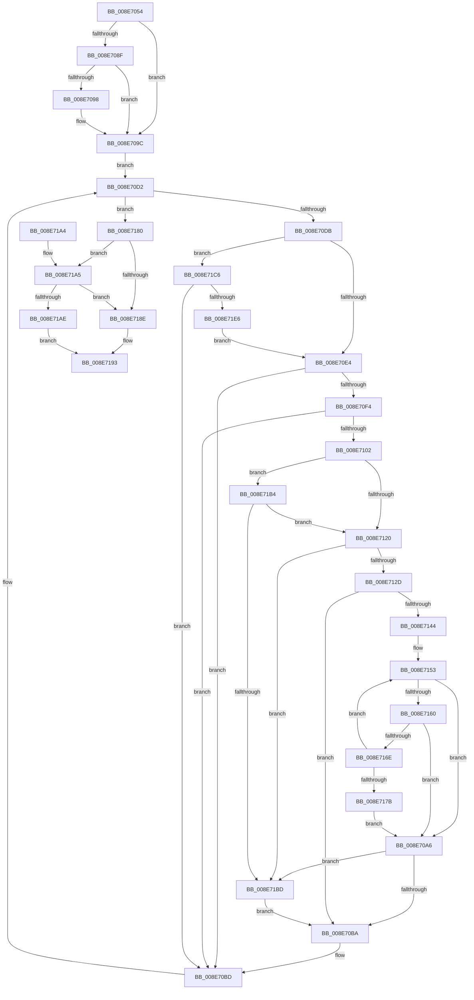

# DrvDbGetDriverDatabaseList

- RVA: `0x008E7054`–`0x008E71EB` (길이 `407` bytes)
- VA: `0x00000001408E7054`
- 실행 섹션: `PAGE`
- PDB 이름 있음: `예`; PDB Function 태그: `아니요`
- unwind 정보 RVA: `0x00086830`
- 디코드: `112`개 명령, `407/407` bytes 표시
- 미해석 바이트: `0` (있으면 어셈블리에 `.byte`로 보존)

> 이 문서는 커널 이미지의 기계어와 PDB 기호를 분석해 생성했습니다. 4번과 5번은 함수 원형과 자료형을 바이너리 사용 방식에서 추정한 C 해석이며 원본 소스 복구 결과는 아닙니다.

## 1. Dependencies

- 직접 호출 지점: **1**; 고유 호출 대상: **1**
- 직접 호출자로 확인된 함수: **1**
- RIP 상대 이미지 참조: **1**

### Outgoing calls
- `0x008E71D9` → [guard_dispatch_icall](../../text/6B/guard_dispatch_icall_function_006BAAD0.md) (function, `0x006BAAD0`)

### Direct callers
- [DrvDbDispatchDriverDatabase](DrvDbDispatchDriverDatabase_function_008E6EC0.md) at `0x008E6F32`

### Static image references
- `0x008E7130` → RVA `0x006C8EC0` (` ?? ::FNODOBFM::`string'`; read)

## 2. Other-region calls and transfers

- 다른 실행 섹션으로 향하는 call: **1**
  - `0x008E71D9` → [guard_dispatch_icall](../../text/6B/guard_dispatch_icall_function_006BAAD0.md) (`PAGE` → `.text`)
- 별도 외부 분기/꼬리 이동을 확인하지 못했습니다.

## 3. Assembly (complete function range)

```asm
008E7054  4C 89 44 24 18                  mov qword ptr [rsp + 0x18], r8
008E7059  48 89 54 24 10                  mov qword ptr [rsp + 0x10], rdx
008E705E  48 89 4C 24 08                  mov qword ptr [rsp + 8], rcx
008E7063  53                              push rbx
008E7064  55                              push rbp
008E7065  56                              push rsi
008E7066  57                              push rdi
008E7067  41 55                           push r13
008E7069  41 56                           push r14
008E706B  41 57                           push r15
008E706D  48 83 EC 30                     sub rsp, 0x30
008E7071  48 8B AC 24 98 00 00 00         mov rbp, qword ptr [rsp + 0x98]
008E7079  33 DB                           xor ebx, ebx
008E707B  49 8B F1                        mov rsi, r9
008E707E  4C 8B D2                        mov r10, rdx
008E7081  48 8B C1                        mov rax, rcx
008E7084  44 8B FB                        mov r15d, ebx
008E7087  89 5D 00                        mov dword ptr [rbp], ebx
008E708A  4D 85 C9                        test r9, r9
008E708D  74 0D                           je 0x1408e709c
008E708F  39 9C 24 90 00 00 00            cmp dword ptr [rsp + 0x90], ebx
008E7096  76 04                           jbe 0x1408e709c
008E7098  66 41 89 19                     mov word ptr [r9], bx
008E709C  4C 8D 69 10                     lea r13, [rcx + 0x10]
008E70A0  49 8B 7D 00                     mov rdi, qword ptr [r13]
008E70A4  EB 2C                           jmp 0x1408e70d2
008E70A6  48 85 C9                        test rcx, rcx
008E70A9  48 8D 42 FE                     lea rax, [rdx - 2]
008E70AD  48 0F 45 C2                     cmovne rax, rdx
008E70B1  66 89 18                        mov word ptr [rax], bx
008E70B4  0F 84 03 01 00 00               je 0x1408e71bd
008E70BA  45 8B FB                        mov r15d, r11d
008E70BD  48 8B 3F                        mov rdi, qword ptr [rdi]
008E70C0  48 8B 44 24 70                  mov rax, qword ptr [rsp + 0x70]
008E70C5  4C 8B 54 24 78                  mov r10, qword ptr [rsp + 0x78]
008E70CA  4C 8B 84 24 80 00 00 00         mov r8, qword ptr [rsp + 0x80]
008E70D2  49 3B FD                        cmp rdi, r13
008E70D5  0F 84 A5 00 00 00               je 0x1408e7180
008E70DB  4D 85 D2                        test r10, r10
008E70DE  0F 85 E2 00 00 00               jne 0x1408e71c6
008E70E4  0F B7 47 10                     movzx eax, word ptr [rdi + 0x10]
008E70E8  D1 E8                           shr eax, 1
008E70EA  FF C0                           inc eax
008E70EC  01 45 00                        add dword ptr [rbp], eax
008E70EF  48 85 F6                        test rsi, rsi
008E70F2  74 C9                           je 0x1408e70bd
008E70F4  45 8D 1C 07                     lea r11d, [r15 + rax]
008E70F8  44 3B 9C 24 90 00 00 00         cmp r11d, dword ptr [rsp + 0x90]
008E7100  73 BB                           jae 0x1408e70bd
008E7102  8B 8C 24 90 00 00 00            mov ecx, dword ptr [rsp + 0x90]
008E7109  48 8B 57 18                     mov rdx, qword ptr [rdi + 0x18]
008E710D  41 2B CF                        sub ecx, r15d
008E7110  41 8B C7                        mov eax, r15d
008E7113  4C 8D 0C 46                     lea r9, [rsi + rax*2]
008E7117  4D 85 C9                        test r9, r9
008E711A  0F 84 94 00 00 00               je 0x1408e71b4
008E7120  48 81 F9 FF FF FF 7F            cmp rcx, 0x7fffffff
008E7127  0F 87 90 00 00 00               ja 0x1408e71bd
008E712D  48 85 D2                        test rdx, rdx
008E7130  4C 8D 05 89 1D DE FF            lea r8, [rip - 0x21e277]
008E7137  4C 0F 45 C2                     cmovne r8, rdx
008E713B  48 85 C9                        test rcx, rcx
008E713E  0F 84 76 FF FF FF               je 0x1408e70ba
008E7144  41 BA FE FF FF 7F               mov r10d, 0x7ffffffe
008E714A  49 8B D1                        mov rdx, r9
008E714D  4C 2B D1                        sub r10, rcx
008E7150  4D 2B C1                        sub r8, r9
008E7153  49 8D 04 0A                     lea rax, [r10 + rcx]
008E7157  48 85 C0                        test rax, rax
008E715A  0F 84 46 FF FF FF               je 0x1408e70a6
008E7160  41 0F B7 04 10                  movzx eax, word ptr [r8 + rdx]
008E7165  66 85 C0                        test ax, ax
008E7168  0F 84 38 FF FF FF               je 0x1408e70a6
008E716E  66 89 02                        mov word ptr [rdx], ax
008E7171  48 83 C2 02                     add rdx, 2
008E7175  48 83 E9 01                     sub rcx, 1
008E7179  75 D8                           jne 0x1408e7153
008E717B  E9 26 FF FF FF                  jmp 0x1408e70a6
008E7180  8B 4D 00                        mov ecx, dword ptr [rbp]
008E7183  8D 41 01                        lea eax, [rcx + 1]
008E7186  89 45 00                        mov dword ptr [rbp], eax
008E7189  48 85 F6                        test rsi, rsi
008E718C  75 17                           jne 0x1408e71a5
008E718E  BB 23 00 00 C0                  mov ebx, 0xc0000023
008E7193  8B C3                           mov eax, ebx
008E7195  48 83 C4 30                     add rsp, 0x30
008E7199  41 5F                           pop r15
008E719B  41 5E                           pop r14
008E719D  41 5D                           pop r13
008E719F  5F                              pop rdi
008E71A0  5E                              pop rsi
008E71A1  5D                              pop rbp
008E71A2  5B                              pop rbx
008E71A3  C3                              ret
008E71A4  CC                              int3
008E71A5  3B 84 24 90 00 00 00            cmp eax, dword ptr [rsp + 0x90]
008E71AC  77 E0                           ja 0x1408e718e
008E71AE  66 89 1C 4E                     mov word ptr [rsi + rcx*2], bx
008E71B2  EB DF                           jmp 0x1408e7193
008E71B4  48 85 C9                        test rcx, rcx
008E71B7  0F 84 63 FF FF FF               je 0x1408e7120
008E71BD  66 41 89 19                     mov word ptr [r9], bx
008E71C1  E9 F4 FE FF FF                  jmp 0x1408e70ba
008E71C6  48 8B 08                        mov rcx, qword ptr [rax]
008E71C9  4D 8B C8                        mov r9, r8
008E71CC  48 8B 57 18                     mov rdx, qword ptr [rdi + 0x18]
008E71D0  41 B8 07 00 00 00               mov r8d, 7
008E71D6  49 8B C2                        mov rax, r10
008E71D9  E8 F2 38 DD FF                  call 0x1406baad0
008E71DE  84 C0                           test al, al
008E71E0  0F 84 D7 FE FF FF               je 0x1408e70bd
008E71E6  E9 F9 FE FF FF                  jmp 0x1408e70e4
```

## 4. C-style interpretation (structured pseudocode)

```c
__int64 __fastcall DrvDbGetDriverDatabaseList(__int64 a1, __int64 a2, __int64 a3, __int64 a4, unsigned int a5, __int64 a6)
{
    __int64 result;
    __int64 v_r10;
    __int64 v_rbx;
    __int64 v_rsp;
    unsigned __int64 v_stack_p10;
    unsigned __int64 v_stack_p18;
    unsigned __int64 v_stack_p8;

    v_stack_p18 = a3;
    v_stack_p10 = a2;
    v_stack_p8 = a1;
    v_rsp = (v_rsp) - (48);
    v_rbx = 0;
    *(unsigned int *)(a6) = 0;
    if (a4 == 0) goto loc_008E709C;
    if (a5 >= = 0) {
        *(unsigned __int16 *)(a4) = 0;
    }
    goto loc_008E70D2;
loc_008E70A6:
    result = a2 - 2;
    if (a1 != 0) { result = a2; }
    *(unsigned __int16 *)(result) = 0;
    if (a1 == 0) goto loc_008E71BD;
loc_008E70BA:
loc_008E70BD:
loc_008E70D2:
    if ((*(unsigned __int64 *)(*(unsigned __int64 *)(a1 + 16))) == (a1 + 16)) goto loc_008E7180;
    if (v_stack_p10 != 0) goto loc_008E71C6;
loc_008E70E4:
    result = (unsigned int)((*(unsigned __int16 *)(*(unsigned __int64 *)(*(unsigned __int64 *)(a1 + 16)) + 16)) >> (1));
    result = (unsigned int)((result) + 1);
    if (a4 == 0) goto loc_008E70BD;
    if (((unsigned int)((unsigned int)((unsigned int)(v_r11)) + result * 1)) >= a5) goto loc_008E70BD;
    a1 = (unsigned int)(((unsigned int)(a5)) - ((unsigned int)((unsigned int)((unsigned int)(v_r11)))));
    if (a4 + (unsigned int)((unsigned int)((unsigned int)((unsigned int)(v_r11)))) * 2 == 0) goto loc_008E71B4;
loc_008E7120:
    if (a1 > 0x7FFFFFFFULL) goto loc_008E71BD;
    a3 = v_rip - 2220663;
    if (*(unsigned __int64 *)(*(unsigned __int64 *)(*(unsigned __int64 *)(a1 + 16)) + 24) != 0) { a3 = *(unsigned __int64 *)(*(unsigned __int64 *)(*(unsigned __int64 *)(a1 + 16)) + 24); }
    if (a1 == 0) goto loc_008E70BA;
    v_r10 = ((unsigned int)(0x7FFFFFFEULL)) - (a1);
    a3 = (a3) - (a4 + (unsigned int)((unsigned int)((unsigned int)((unsigned int)(v_r11)))) * 2);
loc_008E7153:
    if (v_r10 + a1 * 1 == 0) goto loc_008E70A6;
    if ((unsigned __int16)(*(unsigned __int16 *)(a3 + a4 + (unsigned int)((unsigned int)((unsigned int)((unsigned int)(v_r11)))) * 2 * 1)) == 0) goto loc_008E70A6;
    *(unsigned __int16 *)(a4 + (unsigned int)((unsigned int)((unsigned int)((unsigned int)(v_r11)))) * 2) = (unsigned __int16)(*(unsigned __int16 *)(a3 + a4 + (unsigned int)((unsigned int)((unsigned int)((unsigned int)(v_r11)))) * 2 * 1));
    a2 = (a4 + (unsigned int)((unsigned int)((unsigned int)((unsigned int)(v_r11)))) * 2) + (2);
    a1 = (a1) - (1);
    if (condition_is_not_equal) goto loc_008E7153;
    goto loc_008E70A6;
loc_008E7180:
    *(unsigned int *)(a6) = (unsigned int)((unsigned int)(*(unsigned int *)(a6)) + 1);
    if (a4 != 0) goto loc_008E71A5;
loc_008E718E:
loc_008E7193:
    v_rsp = (v_rsp) + (48);
    return (unsigned int)((unsigned int)((unsigned int)(0xC0000023ULL)));
loc_008E71A5:
    if (((unsigned int)((unsigned int)((unsigned int)((unsigned int)(0xC0000023ULL))))) > a5) goto loc_008E718E;
    *(unsigned __int16 *)(a4 + (unsigned int)(*(unsigned int *)(a6)) * 2) = (unsigned __int16)((unsigned int)(0xC0000023ULL));
    goto loc_008E7193;
loc_008E71B4:
    if ((unsigned int)(*(unsigned int *)(a6)) == 0) goto loc_008E7120;
loc_008E71BD:
    *(unsigned __int16 *)(a4 + (unsigned int)((unsigned int)((unsigned int)((unsigned int)(v_r11)))) * 2) = (unsigned __int16)((unsigned int)(0xC0000023ULL));
    goto loc_008E70BA;
loc_008E71C6:
    result = guard_dispatch_icall(*(unsigned __int64 *)((unsigned int)((unsigned int)((unsigned int)(0xC0000023ULL)))), *(unsigned __int64 *)(*(unsigned __int64 *)(*(unsigned __int64 *)(a1 + 16)) + 24), 7, a3);
    if ((unsigned __int8)(result) == 0) goto loc_008E70BD;
    goto loc_008E70E4;
}
```

## 5. (Beta) C Style

```c
int64_t DrvDbGetDriverDatabaseList(void *Arg1, int64_t Arg2, int64_t Arg3, int64_t Arg4, uint32_t Arg5, void *Arg6)
{
    uint8_t *arg1 = (uint8_t *)Arg1;
    uint8_t *arg6 = (uint8_t *)Arg6;

    int64_t result;
    int64_t local_r10;
    int64_t local_rbx;
    int64_t local_rsp;
    uint64_t v_stack_p10;
    uint64_t v_stack_p18;
    uint64_t v_stack_p8;

    v_stack_p18 = Arg3;
    v_stack_p10 = Arg2;
    v_stack_p8 = Arg1;
    local_rsp = (local_rsp) - (48);
    local_rbx = 0;
    *(uint32_t *)(arg6) = 0;
    if (Arg4 == 0) goto loc_008E709C;
    if (Arg5 >= = 0) {
        *(uint16_t *)(Arg4) = 0;
    }
    goto loc_008E70D2;
loc_008E70A6:
    result = Arg2 - 2;
    if (Arg1 != NULL) { result = Arg2; }
    *(uint16_t *)(result) = 0;
    if (Arg1 == NULL) goto loc_008E71BD;
loc_008E70BA:
loc_008E70BD:
loc_008E70D2:
    if ((*(uint64_t *)(*(uint64_t *)(arg1 + 0x10))) == (Arg1 + 16)) goto loc_008E7180;
    if (v_stack_p10 != 0) goto loc_008E71C6;
loc_008E70E4:
    result = (uint32_t)((*(uint16_t *)(*(uint64_t *)(*(uint64_t *)(arg1 + 0x10)) + 0x10)) >> (1));
    result = (uint32_t)((result) + 1);
    if (Arg4 == 0) goto loc_008E70BD;
    if (((uint32_t)((uint32_t)((uint32_t)(local_r11)) + result * 1)) >= Arg5) goto loc_008E70BD;
    Arg1 = (uint32_t)(((uint32_t)(Arg5)) - ((uint32_t)((uint32_t)((uint32_t)(local_r11)))));
    if (Arg4 + (uint32_t)((uint32_t)((uint32_t)((uint32_t)(local_r11)))) * 2 == 0) goto loc_008E71B4;
loc_008E7120:
    if (Arg1 > 0x7FFFFFFFULL) goto loc_008E71BD;
    Arg3 = v_rip - 2220663;
    if (*(uint64_t *)(*(uint64_t *)(*(uint64_t *)(arg1 + 0x10)) + 0x18) != 0) { Arg3 = *(uint64_t *)(*(uint64_t *)(*(uint64_t *)(arg1 + 0x10)) + 0x18); }
    if (Arg1 == NULL) goto loc_008E70BA;
    local_r10 = ((uint32_t)(0x7FFFFFFEULL)) - (Arg1);
    Arg3 = (Arg3) - (Arg4 + (uint32_t)((uint32_t)((uint32_t)((uint32_t)(local_r11)))) * 2);
loc_008E7153:
    if (local_r10 + Arg1 * 1 == 0) goto loc_008E70A6;
    if ((uint16_t)(*(uint16_t *)(Arg3 + Arg4 + (uint32_t)((uint32_t)((uint32_t)((uint32_t)(local_r11)))) * 2 * 1)) == 0) goto loc_008E70A6;
    *(uint16_t *)(Arg4 + (uint32_t)((uint32_t)((uint32_t)((uint32_t)(local_r11)))) * 2) = (uint16_t)(*(uint16_t *)(Arg3 + Arg4 + (uint32_t)((uint32_t)((uint32_t)((uint32_t)(local_r11)))) * 2 * 1));
    Arg2 = (Arg4 + (uint32_t)((uint32_t)((uint32_t)((uint32_t)(local_r11)))) * 2) + (2);
    Arg1 = (Arg1) - (1);
    if (condition_is_not_equal) goto loc_008E7153;
    goto loc_008E70A6;
loc_008E7180:
    *(uint32_t *)(arg6) = (uint32_t)((uint32_t)(*(uint32_t *)(arg6)) + 1);
    if (Arg4 != 0) goto loc_008E71A5;
loc_008E718E:
loc_008E7193:
    local_rsp = (local_rsp) + (48);
    return (uint32_t)((uint32_t)((uint32_t)(0xC0000023ULL)));
loc_008E71A5:
    if (((uint32_t)((uint32_t)((uint32_t)((uint32_t)(0xC0000023ULL))))) > Arg5) goto loc_008E718E;
    *(uint16_t *)(Arg4 + (uint32_t)(*(uint32_t *)(arg6)) * 2) = (uint16_t)((uint32_t)(0xC0000023ULL));
    goto loc_008E7193;
loc_008E71B4:
    if ((uint32_t)(*(uint32_t *)(arg6)) == 0) goto loc_008E7120;
loc_008E71BD:
    *(uint16_t *)(Arg4 + (uint32_t)((uint32_t)((uint32_t)((uint32_t)(local_r11)))) * 2) = (uint16_t)((uint32_t)(0xC0000023ULL));
    goto loc_008E70BA;
loc_008E71C6:
    result = guard_dispatch_icall(*(uint64_t *)((uint32_t)((uint32_t)((uint32_t)(0xC0000023ULL)))), *(uint64_t *)(*(uint64_t *)(*(uint64_t *)(arg1 + 0x10)) + 0x18), 7, Arg3);
    if ((uint8_t)(result) == 0) goto loc_008E70BD;
    goto loc_008E70E4;
}
```

### 관측된 메모리 오프셋

구조체 형식이 확인되지 않은 접근은 인자 기준의 오프셋으로만 기록했습니다.

| 기준 인자 | 오프셋 표현 | 폭 (bit) | 접근 |
|---|---:|---:|---|
| `Arg1` | `+ 0x0` | `64` | `R` |
| `Arg1` | `+ 0x10` | `64` | `R` |
| `Arg6` | `+ 0x0` | `32` | `R` |
| `Arg6` | `+ 0x0` | `32` | `R/W` |
| `Arg6` | `+ 0x0` | `32` | `W` |

## 6. Execution-region graph

[열기: 2D/3D 그래프와 함수 탐색 컨트롤 패널](../../../control-panel.html?section=page&rva=0x008E7054&view=graph)

- 2D 그래프는 위에서 아래로 흐르고, 3D 그래프는 빈 공간을 드래그해 회전합니다. Shift+드래그는 이동, 휠은 확대·축소, 함수 노드 선택은 대상 보고서 이동입니다.

### Static fallback


