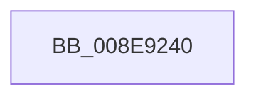

# ExRaiseAccessViolation

- RVA: `0x008E9240`–`0x008E924F` (길이 `15` bytes)
- VA: `0x00000001408E9240`
- 실행 섹션: `PAGE`
- PDB 이름 있음: `예`; PDB Function 태그: `아니요`
- unwind 정보 RVA: `0x0007E574`
- 디코드: `4`개 명령, `15/15` bytes 표시
- 미해석 바이트: `0` (있으면 어셈블리에 `.byte`로 보존)

> 이 문서는 커널 이미지의 기계어와 PDB 기호를 분석해 생성했습니다. 4번과 5번은 함수 원형과 자료형을 바이너리 사용 방식에서 추정한 C 해석이며 원본 소스 복구 결과는 아닙니다.

## 1. Dependencies

- 직접 호출 지점: **1**; 고유 호출 대상: **1**
- 직접 호출자로 확인된 함수: **27**
- RIP 상대 이미지 참조: **0**

### Outgoing calls
- `0x008E9249` → [RtlRaiseStatus](../../text/2F/RtlRaiseStatus_function_002F6A50.md) (function, `0x002F6A50`)

### Direct callers
- [DifExRaiseAccessViolationWrapper](../../text/62/DifExRaiseAccessViolationWrapper_function_00621AC0.md) at `0x00621B70`
- [NtQueryKey](../86/NtQueryKey_function_008676E0.md) at `0x008678B8`
- [NtQuerySecurityObject](../87/NtQuerySecurityObject_function_008737B0.md) at `0x00873868`
- [NtAlpcQueryInformationMessage](../89/NtAlpcQueryInformationMessage_function_00894700.md) at `0x00894802`
- [NtQueryObject](../8A/NtQueryObject_function_008A6DB0.md) at `0x008A6EBD`
- [NtQueryVolumeInformationFile](../8A/NtQueryVolumeInformationFile_function_008AC8C0.md) at `0x008ACA14`
- [IopValidateQueryInformationParameters](../8A/IopValidateQueryInformationParameters_function_008AE440.md) at `0x008AE58C`
- [sub_008D4274](../8D/Unknown_function_008D4274.md) at `0x008D430F`
- [RtlpWriteExtendedContext](../8D/RtlpWriteExtendedContext_function_008D4A5C.md) at `0x008D4B8D`
- [PiControlCopyUserModeCallersBuffer](PiControlCopyUserModeCallersBuffer_function_008E4720.md) at `0x008E47E2`
- [NtAlpcQueryInformation](NtAlpcQueryInformation_function_008E7200.md) at `0x008E72DF`
- [NtRemoveIoCompletionEx](NtRemoveIoCompletionEx_function_008E8760.md) at `0x008E896A`
- [KeUserModeCallback](KeUserModeCallback_function_008E8A00.md) at `0x008E8C2D`
- [NtQueryEvent](NtQueryEvent_function_008E8F90.md) at `0x008E9045`
- [ProbeForWrite](ProbeForWrite_function_008E91C0.md) at `0x008E9221`
- [IopXxxControlFile](IopXxxControlFile_function_008E9AD0.md) at `0x008E9CC0`
- [IopXxxControlFile](IopXxxControlFile_function_008E9AD0.md) at `0x008EA075`
- [BuildQueryDirectoryIrp](BuildQueryDirectoryIrp_function_008EC770.md) at `0x008ECA1D`
- [PiCMReturnBufferResultData](PiCMReturnBufferResultData_function_008ED6D0.md) at `0x008ED7BD`
- [NtGetCompleteWnfStateSubscription](../90/NtGetCompleteWnfStateSubscription_function_00909450.md) at `0x00909538`
- [NtQueryWnfStateData](../90/NtQueryWnfStateData_function_00909DF0.md) at `0x0090A0B6`
- [NtQuerySection](../92/NtQuerySection_function_00921770.md) at `0x00921810`
- [PiCMReturnHandleResultData](../96/PiCMReturnHandleResultData_function_00962354.md) at `0x009623DA`
- [NtQueryLicenseValue](../96/NtQueryLicenseValue_function_0096BCC0.md) at `0x0096BE77`
- [NtQuerySecurityAttributesToken](../97/NtQuerySecurityAttributesToken_function_00972C80.md) at `0x00972D9D`
- [NtPrivilegeCheck](../9C/NtPrivilegeCheck_function_009C8AE0.md) at `0x009C8C13`
- [NtSubscribeWnfStateChange](../9D/NtSubscribeWnfStateChange_function_009D4C20.md) at `0x009D4C92`
- [NtQuerySymbolicLinkObject](../9E/NtQuerySymbolicLinkObject_function_009EBA20.md) at `0x009EBB10`

### Static image references
- 디코드된 RIP-relative 메모리 참조가 없습니다.

## 2. Other-region calls and transfers

- 다른 실행 섹션으로 향하는 call: **1**
  - `0x008E9249` → [RtlRaiseStatus](../../text/2F/RtlRaiseStatus_function_002F6A50.md) (`PAGE` → `.text`)
- 별도 외부 분기/꼬리 이동을 확인하지 못했습니다.

## 3. Assembly (complete function range)

```asm
008E9240  48 83 EC 28                     sub rsp, 0x28
008E9244  B9 05 00 00 C0                  mov ecx, 0xc0000005
008E9249  E8 02 D8 A0 FF                  call 0x1402f6a50
008E924E  CC                              int3
```

## 4. C-style interpretation (structured pseudocode)

```c
__int64 __fastcall ExRaiseAccessViolation(void)
{
    __int64 result;
    __int64 v_rsp;

    v_rsp = (v_rsp) - (40);
    result = RtlRaiseStatus((unsigned int)(0xC0000005ULL), a2, a3, a4);
    return result;
}
```

## 5. (Beta) C Style

```c
void ExRaiseAccessViolation(void)
{
    int64_t result;
    int64_t local_rsp;

    local_rsp = (local_rsp) - (40);
    result = RtlRaiseStatus((uint32_t)(0xC0000005ULL), a2, a3, a4);
    return result;
}
```

## 6. Execution-region graph

[열기: 2D/3D 그래프와 함수 탐색 컨트롤 패널](../../../control-panel.html?section=page&rva=0x008E9240&view=graph)

- 2D 그래프는 위에서 아래로 흐르고, 3D 그래프는 빈 공간을 드래그해 회전합니다. Shift+드래그는 이동, 휠은 확대·축소, 함수 노드 선택은 대상 보고서 이동입니다.

### Static fallback


